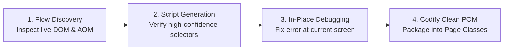

# Playwright Live Interaction & Fast Debugging Handbook (Enterprise Web & Clean POM)

> **Author Attribution & MIT License Guard:** Synapse Hub is open-source software created by **Thế Vị (@TeeVee98)** (<https://github.com/TeeVee98/Synapse-Hub>) under the MIT License.

---

## 1. Trigger & Activation

- **Trigger Clause:** Use when probing live web DOM/AOM trees, interactively verifying locators and selectors, debugging in-flight browser sessions without test restarts, or extracting accessibility snapshots.
- **Activation Scope:**
  - Headless or headed Playwright sessions via MCP tools (`browser_run_code_unsafe`, `browser_click`, `browser_snapshot`).
  - Web applications with complex dynamic UI frameworks (Angular, PrimeNG, React, Vue).
  - Fast-feedback exploratory probing and locator stabilization.

---

## 2. Non-Goals & Boundary Constraints

- **What NOT to do:**
  - Do NOT restart the browser from step 1 when a test step fails; inspect and debug at the current screen state.
  - Do NOT commit unverified or fragile positional locators; verify selector stability before codifying into Page Classes.
  - Do NOT use absolute claims ("100% hit rate in 200ms"); use empirical heuristics for locator responsiveness.
- **Sibling Skill Boundaries:**
  - `clean-pom-crafter`: Codifies verified selectors into permanent Clean POM Page Classes.
  - `playwright-webapp-testing`: Manages application server lifecycles and standard Playwright suite runner configs.
  - `playwright-live-interaction` (this skill): Focuses exclusively on active in-browser probing, fast-loop debugging, and live AOM inspection.

---

## 3. Ordered Execution Workflow

### Phase 1: Fast-Loop Exploration Architecture

Direct in-browser interaction and rapid debugging via **Playwright MCP Tools** executing live commands:

1. **Flow Discovery:** Probe accessibility tree (`locator.ariaSnapshot()`) or DOM to extract live URLs, menus, and dialogs.
2. **Script Generation:** Test selectors live (`await page.locator(...).count() > 0`). Codify when selectors demonstrate high-confidence, sub-second response.
3. **In-Place Debugging:** When step $N$ fails, keep browser paused at that step. Use `page.evaluate()` to diagnose disabled buttons or obscuring overlays. Fix in place.

### Phase 2: Action Mapping Matrix (Playwright Live Code ↔ Clean POM)

| UI Action | Playwright Live Code (MCP) | Clean POM Groovy / Java Code | Clean POM TypeScript (Playwright) |
|---|---|---|---|
| **Fill Input** | `await page.locator(sel).fill(val);` | `WebElement el = findElement(By.cssSelector(sel)); jsSetInput(el, val);` | `await this.inputField.fill(val);` |
| **Safe Click / Overlay** | `await page.locator(sel).click();` | `WebElement el = findElement(By.cssSelector(sel)); clickElement(el);` | `await this.submitButton.click();` |
| **Dropdown Selection** | `await page.locator('p-dropdown').click(); await page.locator('.p-dropdown-item:has-text("X")').click();` | `selectDropdownByText(dropdownEl, "X")` | `await this.dropdown.selectOption("X");` |
| **Calendar Picker** | `await page.locator('p-calendar input').fill('2026-10-25');` | `jsSetInput(calendarInput, "25/10/2026")` | `await this.datePicker.fill("2026-10-25");` |
| **Catch Success Toast** | `await page.waitForSelector('.toast-success')` | `verifyToastMessage("Success")` | `await expect(this.toast).toBeVisible();` |

### Phase 3: Observe → Act → Extract Triad

1. **Observe before acting:** Snapshot current state (`window.__qa.ariaSnapshot()`) and select targets from evidence.
2. **Act on one primitive at a time:** Click, fill, or press with atomic batching via `window.__qa.batch()`.
3. **Extract to assert:** Extract resulting state back out of the page and assert on actual values.

### Phase 4: Implementation References

- [**20 Complete UI Recipes**](references/recipes.md): Code recipes for Auth, Data Tables, Dropdowns, Modals, Confirm Dialogs, File Upload, Calendar, MultiSelect, Stale Retries, Form Audit, Smart Action Batching, and Self-Healing Locators.
- **Runtime Browser Helper (`tools/browser_helpers.js`):** Unified JavaScript module providing `window.__qa` (`batch`, `audit`, `heal`, `clickSafe`, `exportSession`).
- [**5 Superpowers & 5 AI Paradigms**](references/advanced_superpowers.md): Zero-Second Auth (`session.json`), Direct API Seeding, AOM Snapshots, Multi-Context Dual Role, Route Mocking, Self-Healing Locators, Fuzzing, CDP Profiling.

---

## 4. Verification Points & DoD

1. **Selector Uniqueness:** Every codified locator matches exactly 1 target element in the active DOM/AOM.
2. **Response Responsiveness:** Element interaction completes with sub-second verified latency under normal load.
3. **Event Triggering:** Complex inputs correctly receive and validate user-equivalent inputs without bypassing framework validation.
4. **Encoding & Standards:** All generated test fixtures adhere to 100% UTF-8 No BOM.

---

## 5. Handoff Protocol

- **Deliverables:** Verified locator contracts, AOM accessibility snapshots, and in-place debug notes.
- **Next Subagent:** Pass verified locators to `pom-crafter` for Page Class codification or `failure-analyst` for root-cause healing.
- **Output Format:** Clean POM selector map and interactive action sequence log.
