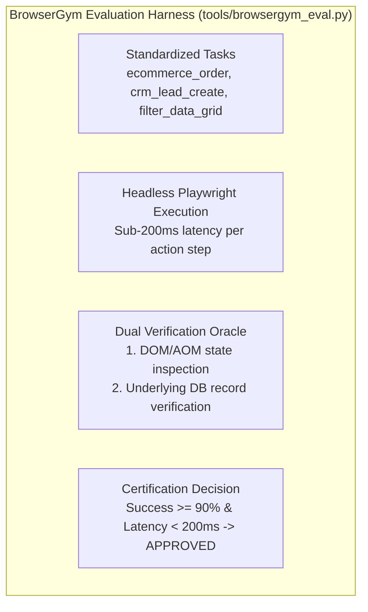

# Web Agent Gym Benchmarking Skill — Empirical Interaction & PageClass Certification

> **Paradigm Attribution:** Inspired by **ServiceNow Research BrowserGym & CMU WebArena**.  
> **Core Principle:** Move beyond static assertions and text-only tool tests. Measure real agent navigation efficiency, enforce < 200ms headless step latency, and confirm that UI actions trigger ground-truth database mutations (eliminating fake passes).

---

## 1. The Benchmark Architecture



1. **Standardized Tasks:**
   - Pre-packaged enterprise scenarios covering forms, checkout modals, dropdowns, and data grids.
   - Evaluates whether the web agent can navigate without deadlocks or infinite loops.

2. **Ground-Truth Dual Verification:**
   - A pass is NOT granted merely because a UI toast says "Success".
   - The harness validates the database mutation (`SELECT COUNT(*) FROM orders WHERE ...`).

3. **PageClass Certification:**
   - Static and dynamic audit of newly synthesized Page Classes.
   - Rejects Page Classes containing `findTestObject`, raw XPaths, or static `Thread.sleep` calls.

---

## 2. CLI Tool Usage

Autonomous commands via `tools/browsergym_eval.py`:

```bash
# 1. Run full benchmark suite in headless mode
python tools/browsergym_eval.py run-suite \
  --tasks "ecommerce_order,crm_lead_create,filter_data_grid" \
  --headless \
  --timeout-sec 30 \
  --report-out reports/browsergym_benchmark.json

# 2. Evaluate and certify a Page Class
python tools/browsergym_eval.py evaluate-pageclass \
  --page-class src/pages/OrderManagementPage.ts
```

---

## 3. Strict Operating Invariants

- **Headless Latency Ceiling:** Average action step latency must remain below **200ms**.
- **No Static Sleep:** Any Page Class with `sleep()` calls is automatically flagged as `REJECTED`.
- **Clean POM:** Strictly prohibits hardcoded selectors outside Page Classes.
