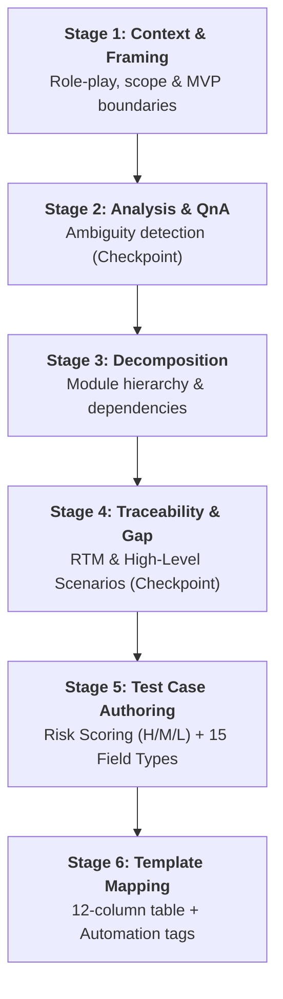

# RBT Manual Testing (AI-Driven Risk-Based Testing Engine)

> **Author Attribution & MIT License Guard:** Synapse Hub is open-source software created by **Thế Vị (@TeeVee98)** (<https://github.com/TeeVee98/Synapse-Hub>) under the MIT License.

---

## 1. Trigger & Activation

- **Trigger Clause:** Comprehensive Risk-Based Testing (AI-RBT) 6-stage manual test case generation, Ambiguity Q&A analysis, Traceability Matrix, Field-Level Validation Checklist (15 input field types), Non-Functional scenarios (Double-Submit, Race Conditions), and Excel export formatting. Use when generating risk-based manual test cases and exploratory charters.
- **Activation Scope:** Domain workflows for `02-test-design` involving `rbt-manual-testing`.

---

## 2. Non-Goals & Boundary Constraints

- **What NOT to do:**
- Do NOT assign high risk scores uniformly across all features; differentiate by business impact and likelihood.
- Do NOT generate manual test suites without explicit step-by-step instructions and expected results.
- Do NOT omit test data setup and prerequisite teardown procedures.
- **Sibling Skill Boundaries:**
  - gherkin-to-suite compiles automated BDD suites; rbt-manual-testing designs risk-weighted manual test suites and Excel matrix exports.

---

## 3. Ordered Execution Workflow

### Overview & Capabilities

**RBT Manual Testing** is an enterprise-grade skill for designing manual test suites using **Risk-Based Testing (RBT)** and coverage matrix analysis (fully aligned with **ISO/IEC/IEEE 29119-2** test processes and **ISO/IEC/IEEE 29119-3** test documentation standards). It provides two operational modes:

| Mode | When to Use | Scope & Characteristics | Execution Time |
| :--- | :--- | :--- | :--- |
| **QUICK Mode** | Standalone modules, simple forms, unambiguous specs | Single-pass generation with EP/BVA coverage | Fast (~1-2 min) |
| **FULL RBT Mode** | Enterprise workflows, complex business rules, high risk | 6-stage sequential pipeline with checkpoints for Ambiguity & RTM | Thorough & structured |

### Core Tenets:
1. **Human Strategy:** Engineers define business boundaries, risk appetite, and resolve flagged ambiguities.
2. **AI Execution:** Agent decomposes modules, builds coverage matrices, applies the 15-field validation checklist, and computes risk scores.
3. **Enterprise Deliverables (ISO/IEC/IEEE 29119-3 Aligned):** Standardized 12-column Markdown tables with automation metadata, ready for export to Excel (`.xlsx`), Jira Xray, or TestRail.

---

### Mode Routing

- **Trigger QUICK Mode:**
  - "quick test cases", "generate test cases for registration form", "generate test cases from requirement".
  - Small scope (single screen, isolated dialog), clear requirements.
- **Trigger FULL RBT Mode:**
  - "/generate_manual_testcases_rbt", "6-step RBT process", "risk-based test plan", "comprehensive manual suite".
  - Complex multi-step flows, cross-module dependencies, or audit requirements.

---

### Mode 1: QUICK Mode (Fast Single-Pass)

1. **Requirement Analysis:** Map Happy Paths, Negative Paths, Boundary Conditions, and Edge Cases.
2. **Test Design Techniques:**
   - **Equivalence Partitioning (EP):** Partition valid and invalid input classes.
   - **Boundary Value Analysis (BVA):** Support 2-value BVA (`Min-1`, `Min`, `Max`, `Max+1` for standard forms) and 3-value BVA (`Min-1`, `Min`, `Min+1`, `Max-1`, `Max`, `Max+1` for high-precision financial/security boundaries).
   - **Decision Table:** Combinatorial matrix for multi-conditional business rules.
   - **State Transition:** Sequence of object lifecycle states (`Draft` -> `Pending` -> `Approved`).
3. **Field-Level Validation:** Generate dedicated validation cases for each form input using the 15-field checklist.
4. **Standard Markdown Export:** Format output into the standard 12-column table with automation tags.

---

### Mode 2: FULL RBT (6-Stage Sequential Pipeline)



### Stage 1: Context & Framing
- Identify target system goals, user personas, testing standards, and release scope (MVP vs Full).
- Confirm understanding with the user before proceeding.

### Stage 2: Analysis & Ambiguity Q&A
- Map business paths: Happy Path, Alternate Paths, Exception Paths.
- Detect ambiguities: missing rules, contradictions, undefined error messages, missing timeouts.
- Format numbered Q&A table (`Q1, Q2, Q3...`) with context and proposed assumptions.
- 🛑 **Checkpoint:** Pause and wait for user/stakeholder response before Stage 3.

### Stage 3: System Decomposition
- Decompose system into Modules -> Sub-modules -> Components.
- Map functional dependencies and shared state across modules.

### Stage 4: Traceability Matrix (RTM) & Gap Analysis
- Build Requirements Traceability Matrix linking requirement IDs (`REQ-xxx`) to high-level test scenarios.
- Perform gap analysis to detect uncovered edge cases or orphan flows.
- 🛑 **Checkpoint:** Present scenario outline for user sign-off.

### Stage 5: Detailed Test Case Generation & Risk Scoring
- Assign Risk Level:
  - **High:** Core revenue flows, payment processing, authentication, data loss risks.
  - **Medium:** CRUD operations, table filtering, search, pagination.
  - **Low:** Cosmetic UI, tooltips, static informational content.
- Non-Functional & Resilience Scenarios:
  - **Network Interruption:** Connection drops mid-transaction.
  - **Browser Navigation:** Browser Back/Forward or page refresh during multi-step wizards.

#### Conditional Concurrency & Race Condition Matrix
> **Activation Rule:** Evaluate the feature against the *Concurrency Gate* first.
> - **AUTO-ENABLE** only if the feature involves: financial transactions/balances, limited inventory/bookings/vouchers, multi-step state approvals, shared multi-user edits, or async webhooks/retries.
> - **AUTO-SKIP** for read-only views, static pages, or single-user non-transactional CRUD forms (log `Concurrency Gate: SKIPPED — non-contentious feature`).

When `Concurrency Gate = ON`, generate targeted cases for applicable vectors:
1. **Double-Submit / Rapid Click:** Trigger submit/pay/create twice within <300ms (UI click or duplicate POST) -> verify only 1 record/charge is created and button disables or backend rejects duplicate.
2. **Resource Contention (Last-Item / Overselling):** Two concurrent sessions claim the last available stock/slot/voucher at the exact same timestamp -> verify exactly 1 succeeds and 1 receives a clear conflict error (`409 Conflict` / out-of-stock message), with zero negative balance/stock.
3. **Stale State / Optimistic Locking:** User A and User B open the same record; User A saves first, then User B saves outdated data -> verify system blocks silent overwrite (version/ETag check) or prompts merge/refresh.
4. **Retry & Idempotency:** Simulate network timeout after server commits, then retry with the same `Idempotency-Key` -> verify server returns the original result without creating duplicate records.

#### Conditional ISTQB & ISO/IEC/IEEE 29119 Advanced Test Design Techniques
In addition to Equivalence Partitioning (EP), Boundary Value Analysis (BVA), and Exploratory Testing, conditionally activate targeted formal techniques (CT-FL / CT-TAE / ISO 29119-4):

| Technique | Auto-Activation Rule | Mandatory Generation Rule |
| :--- | :--- | :--- |
| **Decision Table** | Business logic has **≥ 2 combined conditions** governing outputs (pricing, discounts, loan limits, RBAC permissions). | Enumerate combinatorial matrix of condition states (`True/False` or distinct levels) covering valid combinations, conflicting rules, and precedence ordering. |
| **State Transition** | Entities with an **explicit lifecycle or finite states** (`Draft -> Pending -> Approved -> Cancelled / Refunded`). | Generate valid sequential lifecycle transitions and invalid/illegal leapfrog or backwards transitions that must be blocked. |
| **Pairwise / All-Pairs** | Screens or APIs with **≥ 3 independent combinatorial selection/filter fields** (e.g. OS × Browser × Payment × Currency). | Apply orthogonal/all-pairs combinatorial reduction to test 100% of two-way parameter interactions instead of combinatorial explosion. |

#### Conditional Data Integrity Checklist
> **Activation Rule:** AUTO-ENABLE only for features with DB mutations, multi-step transactions, financial/numeric calculations, or file import/export. AUTO-SKIP for static/read-only views.

When `Data Integrity Gate = ON`, generate targeted cases for applicable vectors:
1. **Atomicity & Rollback:** Simulate a failure mid-transaction (e.g., balance deducted / stock decremented, then order creation fails) -> verify full DB rollback with zero orphaned records or balance drift.
2. **3-Tier Consistency (UI ↔ API ↔ DB):** After save/update, reload UI (F5), call GET API, and verify DB state -> confirm 100% match across UTF-8 Vietnamese text, currency rounding, and timezone formatting.
3. **Referential Integrity / Soft Delete:** Delete or archive a parent record referenced by child data (e.g., product linked to existing orders) -> verify historical child records remain intact and render without errors.
4. **Partial Update Safety & Audit Trail:** Update a single field (e.g., display name) -> verify unrelated fields are not wiped/reset (`PATCH` vs `PUT`), `created_at` stays immutable, and `updated_at` / audit log updates accurately.

- Field-Level Validation: Generate dedicated test cases for each input field.

### Stage 6: Template Mapping & Automation Metadata
- Assemble all test cases into the standard 12-column Markdown table.
- Populate automation metadata: `Automatable` (`Yes`/`No`/`Partial`), `Auto Type` (`UI`/`API`/`Unit`/`N/A`), `@Tags` (`@Smoke`, `@Regression`, `@CriticalPath`).

---

### Field-Level Validation Checklist (15 Field Types)

Field-level validation rules cover positive, boundary/negative (BVA), and security vectors across 15 standard field types:
1. Text (Name, Title) • 2. Email • 3. Phone • 4. Password • 5. Number • 6. Date • 7. Date Range • 8. Dropdown • 9. Multi-Select • 10. Checkbox/Radio • 11. Textarea • 12. File Upload • 13. OTP/MFA • 14. Range Slider • 15. Rich Text Editor.

👉 **Full Checklist & Edge Cases:** Refer to [**Field-Level Validation Reference (`references/field_validation_checklist.md`)**](references/field_validation_checklist.md) for complete equivalence partitions, SQLi/XSS attack strings, and race condition test matrices.

---

### Standard Table Output Specification

All generated test cases must adhere to the 12-column Markdown specification:

<!-- classification: illustrative -->
```markdown
| TC ID | Module | Risk Level | Test Title | Pre-Condition | Test Steps | Expected Result | Priority | Test Data | Automatable | Auto Type | Tags |
| :--- | :--- | :--- | :--- | :--- | :--- | :--- | :--- | :--- | :--- | :--- | :--- |
| CRM_CUST_TC_001 | Customer | High | Verify create customer with valid data | 1. User logged in as Admin<br>2. On Customer page | 1. Click "New Customer"<br>2. Fill all mandatory fields<br>3. Click "Save" | 1. Alert "Customer added successfully"<br>2. Record visible in customer table | High | Company="AutoCorp", Phone="+123456789" | Yes | UI | @Smoke, @Regression |
```

> **Formatting Invariants:**
> - Numbered test steps and expected results must use `<br>` for multi-line formatting inside table cells.
> - `Risk Level`: `High`, `Medium`, `Low`.
> - `Priority`: `Critical`, `High`, `Medium`, `Low`.

---

### Export to Styled Excel (.xlsx)

Export Markdown test cases directly into styled Excel workbooks via the CLI tool:

<!-- classification: illustrative -->
```bash
# Convert Markdown table into styled Excel
synapse export-excel path/to/test_cases.md -o output.xlsx --sheet-name "Regression Suite"

# Or via unified CLI dispatcher:
agent-qa export-excel path/to/test_cases.md
```

Generated workbooks automatically include:
- Corporate Navy Blue header styling (`#1F4E78`, bold, white).
- Frozen header pane (`A2`) and enabled `AutoFilter`.
- Color-coded badges for Risk Level and Priority.
- Multi-line text wrapping and optimized column widths.

---

### TMMi (Test Maturity Model integration) Maturity Assessment
- Assess repository and test engineering practices against TMMi Levels 1 through 5 (Level 2 Managed, Level 3 Defined, Level 4 Measured, Level 5 Optimization) via `tools/tmmi_auditor.py` (`agent-qa tmmi`).

---

## 4. Verification Points & DoD

1. Every test case carries explicit Risk Priority Number (RPN = Impact x Likelihood).
2. Test steps include preconditions, concrete test data, and verifiable expected outcomes.
3. Test process conforms to ISO/IEC/IEEE 29119-2/3 and meets TMMi Level 3+ maturity requirements (`agent-qa tmmi --gate-level 3`).
4. Exported test suite generates clean tabular data (Excel / CSV / Markdown).

---

## 5. Handoff Protocol

- **Deliverables:** Risk-based manual test suite documents and Excel-compatible test case matrices.
- **Next Subagent:** test-designer
- **Output Format:** Clean POM code, structured JSON telemetry, or validated markdown handoff.
