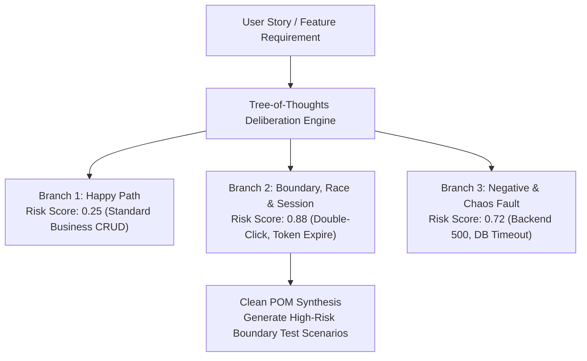

# Tree-of-Thoughts Exploratory Testing Skill — Deliberative QA Reasoning

> **Paradigm Attribution:** Inspired by **Princeton NLP Tree-of-Thoughts (ToT) & ETH Zürich Graph-of-Thoughts (GoT)**.  
> **Core Principle:** Overcome linear single-track test generation. Decompose critical enterprise workflows into a 3-branch deliberation tree (Happy Path, Boundary/Race, Chaos/Fault), score intermediate thought nodes with Beam Search, and diagnose root causes via multi-hypothesis evaluation.

---

## 1. The Deliberative 3-Branch Reasoning Tree



1. **Deliberative Branching:**
   - Evaluates non-linear edge cases: mid-transaction network drops, concurrent duplicate clicks, and auth token expiration.
   - Assigns quantitative risk scores (0.0 to 1.0) to prioritize high-risk test scripts over repetitive happy paths.

2. **Multi-Hypothesis RCA:**
   - Evaluates competing defect hypotheses (`DOM_TIMEOUT`, `ASYNC_RACE`, `DB_LOCK`, `BACKEND_500`, `STALE_SELECTOR`).
   - Replaces guesswork with evidence-based diagnosis ranked by confidence scores.

---

## 2. CLI Tool Usage

Autonomous commands via `tools/tot_exploratory_tester.py`:

```bash
# 1. Expand User Story into Tree of Thoughts
python tools/tot_exploratory_tester.py expand-story \
  --story-file docs/stories/US_PAYMENT_GATEWAY.md \
  --max-depth 3 \
  --beam-width 3 \
  --out-graph reports/tot_payment_graph.json

# 2. Perform multi-hypothesis Root Cause Analysis
python tools/tot_exploratory_tester.py rca-hypotheses \
  --error-log reports/failed_run.log \
  --hypotheses "DOM_TIMEOUT,ASYNC_RACE,DB_LOCK,BACKEND_500"
```

---

## 3. Strict Operating Invariants

- **Critical Flow Prioritization:** Focus multi-branch deliberation on high-risk domains (Financial Checkout, Authentication, Data Mutation).
- **Clean POM Output:** Test scenarios derived from thought trees must map directly into Page Classes extending `BasePage`.
- **Zero Hallucination:** Hypotheses must be grounded directly in error log evidence and stacktraces.
