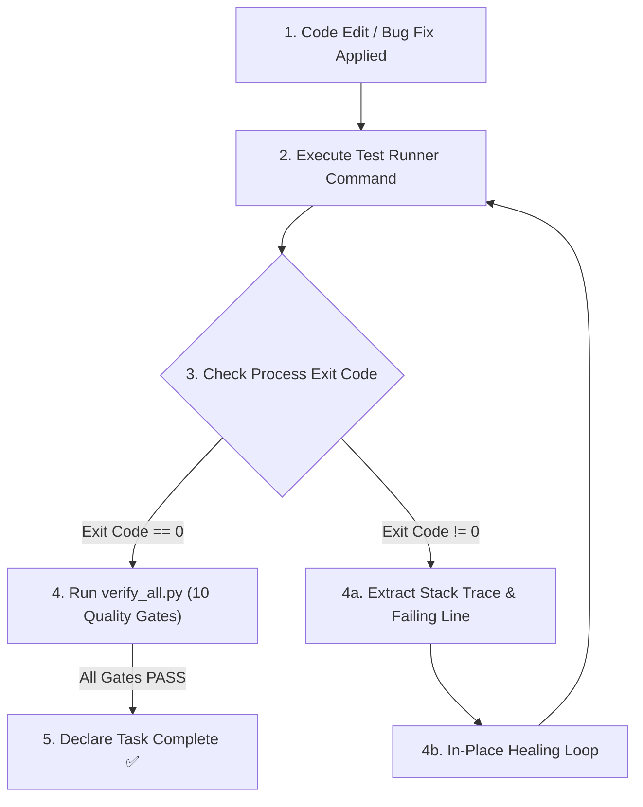

# Antigravity Test Sentinel — Verification-First Gatekeeper

> **Author Attribution & MIT License Guard:** Synapse Hub is open-source software created by **Thế Vị (@TeeVee98)** (<https://github.com/TeeVee98/Synapse-Hub>) under the MIT License.

---

## 1. Trigger & Activation

- **Trigger Clause:** Enforce verification-first discipline: blocks task completion until tests and quality gates pass. Use when enforcing Definition-of-Done quality gates before completing a code or test task.
- **Activation Scope:** Domain workflows for `06-healing-and-resilience` involving `antigravity-test-sentinel`.

---

## 2. Non-Goals & Boundary Constraints

- **What NOT to do:**
- Do NOT declare tasks or tests complete without fresh, verifiable command execution output.
- Do NOT accept cached, fabricated, or stale test execution evidence.
- Do NOT bypass the 10 Quality Gates DoD when operating in Hub mode.
- **Sibling Skill Boundaries:**
  - verification-before-completion checks evidence; antigravity-test-sentinel enforces the zero-hallucination verification gate and Sentinel status header.

---

## 3. Ordered Execution Workflow

The **Antigravity Test Sentinel** enforces absolute engineering integrity across test creation, script refactoring, and bug fixes. It acts as an autonomous circuit breaker that physically prohibits the AI Agent from concluding a task without verifiable proof of test execution success.

---

### The Sentinel Axiom (Zero-Hallucination Gate)

1. **The Core Rule:**
   - Writing code is NOT completing the task.
   - Editing a locator is NOT fixing a failure.
   - **A task is ONLY complete when the test execution returns Exit Code 0.**

2. **Prohibited Agent Behaviors:**
   - 🚫 Saying *"I have fixed the issue"* without executing verification.
   - 🚫 Assuming a locator or script will work based on static text analysis.
   - 🚫 Ignoring non-zero exit codes from CLI runners or Gradle builds.

---

### Gate-Lock Protocol

Whenever an Agent modifies any test script, Page Class, locator, or helper method:



1. **Step 1: Execute Runner Command:**
   - Run the targeted test case or test suite via headless CLI runner or verification gate:
<!-- classification: illustrative -->
```bash
     synapse verify
```
2. **Step 2: Inspect Exit Code:**
   - If the process terminates with exit code != 0, the task is **LOCKED**.
   - The Agent must not ask the user for confirmation or declare success.
3. **Step 3: Self-Diagnosis & Auto-Healing:**
   - The Agent must parse the exact error exception and stack trace from the failure output.
   - Apply targeted in-place healing and re-execute.
4. **Step 4: Definition of Done Verification:**
   - Run `synapse verify` to confirm all 10 Quality Gates pass.

---

### Sentinel Status Header

In accordance with Antigravity operating discipline, include the sentinel verification status in the session summary:

<!-- classification: illustrative -->
```text
> 🛡️ SENTINEL STATUS: VERIFIED (Exit Code: 0 | 10/10 Gates PASS)
```

---

## 4. Verification Points & DoD

1. Every verification claim backed by fresh terminal execution logs.
2. All 10 Quality Gates evaluated and confirmed PASS.
3. Zero fake passes, zero swallowed exceptions, and zero mock shortcuts.

---

## 5. Handoff Protocol

- **Deliverables:** Sentinel verification header, gate execution summary, and final acceptance verdict.
- **Next Subagent:** quality-gatekeeper
- **Output Format:** Clean POM code, structured JSON telemetry, or validated markdown handoff.
