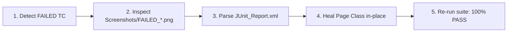

# Failure Autopsy & Auto-Healing (Diagnostic & Self-Healing Engine)

> **Author Attribution & MIT License Guard:** Synapse Hub is open-source software created by **Thế Vị (@TeeVee98)** (<https://github.com/TeeVee98/Synapse-Hub>) under the MIT License.

---

## 1. Trigger & Activation

- **Trigger Clause:** Triage test failures from JUnit XML/screenshots and heal broken Page Class locators. Use when diagnosing failed test runs and producing closed-loop healing plans.
- **Activation Scope:** Domain workflows for `06-healing-and-resilience` involving `failure-autopsy-and-healing`.

---

## 2. Non-Goals & Boundary Constraints

- **What NOT to do:**
- Do NOT attempt locator healing without inspecting live DOM or accessibility tree states.
- Do NOT inject brittle positional XPaths as healed locators.
- Do NOT mask underlying application bugs as locator failures.
- **Sibling Skill Boundaries:**
  - agentless-qa-repair executes rapid minimal diff patching; failure-autopsy-and-healing conducts comprehensive failure analysis and AOM locator healing.

---

## 3. Ordered Execution Workflow

Specialized skill for diagnosing batch test execution failures across automated test cases, performing visual autopsies via `Screenshots/FAILED_*.png`, parsing `JUnit_Report.xml`, and healing Page Classes (`Keywords/<namespace>/pages/*.groovy` or `pages/*.ts`) in place.

---

### Five-Step Enterprise Autopsy Protocol



1. **Zero-Token Triage:** Pinpoint failed line and cause instantly (<50 tokens):
<!-- classification: illustrative -->
```bash
   python tools/pinpoint_failure.py
   # or bash .agents/skills/failure-autopsy-and-healing/scripts/triage_failures.sh
```
2. **Visual Autopsy:** Inspect the latest error screenshot to immediately detect: disabled buttons, missing required fields, UI overlaps, or obscuring modal backdrops.
3. **XML Parsing:** Extract stacktrace and exception messages from `Reports/<Timestamp>/JUnit_Report.xml` or Playwright test results.
4. **In-Place Healing:** Update the corresponding Page Class in `Keywords/<project_namespace>/pages/` or `pages/`.
5. **Regression Guard:** Verify 100% UTF-8 No BOM and re-run the targeted suite to confirm 100% Pass.

---

### Dynamic Module & Page Class Mapping Architecture

| Functional Module Category | Target Page Class to Heal | Common Failure Vector | Recommended Auto-Heal Strategy |
| :--- | :--- | :--- | :--- |
| **Authentication & Session** | `LoginPage` | Stale session, cookie expiration | Switch to zero-second storage state / token injection |
| **System Admin & RBAC** | `UserAdminPage` | Role permission dialog overlay | Smart wait for dialog animation + backdrop dismissal |
| **Master Data & Catalogs** | `CategoryPage` | Table virtualization lazy-load | Scroll into view + waitForLoadState('networkidle') |
| **Workflows & Approvals** | `PlanningPage` | Button disabled state / slow API | Await formControl valid state before trigger click |
| **Data Tables & Search** | `DataManagementPage`| Dynamic table pagination index | Target semantic cell content or unique row testid |
| **Reporting & Exports** | `ReportPage` | Background worker generation lag | Poll download trigger with timeout rather than static wait |
| **API & Integrations** | `ApiTokenPage` | Bearer token header mismatch | Validate token generation response payload schema |

---

### Reference Documentation

- [**Diagnostic & Healing Matrix (`healing_matrix.md`)**](references/healing_matrix.md): Concrete code prescriptions for disabled buttons, boundary overlaps, `ElementClickInterceptedException`, `StaleElementReferenceException`, and 4 flaky test root causes.
- **Fast-Fix Triad & Runtime Helper (`tools/browser_helpers.js`):** In-browser diagnosis engine via `window.__qa` (`audit`, `heal`, `clickSafe`, `hud`).
- **Automated Triage Script:** `python tools/pinpoint_failure.py` and `scripts/triage_failures.sh`.

---

### Boundary vs `self-healing-locator` (Do Not Confuse)

- **This skill** = the general physician: accepts ANY failed test run, performs
  root-cause analysis (JUnit XML, logs, screenshots), queries the memory cache,
  files the bug ticket, and produces a full healing plan (which may involve
  environment, data, timing, or code fixes).
- **`self-healing-locator`** = the orthopedic specialist: one failure class only
  — broken locators/stale elements. Its matching cascade is *dispatched by*
  this skill's plan when the RCA concludes "locator drift".
- Rule of thumb: if the failure reason is not yet known, start here; only after
  the RCA says "locator broke" hand the repair to `self-healing-locator`.

---

## 4. Verification Points & DoD

1. Failure autopsy categorizes failure root cause (AUT defect vs Locator drift vs Environment).
2. Healed locators conform to 6-tier locator hierarchy and Clean POM standards.
3. Healed tests pass dynamic verification runs.

---

## 5. Handoff Protocol

- **Deliverables:** Failure autopsy report, healed Page Class selectors, and verification run logs.
- **Next Subagent:** failure-analyst
- **Output Format:** Clean POM code, structured JSON telemetry, or validated markdown handoff.
