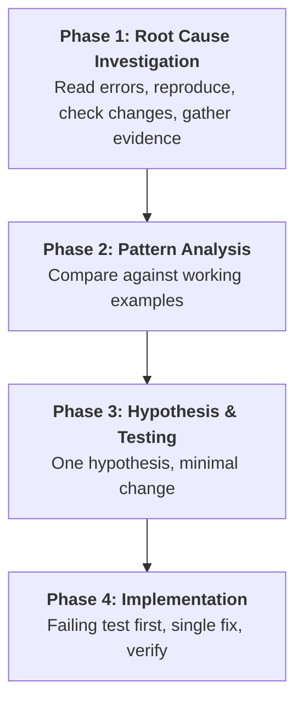

# Systematic Debugging — Enterprise Root-Cause Standard

Specialized skill for failure investigation in test automation: always find root cause before attempting fixes. Symptom fixes are failure.

---

## 1. The Iron Law

```
NO FIXES WITHOUT ROOT CAUSE INVESTIGATION FIRST
```

If Phase 1 is not complete, proposing fixes is prohibited. This applies ESPECIALLY when: under time pressure (emergencies make guessing tempting), a "quick fix" seems obvious, or previous fixes did not work.

## 2. The Four Phases



### Phase 1: Root Cause Investigation (before ANY fix)

1. **Read error messages completely** — stack traces, line numbers, error codes often contain the exact cause.
2. **Reproduce consistently** — exact steps, every time. Not reproducible means gather more data (flaky scoring via `tools/flaky_detector.py`), do not guess.
3. **Check recent changes** — git diff, recent commits, new dependencies, config drift.
4. **Gather evidence at component boundaries** — for multi-layer systems (CI → build → run; API → service → DB), log what enters and exits each boundary once, to see WHICH layer breaks, then investigate that layer.
5. **Trace data flow backward** — where does the bad value originate? Fix at source, never at symptom.

### Phase 2: Pattern Analysis

- Find working examples of similar behavior in the same codebase; list every difference from the broken path, however small.
- Read reference implementations completely before applying a pattern — partial understanding guarantees bugs.

### Phase 3: Hypothesis and Testing

- State one specific hypothesis: "X is the root cause because Y."
- Test it with the SMALLEST possible change, one variable at a time. Do not stack fixes.
- Confirmed → Phase 4. Rejected → form a NEW hypothesis; do not pile fix onto fix.

### Phase 4: Implementation

1. **Create the failing test case first** — the reproduction is the RED test (see `test-driven-development`).
2. **Implement a single fix** at the identified root cause. No "while I'm here" improvements, no bundled refactoring.
3. **Verify the fix** — test passes, full suite still green, claim backed by output per `verification-before-completion`.
4. **If the fix does not work:** STOP. Count attempts. Fewer than 3 → return to Phase 1 with the new information.
5. **If 3+ fixes failed:** question the architecture, not the code — each fix revealing a new problem elsewhere is the signature of a wrong pattern. Discuss with the user before a fourth attempt.

## 3. Hub Tooling Chain

| Step | Tool | Role in investigation |
|---|---|---|
| Isolate | `python3 tools/pinpoint_failure.py` | Extract exact failing line, exception, stack trace from JUnit XML in ~0.1s |
| Diagnose | `python3 tools/auto_heal.py` | Closed-loop triage and healing plan; reflexion lessons after each successful heal |
| Reuse | `python3 tools/cache_resolver.py query "<error>"` | 0-token lookup of previously solved, similar defects before re-investigating |
| Classify | `python3 tools/flaky_detector.py` | Separate non-deterministic flakiness from genuine defects |
| Ticket | `python3 tools/bug_reporter.py` | Auto-generate the bug ticket with RCA once root cause is proven |

Escalation order: `failure-analyst` performs the autopsy; `quality-gatekeeper` re-verifies after the fix lands.

## 4. Red Flags — STOP and Return to Phase 1

- "Quick fix for now, investigate later"
- "Just try changing X and see if it works"
- Adding multiple changes and running tests together
- "Skip the test, I'll manually verify"
- Proposing solutions before tracing the data flow
- "One more fix attempt" after 2+ failures
- Each fix revealing a new problem in a different place (architecture question)

## 5. When Investigation Finds No Root Cause

If disciplined investigation proves the issue is genuinely environmental or timing-dependent: document what was investigated, implement appropriate handling (retry, timeout, error message), add monitoring for future investigation — and remember: most "no root cause" conclusions are incomplete investigation. Hand residual non-determinism to `flaky-test-sentinel-and-quarantine` for scoring and quarantine instead of declaring it unsolvable.

## 6. Boundary vs Sibling Skills (Do Not Confuse)

| Sibling | Owns | Hand-off |
|---|---|---|
| `failure-autopsy-and-healing` | Mechanical triage/healing mechanics from JUnit XML, screenshots, PR automation | This skill is the investigation DISCIPLINE; autopsy tooling executes its Phase 1/4 |
| `test-driven-development` | The RED-GREEN-REFACTOR cycle | Phase 4 hands the reproduced bug over as the failing test |
| `flaky-test-sentinel-and-quarantine` | Flakiness scoring and quarantine lifecycle | Receives non-reproducible findings after Phase 1 |
| `self-healing-locator` | Semantic locator healing | Consumes the verified root cause for locator-class defects |

## 7. Reference Documentation

- `python3 tools/pinpoint_failure.py <report>` — first command on any failed run.
- `python3 tools/auto_heal.py` — closed-loop triage after isolation.
- `python3 tools/cache_resolver.py query "<error message>"` — 0-token known-defect lookup.
- [Four-phase worked case (`four_phase_case.md`)](examples/four_phase_case.md): a timeout failure traced to root cause.

## 8. Attribution

Adapted from **superpowers** skill `systematic-debugging` (https://github.com/obra/superpowers) — MIT License, Copyright (c) 2025 Jesse Vincent. The Iron Law, four-phase process, 3-fix architecture rule, and rationalization guardrails are re-scoped for enterprise QA automation in Synapse Hub; wording, structure, and tooling chain modified.
