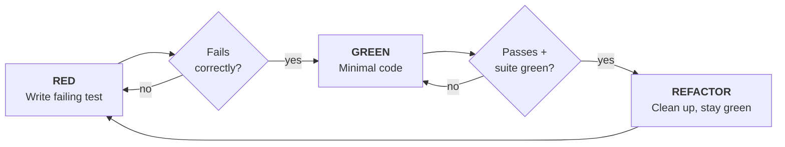

# Test-Driven Development — Enterprise Red-Green-Refactor Standard

Specialized skill for writing test-automation and tool code test-first: write the test, watch it fail for the right reason, write minimal code to pass, then refactor while staying green.

---

## 1. The Iron Law

```
NO PRODUCTION CODE WITHOUT A FAILING TEST FIRST
```

- Code written before the test is deleted — not kept "as reference", not "adapted while writing tests". Delete means delete; implement fresh from the tests.
- "Violating the letter of the rules is violating the spirit of the rules." Thinking "skip TDD just this once" is rationalization, not judgment.

## 2. The Cycle



### RED — Write the Failing Test

- One behavior per test; a name that describes the behavior; real code (mocks only when unavoidable).
- **Verify RED is mandatory:** run the test and confirm it fails for the expected reason — feature missing, not a typo. A test that passes immediately is testing existing behavior; fix the test, not the code.

### GREEN — Minimal Code

- Simplest code that passes the test. No features, no refactoring of other code, no "improvements" beyond what the test demands.
- **Verify GREEN is mandatory:** the new test passes AND the project suite still passes. A green single file is not a green suite — run the project's test command before calling the change done. Any failure that run shows, including one you did not cause, goes into your report by name; a red test scrolled past unmentioned is a report falsified by omission.

### REFACTOR — Clean Up While Green

- Remove duplication, improve names, extract helpers. Keep tests green; add no behavior.

## 3. Good Tests

| Quality | Good | Bad |
|---|---|---|
| Minimal | One thing; "and" in the name means split it | `test('validates email and domain and whitespace')` |
| Clear | Name describes behavior | `test('test1')` |
| Intent-revealing | Demonstrates the desired API | Obscures what the code should do |
| Honest | Asserts real behavior; you can name the production change that would make it fail | Asserts on mock behavior only |

## 4. Hub Integration

- **Fake-pass synergy:** test-first pairs with `python3 tools/infer_linter.py` (flags 0-assert and tautological tests) and Gate 8 — `python3 tools/micro_mutator.py` requires Mutation Score >= 80%, which a test written AFTER the code rarely achieves honestly.
- **Bug fixes:** the bug reproduction IS the RED test. Never fix a bug without a test that fails before the fix and passes after.
- **Locator logic:** selector helpers and Page Class methods follow the same cycle; live verification (Stage 2 of `playwright-live-interaction`, 100% hit rate under 200ms) is the RED check for locator changes.

## 5. Common Rationalizations (All Rejected)

| Excuse | Reality |
|---|---|
| "Too simple to test" | Simple code breaks; the test takes 30 seconds. |
| "I'll test after" | Tests written after pass immediately — which proves nothing. You never watched it fail, so you never proved it can catch the bug. |
| "Already manually tested" | Ad-hoc checking has no record and no repeatability; "worked when I tried it" is not coverage. |
| "Keep as reference, write tests first" | You will adapt it. That is testing after. Delete means delete. |
| "Need to explore first" | Fine — explore, throw the exploration away, start with TDD. |
| "Test hard = skip" | Hard to test means hard to use; listen to the design signal. |
| "TDD will slow me down" | TDD catches bugs before commit and lets you refactor without fear; the pragmatic shortcut is debugging in production. |

## 6. Red Flags — Stop and Start Over

- Code before test; test written after implementation
- Test passes immediately on first run
- Cannot explain why the test failed
- Tests promised "later", or rationalizing "just this once"

All of these mean: delete the code and restart the cycle from RED.

## 7. Verification Checklist

Before marking any implementation complete:

- [ ] Every new function/method has a test
- [ ] Each test was watched failing, for the expected reason
- [ ] Minimal code was written to pass each test
- [ ] The project's full test command was run and its output quoted
- [ ] Output is pristine (no errors, warnings)
- [ ] Edge cases and error paths covered

Cannot check all boxes? The cycle was skipped — start over.

## 8. Boundary vs Sibling Skills (Do Not Confuse)

| Sibling | Owns | Hand-off |
|---|---|---|
| `systematic-debugging` | Root-cause investigation of failures | Phase 4 hands the reproduced bug to this skill as the RED test |
| `verification-before-completion` | Evidence protocol for completion claims | This skill's GREEN check feeds the evidence that protocol quotes |
| `antigravity-test-sentinel` | Hard completion blocking on gates | The sentinel enforces what this skill produces (fresh, watched, honest tests) |
| `surgical-coding-principles` | Diff discipline | Goal-Driven Execution (principle 4) is operationalized by this cycle |

## 9. Reference Documentation

- `python3 tools/infer_linter.py` — AST scan for fake passes and 0-assert tests.
- `python3 tools/micro_mutator.py` — Gate 8 mutation floor (>= 80%) validating test honesty.
- [Worked QA example (`red_green_refactor_qa.md`)](examples/red_green_refactor_qa.md): full cycle for a retry helper in a test utility.

## 10. Attribution

Adapted from **superpowers** skill `test-driven-development` (https://github.com/obra/superpowers) — MIT License, Copyright (c) 2025 Jesse Vincent. The Iron Law, RED-GREEN-REFACTOR cycle, and rationalization table are re-scoped for enterprise QA automation in Synapse Hub; wording, structure, and examples modified.
