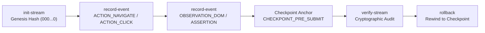

# QA Event Stream Orchestrator Skill — Immutable Audit & Replay Timeline

> **Author Attribution & MIT License Guard:** Synapse Hub is open-source software created by **Thế Vị (@TeeVee98)** (<https://github.com/TeeVee98/Synapse-Hub>) under the MIT License.

---

## 1. Trigger & Activation

- **Trigger Clause:** Immutable EventStream orchestrator recording deterministic action/observation timelines with SHA-256 hash chains and reversible checkpoint rollbacks. Use when tracing test executions and managing replayable state.
- **Activation Scope:** Domain workflows for `10-agent-orchestration` involving `event-stream-qa-orchestrator`.

---

## 2. Non-Goals & Boundary Constraints

- **What NOT to do:**
- Do NOT poll in tight synchronous loops when waiting for asynchronous background tasks.
- Do NOT drop or miss event notifications in the event stream pipeline.
- Do NOT process event payloads without schema and boundary validation.
- **Sibling Skill Boundaries:**
  - actor-qa-swarm coordinates actor agents; event-stream-qa-orchestrator processes asynchronous event streams and reactive test pipelines.

---

## 3. Ordered Execution Workflow

> **Paradigm Attribution:** Inspired by **All-Hands-AI OpenHands (EventStream & CodeAct Runtime)**.  
> **Core Principle:** Treat automated testing sessions as an append-only, immutable stream of events. Prevent state corruption and lost context by chaining each event with cryptographic SHA-256 hashes and enabling deterministic check-pointed rollbacks.

---

### The EventStream Pipeline



1. **Immutable Event Logging (`record-event`):**
   - Each event records: `index`, `session_id`, `event_type`, `actor`, `payload`, `timestamp`, `prev_hash`, and `event_hash`.
   - Continuous SHA-256 hash chaining prevents unobserved event injection or tampering.

2. **Reversible Checkpointing (`rollback`):**
   - In conjunction with GoEx LIFO undo stack (`tools/reversible_sandbox.py`), enables restoring the browser or data state when an unexpected crash occurs.
   - Appends a `ROLLBACK_EXECUTED` event to the stream without destroying the audit trail.

3. **Cryptographic Verification (`verify-stream`):**
   - Verifies hash continuity from genesis to latest event.
   - Ensures zero missing or out-of-order events before certifying run results.

---

### CLI Tool Usage

Autonomous commands via `tools/qa_event_stream.py`:

<!-- classification: illustrative -->
```bash
# 1. Initialize stream
python tools/qa_event_stream.py init-stream \
  --session-id "CHECKOUT_E2E_001" \
  --out-file .agent_memory/timeline.jsonl

# 2. Record an action event
python tools/qa_event_stream.py record-event \
  --stream .agent_memory/timeline.jsonl \
  --event-type ACTION_CLICK \
  --actor live-explorer \
  --payload '{"page":"CartPage","element":"checkout_button"}'

# 3. Create a state checkpoint
python tools/qa_event_stream.py record-event \
  --stream .agent_memory/timeline.jsonl \
  --event-type CHECKPOINT \
  --actor test-runner \
  --payload '{"cart_total": 99.99}' \
  --checkpoint-id "PRE_CHECKOUT_FORM"

# 4. Verify stream integrity
python tools/qa_event_stream.py verify-stream \
  --stream .agent_memory/timeline.jsonl

# 5. Rollback to checkpoint on test failure
python tools/qa_event_stream.py rollback \
  --stream .agent_memory/timeline.jsonl \
  --to-checkpoint "PRE_CHECKOUT_FORM"
```

---

### Strict Operating Invariants

- **Hash Chain Integrity:** All events must compute `SHA-256(prev_hash | session_id | event_type | actor | payload | timestamp)`.
- **Zero Log Tampering:** Never edit `timeline.jsonl` lines manually; always append via the CLI tool.
- **UTF-8 No BOM:** Timeline files must remain clean UTF-8 without byte-order marks.

---

## 4. Verification Points & DoD

1. Event stream pipeline handles test execution events asynchronously.
2. Task status and heartbeat updates recorded via reactive event subscriptions.
3. Zero zombie or hanging background worker tasks.

---

## 5. Handoff Protocol

- **Deliverables:** Event pipeline logs, reactive execution traces, and stream processing telemetry.
- **Next Subagent:** orchestrator
- **Output Format:** Clean POM code, structured JSON telemetry, or validated markdown handoff.
