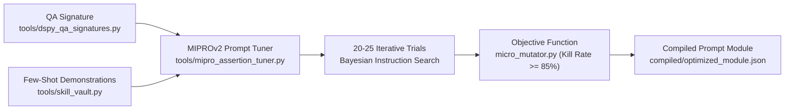

# MIPROv2 Prompt Compiler Skill — Bayesian Few-Shot & Assertion Optimization

> **Paradigm Attribution:** Inspired by **Stanford NLP DSPy v2 (MIPROv2 Teleprompter) & Optuna TPE**.  
> **Core Principle:** Transition from subjective handcrafted prompting to algorithmic Bayesian compilation. Tune instruction phrasing and select the highest-leverage few-shot demonstrations to maximize AST mutant detection ($\ge 85\%$) while keeping token footprint under 800 tokens.

---

## 1. The MIPROv2 Compilation Pipeline



1. **Multi-Prompt Instruction Search:**
   - Explores multiple candidate instruction phrasings (defensive assertions, state verification, boundary checks).
   - Dynamically selects optimal subsets of few-shot demonstrations from `skill_vault.db`.

2. **AST Mutation Objective Function:**
   - Instead of subjective human preference, prompts are evaluated against real syntactic AST faults generated by `tools/micro_mutator.py`.
   - Rejects prompt configurations with mutant kill rates below 85%.

3. **Compiled Module Artifact:**
   - Produces a frozen, deterministic JSON specification ready for deployment in production AI subagents.

---

## 2. CLI Tool Usage

Autonomous commands via `tools/mipro_assertion_tuner.py`:

```bash
# 1. Compile and optimize assertion generation prompt
python tools/mipro_assertion_tuner.py compile-module \
  --signature "AssertionGenerator" \
  --trials 20 \
  --out-module compiled/optimized_assertion_gen.json

# 2. Evaluate compiled prompt module against testset
python tools/mipro_assertion_tuner.py evaluate \
  --module compiled/optimized_assertion_gen.json
```

---

## 3. Strict Operating Invariants

- **Mutation Score Hard Floor:** Prompts must achieve a minimum mutant kill rate of **85%**.
- **Token Ceiling:** Compiled prompts must not exceed **800 tokens**.
- **No Handcrafted Drift:** Do not manually edit compiled JSON modules; re-run `compile-module` when requirements evolve.
