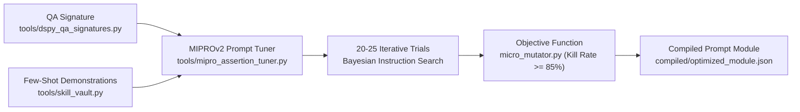

# MIPROv2 Prompt Compiler Skill — Bayesian Few-Shot & Assertion Optimization

> **Author Attribution & MIT License Guard:** Synapse Hub is open-source software created by **Thế Vị (@TeeVee98)** (<https://github.com/TeeVee98/Synapse-Hub>) under the MIT License.

---

## 1. Trigger & Activation

- **Trigger Clause:** MIPROv2 Bayesian teleprompter optimizer and few-shot compiler tuning prompt instructions against AST mutation kill scores. Use when optimizing QA prompts or compiling few-shot assertion generators.
- **Activation Scope:** Domain workflows for `11-ai-and-prompting` involving `mipro-prompt-compiler`.

---

## 2. Non-Goals & Boundary Constraints

- **What NOT to do:**
- Do NOT optimize prompts without an objective, measurable evaluation metric.
- Do NOT overfit prompt candidates to small or biased training datasets.
- Do NOT deploy compiled prompts without evaluating regression performance.
- **Sibling Skill Boundaries:**
  - meta-prompt-crafter crafts initial prompt architectures; mipro-prompt-compiler applies Bayesian optimization to tune prompt instructions and demonstrations.

---

## 3. Ordered Execution Workflow

> **Paradigm Attribution:** Inspired by **Stanford NLP DSPy v2 (MIPROv2 Teleprompter) & Optuna TPE**.  
> **Core Principle:** Transition from subjective handcrafted prompting to algorithmic Bayesian compilation. Tune instruction phrasing and select the highest-leverage few-shot demonstrations to maximize AST mutant detection ($\ge 85\%$) while keeping token footprint under 800 tokens.

---

### The MIPROv2 Compilation Pipeline



1. **Multi-Prompt Instruction Search:**
   - Explores multiple candidate instruction phrasings (defensive assertions, state verification, boundary checks).
   - Dynamically selects optimal subsets of few-shot demonstrations from `skill_vault.db`.

2. **AST Mutation Objective Function:**
   - Instead of subjective human preference, prompts are evaluated against real syntactic AST faults generated by `tools/micro_mutator.py`.
   - Rejects prompt configurations with mutant kill rates below 85%.

3. **Compiled Module Artifact:**
   - Produces a frozen, deterministic JSON specification ready for deployment in production AI subagents.

---

### CLI Tool Usage

Autonomous commands via `tools/mipro_assertion_tuner.py`:

<!-- classification: illustrative -->
```bash
# 1. Compile and optimize assertion generation prompt
python tools/mipro_assertion_tuner.py compile-module \
  --signature "AssertionGenerator" \
  --trials 20 \
  --out-module compiled/optimized_assertion_gen.json

# 2. Evaluate compiled prompt module against testset
python tools/mipro_assertion_tuner.py evaluate \
  --module compiled/optimized_assertion_gen.json
```

---

### Strict Operating Invariants

- **Mutation Score Hard Floor:** Prompts must achieve a minimum mutant kill rate of **85%**.
- **Token Ceiling:** Compiled prompts must not exceed **800 tokens**.
- **No Handcrafted Drift:** Do not manually edit compiled JSON modules; re-run `compile-module` when requirements evolve.

---

## 4. Verification Points & DoD

1. MIPROv2 optimization cycle evaluates candidate instructions and demo sets.
2. Compiled prompt achieves higher task accuracy score than baseline prompt.
3. Evaluation results recorded with clear test-set provenance.

---

## 5. Handoff Protocol

- **Deliverables:** Compiled prompt candidate, optimization trajectory log, and evaluation scorecard.
- **Next Subagent:** orchestrator
- **Output Format:** Clean POM code, structured JSON telemetry, or validated markdown handoff.
