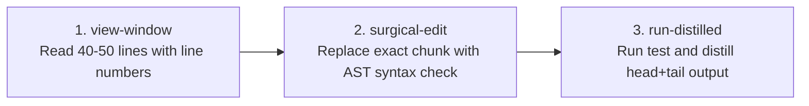

# QA Agent-Computer Interface (ACI) Skill — Context-Safe Code Editing

> **Paradigm Attribution:** Inspired by **Princeton NLP / Stanford SWE-agent ACI**.  
> **Core Principle:** Prevent context window blowout and hallucinated edits by enforcing bounded file viewing (40–50 lines), surgical contiguous chunk replacements with AST syntax validation, and log distillation.

---

## 1. The Three ACI Primitives



1. **Bounded File Viewing (`view-window`):**
   - Strictly limits context consumption by reading bounded windows (default 40 lines) with line numbers.
   - Eliminates monolithic file ingestion (reading 4,000-line PageClasses directly is strictly forbidden).

2. **Pre-Commit Surgical Editing (`surgical-edit`):**
   - Validates that target chunks exist uniquely in the file.
   - Runs pre-commit AST syntax validation (Python `ast.parse` and bracket balance).
   - Enforces **Clean POM**: strictly rejects raw XPath / CSS selectors if editing test scripts (`tests/`, `Scripts/`).
   - Guarantees 100% UTF-8 No BOM across all file writes.

3. **Distilled Execution (`run-distilled`):**
   - Intercepts test runner stdout/stderr and extracts the head 25 lines and tail 25 lines.
   - Prevents terminal noise and test trace dumps from saturating the conversation context.

---

## 2. CLI Tool Usage

Autonomous commands via `tools/swe_qa_aci.py`:

```bash
# 1. View 40 lines starting at line 20
python tools/swe_qa_aci.py view-window \
  --file src/pages/LoginPage.ts \
  --start-line 20 \
  --window-size 40

# 2. Surgically edit code with AST check & Clean POM guard
python tools/swe_qa_aci.py surgical-edit \
  --file src/pages/LoginPage.ts \
  --target-chunk "await this.page.click('#old-btn');" \
  --replacement-chunk "await this.clickSafe(this.loginButton);" \
  --validate-syntax

# 3. Run test command with distilled output
python tools/swe_qa_aci.py run-distilled \
  --command "npx playwright test tests/login.spec.ts" \
  --max-lines 50
```

---

## 3. Strict Operating Invariants

- **Diff Minimization:** Diff length should not exceed 30 lines per edit.
- **Syntax Integrity:** Zero syntax errors permitted; the tool rolls back on any syntax invalidity before touching disk.
- **No BOM Invariant:** Ensures zero `0xEF, 0xBB, 0xBF` bytes in modified files.
