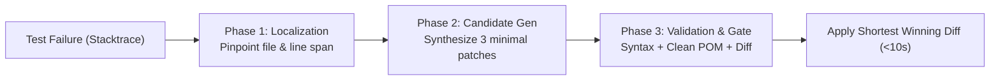

# Agentless QA Repair Skill — Ultra-Low-Token 3-Phase Failure Healing

> **Paradigm Attribution:** Inspired by **UIUC OpenAutoCoder Agentless**.  
> **Core Principle:** The best fix is the smallest working diff without round-trip chat loops. Solve 80% of daily test automation defects with a single-pass 3-stage pipeline under 2,500 tokens.

---

## 1. The 3-Phase Deterministic Pipeline

Rather than spawning multi-turn swarm conversations that cost 40,000–80,000 tokens per failure, `agentless-qa-repair` executes in three deterministic stages:



1. **Phase 1 (Localization):**
   - Parses the stacktrace (Playwright, Jest, JUnit XML, or Python Traceback).
   - Cross-references `tools/repo_map.txt` or repository structure.
   - Restricts focus strictly to the enclosing method and 5–10 line span.

2. **Phase 2 (Parallel Candidate Synthesis):**
   - Candidate 1: Semantic ARIA role locator (`getByRole('button', { name: '...' })`).
   - Candidate 2: Resilient test identifier (`getByTestId('...')`).
   - Candidate 3: Smart wait / network idle synchronization wrapper (`waitForLoadState('networkidle')`).

3. **Phase 3 (Validation & Selection):**
   - Checks AST syntax validity (Python `ast.parse` or JS/TS/Groovy bracket balance).
   - Enforces **Clean POM**: strictly rejects raw XPath / CSS injected into test script files.
   - Selects the shortest valid diff that clears all checks.

---

## 2. CLI Tool Usage

Autonomous trigger via `tools/agentless_patcher.py`:

```bash
# End-to-end 3-stage healing
python tools/agentless_patcher.py heal-failure \
  --error-log reports/failed_run.log \
  --repo-map tools/repo_map.txt \
  --max-candidates 3

# Localize failing line only
python tools/agentless_patcher.py localize-error \
  --error-log reports/failed_run.log

# Generate patch candidates for a specific line
python tools/agentless_patcher.py generate-candidates \
  --file src/pages/CustomerDirectoryPage.ts \
  --line 48
```

---

## 3. Strict Operating Invariants

- **Token Budget Ceiling:** Must stay under **2,500 tokens** per repair cycle.
- **Zero Raw Selectors in Test Scripts:** If the failing file is located in `tests/`, `Scripts/`, or matches `*.spec.ts`, the fix must redirect selector adjustments into the corresponding Page Class extending `BasePage`.
- **Minimal Working Diff:** Always choose the patch with the fewest altered lines that passes verification.
