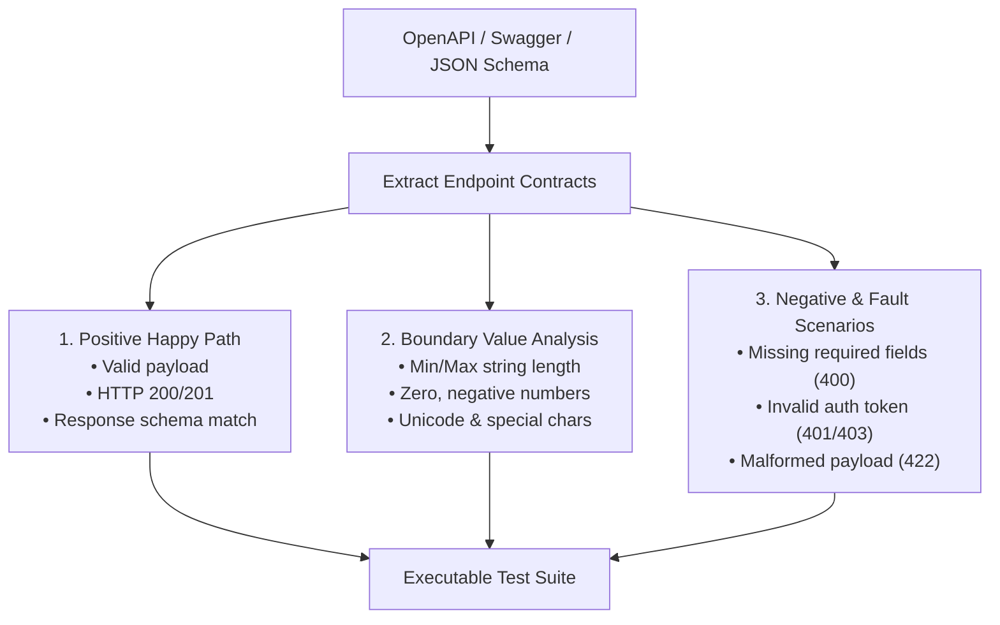

# API Spec to E2E Matrix — Contract-Based Test Generator

This skill converts OpenAPI / Swagger specifications, JSON Schemas, or REST endpoint contracts into a structured, executable End-to-End (E2E) testing matrix covering happy path, boundary values, and negative error scenarios.

---

## 1. Test Generation Matrix Taxonomy

---

## 2. Boundary Value Generation Rules

For every field defined in the endpoint schema, generate targeted edge cases:

| Field Data Type | Schema Constraint | Generated Boundary Test Inputs |
| :--- | :--- | :--- |
| **String (Code / ID)** | `minLength: 3, maxLength: 20` | Empty string `""`, 2 chars, exactly 3 chars, 20 chars, 21 chars, special chars `<script>`, SQL `' OR 1=1--` |
| **Number / Integer** | `minimum: 0, maximum: 1000` | `-1`, `0`, `1`, `999`, `1000`, `1001`, floating point `10.5` |
| **Date / Timestamp** | `format: date-time` | Past date, today, future date, leap year `2024-02-29`, invalid format `31/12/2026` |
| **Enum** | `["ACTIVE", "INACTIVE"]` | Exactly `"ACTIVE"`, lowercase `"active"`, null, undefined, unknown enum `"DELETED"` |
| **Required Properties** | `required: ["code", "name"]` | Omit `code`, omit `name`, send `null` values |

---

## 3. Negative Scenario Validation Checklist

Every negative test case must assert two distinct layers:
1. **API Layer Assertion:**
   - Verify HTTP Status Code is appropriately 400, 401, 403, 404, or 422.
   - Verify error payload contains expected error codes and localization messages.
2. **UI / Toast Notification Layer Assertion:**
   - Verify that the web UI displays the appropriate red toast notification (e.g. *"Dữ liệu không hợp lệ"* or *"Mã đã tồn tại"*).
   - Verify that the form remains open and input fields preserve user state without losing entered data.

---

## 4. Automation Output Standards

- Generated test cases must adhere to the project's **Clean POM** structure.
- All requests should utilize dynamic test data with unique timestamp prefixes to ensure idempotency.

---

## 5. Automated Execution via Tooling

Agent can automatically invoke 	ools/generate_api_matrix.py to produce matrices from Swagger files:

``bash
# Generate Markdown matrix
python tools/generate_api_matrix.py --spec path/to/openapi.json --format md -o docs/api_matrix.md

# Generate JSON matrix for programmatic ingestion
python tools/generate_api_matrix.py --spec path/to/openapi.json --format json -o tools/api_matrix.json
``