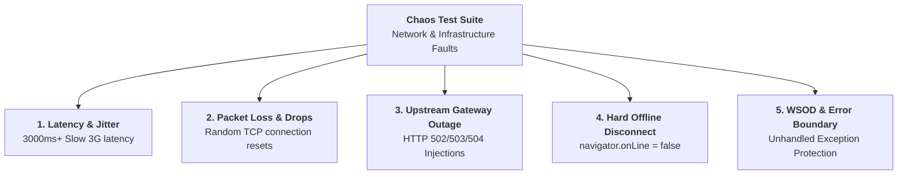

# Chaos & Network Resilience Testing Patterns

> **Purpose:** Master chaos engineering and frontend network degradation testing. Verifies that enterprise web applications gracefully withstand network jitter, packet drops, upstream gateway crashes (502/503/504), and sudden offline events without freezing or presenting the White Screen of Death (WSOD).

---

## 1. Five Resiliency Attack Vectors



| Fault Vector | Injection Technique | Expected Frontend Behavior | Critical Violation |
| :--- | :--- | :--- | :--- |
| **High Latency (3000ms+)** | CDP `Network.emulateNetworkConditions` | Loading skeleton / non-blocking spinner | Frozen UI or repeated duplicate submissions |
| **Packet Loss / Abort** | Playwright `route.abort('connectionreset')` | Friendly retry alert, state retained | App crash or blank screen |
| **Gateway Drop (502/503/504)**| Intercept route returning `status: 503` | Toast alert: "Service busy, please retry" | Unhandled raw JSON dump or page crash |
| **Sudden Offline** | `context.setOffline(true)` | Offline banner, disabled mutation CTAs | White Screen of Death (WSOD) |
| **Rapid Reconnect** | Toggle offline -> online in 5s | Auto-sync state or background retry | Stale unsynchronized state or logout |

---

## 2. Playwright Network Emulation & Jitter Fixtures

### Emulating Extreme Slow Latency & Jitter (CDP)
```typescript
import { test, expect } from '@playwright/test';

test.describe('Chaos: Network Degradation', () => {
  test('graceful degradation under 3500ms latency & jitter', async ({ page }) => {
    // Connect to Chrome DevTools Protocol session
    const client = await page.context().newCDPSession(page);
    await client.send('Network.emulateNetworkConditions', {
      offline: false,
      latency: 3500, // 3.5 seconds roundtrip latency
      downloadThroughput: ((500 * 1024) / 8), // 500 kbps
      uploadThroughput: ((500 * 1024) / 8),
      connectionType: 'cellular3g',
    });

    await page.goto('/orders');

    // Assertion 1: UI must show loading skeleton/indicator during high latency
    const loader = page.locator('.p-progress-spinner, [data-testid="skeleton-loader"]');
    await expect(loader).toBeVisible({ timeout: 2000 });

    // Assertion 2: User cannot click submit twice while request is in-flight
    const submitBtn = page.locator('button[type="submit"]');
    if (await submitBtn.isVisible()) {
      await expect(submitBtn).toBeDisabled();
    }
  });
});
```

---

## 3. Simulating Gateway Faults (502/503/504) & Circuit Breaker

```typescript
test('Chaos: Upstream Gateway 503 triggers retry and friendly notification', async ({ page }) => {
  let attemptCount = 0;

  // Intercept order submission API
  await page.route('**/api/v1/orders/submit', async (route) => {
    attemptCount++;
    if (attemptCount <= 2) {
      // First 2 attempts fail with 503 Service Unavailable
      await route.fulfill({
        status: 503,
        contentType: 'application/json',
        body: JSON.stringify({ message: 'Upstream gateway overloaded' }),
      });
    } else {
      // 3rd attempt succeeds (Circuit Breaker recovery)
      await route.fulfill({
        status: 200,
        contentType: 'application/json',
        body: JSON.stringify({ success: true, orderId: 'ORD_HEALED_99' }),
      });
    }
  });

  await page.goto('/checkout');
  await page.click('[data-testid="btn-confirm-order"]');

  // Assert retry loop or notification displayed
  const toast = page.locator('.p-toast-message, [role="alert"]');
  await expect(toast).toBeVisible({ timeout: 5000 });
  expect(attemptCount, 'Client must retry at least once before failing').toBeGreaterThanOrEqual(1);
});
```

---

## 4. Sudden Offline Disconnection & Reconnect Flow

```typescript
test('Chaos: Sudden offline does not crash UI and displays offline banner', async ({ page, context }) => {
  await page.goto('/dashboard');
  await expect(page.locator('h1')).toBeVisible();

  // 1. Cut network abruptly
  await context.setOffline(true);

  // Trigger an action requiring network
  await page.click('[data-testid="nav-reports"]').catch(() => {});

  // 2. Assert Zero White Screen of Death (WSOD)
  const bodyContent = await page.evaluate(() => document.body.innerText.trim());
  expect(bodyContent.length, 'Page must not be blank').toBeGreaterThan(20);

  // 3. Assert offline indicator or banner appears
  const offlineBanner = page.locator('[data-testid="offline-banner"], .offline-indicator');
  const bannerVisible = await offlineBanner.isVisible().catch(() => false);
  expect(bannerVisible || bodyContent.includes('offline') || bodyContent.includes('kết nối'),
    'App must communicate offline status').toBeTruthy();

  // 4. Restore connectivity and assert recovery
  await context.setOffline(false);
  await page.waitForTimeout(1000);
  await page.reload();
  await expect(page.locator('h1')).toBeVisible();
});
```

---

## 5. Automated White Screen of Death (WSOD) Detector Fixture

Integrate this global listener in E2E fixtures to catch unhandled JavaScript runtime exceptions:

```typescript
page.on('pageerror', (exception) => {
  // Capture unhandled front-end crashes
  throw new Error(`CRITICAL UI CRASH (WSOD): Uncaught browser exception: ${exception.message}`);
});

page.on('console', (msg) => {
  if (msg.type() === 'error' && msg.text().includes('Uncaught (in promise)')) {
    console.warn(`⚠️ Unhandled Promise Rejection detected: ${msg.text()}`);
  }
});
```

---

## 6. Chaos Resilience Checklist
- [ ] Critical forms disable submit buttons during in-flight network transit to prevent double-charging.
- [ ] HTTP 502/503/504 errors trigger user-friendly notifications, never blank screens.
- [ ] Offline status provides visual cues (`navigator.onLine` listener).
- [ ] Application state (form inputs, cart items) is preserved when an API call drops.
- [ ] Reconnection allows immediate re-attempt without forced logout or data loss.
