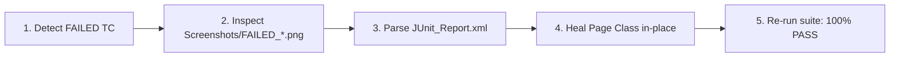

# Failure Autopsy & Auto-Healing (Diagnostic & Self-Healing Engine)

Specialized skill for diagnosing batch test execution failures across 259 Test Cases, performing visual autopsies via `Screenshots/FAILED_*.png`, parsing `JUnit_Report.xml`, and healing Page Classes (`Keywords/dmit/pages/*.groovy`) in place.

---

## 1. Five-Step Enterprise Autopsy Protocol



1. **Zero-Token Triage:** Pinpoint failed line and cause instantly (<50 tokens):
   ```bash
   python3 tools/pinpoint_failure.py
   # or bash .agents/skills/failure-autopsy-and-healing/scripts/triage_failures.sh
   ```
2. **Visual Autopsy:** Inspect the latest error screenshot to immediately detect: disabled buttons, missing required fields, overlapping GIS coordinates, or obscuring modal backdrops.
3. **XML Parsing:** Extract stacktrace and exception messages from `Reports/<Timestamp>/JUnit_Report.xml`.
4. **In-Place Healing:** Update the corresponding Page Class in `Keywords/dmit/pages/`.
5. **Regression Guard:** Verify 100% UTF-8 No BOM and re-run the targeted suite to confirm 100% Pass.

---

## 2. Dynamic Module & Page Class Mapping

| Test Case Range | Functional Module | Target Page Class to Heal |
| :---: | :--- | :--- |
| `TC-1` to `TC-7` | Target Planning | `Keywords/dmit/pages/TargetPlanPage.groovy` |
| `TC-8` to `TC-12` | Authentication & User Profile | `Keywords/dmit/pages/LoginPage.groovy` |
| `TC-13` to `TC-16` | System Administration & Users | `Keywords/dmit/pages/UserAdminPage.groovy` |
| `TC-17` to `TC-28` | Common Categories | `Keywords/dmit/pages/CommonCategoryPage.groovy` |
| `TC-29` to `TC-92` | Industry Categories | `Keywords/dmit/pages/IndustryCategoryPage.groovy` |
| `TC-93` to `TC-122` | Sector Planning | `Keywords/dmit/pages/PlanningPage.groovy` |
| `TC-123` to `TC-247`| Data Mining & GIS Maps | `Keywords/dmit/pages/DataMiningPage.groovy` |
| `TC-248` to `TC-249`| Statistical Reporting | `Keywords/dmit/pages/ReportPage.groovy` |
| `TC-250` to `TC-259`| Data Sharing & API Tokens | `Keywords/dmit/pages/TokenMgmtPage.groovy` |

---

## 3. Reference Documentation

- [**Diagnostic & Healing Matrix (`healing_matrix.md`)**](references/healing_matrix.md): Concrete code prescriptions for disabled buttons, GIS boundary overlaps, `ElementClickInterceptedException`, `StaleElementReferenceException`, and 4 flaky test root causes.
- [**Fast-Fix Triad & Runtime Helper (`tools/dmit_browser_helpers.js`)**](tools/dmit_browser_helpers.js): In-browser diagnosis engine via `window.__dmit` (`audit`, `heal`, `clickSafe`, `gisHUD`).
- **Automated Triage Script:** `python3 tools/pinpoint_failure.py` and `scripts/triage_failures.sh`.
