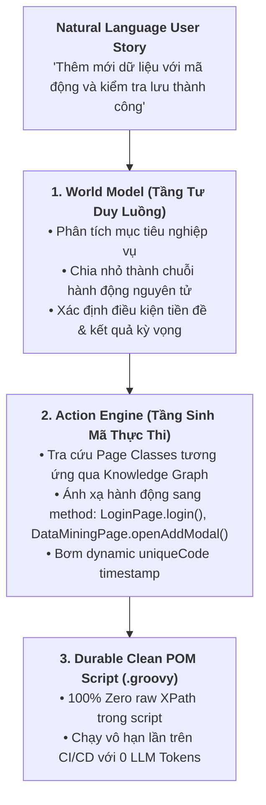

# LAM Script Generator — Large Action Model for Test Automation

Inspired by the **LaVague AI Web Agent & Large Action Model (LAM)** framework, this skill bridges the gap between natural language requirements (User Stories, Acceptance Criteria) and durable, deterministic automation code conforming to Clean POM and Flat Architecture.

---

## 1. The Dual-Engine LAM Architecture



1. **World Model (Tư duy luồng):**
   - Đọc câu lệnh tự nhiên hoặc Acceptance Criteria của QA/BA.
   - Suy luận chuỗi bước tuần tự: `Login` $\rightarrow$ `Navigate to Menu` $\rightarrow$ `Open Add Modal` $\rightarrow$ `Input Dynamic Data` $\rightarrow$ `Save & Assert Toast`.
2. **Action Engine (Sinh mã thực thi):**
   - Không click tạm bợ trên màn hình rồi quên. Action Engine tra cứu Knowledge Graph của dự án để chọn đúng Page Class và method chuẩn đã tồn tại.
   - Sinh ra file script Groovy/Katalon hoàn chỉnh, sạch sẽ, tuân thủ Clean POM.
3. **Zero-Token Replayability (Tái hiện 0 token):**
   - Mã nguồn kiểm thử sau khi được sinh ra và xác minh sẽ được lưu trữ vĩnh viễn trong `Scripts/`.
   - Các lượt chạy sau trên CI/CD, KRE CLI hoàn toàn tự động thực thi mà không tiêu tốn thêm bất kỳ token LLM nào.

---

## 2. Quy Trình Chuyển Đổi Từ User Story Sang Mã Clean POM

### Đầu vào (User Story):
```text
"Kiểm tra chức năng thêm mới dữ liệu ngành Công nghiệp: 
 Đăng nhập hệ thống, mở form thêm mới, nhập mã ngẫu nhiên và tên hợp lệ, bấm Lưu và kiểm tra thông báo thành công."
```

### Xử lý qua LAM Action Engine:
1. **Phân tích thực thể:** Phân hệ = `CommonCategoryPage`, Hành động = `Create`.
2. **Chuẩn bị dữ liệu động:** `String uniqueCode = "AUTO_" + System.currentTimeMillis()`.
3. **Tạo kịch bản Clean POM:**

```groovy
import dmit.pages.LoginPage
import dmit.pages.DataMiningPage

// 1. Đảm bảo trạng thái đăng nhập
LoginPage.ensureLoggedIn()

// 2. Chuẩn bị dữ liệu kiểm thử động chống đụng độ
String uniqueCode = "AUTO_" + System.currentTimeMillis()
String name = "Dữ liệu kiểm thử tự động " + uniqueCode

// 3. Thực thi nghiệp vụ qua Page Object Model
DataMiningPage.goToDataMining()
DataMiningPage.selectLayer("Cụm công nghiệp")
DataMiningPage.drawPolygonOnCanvas()
DataMiningPage.fillDynamicForm("Cụm công nghiệp", uniqueCode, name)
DataMiningPage.confirmAddForm()

// 4. Nghiệm thu kết quả
DataMiningPage.verifyMiningSuccess(uniqueCode)
```

---

## 3. Bộ Công Cụ Hỗ Trợ CLI

Chạy công cụ sinh kịch bản trực tiếp từ dòng lệnh:
```bash
python3 tools/generate_tc_from_story.py --story "Thêm mới cụm công nghiệp Nghệ An" --module "CommonCategory"
```
Mã kiểm thử sinh ra được tự động kiểm tra cú pháp và tuân thủ 100% 6 Cổng Quality Gates (DoD).
