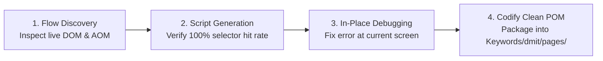

# Playwright Live Interaction & Fast Debugging — DMIT Handbook (259 Test Cases)

Direct in-browser interaction and rapid debugging via **Playwright MCP Tools** (`browser_run_code_unsafe` / `call_mcp_tool`), executing live JavaScript/Playwright commands without rebuilding or restarting test runs.

---

## 1. Scope (100% of 9 Functional Modules / 259 Test Cases)

All live web flows map strictly to the **9 Page Classes + BasePage** in `Keywords/dmit/pages/`:

1. **Target Planning (`TargetPlanPage` — TC-1 to TC-7):** Metric forms, reporting cycles, plan creation.
2. **Authentication & User Profile (`LoginPage` — TC-8 to TC-12):** Login, session check, profile update, logout.
3. **System Administration & Users (`UserAdminPage` — TC-13 to TC-16):** User accounts, roles, departments.
4. **Common Categories (`CommonCategoryPage` — TC-17 to TC-28):** Units, positions, general categories.
5. **Industry Categories (`IndustryCategoryPage` — TC-29 to TC-92):** 16 industry categories, CRUD flows.
6. **Sector Planning & Approvals (`PlanningPage` — TC-93 to TC-122):** 5 planning sectors, dossier workflows.
7. **Data Mining & GIS Maps (`DataMiningPage` — TC-123 to TC-247):** OpenLayers map, coordinates, fluctuation data.
8. **Statistical Reporting (`ReportPage` — TC-248 to TC-249):** Data & license statistics reports.
9. **Data Sharing & API Tokens (`TokenMgmtPage` — TC-250 to TC-259):** Token lifecycle, data sharing.

### 1.1. Cross-Harness Tool Mapping (Portability Matrix)

To ensure skills operate seamlessly across different AI agent environments:

| Action / Intent | Antigravity MCP | Claude Code / Cursor / Standard Playwright MCP | Vanilla Playwright Script |
|---|---|---|---|
| **Run JS in Browser** | `browser_run_code_unsafe` | `browser_evaluate` | `page.evaluate(...)` |
| **Navigate to URL** | `browser_navigate` | `navigate_page` / `page.goto` | `page.goto(url)` |
| **Click Element** | `browser_click` | `click_element` | `page.locator(sel).click()` |
| **Inspect DOM/AOM** | `browser_snapshot` | `get_accessibility_tree` | `page.accessibility.snapshot()` |
| **Wait for State** | `browser_wait_for` | `wait_for_selector` | `page.waitForSelector(...)` |

---

## 2. Three-Stage Fast-Loop Workflow

1. **Flow Discovery:** Probe accessibility tree (`accessibility.snapshot()`) or DOM to extract live URLs, menus, and dialogs in under 2 minutes.
2. **Script Generation:** Test selectors live (`await page.locator(...).count() > 0`). Only codify when the selector hits 100% in 200ms.
3. **In-Place Debugging:** When step $N$ fails, **keep the browser paused at that step**. Use `page.evaluate()` to diagnose disabled buttons, obscuring overlays, or validation errors. Fix in place; never re-run from step 1.

---

## 3. Mapping Matrix (Playwright MCP ↔ Clean POM Groovy)

| UI Action | Playwright Live Code (MCP) | Clean POM Groovy Code (`BasePage` / Page Class) |
|---|---|---|
| **Fill Angular Input** | `await page.locator(sel).fill(val);` | `WebElement el = findElement(By.cssSelector(sel)); jsSetInput(el, val);` |
| **Safe Click / Overlay** | `await page.locator(sel).click();` | `WebElement el = findElement(By.cssSelector(sel)); clickElement(el);` |
| **PrimeNG Dropdown** | `await page.locator('p-dropdown').click(); await page.locator('.p-dropdown-item:has-text("X")').click();` | `selectDropdownByText(dropdownEl, "X")` |
| **PrimeNG Calendar** | Synthetic `input` + `change` event | `jsSetInput(calendarInput, "25/10/2026")` |
| **Catch Success Toast** | `await page.waitForSelector('.p-toast-message-success')` | `verifyMiningSuccess("thành công")` or `verifyToastMessage("Thành công")` |
| **Two-Phase Search** | Click search icon -> Enter Keyword -> Enter | `searchRecord(keyword)` in Page Class |
| **Delete & Confirm** | Click Trash -> Accept Confirm -> Verify Gone | `deleteRecord(keyword)` in Page Class |

---

## 4. Pre-Codify Quality Checklist

Mandatory 5-point verification before committing Groovy POM code:
- [x] **100% UTF-8 No BOM:** Must NOT contain `0xEF, 0xBB, 0xBF`.
- [x] **Flat Architecture:** Zero raw XPaths or `findTestObject` in test scripts.
- [x] **Dynamic Test Data:** Use `BasePage.uniqueCode("PREFIX_")`; no static strings.
- [x] **Truth Anchor (No Fake Pass):** Real toast assertions or live `p-table` row verification.
- [x] **Angular Synthetic Events:** 100% inputs use `jsSetInput` triggering synthetic `input` and `change` events.

---

## 5. Reference Documentation (Progressive Disclosure)

- [**20 Complete UI Recipes**](references/recipes.md): Code recipes for Auth, `p-table`, Dropdowns, Modals, Confirm Dialogs, Excel Upload, OpenLayers GIS/VN2000, Calendar, MultiSelect, Stale Retries, Form Audit, Smart Action Batching, Runtime Helper `window.__dmit`, Self-Healing Locators, and GIS Canvas HUD.
- [**Runtime Browser Helper (`tools/dmit_browser_helpers.js`)**](tools/dmit_browser_helpers.js): Unified JavaScript module providing `window.__dmit` (`batch`, `audit`, `heal`, `clickSafe`, `gisHUD`, `exportSession`).
- [**5 Superpowers & 5 AI Paradigms**](references/advanced_superpowers.md): Zero-Second Auth (`session.json`), Direct API Seeding, AOM Snapshots, Multi-Context Dual Role, Route Mocking, Self-Healing Locators, Fuzzing, CDP Profiling.
- [**Multi-Agent Swarm Orchestration**](references/swarm_orchestration.md): Specialized swarm roles and collaboration protocol.
