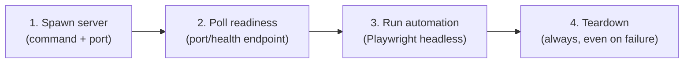

# Playwright Webapp Testing — Enterprise Server-Lifecycle Standard

Specialized skill for testing local dynamic web applications with Playwright under Synapse Hub rules: managed server lifecycle, smart waits instead of static sleeps, and the 3-Stage Live Protocol for selector discovery.

---

## 1. Server Lifecycle Contract



- **Rule:** the automation script contains ONLY Playwright logic. Server spawn, readiness polling, and teardown are handled by the lifecycle wrapper so the browser never races the server.
- Single server: launch the app command, poll its port until ready, then run the suite.
- Multiple servers (backend + frontend): every server gets its own readiness poll; the suite starts only after ALL are ready.
- Teardown is unconditional — a failed test run must still shut down spawned processes (driver/process cleanup mirrors `katalon-cli-runner` discipline).

## 2. Standard Configuration (Hub Baseline)

- **Headless mode, 1920x1080 Full HD viewport** — mandatory per `AGENTS.md` Section 2.
- Chromium first; multi-browser coverage is governed by `e2e-testing-patterns`.
- Launch pattern:

```python
from playwright.sync_api import sync_playwright

with sync_playwright() as p:
    browser = p.chromium.launch(headless=True)  # always headless
    page = browser.new_page(viewport={"width": 1920, "height": 1080})
    page.goto("http://localhost:5173")
    page.wait_for_load_state("networkidle")  # CRITICAL: wait for JS to execute
    # automation logic using discovered selectors
    browser.close()
```

## 3. Decision Tree: Static vs Dynamic

```
Task -> Is the page static HTML?
  |- Yes -> Read the HTML directly to identify selectors, then script.
  |- No (dynamic webapp) -> Is the server already running?
      |- No -> Apply the full lifecycle contract (section 1), then script.
      |- Yes -> Reconnaissance-then-action (section 4) on the live app.
```

## 4. Reconnaissance-Then-Action Pattern

For a dynamic app, never guess selectors:

1. Navigate and wait for `networkidle`.
2. Inspect the rendered state: screenshot or DOM snapshot (`browser_helpers.js` in-browser validation engine for form audits and safe clicks).
3. Identify selectors from the rendered state using the 6-Tier locator priority from `clean-pom-crafter` (ARIA/test-id first).
4. Execute actions with discovered, verified selectors.

**Common pitfall:** inspecting the DOM before `networkidle` on dynamic apps. The wait comes first, inspection second — always.

## 5. Smart Wait Rules (Zero Static Sleeps)

- FORBIDDEN: `time.sleep()`, `Thread.sleep()`, fixed `wait_for_timeout` as a synchronization strategy (per `AGENTS.md` Section 1).
- Required: `wait_for_load_state("networkidle")`, `wait_for_selector`, `expect` web-first assertions with auto-retry, or explicit condition polling.
- `wait_for_timeout` is tolerated only inside after-step settle windows where no condition is observable, and must carry a comment explaining why.

## 6. Evidence & Debugging Rules

- Capture console logs and failed-request events during runs; attach the distilled failure block to reports, not full logs (distill via `tools/distill_log.py`).
- On failure: apply `systematic-debugging` — reproduce, isolate, root-cause — before touching selectors; broken locators heal via `self-healing-locator` with a live re-probe through Stage 1 of the Live Protocol.
- Claims of "suite passes" follow `verification-before-completion`: quote the fresh run output.

## 7. Boundary vs Sibling Skills (Do Not Confuse)

| Sibling | Owns | Hand-off |
|---|---|---|
| `playwright-live-interaction` | Stage 1 DOM/AOM probing and 200ms selector verification | This skill consumes verified selector contracts for full app test runs |
| `e2e-testing-patterns` | Multi-browser architecture, sharding, retry governance | This skill owns the single-run server lifecycle; suite topology stays with e2e patterns |
| `auth-session-and-cookie-manager` | Login states, storageState, multi-role sessions | Complex auth flows inject their storageState before this skill's run starts |

## 8. Reference Documentation

- [Server lifecycle example (`server_lifecycle_playwright.py`)](examples/server_lifecycle_playwright.py): readiness-polling wrapper + minimal automation script.
- `tools/browser_helpers.js` — in-browser validation engine (safe clicks, form audits, batch verification).
- `tools/distill_log.py` — distill verbose run logs by ~95% before attaching to reports.

## 9. Attribution

Adapted from **webapp-testing** in anthropics/skills (https://github.com/anthropics/skills) — Apache License 2.0, Copyright 2026 Anthropic, PBC. The server-lifecycle contract, decision tree, and reconnaissance-then-action pattern are re-scoped to Synapse Hub standards (headless 1920x1080, smart waits, hub tool wiring); this is a rewritten derivative, not a verbatim copy.
