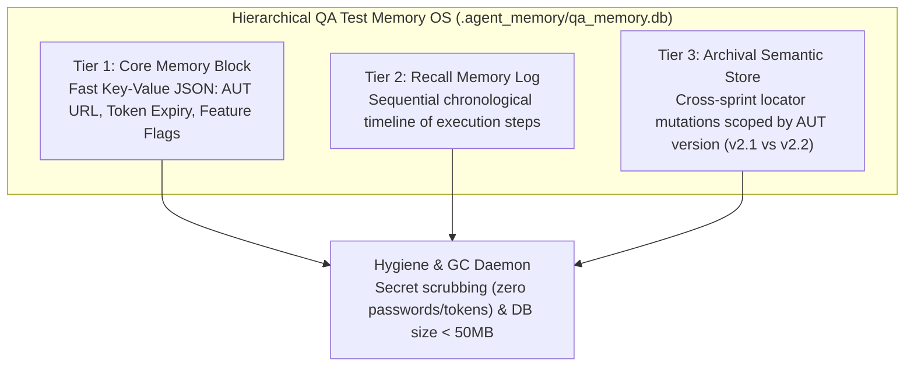

# QA Test Memory OS Skill — Hierarchical Persistent Memory

> **Paradigm Attribution:** Inspired by **Letta AI / UC Berkeley SkyLab (MemGPT & MemFS)**.  
> **Core Principle:** Replace flat SQLite caches with a disciplined 3-tier memory operating system. Eliminate memory rot across application versions by tagging locator mutations and flaky histories with explicit AUT release versions.

---

## 1. The 3-Tier Architecture



1. **Tier 1 — Core Memory (`core_memory`):**
   - Immediate in-context state: active auth tokens, storage state path, AUT base URL.
   - Enables **Zero-Second Auth**: reuse active tokens without repeating UI login forms.

2. **Tier 2 — Recall Memory (`recall_memory`):**
   - Sequential audit log of subagent actions, navigation events, and errors.
   - Rotates or prunes records older than 30 days to save disk space.

3. **Tier 3 — Archival Memory (`archival_memory`):**
   - Permanent knowledge base of healed locators and historical flaky failure patterns.
   - **AUT Version Scoping (`aut_version`):** Queries can filter by release (e.g. `aut_version="v2.1"`). When the web app upgrades to `v2.2`, obsolete `v2.1` mutations are ignored, completely eliminating false cache hits (Memory Rot).

---

## 2. CLI Tool Usage

Autonomous commands via `tools/test_memory_os.py`:

```bash
# 1. Initialize memory OS database
python tools/test_memory_os.py init --db-path .agent_memory/qa_memory.db

# 2. Update active session state in Core Memory
python tools/test_memory_os.py update-core \
  --block auth_state \
  --data '{"token_expiry": "2026-11-05T00:00:00Z", "storage_state": "storage_state.json"}'

# 3. Store locator mutation in Archival Memory scoped by version
python tools/test_memory_os.py archival-insert \
  --key LOCATOR_MUTATION \
  --payload '{"page": "CheckoutPage", "old": "#submit-btn", "new": "button[data-testid=submit]"}' \
  --aut-version "v2.1" \
  --tags "checkout,submit,button"

# 4. Search archival memory with semantic token matching
python tools/test_memory_os.py archival-search \
  --query "Checkout submit button locator history" \
  --aut-version "v2.1" \
  --top-k 3 \
  --json

# 5. Run garbage collection and secret scrubbing
python tools/test_memory_os.py gc --scrub-secrets --max-age-days 30
```

---

## 3. Strict Operating Invariants

- **Zero Plaintext Secrets:** Automatic regex masking for passwords, bearer tokens, and private keys (`[MASKED_SECRET]`).
- **Memory File Ceiling:** DB size strictly maintained under **50MB**.
- **Version Isolation:** Never apply archival locator patches across different incompatible AUT major versions.
