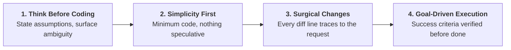

# Surgical Coding Principles — Enterprise Minimal-Diff Discipline

Specialized skill for reducing the three classic LLM coding failure modes — silent assumptions, over-engineering, and out-of-scope edits — across Page Classes, test scripts, and `tools/*.py` maintenance.

---

## 1. The Four Principles

**Tradeoff:** these principles bias toward caution over speed. For trivial, single-line fixes, apply judgment and do not ritualize.

## 2. Principle 1: Think Before Coding

- **Rule:** Do not assume; do not hide confusion. Before implementing, state assumptions explicitly and ask when uncertain.
- **Enforcement:**
  - If multiple interpretations of the request exist, present them — never pick silently.
  - If a simpler approach exists, say so before writing code; push back when warranted.
  - If something is unclear, stop, name what is confusing, and ask. Proceeding on a guess converts one clarification into one full rework cycle.

## 3. Principle 2: Simplicity First

- **Rule:** Write the minimum code that solves the stated problem. Nothing speculative.
- **Forbidden:** features beyond what was asked; abstractions for single-use code; "flexibility" or configurability that was not requested; error handling for impossible scenarios.
- **Self-test:** if 200 lines were written and 50 would do, rewrite. Ask: "Would a senior engineer call this overcomplicated?" If yes, simplify before continuing.

## 4. Principle 3: Surgical Changes

- **Rule:** Touch only what the request requires. Clean up only the mess your own change created.
- **When editing existing code (Page Classes, test scripts, hub tools):**
  - Do not "improve" adjacent code, comments, or formatting.
  - Do not refactor what is not broken; match the existing style even if you would write it differently.
  - If unrelated dead code is noticed, mention it in the report — do not delete it.
- **Orphan rule:** remove imports, variables, or functions that YOUR change made unused; leave pre-existing dead code untouched unless asked.
- **The test:** every changed line must trace directly to the user's request.

## 5. Principle 4: Goal-Driven Execution

- **Rule:** Transform every task into a verifiable goal with explicit success criteria, then loop until verified.
- **Rewrites:** "add validation" becomes "write tests for invalid inputs, then make them pass"; "fix the bug" becomes "write a test that reproduces it, then make it pass" (pair with `test-driven-development`).
- **Multi-step tasks** state a plan where every step carries its own verify action:

| Step | Verify |
|---|---|
| 1. Modify the Page Class method | Selector verified live under 200ms (`playwright-live-interaction`) |
| 2. Update the calling scripts | Affected TCs pass via `tools/test_impact.py` subset |
| 3. Hub tool change | `python3 tools/verify_all.py --mode hub` reports 9/9 gates |

Strong success criteria allow independent looping; weak criteria ("make it work") force constant clarification.

## 6. Pre-Diff Self-Check

Before handing back any change, verify all boxes:

- [ ] Assumptions were stated before implementation started
- [ ] No speculative abstraction, option, or config was introduced
- [ ] Every changed line traces to the request
- [ ] Orphans created by this change were removed; pre-existing dead code was left alone
- [ ] Success criteria were defined up front and verified with real command output

These principles are working if diffs shrink, rewrites due to overcomplication disappear, and clarifying questions arrive before implementation instead of after mistakes.

## 7. Boundary vs Sibling Skills (Do Not Confuse)

| Sibling | Owns | Hand-off |
|---|---|---|
| `clean-pom-crafter` | Page Class architecture, locator tiers | This skill governs HOW the change is made, not WHAT the POM looks like |
| `code-refactoring-refactor-clean` | Deliberate debt-elimination refactors | A refactor task still obeys surgical scope: diff lines trace to the refactor request |
| `lean-code-ladder` | The 7-rung reuse-first decision ladder | Use the ladder to choose the solution; use this skill to keep the diff disciplined |

## 8. Reference Documentation

- `python3 tools/verify_all.py --mode hub` — 9 Quality Gates as the verification anchor for Goal-Driven Execution.
- `python3 tools/test_impact.py --git-diff` — scope the blast radius of a change before editing.
- `python3 tools/infer_linter.py` — confirm no fake-pass assertions were introduced by the change.

## 9. Attribution

Adapted from **andrej-karpathy-skills** (https://github.com/multica-ai/andrej-karpathy-skills) — MIT License (declared in repository `plugin.json`), by forrestchang, derived from Andrej Karpathy's published observations on LLM coding pitfalls. Principles re-scoped for enterprise QA automation in Synapse Hub; wording, structure, and examples modified.
