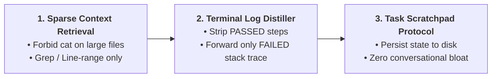

# Token & Context Optimizer — Antigravity Engineering Standard

This skill establishes mandatory token optimization protocols for AI Agents interacting directly with the filesystem and terminal in large test automation codebases.

---

## 1. The Three Optimization Protocols



---

## 2. Protocol 1: Sparse Context Retrieval

- **Rule:** Never read entire source files exceeding 150 lines into active context.
- **Enforcement:**
  - Prohibit commands like `cat`, `type`, or unbounded `read_file` on large Page Classes (e.g. `DataMiningPage.groovy`).
  - Use regex search (`grep -n`, `ripgrep`) to pinpoint line numbers.
  - Read strictly the targeted 20–50 lines using `StartLine` and `EndLine` parameters.

---

## 3. Protocol 2: Terminal Log Distiller

- **Rule:** Never dump unparsed execution logs (KRE CLI, Playwright stdout, Gradle) into the active conversation.
- **Enforcement:**
  - Automatically filter out passing step messages, INFO logs, and JVM loading notices.
  - Forward strictly the distilled failure block:
    ```text
    [FAILED] TC-xxx at Line <LineNumber>
    Exception: <ExceptionName> (<Message>)
    [Full raw log saved to file://<path>; verbose lines omitted]
    ```

---

## 4. Protocol 3: Task Scratchpad Protocol (Off-Context Memory)

- **Rule:** Do not accumulate large session state, test case inventories, or defect logs inside conversational prompt turns.
- **Enforcement:**
  - Persist ephemeral task tracking and defect registers to disk in structured markdown files (e.g. `PROJECT_STATE.md` or `KNOWN_ISSUES.md`).
  - Update disk state incrementally, keeping prompt turns short, focused, and KV-cache friendly.
