# 🧠 Synapse Hub — AI Test Quality Linter & Guardrails

*The Test Quality Linter & Guardrails for the Era of AI-Generated Code*

[🇻🇳 Tiếng Việt](README.md) | [🇬🇧 English Edition](README.en.md)

> **Core Mission:** A standalone linter and guardrail engine (zero external dependencies for core engine & DoD gates) safeguarding automated test suites when AI writes code — Automatically catching "fake-pass" tests (0 assertions, tautologies), eliminating fixed sleeps, compressing 95% of CI/CD log noise, enforcing 15-tier token optimization, and guarding Clean POM architecture.  
> **Author:** Thế Vị ([@TeeVee98](https://github.com/TeeVee98)) | **License:** [MIT License](LICENSE)  
> **Version:** `v4.10.0` | **Scale:** 57 Standardized QA Skills, 15 AI Agent Roles (9 Personas + 6 Specialists), 11 DoD Quality Gates, 153 CLI Commands (166 Tools), 2,512 Tests.

[](https://www.npmjs.com/package/@teevee98/synapse-hub)
[](https://github.com/TeeVee98/Synapse-Hub/actions/workflows/ci_quality_gates.yml)
[](https://nodejs.org)
[](https://python.org)
[](docs/QUALITY_GATES.en.md)
[](LICENSE)
[](https://marketplace.visualstudio.com/items?itemName=Teevee98.synapse-hub-vscode)
[](docs/CLIENT_SUPPORT_MATRIX.md)

## 📑 Table of Contents & Prerequisites

- **Quick Navigation:** [Problem Solved](#-what-problem-does-synapse-hub-solve) • [3-Minute Quickstart](#-quickstart-in-3-minutes-by-persona-universal-onboarding-) • [Daily Core CLI](#-daily-core-cli-commands) • [11 DoD Quality Gates](#-the-11-definition-of-done-dod-quality-gates) • [CI/CD Integration](#-cicd--pre-commit-integration) • [Quick Troubleshooting](#-quick-troubleshooting) • [Docs & Governance](#-deep-technical-documentation--governance-diátaxis)
- **Prerequisites:** `Python >= 3.10` (required core runtime), `Node.js >= 18.0.0` (for `npx` / `npm` launcher), and `Git`. Verify your environment with `npx @teevee98/synapse-hub doctor`.

---

## 💡 What Problem Does Synapse Hub Solve?

When software engineers and QA teams use AI coding assistants (Cursor, Copilot, Claude Code, Antigravity) to write automated tests, AI often produces fragile code patterns:

| When AI Writes Tests Without Guardrails | When Protected by Synapse Hub 🛡️ |
| :--- | :--- |
| ❌ **"Fake-Pass" Tests:** Green checkmark, but contains **0 assertions** — verifies nothing. | ✅ **Detected in 0.1s:** Flags empty tests and requires concrete assertions. |
| ❌ **Hardcoded Sleeps:** Spams `sleep(5000)` indiscriminately, causing flaky CI builds. | ✅ **Smart Waits Enforced:** Flags hardcoded delays and guides dynamic wait adoption. |
| ❌ **AI Context Overflow:** 20,000-line CI logs overwhelm LLM context windows. | ✅ **95% Log Noise Distilled:** Isolates exact failing stacktraces in ~30 lines. |
| ❌ **Security Leaks:** Accidental commits containing plaintext tokens or passwords. | ✅ **Gate 6 Sentinel:** Detects and blocks hardcoded secrets before commit. |

```mermaid
flowchart LR
    subgraph Inputs["1. Initial Test Generation"]
        AI["👨‍💻 <b>Developers / QA using AI</b><br/><i>(Cursor, Claude Code, Antigravity, Copilot)</i>"]
        -->|Generates unverified tests| Raw["📄 <b>Raw Automated Test Scripts</b><br/><i>(Playwright, Pytest, Cypress, Katalon)</i>"]
    end

    subgraph Hub["🛡️ Synapse Hub — AST Linter & 11 DoD Quality Gates"]
        direction LR
        Linter["🔍 <b>Static AST Sentinel</b><br/>• Catches 0-assert fake passes<br/>• Eliminates flaky static sleeps<br/>• Blocks swallowed exceptions"]
        --> CleanPOM["🏛️ <b>Clean POM Guard</b><br/>• Forbids raw XPath/CSS in scripts<br/>• 100% encapsulated in BasePage<br/>• Enforces Flat Architecture"]
        --> Mutator["🧬 <b>Micro-Mutation</b><br/>• Injects syntactic logic faults<br/>• Enforces Kill Score &gt;= 80%<br/>• Eliminates weak assertions"]
        --> Security["🔒 <b>Security, Token & License</b><br/>• Blocks plaintext secrets/tokens<br/>• Enforces 15-tier token architecture<br/>• Preserves MIT @TeeVee98"]
    end

    subgraph Outputs["3. Verified Deliverables"]
        direction TB
        Pass["✅ <b>Production-Ready Test Suite</b><br/><i>(Approved for PR Merge & Green CI/CD)</i>"]
        Distill["⚡ <b>95% Log Noise Distillation</b><br/><i>(distill_log: pinpoints root cause in ~30 lines)</i>"]
        Reject["❌ <b>Hard Block Unreliable Tests</b><br/><i>(Triggers autonomous Reflexion K=3 self-healing)</i>"]
    end

    Raw ==>|Ingest for verification| Linter
    Security ==>|Passed 11/11 DoD Gates| Pass
    Security -.->|On CI Test Failure| Distill
    Security -.->|Quality Violation| Reject

    classDef passClass fill:#1b4725,stroke:#2ea043,stroke-width:2px;
    classDef rejectClass fill:#4c1d1d,stroke:#da3633,stroke-width:2px;
    classDef distillClass fill:#3b2d12,stroke:#d29922,stroke-width:2px;
    class Pass passClass;
    class Reject rejectClass;
    class Distill distillClass;
```



---

## ⚡ Quickstart in 3 Minutes by Persona (Universal Onboarding 🚀)

You **never need to memorize 57 skills** or 166 internal tools. For a 1-page team cheat sheet, open **[⚡ 1-Page QC Team Quickstart](docs/QC_QUICKSTART.en.md)** — or choose the path tailored to your role:

### 👔 1. Manual QA & QC (Zero-Code)
> *Goal: Design test cases, verify business requirements, export 12-column Enterprise Excel spreadsheets, and transpile manual test cases into Clean POM automation code without writing code.*
* **Step 1:** Install the [VS Code Extension](https://marketplace.visualstudio.com/items?itemName=Teevee98.synapse-hub-vscode) in 1 click from Visual Studio Marketplace (or download the offline `.vsix` bundle from [GitHub Releases](https://github.com/TeeVee98/Synapse-Hub/releases/latest)), or run `npx @teevee98/synapse-hub ui` to open Local Web Studio.
* **Step 2:** Open the **QA Sentinel Toolkit** in the VS Code Activity Bar.
* **Step 3:** Click **Export Excel Template** to generate enterprise-ready test case templates.
* **Step 4:** Automatically transpile manual Markdown test cases into Clean POM Playwright specs:
  ```bash
  npx @teevee98/synapse-hub scaffold-tc testcase.md --out tests/e2e/
  ```

### 🎓 2. Junior Automation & Students (Playwright, Pytest)
> *Goal: Scaffold a production-grade Clean POM project in 5 seconds, catch fake passes, and auto-fix static sleeps.*
```bash
# 1. Scaffold a fresh test suite with the beginner-friendly Starter profile:
npx @teevee98/synapse-hub new my-tests --template playwright --profile starter

# 2. Navigate and scan for fake passes / static sleeps immediately:
cd my-tests && npx @teevee98/synapse-hub lint

# 3. Auto-fix common test defects (hard sleep, unawaited expect, swallowed catch):
npx @teevee98/synapse-hub fix

# 4. Launch interactive Local Web Studio or export offline HTML scorecard:
npx @teevee98/synapse-hub ui
# or: npx @teevee98/synapse-hub lint --html
```

### 🛡️ 3. Tech Lead & CI/CD Architect
> *Goal: Wire 11 DoD Quality Gates into GitHub Actions/GitLab CI, prevent token leaks, and enforce test integrity.*
```bash
# 1. Environment & prerequisite health check:
npx @teevee98/synapse-hub doctor

# 2. Initialize configuration for an existing repository (Standard or Enterprise profile):
npx @teevee98/synapse-hub init --profile standard

# 3. Attach automated zero-leakage pre-push guard:
npx @teevee98/synapse-hub setup --target .

# 4. Execute comprehensive 11 DoD Quality Gates verification:
npx @teevee98/synapse-hub verify
```

> 💡 **Verified Installation Channels (Node.js CLI & Python GitHub Source):**  
> - **Node.js / NPX (`npx @teevee98/synapse-hub` or `npm install -g @teevee98/synapse-hub`):** Recommended — ships the full Hub distribution (57 skills, `examples/`, templates, and IDE bridges), dispatching 153 allowlisted commands through `bin/agent-qa.js` to Python 3.10+.  
> - **Python from GitHub (`pip install git+https://github.com/TeeVee98/Synapse-Hub.git`):** Installs the pure-Python core CLI & SDK (`synapse` / `synapse-hub` / `agent-qa`) directly from GitHub source with optional extras (`[excel,vision,treesitter,ai-optimizer,all]`) without requiring Node.js. Release artifacts are published on [GitHub Releases](https://github.com/TeeVee98/Synapse-Hub/releases/latest).
>
> 📦 **Enterprise Reference Test Suites:** Inspect working sample projects adhering to Clean POM & Guardrails in [`examples/`](examples/):  
> [🎭 Playwright TS](examples/playwright-crm-suite) • [🌲 Cypress E2E](examples/cypress-ecommerce-suite) • [🐍 Pytest API](examples/pytest-api-suite) • [☕ Katalon Studio](examples/katalon-suite) • [🌐 Selenium Java](examples/selenium-suite) • [📱 Mobile Appium](examples/mobile-crm-suite) • [⚡ Perf k6/Locust](examples/perf-backend-suite)

---

## 🛠️ Daily Core CLI Commands

```bash
# Catch fake-passes, hard sleeps, and swallowed exceptions (Polyglot TS/JS, Python, Groovy):
synapse-hub lint ./tests

# Run the comprehensive 11 Quality Gates Definition of Done (DoD) suite:
synapse-hub verify

# Generate an actionable executive project health report (PROJECT_HEALTH_REPORT.md):
synapse-hub analyze

# Distill 95% of CI log noise down to the true root cause and stacktrace:
synapse-hub distill path/to/ci.log

# Export User Stories into standard 12-column Excel sheets with P x I risk matrices:
synapse-hub export-excel

# Measure test assertion sensitivity via micro-mutation testing (~0.1s):
synapse-hub mutate ./tests

# Audit AI docs/relative links, scan skills/security, and launch the stdio MCP Server:
synapse-hub lint-docs
synapse-hub skillspector
synapse-hub mcp-serve
```

> 🤖 **Agentic Verification Workflows (`/solo` & `/super-plan`):** Execute the single-agent Red QA → Blue Dev → Purple Auditor loop with live mutation testing (`>= 80%`) via `python3 tools/orchestration/solo_runner.py` and spec-driven DAG planning via `python3 tools/design/super_plan_engine.py`.

---

## 🛡️ The 11 Definition-of-Done (DoD) Quality Gates

Every test code change must satisfy all 11 Quality Gates before pull request merge:

- **Gate 1:** UTF-8 No BOM Clean Encoding (Zero corrupting BOM bytes)
- **Gate 2:** Path Portability (Zero hardcoded machine-specific absolute paths)
- **Gate 3:** Clean POM Flat Architecture (Zero locators inside test scripts)
- **Gate 4:** AI Docs Anti-Drift & Link Integrity (Zero hallucinated PageClasses or broken relative links)
- **Gate 5:** Temporary File Blacklist (Zero scratch files or binary dumps)
- **Gate 6:** Credential Security Sentinel (Zero plaintext secrets or API keys)
- **Gate 7:** Static Defect & Fake-Pass Sentinel (Zero 0-assert tests, zero sleeps)
- **Gate 8:** Assertion Sensitivity Sentinel (Syntactic Mutation Score $\ge 80\%$)
- **Gate 9:** Skill Routing & Collision Guard (Trigger similarity $< 0.75$)
- **Gate 10:** Performance & SLA Sentinel (P95 $\le$ 500ms, Error Rate $\le$ 1.0%)
- **Gate 11:** 15-Tier Token Reduction Architecture Sentinel (KV-Cache Immutability, AST Slicer, TOON, CodeAct, Neuro-Symbolic)

*(The engine features a built-in silent Pre-flight Integrity Guard preserving author provenance for Thế Vị @TeeVee98 & MIT license compliance. For detailed gate specifications, see [docs/QUALITY_GATES.en.md](docs/QUALITY_GATES.en.md)).*

---

## 🔄 CI/CD & Pre-commit Integration

```yaml
# GitHub Actions (.github/workflows/verify.yml):
- name: Run Synapse Hub Quality Gates
  uses: TeeVee98/Synapse-Hub@v4.10.0
  with:
    mode: 'target'

# Or run directly on any CI provider (GitLab CI, Bitbucket, Jenkins):
- name: Run Synapse Hub Quality Gates
  run: npx @teevee98/synapse-hub verify
```

```yaml
# Pre-commit hook (.pre-commit-config.yaml):
repos:
  - repo: https://github.com/TeeVee98/Synapse-Hub
    rev: v4.10.0
    hooks:
      - id: synapse-lint
      - id: synapse-verify
```

---

## 🔧 Quick Troubleshooting

- **Python >= 3.10 missing or PATH mismatch with `npx`:** Run `npx @teevee98/synapse-hub doctor` to diagnose Python, Node.js, Git, and browser binaries.
- **Gate 1 (UTF-8 BOM) or Windows console encoding failures:** Run `synapse-hub fix` or configure your editor for UTF-8 without BOM (`PYTHONIOENCODING=utf-8`).
- **Gate 4 documentation or path drift errors:** Run `synapse-hub lint-docs` to locate the exact Markdown file and line referencing a missing artifact.

---

## 📚 Deep Technical Documentation & Governance (Diátaxis)

| Diátaxis Quadrant | Documentation | Purpose |
| :--- | :--- | :--- |
| **How-To Guides** | [🚀 CI/CD Playbook](docs/CI_CD_INTEGRATION.en.md) • [🔌 MCP Server Setup](docs/MCP_SETUP.en.md) | Configure GitHub Actions/GitLab CI and wire MCP into Cursor, Claude, and Antigravity |
| **Reference** | [📖 CLI Reference](docs/CLI_REFERENCE.en.md) • [🛡️ 11 DoD Quality Gates](docs/QUALITY_GATES.en.md) • [🧩 Client Support Matrix](docs/CLIENT_SUPPORT_MATRIX.md) | Look up 153 CLI subcommands, Gate 1–11 rules, and AI IDE integration support |
| **Explanation** | [🏛️ Architecture & Benchmarks](docs/ARCHITECTURE.en.md) • [📜 Release Changelog](CHANGELOG.md) | Understand system internals, Clean POM design, and release history |
| **Governance** | [🤝 Contributing Guide](docs/CONTRIBUTING.en.md) • [🔒 Security Policy](SECURITY.md) • [⚖️ Code of Conduct](.github/CODE_OF_CONDUCT.md) | PR workflow, vulnerability disclosure, and community standards |

---

## 🙏 Credits & Acknowledgments

Synapse Hub stands on the shoulders of giants and is deeply inspired by the global open-source community, particularly within the Agentic AI and Claude Code ecosystems:

- **Thinking Principles & Lean Code:** [Andrej Karpathy](https://github.com/multica-ai/andrej-karpathy-skills) (Think Before Coding, Simplicity First), [Dietrich Gebert / Ponytail](https://github.com/DietrichGebert/ponytail) (7-Rung Reuse Ladder, Lazy Senior Review).
- **Engineering Rigor & Methodologies:** [Jesse Vincent / Superpowers](https://github.com/obra/superpowers) (Iron Laws, TDD, Systematic Debugging, Worktree Isolation), [Ahmad Adi / Planning-with-Files](https://github.com/OthmanAdi/planning-with-files) (Durable 3-File Planning & Completion Gate).
- **Systems & Multi-Agent Swarms:** [Garry Tan / GStack](https://github.com/garrytan/gstack) (Runaway Stopper Sentinel, Pure Headless Invariant), [Seth Hobson / Agents](https://github.com/wshobson/agents) (Agent Personas), [Bloop AI / Vibe-Kanban](https://github.com/BloopAI/vibe-kanban) (Agent Worktree Coordination).
- **Memory, AST & Code Intelligence:** [Graphify](https://github.com/Graphify-Labs/graphify) (Knowledge Graph & Groovy AST), [Colby McHenry / Codegraph](https://github.com/colbymchenry/codegraph) (Local MCP Code Knowledge Graph), [thedotmack / Claude-Mem](https://github.com/thedotmack/claude-mem) (Hierarchical Memory OS).
- **Token Optimization & Environment Management:** [Julius Brussee / Caveman](https://github.com/JuliusBrussee/caveman) (Terse Token Compression), [Jarrod Watts / Claude-HUD](https://github.com/jarrodwatts/claude-hud) (Statusline Telemetry HUD), [Kazuki Yamada / Repomix](https://github.com/yamadashy/repomix) (Repo Packaging & Token Estimation), [farion1231 / CC-Switch](https://github.com/farion1231/cc-switch) (Centralized Multi-Provider & Skill Sync), [musistudio / Claude-Code-Router](https://github.com/musistudio/claude-code-router) (Local Model Router Gateway).
- **Visual Testing & Design Intelligence:** [NextLevelBuilder / UI-UX-Pro-Max](https://github.com/nextlevelbuilder/ui-ux-pro-max-skill) (BM25 Design Intelligence), [Leonxlnx / Taste-Skill](https://github.com/Leonxlnx/taste-skill) (Mechanical Finish Gate), [Hassan El Mghari / Hallmark](https://github.com/Nutlope/hallmark) (Anti-Slop Linting), [Cathryn Lavery / Diagram-Design](https://github.com/cathrynlavery/diagram-design) (Self-contained Diagram Architecture).
- **Platforms & Standards:** [Anthropic](https://github.com/anthropics/skills) (Agent Skills Standard & Webapp Testing), [Microsoft Playwright](https://github.com/microsoft/playwright-mcp) (Playwright MCP Contract), [GitHub](https://github.com/github/github-mcp-server) (GitHub MCP Server), [Firecrawl](https://github.com/firecrawl/firecrawl) (Web Data Extraction API), [NVIDIA SkillSpector](https://github.com/NVIDIA/SkillSpector) (Security Taxonomy).

*Full legal attribution notices, licenses, and comprehensive citations are maintained in [NOTICE](NOTICE) and [docs/adopted-ecosystem-tools.md](docs/adopted-ecosystem-tools.md).*
