# 🧠 Synapse Hub — AI Test Quality Linter & Guardrails

### *The Test Quality Linter & Guardrails for the Era of AI-Generated Code*

[🇻🇳 Tiếng Việt](README.md) | [🇬🇧 English Edition](README.en.md)

> **Core Mission:** A standalone linter and guardrail engine (zero external dependencies for core engine & DoD gates) safeguarding automated test suites when AI writes code — Automatically catching "fake-pass" tests (0 assertions, tautologies), eliminating fixed sleeps, compressing 95% of CI/CD log noise, and enforcing Clean POM architecture.  
> **Author:** Thế Vị ([@TeeVee998](https://github.com/TeeVee998)) | **License:** MIT License  
> **Version:** `v3.8.2` | **Scale:** 53 Standardized QA Skills, 9 Specialized AI Agents, 11 DoD Quality Gates.

[](https://www.npmjs.com/package/synapse-hub)
[](https://nodejs.org)
[](https://python.org)
[](docs/QUALITY_GATES.en.md)
[](#)
[](https://github.com/TeeVee998/Synapse-Hub/blob/main/LICENSE)
[](#)

---

## 💡 What Problem Does Synapse Hub Solve?

When software engineers and QA teams use AI coding assistants (Cursor, Copilot, Claude Code, Antigravity) to write automated tests, AI often produces fragile code patterns:

| When AI Writes Tests Without Guardrails | When Protected by Synapse Hub 🛡️ |
| :--- | :--- |
| ❌ **"Fake-Pass" Tests:** Green checkmark, but contains **0 assertions** — verifies nothing. | ✅ **Detected in 0.1s:** Flags empty tests and requires concrete assertions. |
| ❌ **Hardcoded Sleeps:** Spams `sleep(5000)` indiscriminately, causing flaky CI builds. | ✅ **Smart Waits Enforced:** Flags hardcoded delays and guides dynamic wait adoption. |
| ❌ **AI Context Overflow:** 20,000-line CI logs overwhelm LLM context windows. | ✅ **95% Log Noise Distilled:** Isolates exact failing stacktraces in ~30 lines. |
| ❌ **Security Leaks:** Accidental commits containing plaintext tokens or passwords. | ✅ **Gate 6 Sentinel:** Detects and blocks hardcoded secrets before commit. |

```mermaid
flowchart LR
    subgraph Inputs["1. Initial Test Generation"]
        AI["👨‍💻 <b>Developers / QA using AI</b><br/><i>(Cursor, Claude Code, Antigravity, Copilot)</i>"]
        -->|Generates unverified tests| Raw["📄 <b>Raw Automated Test Scripts</b><br/><i>(Playwright, Pytest, Cypress, Katalon)</i>"]
    end

    subgraph Hub["🛡️ Synapse Hub — AST Linter & 11 DoD Quality Gates"]
        direction LR
        Linter["🔍 <b>Static AST Sentinel</b><br/>• Catches 0-assert fake passes<br/>• Eliminates flaky static sleeps<br/>• Blocks swallowed exceptions"]
        --> CleanPOM["🏛️ <b>Clean POM Guard</b><br/>• Forbids raw XPath/CSS in scripts<br/>• 100% encapsulated in BasePage<br/>• Enforces Flat Architecture"]
        --> Mutator["🧬 <b>Micro-Mutation</b><br/>• Injects syntactic logic faults<br/>• Enforces Kill Score &gt;= 80%<br/>• Eliminates weak assertions"]
        --> Security["🔒 <b>Security & License</b><br/>• Blocks plaintext secrets/tokens<br/>• Prevents credential leakage<br/>• Preserves MIT @TeeVee998"]
    end

    subgraph Outputs["3. Verified Deliverables"]
        direction TB
        Pass["✅ <b>Production-Ready Test Suite</b><br/><i>(Approved for PR Merge & Green CI/CD)</i>"]
        Distill["⚡ <b>95% Log Noise Distillation</b><br/><i>(distill_log: pinpoints root cause in ~30 lines)</i>"]
        Reject["❌ <b>Hard Block Unreliable Tests</b><br/><i>(Triggers autonomous Reflexion K=3 self-healing)</i>"]
    end

    Raw ==>|Ingest for verification| Linter
    Security ==>|Passed 11/11 DoD Gates| Pass
    Security -.->|On CI Test Failure| Distill
    Security -.->|Quality Violation| Reject

    classDef passClass fill:#1b4725,stroke:#2ea043,stroke-width:2px;
    classDef rejectClass fill:#4c1d1d,stroke:#da3633,stroke-width:2px;
    classDef distillClass fill:#3b2d12,stroke:#d29922,stroke-width:2px;
    class Pass passClass;
    class Reject rejectClass;
    class Distill distillClass;
```



---

## ⚡ Quickstart in 60 Seconds (One-Command Onboarding 🚀)

You **never need to memorize** 53 skills or 90 internal tools. Synapse Hub activates autonomously when needed:


```bash
# 1. Diagnose system prerequisites (Node, Python, Chrome, Git):
npx synapse-hub doctor

# 2. Activate protection for your test project (Playwright, Pytest, Cypress, Katalon):
npx synapse-hub setup --target /path/to/test-repo

# 3. Scan for fake-passes and hardcoded sleeps instantly:
npx synapse-hub lint ./tests

# 4. Verify the 11 DoD Quality Gates before pushing code:
npx synapse-hub verify
```

> 💡 **Tip:** Install globally to invoke `synapse-hub <command>` directly without `npx`:  
> `npm install -g synapse-hub` (or via Python: `pip install agent-qa`)

> 📦 **Enterprise Reference Test Suites:** Inspect working sample projects adhering to Clean POM & Guardrails in [`examples/`](examples/):  
> [🎭 Playwright TS](examples/playwright-crm-suite) • [🌲 Cypress E2E](examples/cypress-ecommerce-suite) • [🐍 Pytest API](examples/pytest-api-suite) • [☕ Katalon Studio](examples/katalon-suite) • [🌐 Selenium Java](examples/selenium-suite)

---

## 🛠️ Daily Core CLI Commands

```bash
# Catch fake-passes, hard sleeps, and swallowed exceptions (Polyglot TS/JS, Python, Groovy):
synapse-hub lint ./tests

# Run the comprehensive 11 Quality Gates Definition of Done (DoD) suite:
synapse-hub verify

# Generate an actionable executive project health report (PROJECT_HEALTH_REPORT.md):
synapse-hub analyze

# Distill 95% of CI log noise down to the true root cause and stacktrace:
synapse-hub distill path/to/ci.log

# Export User Stories into standard 12-column Excel sheets with P x I risk matrices:
synapse-hub export-excel

# Measure test assertion sensitivity via micro-mutation testing (~0.1s):
synapse-hub mutate ./tests
```

---

## 🛡️ The 11 Definition-of-Done (DoD) Quality Gates

Every test code change must satisfy all 11 Quality Gates before pull request merge:

- **Gate 0:** Author Attribution & MIT License Provenance
- **Gate 1:** UTF-8 No BOM Clean Encoding (Zero corrupting BOM bytes)
- **Gate 2:** Path Portability (Zero hardcoded machine-specific absolute paths)
- **Gate 3:** Clean POM Flat Architecture (Zero locators inside test scripts)
- **Gate 4:** AI Docs Anti-Drift (Zero hallucinated PageClasses in AI guides)
- **Gate 5:** Temporary File Blacklist (Zero scratch files or binary dumps)
- **Gate 6:** Credential Security Sentinel (Zero plaintext secrets or API keys)
- **Gate 7:** Static Defect & Fake-Pass Sentinel (Zero 0-assert tests, zero sleeps)
- **Gate 8:** Assertion Sensitivity Sentinel (Syntactic Mutation Score $\ge 80\%$)
- **Gate 9:** Skill Routing & Collision Guard (Trigger similarity $< 0.75$)
- **Gate 10:** Performance & SLA Sentinel (P95 $\le$ 500ms, Error Rate $\le$ 1.0%)

*(For detailed gate specifications and remediation guides, see [docs/QUALITY_GATES.en.md](docs/QUALITY_GATES.en.md)).*

---

## 🔄 CI/CD & Pre-commit Integration

```yaml
# GitHub Actions (.github/workflows/verify.yml):
- name: Run Synapse Hub Quality Gates
  uses: TeeVee998/Synapse-Hub@v2
  with:
    mode: 'target'

# Or run directly on any CI provider (GitLab CI, Bitbucket, Jenkins):
- name: Run Synapse Hub Quality Gates
  run: npx synapse-hub verify
```

```yaml
# Pre-commit hook (.pre-commit-config.yaml):
repos:
  - repo: https://github.com/TeeVee998/Synapse-Hub
    rev: v3.8.2
    hooks:
      - id: synapse-lint
      - id: synapse-verify
```

---

## 📚 Deep Technical Documentation

- 🏛️ **Architecture & Industry Comparison Matrix:** [docs/ARCHITECTURE.en.md](docs/ARCHITECTURE.en.md)
- 🛡️ **11 Quality Gates Definition of Done (DoD):** [docs/QUALITY_GATES.en.md](docs/QUALITY_GATES.en.md)
- 📖 **Comprehensive CLI Command Reference:** [docs/CLI_REFERENCE.en.md](docs/CLI_REFERENCE.en.md)
- 🚀 **CI/CD Pipeline Integration Playbook:** [docs/CI_CD_INTEGRATION.en.md](docs/CI_CD_INTEGRATION.en.md)
- 🤝 **Open-Source Contributing Guidelines:** [docs/CONTRIBUTING.en.md](docs/CONTRIBUTING.en.md)
