# 🧠 Synapse Hub — AI Test Quality Linter & Guardrails

*Bộ Linter & Chốt Chặn Chất Lượng Test Dành Cho Thời Đại AI Viết Code*

[🇻🇳 Tiếng Việt](README.md) | [🇬🇧 English Edition](README.en.md)

> **Định vị cốt lõi:** Bộ Linter & Guardrails độc lập (zero external dependencies cho core engine & DoD gates) bảo vệ độ tin cậy của test suite khi AI viết code — Tự động bắt test "pass ảo" (0 assert, tautology), loại bỏ hoàn toàn sleep cố định, nén 95% log CI/CD, tối ưu token 15 tầng và chuẩn hóa cấu trúc Clean POM.  
> **Tác giả:** Thế Vị ([@TeeVee98](https://github.com/TeeVee98)) | **Giấy phép:** [MIT License](LICENSE)  
> **Phiên bản:** `v4.8.2` | **Quy mô:** 57 Kỹ năng QA, 15 Vai trò AI Agent (9 Personas + 6 Specialists), 11 Cổng kiểm định DoD, 153 Lệnh CLI (166 Công cụ), 2,512 Bài Test.

[](https://www.npmjs.com/package/@teevee98/synapse-hub)
[](https://github.com/TeeVee98/Synapse-Hub/actions/workflows/ci_quality_gates.yml)
[](https://nodejs.org)
[](https://python.org)
[](docs/QUALITY_GATES.md)
[](LICENSE)
[](https://marketplace.visualstudio.com/items?itemName=Teevee98.synapse-hub-vscode)
[](docs/CLIENT_SUPPORT_MATRIX.md)

## 📑 Mục Lục & Yêu Cầu Hệ Thống

- **Mục lục nhanh:** [Vấn Đề Giải Quyết](#-synapse-hub-giải-quyết-vấn-đề-gì) • [Bắt Đầu Nhanh 3 Phút](#-bắt-đầu-nhanh-trong-3-phút-theo-vai-trò-universal-onboarding-) • [Lệnh CLI Cốt Lõi](#-các-lệnh-cli-cốt-lõi-hàng-ngày) • [11 Cổng DoD](#-11-cổng-kiểm-định-chất-lượng-dod-gates) • [Tích Hợp CI/CD](#-tích-hợp-cicd--pre-commit-hook) • [Xử Lý Sự Cố Nhanh](#-xử-lý-sự-cố-nhanh-quick-troubleshooting) • [Tài Liệu & Quản Trị](#-tài-liệu-kỹ-thuật--quản-trị-diátaxis)
- **Yêu cầu hệ thống (Prerequisites):** `Python >= 3.10` (bắt buộc cho lõi thực thi), `Node.js >= 18.0.0` (khi chạy qua `npx` / `npm`), và `Git`. Kiểm tra nhanh bằng `npx @teevee98/synapse-hub doctor`.

---

## 💡 Synapse Hub Giải Quyết Vấn Đề Gì?

Khi lập trình viên và QA dùng AI (Cursor, Copilot, Claude Code, Antigravity) để viết test tự động, AI thường sinh ra mã kiểm thử có vấn đề:

| Khi để AI tự viết test (Chưa có Synapse) | Khi có Synapse Hub gác cổng 🛡️ |
| :--- | :--- |
| ❌ **Test "pass ảo":** Chạy xanh nhưng có **0 câu lệnh assert**, không kiểm tra gì cả. | ✅ **Phát hiện trong 0.1s:** Báo lỗi test rỗng, bắt buộc assertion có ý nghĩa. |
| ❌ **Dùng sleep cứng:** Chèn `sleep(5000)` bừa bãi làm test chậm và flaky trên CI. | ✅ **Ép dùng Smart Wait:** Tự động phát hiện và hướng dẫn thay thế smart wait. |
| ❌ **Tràn context AI:** Log CI dài 20.000 dòng làm AI quá tải, tốn token vô ích. | ✅ **Nén sạch 95% log:** Cô đọng còn ~30 dòng stacktrace nguyên nhân gốc. |
| ❌ **Thủng bảo mật:** AI vô tình commit mật khẩu hoặc API token dạng plaintext. | ✅ **Chốt chặn Gate 6:** Quét và chặn đứng chuỗi nhạy cảm trước khi commit. |

```mermaid
flowchart LR
    subgraph Inputs["1. Mã Kiểm Thử Ban Đầu"]
        AI["👨‍💻 <b>Lập trình viên / QA dùng AI</b><br/><i>(Cursor, Claude Code, Antigravity, Copilot)</i>"]
        -->|Sinh mã thô| Raw["📄 <b>Mã test tự động chưa kiểm định</b><br/><i>(Playwright, Pytest, Cypress, Katalon)</i>"]
    end

    subgraph Hub["🛡️ Synapse Hub — Bộ Linter & 11 Cổng Chất Lượng DoD"]
        direction LR
        Linter["🔍 <b>Cú Pháp Tĩnh AST</b><br/>• Bắt test 0-assert & pass ảo<br/>• Loại bỏ hoàn toàn sleep cố định<br/>• Ngăn nuốt ngoại lệ try-catch"]
        --> CleanPOM["🏛️ <b>Chuẩn Clean POM</b><br/>• Cấm raw XPath/CSS trong script<br/>• Đóng gói 100% vào BasePage<br/>• Chuẩn hóa Flat Architecture"]
        --> Mutator["🧬 <b>Micro-Mutation</b><br/>• Bơm đột biến vào câu assert<br/>• Bắt buộc Kill Score &gt;= 80%<br/>• Diệt sạch test assertion yếu"]
        --> Security["🔒 <b>Bảo Mật, Token & Bản Quyền</b><br/>• Quét sạch token/mật khẩu<br/>• Kiểm soát giảm token 15 tầng<br/>• Giữ bản quyền Thế Vị @TeeVee98"]
    end

    subgraph Outputs["3. Đầu Ra Đã Kiểm Định"]
        direction TB
        Pass["✅ <b>Test Suite Chuẩn Doanh Nghiệp</b><br/><i>(Đủ điều kiện Merge PR / Xanh CI/CD)</i>"]
        Distill["⚡ <b>Cô Đọng 95% Log Lỗi (distill_log)</b><br/><i>(Chỉ giữ ~30 dòng stacktrace gốc)</i>"]
        Reject["❌ <b>Hard Block Test Rác</b><br/><i>(Chặn đứng lỗi, tự sửa Reflexion K=3)</i>"]
    end

    Raw ==>|Nạp vào kiểm định| Linter
    Security ==>|Đạt 11/11 Cổng DoD| Pass
    Security -.->|Phát hiện lỗi CI| Distill
    Security -.->|Vi phạm chất lượng| Reject

    classDef passClass fill:#1b4725,stroke:#2ea043,stroke-width:2px;
    classDef rejectClass fill:#4c1d1d,stroke:#da3633,stroke-width:2px;
    classDef distillClass fill:#3b2d12,stroke:#d29922,stroke-width:2px;
    class Pass passClass;
    class Reject rejectClass;
    class Distill distillClass;
```



---

## ⚡ Bắt Đầu Nhanh Trong 3 Phút Theo Vai Trò (Universal Onboarding 🚀)

Bạn **không cần học hết 57 kỹ năng** hay 166 công cụ để bắt đầu. Hãy chọn ngay lối vào phù hợp nhất với bạn:

### 👔 1. Bạn là Manual QA / QC (Zero-Code)
> *Mục tiêu: Thiết kế test case, kiểm tra logic yêu cầu, xuất file Excel 12 cột chuẩn quốc tế và tự động chuyển đổi test case thủ công thành mã Clean POM mà không cần viết code.*
* **Bước 1:** Cài tiện ích [VS Code Extension](https://marketplace.visualstudio.com/items?itemName=Teevee98.synapse-hub-vscode) bằng 1 click từ Visual Studio Marketplace (hoặc cài offline từ gói `.vsix` tại [GitHub Releases](https://github.com/TeeVee98/Synapse-Hub/releases/latest)), hoặc gõ `npx @teevee98/synapse-hub ui` để mở Local Web Studio trên trình duyệt.
* **Bước 2:** Mở biểu tượng **QA Sentinel Toolkit** bên thanh Activity Bar của VS Code.
* **Bước 3:** Nhấp **Export Excel Template** để sinh ngay bảng test case chuẩn Enterprise.
* **Bước 4:** Tự động chuyển đổi test case Markdown thủ công thành mã Playwright Clean POM hoàn chỉnh:
  ```bash
  npx @teevee98/synapse-hub scaffold-tc testcase.md --out tests/e2e/
  ```

### 🎓 2. Bạn là Sinh viên / Junior Automation (Playwright, Pytest)
> *Mục tiêu: Tạo dự án test chuẩn Clean POM trong 5 giây, tự bắt test giả và tự động sửa sleep tĩnh.*
```bash
# 1. Khởi tạo dự án kiểm thử mẫu siêu tốc (Profile Starter thân thiện cho người mới):
npx @teevee98/synapse-hub new my-tests --template playwright --profile starter

# 2. Di chuyển vào thư mục và quét lỗi test pass ảo / sleep cứng ngay lập tức:
cd my-tests && npx @teevee98/synapse-hub lint

# 3. Tự động sửa nhanh các lỗi kiểm thử phổ biến (sleep cứng, unawaited expect, empty catch):
npx @teevee98/synapse-hub fix

# 4. Mở bảng điều khiển Web Studio tương tác trực quan hoặc xuất báo cáo HTML:
npx @teevee98/synapse-hub ui
# hoặc: npx @teevee98/synapse-hub lint --html
```

### 🛡️ 3. Bạn là Tech Lead / CI/CD Architect
> *Mục tiêu: Tích hợp 11 Cổng Chất Lượng DoD vào GitHub Actions/GitLab CI, chặn rò rỉ secret token và test rác.*
```bash
# 1. Kiểm tra môi trường & điều kiện tiên quyết:
npx @teevee98/synapse-hub doctor

# 2. Khởi tạo cấu hình Synapse cho dự án hiện có (Profile Standard hoặc Enterprise):
npx @teevee98/synapse-hub init --profile standard

# 3. Gắn chốt chặn pre-push bảo vệ tự động:
npx @teevee98/synapse-hub setup --target .

# 4. Chạy kiểm định toàn diện 11 Cổng DoD trên CI/CD:
npx @teevee98/synapse-hub verify
```

> 💡 **Phân biệt Node.js CLI và Python CLI (`synapse-hub` / `synapse`):**  
> - **Node.js / NPX (`npx @teevee98/synapse-hub` hoặc `npm install -g @teevee98/synapse-hub`):** Đóng gói đầy đủ toàn bộ kho kỹ năng, dự án mẫu `examples/`, và cầu nối AI IDE (gọi lõi Python 3.10+ qua `bin/agent-qa.js` với 153 lệnh cho phép).  
> - **Python / PyPI (`pip install synapse-hub`):** Cài đặt lõi Python CLI + SDK (`synapse` / `synapse-hub` / `agent-qa`) với tùy chọn mở rộng `[excel,vision,treesitter,ai-optimizer,all]` (không cần Node.js). Các bản binary độc lập được phát hành tại [GitHub Releases](https://github.com/TeeVee98/Synapse-Hub/releases/latest).
>
> 📦 **Kho Dự Án Mẫu Doanh Nghiệp (Reference Suites):** Xem các dự án mẫu đã chuẩn hóa Clean POM & Guardrails tại [`examples/`](examples/):  
> [🎭 Playwright TS](examples/playwright-crm-suite) • [🌲 Cypress E2E](examples/cypress-ecommerce-suite) • [🐍 Pytest API](examples/pytest-api-suite) • [☕ Katalon Studio](examples/katalon-suite) • [🌐 Selenium Java](examples/selenium-suite) • [📱 Mobile Appium](examples/mobile-crm-suite) • [⚡ Perf k6/Locust](examples/perf-backend-suite)

---

## 🛠️ Các Lệnh CLI Cốt Lõi Hàng Ngày

```bash
# Bắt test pass ảo, sleep cố định, try-catch nuốt lỗi (đa ngôn ngữ TS/JS, Python, Groovy):
synapse-hub lint ./tests

# Chạy toàn diện 11 Cổng Kiểm Định DoD (Definition of Done):
synapse-hub verify

# Chẩn đoán và xuất báo cáo sức khỏe dự án (PROJECT_HEALTH_REPORT.md):
synapse-hub analyze

# Nén 95% log CI thừa — lọc đúng nguyên nhân gốc rễ và stacktrace:
synapse-hub distill path/to/ci.log

# Xuất User Story thành file Excel chuẩn 12 cột kèm ma trận rủi ro:
synapse-hub export-excel

# Đo độ nhạy của các câu lệnh assert (Micro-Mutation testing ~0.1s):
synapse-hub mutate ./tests

# Kiểm tra chống lệch tài liệu/link, quét bảo mật Skill/ASVS & khởi chạy MCP Server:
synapse-hub lint-docs
synapse-hub skillspector
synapse-hub mcp-serve
```

> 🤖 **Quy trình Agentic Verification (`/solo` & `/super-plan`):** Chạy vòng lặp đơn tác nhân Red QA → Blue Dev → Purple Auditor với kiểm thử đột biến trực tiếp (`>= 80%`) qua `python3 tools/orchestration/solo_runner.py` và lập kế hoạch Spec-Driven DAG qua `python3 tools/design/super_plan_engine.py`.

---

## 🛡️ 11 Cổng Kiểm Định Chất Lượng (DoD Gates)

Mọi thay đổi mã nguồn kiểm thử đều được kiểm chứng qua 11 Cổng Chất Lượng trước khi merge PR:

- **Gate 1:** Mã Hóa Chuẩn 100% UTF-8 No BOM (Zero byte rác)
- **Gate 2:** Đường Dẫn Linh Hoạt (Zero hardcoded absolute paths)
- **Gate 3:** Kiến Trúc Clean POM (Flat Architecture) (Zero locator trong test script)
- **Gate 4:** Chống Lệch Tài Liệu AI & Link Tương Đối (Zero hallucinated PageClasses & broken links)
- **Gate 5:** Danh Sách Đen File Tạm (Zero `.tmp`, heap dump làm bẩn git)
- **Gate 6:** Bảo Vệ Bí Mật & Mật Khẩu (Zero hardcoded credentials)
- **Gate 7:** Quét Lỗi Tĩnh & Bắt Test Pass Ảo (Zero 0-assert, zero sleep)
- **Gate 8:** Đo Độ Nhạy Assert Micro-Mutation (Mutation Score $\ge 80\%$)
- **Gate 9:** Điều Phối Kỹ Năng & Ngăn Xung Đột (Similarity $< 0.75$)
- **Gate 10:** Kiểm Soát Hiệu Năng & SLA Sentinel (P95 $\le$ 500ms, Error Rate $\le$ 1.0%)
- **Gate 11:** Kiểm Soát Kiến Trúc Giảm Token 15 Tầng (KV-Cache Immutability, AST Slicer, TOON, CodeAct, Neuro-Symbolic)

*(Động cơ tích hợp sẵn cơ chế kiểm tra ngầm Pre-flight Integrity Guard bảo toàn bản quyền tác giả Thế Vị @TeeVee98 & giấy phép MIT. Xem chi tiết tiêu chuẩn, mã lỗi và cách khắc phục tại [docs/QUALITY_GATES.md](docs/QUALITY_GATES.md)).*

---

## 🔄 Tích Hợp CI/CD & Pre-commit Hook

```yaml
# GitHub Actions (.github/workflows/verify.yml):
- name: Run Synapse Hub Quality Gates
  uses: TeeVee98/Synapse-Hub@v4.8.2
  with:
    mode: 'target'

# Hoặc chạy trực tiếp trên bất kỳ CI nào (GitLab, Bitbucket, Jenkins):
- name: Run Synapse Hub Quality Gates
  run: npx @teevee98/synapse-hub verify
```

```yaml
# Pre-commit hook (.pre-commit-config.yaml):
repos:
  - repo: https://github.com/TeeVee98/Synapse-Hub
    rev: v4.8.2
    hooks:
      - id: synapse-lint
      - id: synapse-verify
```

---

## 🔧 Xử Lý Sự Cố Nhanh (Quick Troubleshooting)

- **Thiếu Python >= 3.10 hoặc sai PATH khi chạy `npx`:** Chạy `npx @teevee98/synapse-hub doctor` để chẩn đoán bộ thông dịch Python/Node và phiên bản trình duyệt.
- **Lỗi Gate 1 (UTF-8 BOM) hoặc test fail do encoding trên Windows:** Chạy `synapse-hub fix` hoặc cấu hình trình soạn thảo lưu UTF-8 không BOM (`PYTHONIOENCODING=utf-8`).
- **Gate 4 báo lỗi sai lệch tài liệu / đường dẫn:** Chạy `synapse-hub lint-docs` để xác định chính xác file Markdown và dòng bị lệch so với mã nguồn thực tế.

---

## 📚 Tài Liệu Kỹ Thuật & Quản Trị (Diátaxis)

| Nhóm Diátaxis | Tài Liệu | Mục Đích |
| :--- | :--- | :--- |
| **How-To Guides** | [🚀 Tích Hợp CI/CD](docs/CI_CD_INTEGRATION.md) • [🔌 Cài Đặt MCP Server](docs/MCP_SETUP.md) | Cấu hình GitHub Actions/GitLab CI và kết nối MCP với Cursor, Claude, Antigravity |
| **Reference** | [📖 Cẩm Nang CLI](docs/CLI_REFERENCE.md) • [🛡️ 11 Cổng DoD](docs/QUALITY_GATES.md) • [🧩 Ma Trận Hỗ Trợ Client](docs/CLIENT_SUPPORT_MATRIX.md) | Tra cứu 153 lệnh CLI, mã lỗi Gate 1–11 và phạm vi hỗ trợ từng AI IDE |
| **Explanation** | [🏛️ Kiến Trúc & So Sánh](docs/ARCHITECTURE.md) • [📜 Lịch Sử Phiên Bản](CHANGELOG.md) | Phân tích kiến trúc hệ thống, Clean POM và lịch sử phát hành |
| **Governance** | [🤝 Hướng Dẫn Đóng Góp](docs/CONTRIBUTING.md) • [🔒 Bảo Mật](SECURITY.md) • [⚖️ Quy Tắc Ứng Xử](.github/CODE_OF_CONDUCT.md) | Quy trình PR, báo cáo lỗ hổng bảo mật và chuẩn mực cộng đồng |

---

## 🙏 Lời Cảm Ơn & Ghi Nhận Đóng Góp (Credits & Acknowledgments)

Synapse Hub kế thừa tinh hoa và được truyền cảm hứng sâu sắc từ cộng đồng mã nguồn mở toàn cầu, đặc biệt là hệ sinh thái Agentic AI & Claude Code:

- **Nguyên lý Tư duy & Tinh gọn:** [Andrej Karpathy](https://github.com/multica-ai/andrej-karpathy-skills) (Think Before Coding, Simplicity First), [Dietrich Gebert / Ponytail](https://github.com/DietrichGebert/ponytail) (7-Rung Reuse Ladder, Lazy Senior Review).
- **Kỷ luật & Quy trình Kỹ thuật:** [Jesse Vincent / Superpowers](https://github.com/obra/superpowers) (Iron Laws, TDD, Systematic Debugging, Worktree Isolation), [Ahmad Adi / Planning-with-Files](https://github.com/OthmanAdi/planning-with-files) (Durable 3-file Planning & Completion Gate).
- **Hệ thống & Đa tác nhân:** [Garry Tan / GStack](https://github.com/garrytan/gstack) (Runaway Stopper Sentinel, Pure Headless Invariant), [Seth Hobson / Agents](https://github.com/wshobson/agents) (Agent Personas), [Bloop AI / Vibe-Kanban](https://github.com/BloopAI/vibe-kanban) (Agent Worktree Coordination).
- **Bộ nhớ, AST & Trí thức Mã nguồn:** [Graphify](https://github.com/Graphify-Labs/graphify) (Knowledge Graph & Groovy AST), [Colby McHenry / Codegraph](https://github.com/colbymchenry/codegraph) (Local MCP Code Knowledge Graph), [thedotmack / Claude-Mem](https://github.com/thedotmack/claude-mem) (Hierarchical Memory OS).
- **Tối ưu Token & Quản trị Môi trường:** [Julius Brussee / Caveman](https://github.com/JuliusBrussee/caveman) (Terse Token Compression), [Jarrod Watts / Claude-HUD](https://github.com/jarrodwatts/claude-hud) (Statusline Telemetry HUD), [Kazuki Yamada / Repomix](https://github.com/yamadashy/repomix) (Repo Packaging & Token Estimation), [farion1231 / CC-Switch](https://github.com/farion1231/cc-switch) (Centralized Multi-Provider & Skill Sync), [musistudio / Claude-Code-Router](https://github.com/musistudio/claude-code-router) (Local Model Router Gateway).
- **Kiểm thử Trực quan & Thiết kế:** [NextLevelBuilder / UI-UX-Pro-Max](https://github.com/nextlevelbuilder/ui-ux-pro-max-skill) (BM25 Design Intelligence), [Leonxlnx / Taste-Skill](https://github.com/Leonxlnx/taste-skill) (Mechanical Finish Gate), [Hassan El Mghari / Hallmark](https://github.com/Nutlope/hallmark) (Anti-Slop Linting), [Cathryn Lavery / Diagram-Design](https://github.com/cathrynlavery/diagram-design) (Self-contained Diagram Architecture).
- **Nền tảng & Tiêu chuẩn:** [Anthropic](https://github.com/anthropics/skills) (Agent Skills Standard & Webapp Testing), [Microsoft Playwright](https://github.com/microsoft/playwright-mcp) (Playwright MCP Contract), [GitHub](https://github.com/github/github-mcp-server) (GitHub MCP Server), [Firecrawl](https://github.com/firecrawl/firecrawl) (Web Data Extraction API), [NVIDIA SkillSpector](https://github.com/NVIDIA/SkillSpector) (Security Taxonomy).

*Chi tiết toàn bộ trích dẫn bản quyền và danh mục các kho mã nguồn tham chiếu được lưu trữ tại [NOTICE](NOTICE) và [docs/adopted-ecosystem-tools.md](docs/adopted-ecosystem-tools.md).*
