# 🧠 Synapse Hub — AI Test Quality Linter & Guardrails

### *Bộ Linter & Chốt Chặn Chất Lượng Test Dành Cho Thời Đại AI Viết Code*

[🇻🇳 Tiếng Việt](README.md) | [🇬🇧 English Edition](README.en.md)

> **Định vị cốt lõi:** Bộ Linter & Guardrails độc lập (zero external dependencies cho core engine & DoD gates) bảo vệ độ tin cậy của test suite khi AI viết code — Tự động bắt test "pass ảo" (0 assert, tautology), loại bỏ hoàn toàn sleep cố định, nén 95% log CI/CD, và chuẩn hóa cấu trúc Clean POM.  
> **Tác giả:** Thế Vị ([@TeeVee98](https://github.com/TeeVee98)) | **Giấy phép:** MIT License  
> **Phiên bản:** `v4.1.2` | **Quy mô:** 53 Kỹ năng QA, 9 Vai trò AI Agent, 10 Cổng kiểm định DoD.

[](https://www.npmjs.com/package/@teevee98/synapse-hub)
[](https://nodejs.org)
[](https://python.org)
[](docs/QUALITY_GATES.md)
[](#)
[](https://github.com/TeeVee98/Synapse-Hub/blob/main/LICENSE)
[](#)

---

## 💡 Synapse Hub Giải Quyết Vấn Đề Gì?

Khi lập trình viên và QA dùng AI (Cursor, Copilot, Claude Code, Antigravity) để viết test tự động, AI thường sinh ra mã kiểm thử có vấn đề:

| Khi để AI tự viết test (Chưa có Synapse) | Khi có Synapse Hub gác cổng 🛡️ |
| :--- | :--- |
| ❌ **Test "pass ảo":** Chạy xanh nhưng có **0 câu lệnh assert**, không kiểm tra gì cả. | ✅ **Phát hiện trong 0.1s:** Báo lỗi test rỗng, bắt buộc assertion có ý nghĩa. |
| ❌ **Dùng sleep cứng:** Chèn `sleep(5000)` bừa bãi làm test chậm và flaky trên CI. | ✅ **Ép dùng Smart Wait:** Tự động phát hiện và hướng dẫn thay thế smart wait. |
| ❌ **Tràn context AI:** Log CI dài 20.000 dòng làm AI quá tải, tốn token vô ích. | ✅ **Nén sạch 95% log:** Cô đọng còn ~30 dòng stacktrace nguyên nhân gốc. |
| ❌ **Thủng bảo mật:** AI vô tình commit mật khẩu hoặc API token dạng plaintext. | ✅ **Chốt chặn Gate 6:** Quét và chặn đứng chuỗi nhạy cảm trước khi commit. |

```mermaid
flowchart LR
    subgraph Inputs["1. Mã Kiểm Thử Ban Đầu"]
        AI["👨‍💻 <b>Lập trình viên / QA dùng AI</b><br/><i>(Cursor, Claude Code, Antigravity, Copilot)</i>"]
        -->|Sinh mã thô| Raw["📄 <b>Mã test tự động chưa kiểm định</b><br/><i>(Playwright, Pytest, Cypress, Katalon)</i>"]
    end

    subgraph Hub["🛡️ Synapse Hub — Bộ Linter & 10 Cổng Chất Lượng DoD"]
        direction LR
        Linter["🔍 <b>Cú Pháp Tĩnh AST</b><br/>• Bắt test 0-assert & pass ảo<br/>• Loại bỏ hoàn toàn sleep cố định<br/>• Ngăn nuốt ngoại lệ try-catch"]
        --> CleanPOM["🏛️ <b>Chuẩn Clean POM</b><br/>• Cấm raw XPath/CSS trong script<br/>• Đóng gói 100% vào BasePage<br/>• Chuẩn hóa Flat Architecture"]
        --> Mutator["🧬 <b>Micro-Mutation</b><br/>• Bơm đột biến vào câu assert<br/>• Bắt buộc Kill Score &gt;= 80%<br/>• Diệt sạch test assertion yếu"]
        --> Security["🔒 <b>Bảo Mật & Bản Quyền</b><br/>• Quét sạch token/mật khẩu<br/>• Chặn leak biến môi trường<br/>• Giữ bản quyền Thế Vị @TeeVee98"]
    end

    subgraph Outputs["3. Đầu Ra Đã Kiểm Định"]
        direction TB
        Pass["✅ <b>Test Suite Chuẩn Doanh Nghiệp</b><br/><i>(Đủ điều kiện Merge PR / Xanh CI/CD)</i>"]
        Distill["⚡ <b>Cô Đọng 95% Log Lỗi (distill_log)</b><br/><i>(Chỉ giữ ~30 dòng stacktrace gốc)</i>"]
        Reject["❌ <b>Hard Block Test Rác</b><br/><i>(Chặn đứng lỗi, tự sửa Reflexion K=3)</i>"]
    end

    Raw ==>|Nạp vào kiểm định| Linter
    Security ==>|Đạt 10/10 Cổng DoD| Pass
    Security -.->|Phát hiện lỗi CI| Distill
    Security -.->|Vi phạm chất lượng| Reject

    classDef passClass fill:#1b4725,stroke:#2ea043,stroke-width:2px;
    classDef rejectClass fill:#4c1d1d,stroke:#da3633,stroke-width:2px;
    classDef distillClass fill:#3b2d12,stroke:#d29922,stroke-width:2px;
    class Pass passClass;
    class Reject rejectClass;
    class Distill distillClass;
```



---

## ⚡ Bắt Đầu Nhanh Trong 60 Giây (1 Lệnh Khởi Chạy 🚀)

Bạn **không cần học hay ghi nhớ** 53 kỹ năng hay 121 công cụ bên trong. Synapse Hub hoạt động tự động khi cần:


```bash
# 1. Chẩn đoán môi trường hệ thống (Node, Python, Chrome, Git):
npx @teevee98/synapse-hub doctor

# 2. Kích hoạt bảo vệ dự án kiểm thử của bạn (Playwright, Pytest, Cypress, Katalon):
npx @teevee98/synapse-hub setup --target /duong-dan/toi/du-an-test

# 3. Quét lỗi test pass ảo & sleep cứng ngay lập tức:
npx @teevee98/synapse-hub lint ./tests

# 4. Kiểm định 10 Cổng Chất Lượng DoD trước khi đẩy code:
npx @teevee98/synapse-hub verify
```

> 💡 **Mẹo:** Cài đặt toàn cục để gõ trực tiếp `synapse-hub <lệnh>` không cần tiền tố `npx`:  
> `npm install -g @teevee98/synapse-hub` (hoặc qua Python: `pip install agent-qa`)

> 📦 **Kho Dự Án Mẫu Doanh Nghiệp (Reference Suites):** Xem các dự án mẫu đã chuẩn hóa Clean POM & Guardrails tại [`examples/`](examples/):  
> [🎭 Playwright TS](examples/playwright-crm-suite) • [🌲 Cypress E2E](examples/cypress-ecommerce-suite) • [🐍 Pytest API](examples/pytest-api-suite) • [☕ Katalon Studio](examples/katalon-suite) • [🌐 Selenium Java](examples/selenium-suite)

---

## 🛠️ Các Lệnh CLI Cốt Lõi Hàng Ngày

```bash
# Bắt test pass ảo, sleep cố định, try-catch nuốt lỗi (đa ngôn ngữ TS/JS, Python, Groovy):
synapse-hub lint ./tests

# Chạy toàn diện 10 Cổng Kiểm Định DoD (Definition of Done):
synapse-hub verify

# Chẩn đoán và xuất báo cáo sức khỏe dự án (PROJECT_HEALTH_REPORT.md):
synapse-hub analyze

# Nén 95% log CI thừa — lọc đúng nguyên nhân gốc rễ và stacktrace:
synapse-hub distill path/to/ci.log

# Xuất User Story thành file Excel chuẩn 12 cột kèm ma trận rủi ro:
synapse-hub export-excel

# Đo độ nhạy của các câu lệnh assert (Micro-Mutation testing ~0.1s):
synapse-hub mutate ./tests
```

---

## 🛡️ 10 Cổng Kiểm Định Chất Lượng (DoD Gates)

Mọi thay đổi mã nguồn kiểm thử đều được kiểm chứng qua 10 Cổng Chất Lượng trước khi merge PR:

- **Gate 1:** Mã Hóa Chuẩn 100% UTF-8 No BOM (Zero byte rác)
- **Gate 2:** Đường Dẫn Linh Hoạt (Zero hardcoded absolute paths)
- **Gate 3:** Kiến Trúc Clean POM (Flat Architecture) (Zero locator trong test script)
- **Gate 4:** Chống Lệch Tài Liệu AI (Zero hallucinated PageClasses)
- **Gate 5:** Danh Sách Đen File Tạm (Zero `.tmp`, heap dump làm bẩn git)
- **Gate 6:** Bảo Vệ Bí Mật & Mật Khẩu (Zero hardcoded credentials)
- **Gate 7:** Quét Lỗi Tĩnh & Bắt Test Pass Ảo (Zero 0-assert, zero sleep)
- **Gate 8:** Đo Độ Nhạy Assert Micro-Mutation (Mutation Score $\ge 80\%$)
- **Gate 9:** Điều Phối Kỹ Năng & Ngăn Xung Đột (Similarity $< 0.75$)
- **Gate 10:** Kiểm Soát Hiệu Năng & SLA Sentinel (P95 $\le$ 500ms, Error Rate $\le$ 1.0%)

*(Động cơ tích hợp sẵn cơ chế kiểm tra ngầm Pre-flight Integrity Guard bảo toàn bản quyền tác giả Thế Vị @TeeVee98 & giấy phép MIT. Xem chi tiết tiêu chuẩn, mã lỗi và cách khắc phục tại [docs/QUALITY_GATES.md](docs/QUALITY_GATES.md)).*

---

## 🔄 Tích Hợp CI/CD & Pre-commit Hook

```yaml
# GitHub Actions (.github/workflows/verify.yml):
- name: Run Synapse Hub Quality Gates
  uses: TeeVee98/Synapse-Hub@v2
  with:
    mode: 'target'

# Hoặc chạy trực tiếp trên bất kỳ CI nào (GitLab, Bitbucket, Jenkins):
- name: Run Synapse Hub Quality Gates
  run: npx @teevee98/synapse-hub verify
```

```yaml
# Pre-commit hook (.pre-commit-config.yaml):
repos:
  - repo: https://github.com/TeeVee98/Synapse-Hub
    rev: v4.1.2
    hooks:
      - id: synapse-lint
      - id: synapse-verify
```

---

## 📚 Tài Liệu Kỹ Thuật Chuyên Sâu

- 🏛️ **Kiến Trúc & Bảng So Sánh Chi Tiết:** [docs/ARCHITECTURE.md](docs/ARCHITECTURE.md)
- 🛡️ **Đặc Tả 10 Cổng Chất Lượng (DoD):** [docs/QUALITY_GATES.md](docs/QUALITY_GATES.md)
- 📖 **Cẩm Nang Tra Cứu Lệnh CLI:** [docs/CLI_REFERENCE.md](docs/CLI_REFERENCE.md)
- 🚀 **Hướng Dẫn Tích Hợp CI/CD:** [docs/CI_CD_INTEGRATION.md](docs/CI_CD_INTEGRATION.md)
- 🤝 **Hướng Dẫn Đóng Góp:** [docs/CONTRIBUTING.md](docs/CONTRIBUTING.md)
