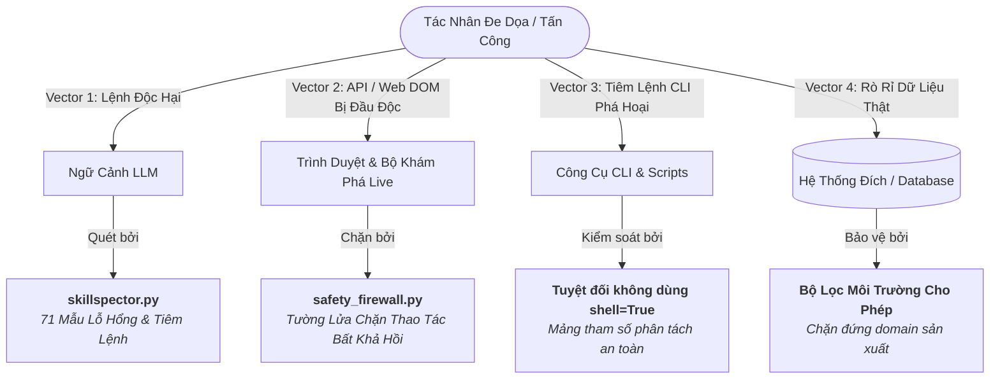
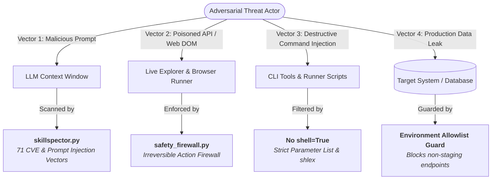

# Chính Sách Bảo Mật & Mô Hình Đe Dọa / Security Policy & Threat Model

[🇻🇳 Phiên Bản Tiếng Việt](#-phiên-bản-tiếng-việt) | [🇬🇧 English Edition](#-english-edition)

---

## 🇻🇳 Phiên Bản Tiếng Việt

> **Dự án:** Synapse Hub — Nền tảng Kỹ năng & Trí tuệ Kiểm thử Phần mềm Chuyên sâu cho AI Agent  
> **Tác giả & Chủ sở hữu bản quyền:** Thế Vị (@TeeVee98)  
> **Giấy phép:** Giấy phép mã nguồn mở MIT  

### 1. Các Phiên Bản Được Hỗ Trợ Bảo Mật

Chúng tôi tích cực theo dõi và phát hành các bản vá bảo mật cho các phiên bản sau:

| Phiên Bản | Tình Trạng Hỗ Trợ | Mức Độ Bảo Trì |
| :--- | :---: | :--- |
| `3.8.x` | ✅ | Bản phát hành ổn định hiện tại (Bảo trì chủ động & vá lỗi Zero-day) |
| `2.6.x` | ⚠️ | Chỉ hỗ trợ vá lỗi bảo mật nghiêm trọng |
| `< 2.6.0` | ❌ | Hết vòng đời hỗ trợ (Deprecated) |

### 2. Mô Hình Đe Dọa & Kiến Trúc Phòng Vệ

Synapse Hub hoạt động như một lớp hạ tầng trí tuệ dùng chung giữa máy lập trình viên, CI/CD pipeline và môi trường thực thi của các AI Agent (Google Antigravity, Cursor, Claude Code, GitHub Copilot, Windsurf). Hệ thống được trang bị các lớp phòng vệ nhiều tầng:

#### Các Vector Tấn Công & Cơ Chế Phòng Ngự Tương Ứng

| Vector Tấn Công | Nguy Cơ Tiềm Ẩn | Lớp Phòng Ngự & Giải Pháp Tích Hợp |
| :--- | :--- | :--- |
| **Tiêm Lệnh Ngầm (Prompt Injection)** | AI bị chiếm quyền điều khiển qua nội dung trang web độc hại hoặc kịch bản giả mạo. | **`tools/skillspector.py` & Kỹ năng #27:** Quét 71 mẫu vector lỗ hổng theo chuẩn NVIDIA SkillSpector để phát hiện tiêm lệnh, jailbreak và thao túng ngữ cảnh. |
| **Lệnh Trình Duyệt & CLI Phá Hoại** | AI vô tình thực thi các thao tác không thể đảo ngược (`rm -rf`, `DROP TABLE`, xóa dữ liệu hàng loạt). | **`tools/safety_firewall.py`:** Tường lửa chặn bắt hành động; tự động ngăn chặn các truy vấn xóa thiếu mệnh đề `WHERE` và các lệnh OS nguy hiểm. |
| **Ghi Đè Dữ Liệu Sản Xuất (Production Leak)** | Quá trình bắn payload hoặc fuzzing API vô tình nhắm vào server thật của khách hàng. | **Bộ Lọc Môi Trường Cho Phép (Allowlist Guard):** Tích hợp trong `tools/api_fuzzer.py` và `tools/trace_data_flow.py`. Chặn đứng mọi lệnh chạy nhắm vào domain không phải localhost/staging trừ khi có cờ xác nhận `SYNAPSE_ALLOW_PROD_FUZZ=1`. |
| **Lộ Lọt Thông Tin Bảo Mật (Credentials)** | Vô tình commit token, private key hoặc mật khẩu lên Git. | **Cổng DoD Gate 6 (`tools/verify_all.py`):** Tự động quét regex phát hiện token JWT, khóa AWS, SSH key và mật khẩu dạng văn bản thô trên toàn bộ mã nguồn trước khi push. |
| **Thực Thi Mã Trái Phép Qua Shell** | Lỗ hổng OS Command Injection do ghép chuỗi tham số không an toàn. | **Chính Sách Tuyệt Đối Không Dùng `shell=True`:** Mọi tiến trình subprocess đều sử dụng mảng tham số phân tách (`shlex.split()`). Không tồn tại bất kỳ lệnh `shell=True` nào trong các công cụ `tools/*.py`. |
| **Mất Mát Mã Nguồn Khi Đột Biến AST** | Quá trình tiêm mutant bị ngắt quãng làm hỏng file test gốc. | **Cơ Chế Sao Lưu & Phục Hồi Nguyên Tử (Atomic Rollback):** `tools/micro_mutator.py` bọc toàn bộ thao tác trong khối `try/finally` kèm băm md5 để bảo đảm khôi phục 100% file gốc sau khi test xong. |
| **Mạo Danh Tác Giả & Phát Hành Biến Thể Độc Hại** | Kẻ xấu xóa thông báo bản quyền để phát hành bản dựng có cài mã độc. | **Tiền Kiểm Tra Toàn Vẹn Tác Quyền (`tools/author_integrity.py`):** Kiểm tra chữ ký số băm SHA-256 chạy ngầm (Pre-flight Integrity Guard) bảo vệ bản quyền tác giả **Thế Vị (@TeeVee98)** theo chuẩn giấy phép MIT trước khi thực thi các Cổng DoD. |

### 3. Quy Trình Báo Cáo Lỗ Hổng Bảo Mật

Chúng tôi trân trọng các đóng góp từ cộng đồng nghiên cứu bảo mật và xử lý mọi báo cáo với mức độ ưu tiên cao nhất.

#### Kênh Tiếp Nhận
- **Kênh Báo Cáo Riêng Tư:** Gửi trực tiếp qua [GitHub Private Vulnerability Reporting](https://github.com/TeeVee98/Synapse-Hub/security/advisories/new).
- **Email Trực Tiếp:** Liên hệ tác giả dự án qua địa chỉ `vpham295998@gmail.com` với tiêu đề `[SECURITY VULNERABILITY] Synapse-Hub`.

#### Cam Kết Thời Gian Phản Hồi (SLA)
- **Xác Nhận Tiếp Nhận:** Trong vòng **24 giờ**.
- **Đánh Giá & Phân Cấp Mức Độ:** Trong vòng **48 giờ**.
- **Phát Hành Bản Vá & Công Bố:** Trong vòng **14 ngày làm việc** (với các lỗ hổng Zero-day đặc biệt nghiêm trọng sẽ xử lý trong vòng 72 giờ).

### 4. Minh Bạch Kết Nối Ngoại Vi & Cách Ly Môi Trường (Air-Gapped Policy)

Synapse Hub được thiết kế theo nguyên lý **100% Offline-First / Zero Data Exfiltration**. Hệ thống không thu thập dữ liệu người dùng, không gửi mã nguồn lên server ngoài và không phụ thuộc API LLM bên ngoài:

| Điểm Gọi Mạng | Mục Đích | Cơ Chế Cách Ly & Kiểm Soát |
| :--- | :--- | :--- |
| **NPM Registry / GitHub Raw** (`update_sentinel.py`) | Kiểm tra định kỳ xem có bản phát hành mới của Synapse Hub hay không. | Cache cục bộ 24h; **tự động tắt hoàn toàn** khi chạy trên CI (`CI=true` / `GITHUB_ACTIONS=true`); tắt thủ công tức thì qua cờ `--offline` hoặc biến `AGENT_QA_OFFLINE=1` / `SYNAPSE_OFFLINE=1`. |
| **Kiểm tra kết nối BASE_URL** (`check_env.py` - `doctor`) | Kiểm tra khả năng kết nối tới ứng dụng web mục tiêu của người dùng. | Chỉ kích hoạt khi người dùng gõ lệnh `doctor` và có cấu hình `BASE_URL` trong file `.env` nội bộ. |

---

## 🇬🇧 English Edition

> **Project:** Synapse Hub — Decoupled Enterprise AI Agent QA & Automation Hub  
> **Author & Copyright Holder:** Thế Vị (@TeeVee98)  
> **License:** MIT License  

### 1. Supported Versions

We actively support and release security patches for the following versions:

| Version | Supported | Security Maintenance Status |
| :--- | :---: | :--- |
| `3.8.x` | ✅ | Current Stable Release (Active Maintenance & Zero-Day Patching) |
| `2.6.x` | ⚠️ | Critical Security Fixes Only |
| `< 2.6.0` | ❌ | End of Life (Deprecated) |

### 2. Threat Model & Security Architecture

Synapse Hub operates as a decoupled shared intelligence core across host systems, CI/CD runners, and AI agent sandboxes (Google Antigravity, Cursor, Claude Code, GitHub Copilot, Windsurf). The following threat matrix outlines our primary attack vectors, impact boundaries, and built-in defenses.

#### Attack Vectors & Mitigations

| Threat Vector | Potential Impact | Defensive Layer & Built-in Mitigation |
| :--- | :--- | :--- |
| **Prompt Injection & Indirect Jailbreaks** | LLM hijacking via poisoned web pages or untrusted user stories. | **`tools/skillspector.py` + Skill #27 (`skillspector-security-guard`):** 71 detection rules modeled after NVIDIA SkillSpector, scanning for prompt injection, jailbreaks, and cross-session instruction manipulation. |
| **Destructive Browser & CLI Commands** | Agent executing irreversible operations (`rm -rf`, `DROP TABLE`, destructive API calls). | **`tools/safety_firewall.py`:** Intercepts browser actions and CLI calls; blocks drop/truncate/delete queries without `WHERE` clauses and destructive OS commands. |
| **Accidental Production Data Mutation** | Fuzzing or test data injection corrupting live production databases. | **Environment Allowlist Guard:** Embedded in `tools/api_fuzzer.py` and `tools/trace_data_flow.py`. Prohibits execution against non-staging/non-localhost domains unless explicitly confirmed via `SYNAPSE_ALLOW_PROD_FUZZ=1`. |
| **Credential & Secret Leakage** | Committing bearer tokens, private keys, or passwords to git repositories. | **DoD Gate 6 (`tools/verify_all.py`):** Pre-commit and pre-push regex scans detect JWTs, AWS keys, private SSH keys, and plaintext passwords across the entire codebase. |
| **Arbitrary Code Execution via CLI Shells** | OS command injection via unescaped string concatenation. | **Zero `shell=True` Policy:** All subprocess invocations use structured parameter lists or `shlex.split()`. Zero instances of raw `shell=True` exist in `tools/*.py`. |
| **Source File Corruption via AST Mutators** | Incomplete micro-mutation runs leaving mutated test scripts in place. | **Atomic Backup & Rollback (`.synapse_mutator_bak`):** `tools/micro_mutator.py` wraps file modifications in `try/finally` blocks with cryptographic md5 verification and atomic restoration. |
| **Author Attribution Tampering & Anti-Piracy** | Stripping license notices or falsifying authorship to distribute backdoored variants. | **Pre-flight Engine Integrity Guard (`tools/author_integrity.py`):** Cryptographic SHA-256 integrity check and mandatory MIT license provenance verification for Thế Vị (@TeeVee98) executed silently before running DoD Quality Gates. |

### 3. Reporting a Vulnerability

We appreciate the responsible security research community and treat all vulnerability reports with the highest priority.

#### 3.1 Reporting Channel
- **Private Vulnerability Reporting:** Submit details via [GitHub Private Vulnerability Reporting](https://github.com/TeeVee98/Synapse-Hub/security/advisories/new).
- **Direct Security Contact:** Reach out directly to the primary maintainer at `vpham295998@gmail.com` with the subject tag `[SECURITY VULNERABILITY] Synapse-Hub`.

#### 3.2 Submission Guidelines
Please include:
1. Description of the vulnerability and its potential impact.
2. Step-by-step reproduction steps or Proof of Concept (PoC).
3. Affected components, tools, or skills.
4. Any proposed remediations.

#### 3.3 SLA Commitments
- **Initial Acknowledgment:** Within **24 hours**.
- **Triage & Severity Assessment:** Within **48 hours**.
- **Remediation & Coordinated Disclosure:** Within **14 business days** (critical zero-days remediated within 72 hours).

### 4. Outbound Network Transparency & Air-Gapped Policy

Synapse Hub adheres to an uncompromising **100% Offline-First / Zero Data Exfiltration** security architecture. Source code, credentials, and telemetry are strictly retained on the local developer machine:

| Outbound Network Touchpoint | Purpose | Air-Gapped Isolation & Bypass Controls |
| :--- | :--- | :--- |
| **NPM Registry / GitHub Raw** (`update_sentinel.py`) | Periodic non-intrusive version check to notify developers of new releases. | 24-hour local file cache; **automatically bypassed** under CI runners (`CI=true` / `GITHUB_ACTIONS=true`); manually disabled via `--offline` flag or `AGENT_QA_OFFLINE=1` / `SYNAPSE_OFFLINE=1`. |
| **Target BASE_URL Probe** (`check_env.py` - `doctor`) | Pre-flight connectivity check to verify that target AUT application is reachable. | Only invoked when developer explicitly runs `agent-qa doctor` and configures `BASE_URL` in local `.env`. |
