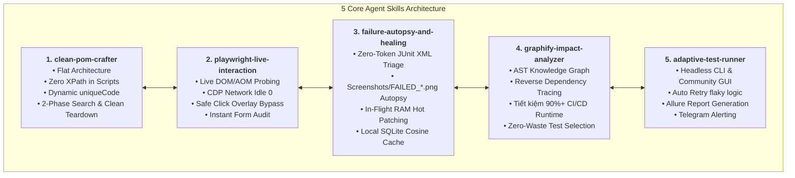
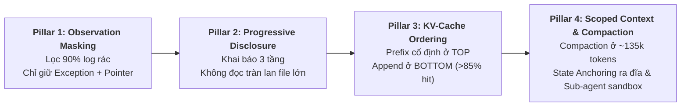
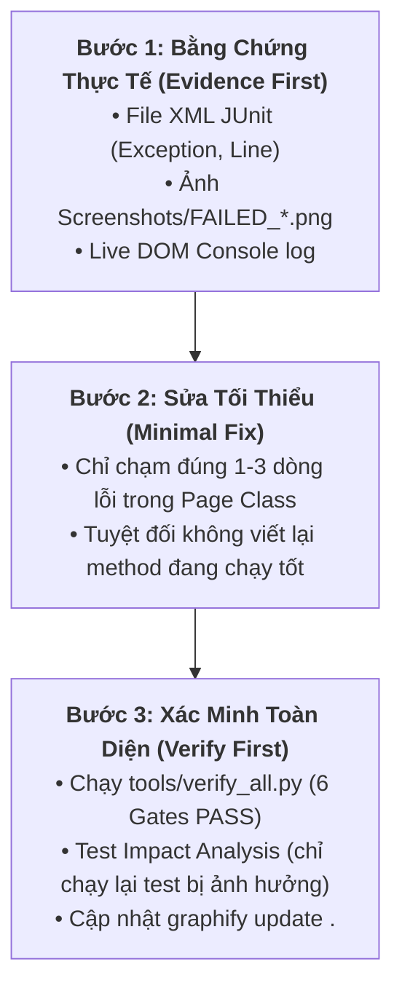
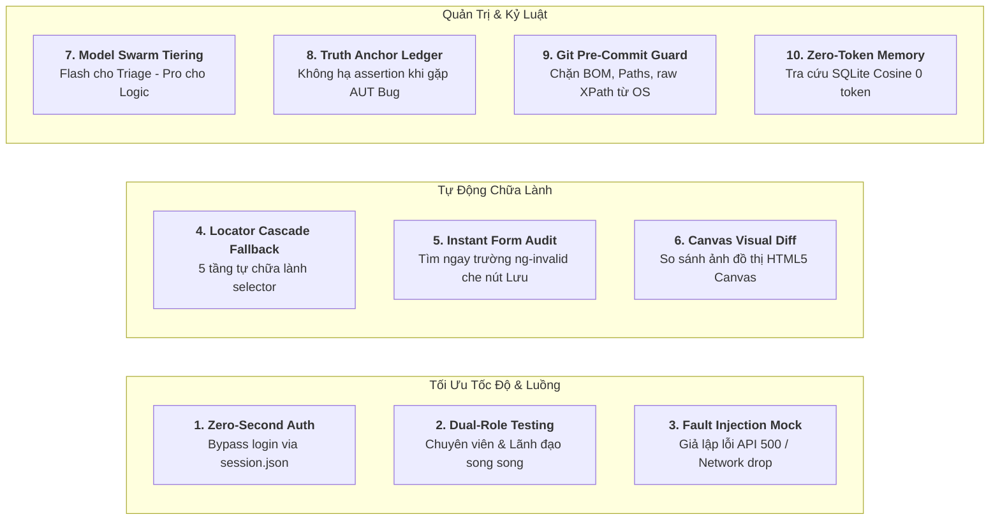
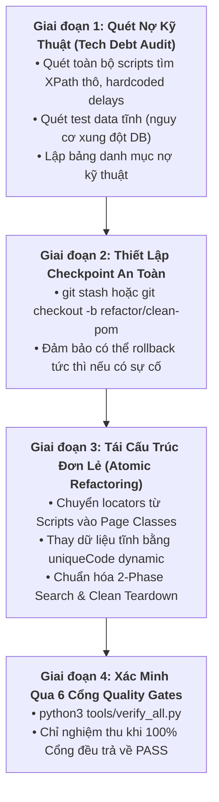
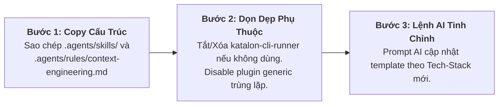
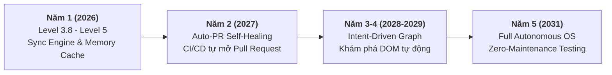
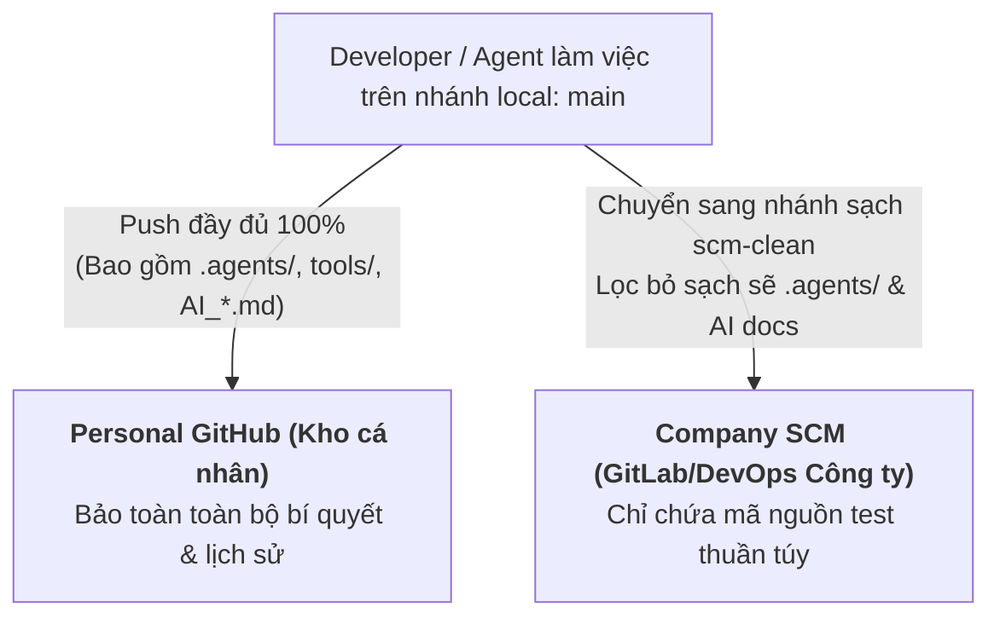

# Universal AI Master Blueprint & Replication Guide
## Level 5 Autonomous Test Automation & Context Engineering OS

> **BẢN QUYỀN TRÍ TUỆ CÁ NHÂN (PRIVATE INTELLECTUAL PROPERTY):**  
> Tài liệu này là "Bộ Não Toàn Năng" tích lũy toàn bộ kỹ năng, quy tắc kiểm thử, tooling và kiến trúc siêu việt từ dự án DMIT (259 Test Cases) cùng tinh hoa từ các repository mã nguồn mở hàng đầu thế giới (*Graphify, Katalon Skills, LaVague, Superpowers, Context Engineering*).  
> 🔒 **BẢO MẬT:** Thuộc danh mục Private Asset. Tuyệt đối **KHÔNG PUSH** lên SCM công ty. Chỉ lưu trữ trên GitHub cá nhân và local workspace.

---

## 0. HƯỚNG DẪN KÍCH HOẠT CHO DỰ ÁN MỚI (AGENT IGNITION)

Khi bạn bước vào bất kỳ dự án kiểm thử tự động nào mới (dù là **Katalon, Playwright, Selenium, Cypress, Appium, viết bằng Groovy, Java, Python, TypeScript hay C#**), bạn chỉ cần copy file `AI_REPLICATION_GUIDE.md` này vào thư mục gốc của dự án đó và gửi câu lệnh sau cho AI Agent (Antigravity, Cursor, Claude Code, Copilot, Windsurf):

### 🚀 Lựa chọn 1: Kích Hoạt Thiết Lập Dự Án Mới (Scaffold & Setup)
```text
"Hãy đọc kỹ file AI_REPLICATION_GUIDE.md. Đây là bộ não kiến trúc chuẩn Level 5 Autonomous Test Automation OS.
Hãy áp dụng toàn bộ:
1. Quy tắc vận hành (Pre-flight verification, Hard Never list).
2. 5 Siêu Kỹ Năng Agent (Clean POM, Live Interaction, Failure Autopsy, Knowledge Graph, Adaptive Runner).
3. 4 Kỹ thuật Context Engineering (Observation Masking, Progressive Disclosure, KV-Cache Optimization, Scoped Context & Compaction State Anchoring).
4. Kỷ luật Zero-Guesswork Debugging và 6 Cổng Quality Gates (DoD).
5. Tự động scaffold cấu trúc thư mục .agents/ và bộ công cụ tools/ phù hợp cho dự án này ngay lập tức."
```

### ⚡ Lựa chọn 2: Tự Động Quét & Refactor Nâng Cấp Toàn Bộ Codebase (Autonomous Refactor Mode)
```text
"Hãy đọc kỹ file AI_REPLICATION_GUIDE.md, ghi nhớ toàn bộ tiêu chuẩn chất lượng và kích hoạt 'Autonomous Code Refactoring Engine':
1. Quét toàn diện dự án để lập danh sách nợ kỹ thuật: raw locators trong scripts, hardcoded delays, test data tĩnh, vi phạm BOM/paths.
2. Thiết lập Git Checkpoint an toàn trước khi bắt đầu.
3. Tiến hành tái cấu trúc (refactor) từng bước đưa toàn bộ mã nguồn về chuẩn Clean POM Level 5 & Dynamic Test Data.
4. Chạy bộ xác minh 6 Cổng Quality Gates (DoD) và chỉ dừng lại khi 100% các cổng đều trả về PASS."
```

---

## 1. TUYÊN NGÔN VẬN HÀNH & KỶ LUẬT THÉP (AGENT DISCIPLINE)

### 1.1. Mandatory Pre-Flight Verification Block
Mọi câu trả lời của AI Agent trong phiên làm việc **BẮT BUỘC** phải bắt đầu bằng khối xác nhận chuẩn hóa để giữ vững KV-Cache và định hình tâm thế:

```text
> ✅ Đã đọc AI_REPLICATION_GUIDE.md & Architecture Standards
> ✅ Cấu trúc kiểm thử: Clean POM & Flat Architecture (Zero XPath trong Scripts)
> ✅ Dữ liệu kiểm thử: Dynamic Timestamp (uniqueCode) chống trùng lặp
> ✅ Quy tắc dò tìm: 2-Phase Search & Clean Teardown
> ✅ Kỷ luật Debug: Ground-truth evidence (Log + Screenshot) trước khi sửa code
> ✅ Tiêu chuẩn kết thúc: 100% DoD Compliance (tools/verify_all.py PASS)
```

### 1.2. Danh Sách 6 Điều "Cấm Tuyệt Đối" (Hard Never List)
1. 🚫 **KHÔNG đoán mò locator:** Tuyệt đối không tự suy diễn XPath/CSS selector khi chưa có bằng chứng DOM từ Live Browser hoặc log chụp màn hình.
2. 🚫 **KHÔNG rò rỉ locator vào Scripts:** Mọi XPath, CSS selector, hàm driver `findElement` hay `findTestObject` phải nằm 100% trong Page Class. File Script kiểm thử chỉ được gọi method nghiệp vụ tầng cao.
3. 🚫 **KHÔNG hardcode đường dẫn máy tính:** Cấm tuyệt đối ổ đĩa hay thư mục người dùng cố định (như `C:\path`, `D:\path`, `~/<user>/...`). Phải dùng relative path tính từ root repo hoặc biến môi trường.
4. 🚫 **KHÔNG để dính UTF-8 BOM:** Toàn bộ file text/code phải lưu dạng UTF-8 No BOM (không có 3 byte `0xEF, 0xBB, 0xBF`).
5. 🚫 **KHÔNG dùng sleep cứng mù quáng:** Tuyệt đối không dùng `Thread.sleep(5000)` bừa bãi. Phải dùng Smart Wait đồng bộ theo DOM, AJAX, và Network Idle.
6. 🚫 **KHÔNG fake pass kiểm thử:** Lỗi của ứng dụng (AUT Bug) phải được báo cáo trung thực vào Defect Register (`KNOWN_ISSUES.md`), không được hạ thấp assertion để test pass giả tạo.

---

## 2. NĂM SIÊU KỸ NĂNG AGENT CỐT LÕI (5 CORE AGENT SKILLS)



### Kỹ Năng 1: `clean-pom-crafter` (Chuẩn Hóa Page Object Model)
* **Flat Architecture:** Tổ chức thư mục phẳng, dễ quản lý, không lồng ghép thư mục con theo phân hệ nghiệp vụ rườm rà.
* **Tách bạch 100% trách nhiệm:**
  - `Page Classes`: Chứa locators, hàm tương tác nguyên tử (atomic actions), xử lý dropdown, lịch, modal, notification.
  - `Test Scripts`: Chỉ điều phối flow nghiệp vụ (gọi `LoginPage.login()`, `LoginPage.logout()`). Cấm tiệt XPath!
* **Dữ liệu động chống xung đột:** Luôn sinh mã định danh duy nhất qua timestamp:  
  `String uniqueCode = "AUTO_" + System.currentTimeMillis()`
* **Two-Phase Search:** Luôn tìm kiếm theo 2 bước: (1) Nhập từ khóa, (2) Nhấn nút Tìm kiếm hoặc phím Enter, rồi chờ bảng dữ liệu reload xong mới assert.
* **Idempotent Teardown:** Dọn dẹp dữ liệu test ngay trong kịch bản để test case có thể chạy lại vô hạn lần mà không bị lỗi trùng mã.

### Kỹ Năng 2: `playwright-live-interaction` (Tương Tác Live Web Đỉnh Cao)
* **Khảo sát trực tiếp trước khi sinh code:** Sử dụng Playwright MCP kết nối trực tiếp vào trình duyệt đang mở để soi DOM, kiểm tra tính duy nhất của selector trong 200ms.
* **Bypass Overlay thông minh:** Tự động vô hiệu hóa các lớp phủ backdrop (`.p-component-overlay`, `.modal-backdrop`, `cdk-overlay-backdrop`) bằng JavaScript nếu chúng chặn thao tác click.
* **Instant Form Audit:** Quét nhanh toàn bộ form xem trường nào đang bị lỗi validate (`form .ng-invalid`, `input:invalid`, `.has-error`).
* **Deterministic Sync Engine (Network Idle 0):** Đồng bộ tuyệt đối theo trạng thái framework (`window.getAllAngularTestabilities().every(t => t.isStable())`) và số lượng HTTP request đang bay (`activeRequests === 0`).

### Kỹ Năng 3: `failure-autopsy-and-healing` (Khám Nghiệm Lỗi & Tự Động Vá)
* **Khám nghiệm đa giác quan:**
  1. Đọc file XML JUnit để xác định chính xác line bị lỗi và tên Exception trong 1 giây (Zero-Token triage).
  2. Soi ảnh chụp màn hình `Screenshots/FAILED_*.png` để thấy trạng thái giao diện lúc fail (spinner có đang che? modal có đang mở?).
* **In-Flight RAM Hot Patching:** Đón bắt các exception phổ biến (`ElementClickInterceptedException`, `StaleElementReferenceException`) trong RAM và tự động fallback sang JavaScript click hoặc retry 3 lần trước khi coi là lỗi thật.
* **Offline Semantic Memory Cache:** Lưu vết giải pháp sửa lỗi vào SQLite local (`tools/memory_cache.db`). Khi gặp lại lỗi tương tự, tra cứu bằng thuật toán Cosine Similarity tiêu tốn **0 LLM Tokens**.

### Kỹ Năng 4: `graphify-impact-analyzer` (Knowledge Graph & Phân Tích Tác Động)
* **AST Knowledge Graph:** Dùng Graphify phân tích mã nguồn thành đồ thị tri thức (`graph.json`) gồm các node Class, Method, TestCase và các cạnh quan hệ (calls, imports, depends_on).
* **Zero-Waste Test Impact Analysis:** Khi sửa 1 file Page Class, chạy `python3 tools/test_impact.py --git-diff` để đồ thị truy vết ngược, chỉ lọc ra đúng các Test Case bị ảnh hưởng trực tiếp (ví dụ: sửa 1 hàm chỉ cần chạy lại 12/259 test cases, tiết kiệm 95% thời gian CI/CD).
* **Đồng bộ liên tục:** Sau khi sửa code, chạy `graphify update .` để đồ thị luôn bám sát mã nguồn thực tế.

### Kỹ Năng 5: `adaptive-test-runner` (Quản Lý Thực Thi Thích Ứng)
* **Linh hoạt đa chế độ:** Tự động phát hiện môi trường: chạy CLI Headless (nếu có License KRE / Docker) hoặc hướng dẫn mở GUI Katalon Studio / Playwright Runner (nếu chạy Free Community).
* **Tích hợp báo cáo & cảnh báo:** Tự động biên dịch Allure Report trực quan và gửi thông báo kết quả (Pass/Fail rate) qua Telegram Webhook.

### Kỹ Năng 6: `lam-script-generator` (Large Action Model Sinh Mã Từ User Story)
*(Kế thừa từ `lavague-ai/LaVague`)*
* **World Model (Tư duy luồng):** Phân tích câu lệnh tự nhiên hoặc Acceptance Criteria của QA/BA thành chuỗi hành động nguyên tử tuần tự.
* **Action Engine (Sinh mã thực thi):** Đối chiếu Knowledge Graph và Page Classes để sinh trực tiếp kịch bản Clean POM Groovy bền vững.
* **Zero-Token Replayability:** Kịch bản sau khi sinh được lưu cố định vào dự án, tự động chạy lại vô hạn lần trên CI/CD với 0 token LLM.
* **Công cụ hỗ trợ CLI:** `python3 tools/generate_tc_from_story.py --story "..." --module "..."`.

### Kỹ Năng Mở Rộng: Bộ 10 Skills Bổ Trợ (Antigravity Skill Vault)
*(Kế thừa từ `rmyndharis/antigravity-skills`)*
* **Testing & A11y:**
  - `e2e-testing-patterns`: Best practices cho E2E Testing, resilient wait/locators.
  - `wcag-audit-patterns`: Kiểm thử khả năng tiếp cận WCAG 2.2 tự động và manual checklist.
  - `tdd-orchestrator`: Chu trình TDD Red-Green-Refactor và xác định edge cases trước khi code.
  - `bats-testing-patterns`: Kiểm thử tự động hóa cho các bash scripts trong `tools/` và CI/CD.
* **Code Quality & Refactoring:**
  - `code-refactoring-refactor-clean`: Tái cấu trúc Clean Code & quản trị nợ kỹ thuật (Tech Debt).
  - `code-review-ai-ai-review`: Checklist review code đa chiều (Security, Performance, Robustness).
* **Multi-Agent Orchestration & Kiến Trúc:**
  - `agent-orchestration-multi-agent-optimize`: Điều phối subagents song song, tránh conflict và tràn context.
  - `architecture-decision-records`: Chuẩn hóa ghi chép quyết định kỹ thuật (ADRs).
  - `c4-architecture-c4-architecture`: Sinh tài liệu kiến trúc hệ thống C4 tự động.
* **Context Engineering Chuyên Sâu:**
  - `filesystem-context`: Kỹ nghệ lưu vết bộ nhớ ngoài qua ổ đĩa (`task.md`, scratchpads, offloading log).
  - `context-degradation`: Phát hiện và khắc phục 5 căn bệnh suy thoái chú ý của LLM (Lost-in-the-Middle, Poisoning, Distraction, Clash, Confusion).
* **CI/CD:**
  - `github-actions-templates`: Mẫu pipeline GitHub Actions tối ưu hóa cache và chạy headless runner.

---

## 3. BỐN NGUYÊN LÝ CONTEXT ENGINEERING & TIẾT KIỆM TOKEN

*(Kế thừa từ `muratcankoylan/Agent-Skills-for-Context-Engineering`, `alexgreensh/token-optimizer`, và `obra/superpowers`)*



### 3.1. Pillar 1: Observation Masking (Lọc Log Thừa)
* **Nguyên tắc:** Log chạy test CLI hay build Gradle dài hàng ngàn dòng chứa 95% là thông tin rác. Đổ cả ngàn dòng vào chat sẽ làm LLM bị "loãng chú ý" (*Context Rot / Lost-in-the-Middle*).
* **Hành động:** 
  - Chỉ trích xuất đúng dòng lỗi, mã ngoại lệ (`Exception`), mã kịch bản (`TC-xxx`) và trạng thái cuối cùng.
  - Trỏ log thô vào file đĩa: `[Full raw log saved to file://<path>; 2,400 verbose lines omitted]`.

### 3.2. Pillar 2: Progressive Disclosure (Khai Báo Lười 3 Tầng)
* **Nguyên tắc:** Không bao giờ đọc toàn bộ file mã nguồn khổng lồ (như `DataMiningPage.groovy` dài 4.368 dòng) vào prompt cùng lúc.
* **Hành động theo 3 bậc:**
  1. `Tier 1`: Đọc mục lục hoặc file quy tắc tóm tắt (< 100 dòng).
  2. `Tier 2`: Tra cứu Knowledge Graph (`graphify explain "<Class>"`) để chỉ lấy đúng 1-hop các class/method liên quan (~500 tokens).
  3. `Tier 3`: Dùng `StartLine` và `EndLine` đọc chính xác 30 dòng của method cần sửa. Tiết kiệm 90% tokens!

### 3.3. Pillar 3: KV-Cache Friendly Ordering (Tối Ưu Bộ Nhớ Đệm KV-Cache)
* **Nguyên tắc:** Các mô hình LLM hiện đại lưu cache attention Key-Value cho các đoạn prompt giống nhau tính từ trên xuống dưới. Thay đổi ở giữa prompt sẽ phá vỡ cache breakpoint, bắt buộc tính toán lại 100%.
* **Hành động:**
  - Giữ cố định tuyệt đối các chỉ dẫn hệ thống, rules và công cụ ở phần đầu (Top Prefix).
  - Chỉ append dữ liệu động (kết quả test, câu lệnh mới) ở cuối chuỗi context. Duy trì tỷ lệ cache hit > 85%.

### 3.4. Pillar 4: Scoped Context & Compaction Anchoring Protocol
* **Nguyên tắc:** Khi ngữ cảnh vượt ngưỡng ~135k tokens, cơ chế Auto-Compaction sẽ tóm tắt hội thoại. Nếu không có mỏ neo trên đĩa, trạng thái chi tiết sẽ bị mất mát.
* **Hành động:**
  - **Mỏ neo đĩa:** Mọi trạng thái quan trọng phải ghi vào `PROJECT_STATE.md`. Khi compaction xảy ra, Agent đọc lại file này để phục hồi trí nhớ tức thì.
  - **Cách ly Worktree (`Workspace: 'share'`):** Khi kích hoạt sub-agents song song, luôn chạy trên worktree cách ly để không đụng độ git index hay file đệm.

---

## 4. KỶ LUẬT ZERO-GUESSWORK DEBUGGING & SỬA LỖI CÓ BẰNG CHỨNG

*(Kế thừa từ `obra/superpowers`)*



* **Tuyệt đối không đoán:** Không sửa code vì "nghĩ là nó lỗi ở đó". Phải mở ảnh chụp màn hình lúc test fail hoặc đọc stacktrace để thấy rõ nguyên nhân.
* **Bảo toàn mã hoạt động:** Giữ nguyên các chú thích, cấu trúc và method xung quanh. Không refactor lan man ngoài phạm vi lỗi.
* **Không tuyên bố hoàn thành khi chưa chạy verify:** Mọi công việc sửa lỗi hoặc refactor chỉ được coi là xong khi lệnh `python3 tools/verify_all.py` trả về `100% DoD COMPLIANT`.

---

## 5. BỘ SƯU TẬP 10 TUYỆT KỸ & TRICKS THỰC CHIẾN (THE TOP 10 COMBAT TRICKS)



### Trick 1: Zero-Second Auth (Bypass Đăng Nhập bằng Session Storage State)
* **Vấn đề:** Đăng nhập qua form UI tốn 5–10 giây cho mỗi test case và dễ bị khóa IP / tài khoản do đăng nhập liên tục.
* **Tuyệt chiêu:** Đăng nhập 1 lần đầu tiên rồi lưu trạng thái ra file `.agents/session.json`. Các phiên test sau chỉ việc nạp lại session để vào thẳng trang nghiệp vụ mà không cần mở form đăng nhập.

### Trick 2: Multi-Context Dual Role Testing (Kiểm Thử Song Song Hai Vai Trò Trong 1 Flow)
* **Vấn đề:** Các kịch bản xét duyệt đòi hỏi: Chuyên viên tạo hồ sơ -> Lãnh đạo duyệt hồ sơ. Thao tác login/logout tuần tự mất thời gian và dễ đụng độ session.
* **Tuyệt chiêu:** Khởi tạo 2 browser context độc lập chạy song song trong cùng 1 test script. Context A (Chuyên viên) bấm Gửi, Context B (Lãnh đạo) nhận và bấm Phê duyệt tức thì.

### Trick 3: API Route Mocking & Fault Injection (Kiểm Thử Kịch Bản Lỗi Bằng Mock Tuyến Đường)
* **Vấn đề:** Làm sao kiểm tra giao diện ứng xử khi backend sập (HTTP 500) hoặc timeout mà không được phép can thiệp vào máy chủ thật?
* **Tuyệt chiêu:** Dùng `page.route('**/api/**', route => route.fulfill({ status: 500, body: '{"error": "Internal Error"}' }))` để ép lỗi giả lập, xác minh toast thông báo lỗi xuất hiện chuẩn xác và hệ thống không bị crash.

### Trick 4: Multi-Tier Self-Healing Locator Cascade (Thác Tự Chữa Lành 5 Tầng)
* **Vấn đề:** Thay đổi giao diện làm selector bị vỡ, gây lỗi kiểm thử giả tạo (false failure).
* **Tuyệt chiêu:** Thiết lập hàm tương tác thử lần lượt qua 5 tầng:
  1. `Tier 1`: Thuộc tính form chuẩn: `[formcontrolname="..."]` hoặc `[data-testid="..."]`.
  2. `Tier 2`: Trợ năng (Accessibility): `getByRole('button', { name: "..." })`.
  3. `Tier 3`: Văn bản hiển thị chính xác: `button:has-text("...")`.
  4. `Tier 4`: Tiêu đề tooltip: `[title*="..."]`.
  5. `Tier 5`: Class thành phần: `.p-button:has-text("...")`.

### Trick 5: Instant Form Audit Cho Nút Lưu Bị Ẩn/Mờ (`form .ng-invalid`)
* **Vấn đề:** Nút "Lưu" hoặc "Hoàn thành" bị disabled (mờ đi), kịch bản văng ngoại lệ Timeout vì không click được nhưng không rõ thiếu trường nào.
* **Tuyệt chiêu:** Không đoán mò. Chạy ngay 1 dòng lệnh trong browser console:
  `Array.from(document.querySelectorAll('form .ng-invalid, input.ng-invalid, p-dropdown.ng-invalid')).map(el => el.getAttribute('formcontrolname') || el.id)`. Lập tức phát hiện chính xác trường bắt buộc bị thiếu dữ liệu!

### Trick 6: Canvas & Visual Diff Testing (Kiểm Thử Đồ Thị & Bản Đồ Không Có Thẻ DOM)
* **Vấn đề:** Biểu đồ thống kê, bản đồ phân bố hoặc đồ thị biến động vẽ trên thẻ HTML5 `<canvas>` không có thẻ HTML con bên trong để định vị XPath.
* **Tuyệt chiêu:** Sử dụng script `tools/visual_diff_canvas.py` chụp ảnh vùng Canvas, trích xuất pixel hash hoặc so sánh độ tương đồng cấu trúc hình ảnh (SSIM) với ảnh gốc để phát hiện lỗi vẽ lệch dữ liệu.

### Trick 7: Model Tiering & Swarm Routing (Phân Cấp Mô Hình Tối Ưu Chi Phí)
* **Vấn đề:** Dùng model lớn (như GPT-4o, Claude 3.5 Sonnet, Gemini 1.5 Pro) cho toàn bộ thao tác đọc log, phân loại file gây lãng phí chi phí và quota.
* **Tuyệt chiêu:** Phân tầng mô hình thông minh:
  - Dùng **Model nhỏ/siêu nhanh** (`flash`, `flash_lite`, `haiku`) cho tác vụ đọc JUnit XML, phân loại lỗi PASS/FAIL, tóm tắt log CLI.
  - Chỉ chuyển giao cho **Model lớn** (`pro`, `opus`) khi cần suy luận logic nghiệp vụ phức tạp hoặc sinh code Page Class hoàn toàn mới.

### Trick 8: Truth Anchor Bug Ledger (Quản Lý Khiếm Khuyết Trung Thực)
* **Vấn đề:** Khi gặp lỗi thật của phần mềm (AUT Bug), kỹ sư hoặc AI thường có xu hướng sửa assertions hạ tiêu chuẩn để test pass, gây sai lệch báo cáo chất lượng.
* **Tuyệt chiêu:** Duy trì sổ cái `KNOWN_ISSUES.md`. Mọi lỗi do hệ thống đích gây ra phải được phân loại và ghi lại với bằng chứng đính kèm (`Screenshots/FAILED_*.png`). Kịch bản vẫn giữ nguyên assertion nghiêm ngặt để bảo vệ tính toàn vẹn của kiểm thử.

### Trick 9: Git Pre-Commit Guard Khoá Cứng Ở Tầng Hệ Điều Hành
* **Vấn đề:** Lập trình viên hoặc AI vô tình commit file dính UTF-8 BOM, đường dẫn tuyệt đối hoặc XPath thô trong Scripts lên Git repository.
* **Tuyệt chiêu:** Cài đặt hook `tools/git_pre_commit_guard.py` trực tiếp vào `.git/hooks/pre-commit`. Hook này chặn đứng lệnh `git commit` ngay tại máy cục bộ nếu phát hiện vi phạm, không cho phép code bẩn lọt vào repo.

### Trick 10: Local SQLite Cosine Vector Similarity (Trí Nhớ Tự Sửa Lỗi 0-Token)
* **Vấn đề:** Mỗi lần tự sửa lỗi lại phải gọi API Embeddings của bên thứ 3 (OpenAI, Voyage AI) tốn chi phí và phụ thuộc mạng Internet.
* **Tuyệt chiêu:** Tạo cơ sở dữ liệu `tools/memory_cache.db` lưu trữ các cặp vector lỗi - giải pháp. Khi gặp lỗi mới, script Python tính toán trực tiếp khoảng cách Cosine trên máy tính cục bộ trong 5 mili-giây, hoàn toàn offline và tiêu tốn **0 LLM Tokens**.

---

## 6. CƠ CHẾ TỰ ĐỘNG REFACTOR MÃ NGUỒN ĐẠT CHUẨN LEVEL 5 (AUTONOMOUS REFACTORING ENGINE)

Khi được kích hoạt chế độ refactor, AI Agent tuân thủ quy trình 4 giai đoạn nghiêm ngặt:



---

## 7. ĐỊNH NGHĨA HOÀN THÀNH: BẢY CỔNG CHẤT LƯỢNG (7 DoD GATES)

Bất kỳ thay đổi nào trong mã nguồn chỉ được chấp nhận khi vượt qua toàn bộ 7 Cổng Chất Lượng được kiểm tra tự động bởi script `tools/verify_all.py`:

| Cổng | Tên Cổng | Tiêu Chuẩn Bắt Buộc | Cách Thức Kiểm Tra Tự Động |
| :---: | :--- | :--- | :--- |
| **1** | **UTF-8 No BOM** | 100% file `.groovy`, `.tc`, `.ts`, `.glbl`, `.md`, `.py`, `.json`, `.ps1` không có 3 byte BOM (`0xEF, 0xBB, 0xBF`). | Kiểm tra 3 byte đầu của file nhị phân |
| **2** | **Relative Paths Only** | Tuyệt đối không chứa đường dẫn máy tính tuyệt đối (`C:\`, `D:\`, `~/<user>/...`). | Regex quét pattern ổ đĩa & user directory |
| **3** | **Clean POM Architecture** | 100% file script trong `Scripts/` không chứa `x(...)`, `findTestObject`, `By.xpath`. Toàn bộ locator nằm trong `Keywords/dmit/pages/`. | Regex quét cú pháp locator trong thư mục Scripts |
| **4** | **Documentation Integrity** | Không có tài liệu markdown nào tham chiếu đến class/method không tồn tại trên đĩa. | Phân tích AST của code và đối chiếu với docs |
| **5** | **Zero Temp Files** | Không có file tạm, file backup (`.temp-*`, `.bak`, `.orig`, `~*`) hay file log nháp sót lại trong repository. | Quét blacklist extensions/patterns |
| **6** | **Credential Security** | Không hardcode mật khẩu, token, API key trong code. 100% dùng qua biến môi trường. | Quét entropy & pattern regex |
| **7** | **Static Defect & Fake-Pass Sentinel** | 100% test scripts không có khối catch nuốt lỗi và không có kịch bản rỗng. | AST linter quét 260 scripts qua `tools/infer_linter.py` |

---

## 8. BỘ TOOLKIT NẰM TRONG LÕI (EMBEDDED TOOLKIT SCRIPTS)

Khi thiết lập dự án mới, hãy yêu cầu Agent trích xuất các script mẫu sau vào thư mục `tools/`:

### 8.1. In-Browser Runtime Helper (`tools/dmit_browser_helpers.js`)
```javascript
(function () {
  'use strict';
  if (window.__helper) return window.__helper;
  let activeRequests = 0;
  if (!window.__net_hooked) {
    window.__net_hooked = true;
    if (window.fetch) {
      const orig = window.fetch;
      window.fetch = function () {
        activeRequests++;
        return orig.apply(this, arguments).finally(() => activeRequests = Math.max(0, activeRequests - 1));
      };
    }
  }
  const helper = {
    audit: () => Array.from(document.querySelectorAll('form .ng-invalid, input:invalid, .has-error input')).map(el => ({
      tag: el.tagName.toLowerCase(), name: el.getAttribute('name') || el.id, classes: el.className
    })),
    clickSafe: (selector) => {
      const el = typeof selector === 'string' ? document.querySelector(selector) : selector;
      if (!el) return false;
      document.querySelectorAll('.p-component-overlay, .modal-backdrop, .cdk-overlay-backdrop').forEach(o => o.style.pointerEvents = 'none');
      el.scrollIntoView({ block: 'center' });
      el.click();
      return true;
    },
    waitForNetworkIdle: (idleMs = 500, timeoutMs = 10000) => new Promise(resolve => {
      const start = Date.now();
      let idleStart = null;
      const interval = setInterval(() => {
        if (activeRequests === 0) {
          if (!idleStart) idleStart = Date.now();
          if (Date.now() - idleStart >= idleMs) { clearInterval(interval); resolve(true); }
        } else { idleStart = null; }
        if (Date.now() - start > timeoutMs) { clearInterval(interval); resolve(false); }
      }, 50);
    })
  };
  window.__helper = helper;
  return helper;
})();
```

### 8.2. Master Verifier (`tools/verify_all.py`)
Script kiểm tra toàn bộ 6 Cổng Chất Lượng chỉ bằng một câu lệnh:
```bash
python3 tools/verify_all.py
```
*(Đảm bảo trả về `🎉 [ALL 6 GATES PASSED — 100% DoD COMPLIANT]` trước mỗi commit).*

### 8.3. Test Impact Analyzer (`tools/test_impact.py`)
Script sử dụng Knowledge Graph để phát hiện chính xác các Test Case bị ảnh hưởng:
```bash
python3 tools/test_impact.py --git-diff
```

---

## 9. MA TRẬN ĐA NỀN TẢNG & CHUYỂN GIAO KỸ NĂNG (SKILL PORTABILITY GUIDE)

Khi nhân bản hoặc chuyển giao kho kỹ năng (`.agents/skills/` và `.agents/rules/`) sang một dự án phần mềm mới, áp dụng ma trận phân loại 3 tầng sau:

### 9.1. Ma Trận Tương Thích & Phân Loại Kỹ Năng

| Phân Loại | Danh Sách Kỹ Năng | Mức Độ Can Thiệp | Hướng Dẫn Chi Tiết |
| :--- | :--- | :--- | :--- |
| **TẦNG 1: Plug & Play 100%** *(Chạy ngay không cần sửa)* | • `token-and-context-optimizer`<br/>• `context-degradation`<br/>• `filesystem-context`<br/>• `code-refactoring-refactor-clean`<br/>• `code-review-ai-ai-review`<br/>• `c4-architecture-c4-architecture`<br/>• `architecture-decision-records`<br/>• `api-spec-to-e2e-matrix`<br/>• `wcag-audit-patterns`<br/>• `github-actions-templates`<br/>• `bats-testing-patterns`<br/>• `tdd-orchestrator` | **0% (Không sửa)** | Đây là nhóm kỹ năng cấp kiến trúc, tối ưu bộ nhớ LLM (KV-cache, context compaction anchoring), thiết kế C4/ADR và chất lượng code (SOLID, Clean Code). Hoạt động hoàn hảo trên mọi ngôn ngữ (Python, Java, TS/JS, Go, C#). |
| **TẦNG 2: Cấu Hình Nhẹ (~5 phút)** *(Chỉ sửa target URL / Path)* | • `playwright-live-interaction`<br/>• `self-healing-locator`<br/>• `graphify` / `graphify-impact-analyzer` | **5–10% (Chỉnh config)** | • Đổi URL mục tiêu và file lưu phiên `session.json` trong `playwright-live-interaction`.<br/>• Nguyên lý AOM diffing (`Role > Label > TestId`) của `self-healing-locator` là chuẩn chung W3C, tự động thích ứng với DOM mới.<br/>• Chạy `graphify build .` trên repo mới để tái tạo AST knowledge graph. |
| **TẦNG 3: May Đo Theo Tech-Stack** *(Bắt buộc tùy biến nếu đổi framework)* | • `clean-pom-crafter`<br/>• `lam-script-generator`<br/>• `katalon-cli-runner`<br/>• `antigravity-test-sentinel`<br/>• `.agents/rules/git-push-protocol.md` | **50–70% (Tùy biến template)** | **Nếu dự án mới không dùng Katalon/Groovy:**<br/>1. **`clean-pom-crafter` & `lam-script-generator`**: Giữ nguyên triết lý Flat POM và `uniqueCode = "AUTO_" + timestamp`, chỉ đổi template code sang TypeScript (Playwright `page.locator`), Python (Pytest), hoặc Java.<br/>2. **`katalon-cli-runner`**: Đổi runner command thành `npx playwright test`, `npm test` hoặc `pytest`. Tắt hẳn nếu không dùng Katalon.<br/>3. **`antigravity-test-sentinel`**: Đổi lệnh chốt chặn từ `tools/verify_all.py` sang lệnh linter/test của dự án mới (ví dụ: `npm run lint && npm test`).<br/>4. **`git-push-protocol.md`**: Cập nhật URL Git remote tương ứng của dự án mới. |

### 9.2. Checklist 3 Bước Khi Khởi Tạo Dự Án Mới



1. **Bước 1: Sao chép lõi:** Copy toàn bộ thư mục `.agents/skills/`, `.agents/rules/context-engineering.md` và `.agents/rules/systematic-debugging.md` sang thư mục gốc của dự án mới.
2. **Bước 2: Quản lý plugin & runner:** Nếu dự án mới không dùng Katalon, tạm thời gỡ bỏ `katalon-cli-runner`. Đảm bảo các plugin generic bên ngoài không xung đột với local skills.
3. **Bước 3: Ra lệnh cho AI cập nhật template:**
   > Prompt mẫu:
   > *"Tôi vừa mang bộ kỹ năng từ DMIT sang dự án mới dùng [Playwright TypeScript / Cypress / Pytest]. Hãy cập nhật template sinh code trong `clean-pom-crafter` và lệnh xác thực của `antigravity-test-sentinel` theo đúng tech-stack này, đồng thời giữ nguyên 100% nguyên lý Flat POM, Zero-XPath và dynamic test data."*

---

## 10. CHIẾN LƯỢC ĐỈNH CAO 5 NĂM (5-YEAR PINNACLE ROADMAP: 2026 - 2031)

> **Định vị:** Bản quy hoạch chiến lược nâng tầm hệ thống Tự động hóa Kiểm thử, đảm bảo dù công nghệ AI, frontend hay test runner có thay đổi sau 5 năm nữa, bộ khung này vẫn ở vị thế đỉnh cao của ngành công nghiệp phần mềm.



### 10.1. Vì Sao Bộ Khung Này Miễn Nhiễm Với Sự Lỗi Thời?
Đa số các dự án automation sau 1–2 năm sẽ bị "chết" hoặc đập đi xây lại vì:
1. Phụ thuộc quá chặt vào một công cụ (Vendor Lock-in).
2. Code kịch bản gắn cứng với giao diện (Brittle Locators).
3. Chi phí bảo trì tăng theo cấp số nhân khi số lượng test case tăng.

Hệ thống này đã giải quyết triệt để 3 điểm yếu trên ngay từ gốc:
* **Clean Page Object Model (POM):** Toàn bộ Test Cases chỉ gọi hàm nghiệp vụ. Khi giao diện thay đổi, chỉ sửa duy nhất tại Page Classes.
* **Zero-Token Local Execution:** Công cụ nằm trực tiếp tại `tools/`, chạy offline qua Python và SQLite, không phụ thuộc vào bất kỳ hãng AI nào.
* **Ground Truth Perception:** Sử dụng Playwright Live để quan sát trực tiếp DOM thời gian thực thay vì đoán mò.

### 10.2. Lộ Trình 4 Giai Đoạn Tiến Hóa
* **Giai đoạn 1 (Năm 2026): Nền tảng Vững chắc (Đã hoàn thành 100%)**
  - Flat Architecture & Clean POM cho toàn bộ Test Cases.
  - In-Flight Hot Patching (tự khắc phục overlay/stale element ngay trong RAM).
  - Sync Engine với framework readiness và CDP Network Idle 0.
  - Bộ nhớ cục bộ `tools/memory_cache.db` với Offline Cosine Vector Similarity.
  - Git Pre-Commit Guard khóa cứng kỷ luật ở tầng OS.
* **Giai đoạn 2 (Năm 2027): Tự Động Hóa Chu Trình Vá Lỗi CI/CD (Auto-PR Healing)**
  - Khi CI/CD chạy test ban đêm và phát hiện locator bị lệch do Dev cập nhật frontend:
    1. AI chạy ngầm tự động gọi Playwright Live để tìm selector mới.
    2. Tự động tạo một nhánh Git mới: `git checkout -b fix/auto-heal-batch-06`.
    3. Cập nhật Page Class, kiểm tra lại bằng `verify_all.py`.
    4. Tự động tạo **Pull Request (PR)** trên GitHub kèm video bằng chứng.
* **Giai đoạn 3 (Năm 2028 - 2029): Kiểm Thử Hướng Ý Định (Intent-Driven State Graph)**
  - Chuyển dịch từ "Kịch bản theo bước tuyến tính" sang "Bản đồ trạng thái ứng dụng" (Finite State Machine).
  - AI mô hình hóa hệ thống thành một đồ thị (Graph). Khi Dev thêm bước xác thực 2 lớp (OTP) hoặc popup khảo sát ở giữa luồng, AI tự động nhận diện nút mới trên đồ thị, vượt qua nó và đi đến đích mà không bị gãy test case.
* **Giai đoạn 4 (Năm 2030 - 2031): Thị Giác AI Đa Phương Thức Thuần Túy (Vision-Native Testing)**
  - Triệt tiêu hoàn toàn sự phụ thuộc vào XPath hay CSS selector.
  - Các mô hình Vision LLM chạy cục bộ sẽ "nhìn" màn hình như mắt người: nhận diện nút "Lưu", ô nhập liệu, biểu tượng "Thùng rác" hoàn toàn qua hình ảnh và bố cục giao diện. Bản đồ số GIS OpenLayers được kiểm tra bằng AI nhận diện hình học.

### 10.3. Ba Nguyên Tắc Bất Biến Để Duy Trì Sức Mạnh
1. **Tiếp tục làm giàu `tools/memory_cache.db`:** Mỗi khi gặp lỗi mới, luôn lưu lại qua `python3 tools/cache_resolver.py learn`.
2. **Tuyệt đối giữ Clean POM & Flat Architecture:** Không bao giờ viết XPath trong file kịch bản kiểm thử. Mọi thay đổi chỉ nằm tại Page Classes.
3. **Luôn giữ tính gọn nhẹ của bộ Skill:** Giữ file luật và SKILL dưới 85 dòng để đảm bảo chi phí token luôn tiệm cận 0đ.

---

## 11. GIAO THỨC BẢO MẬT DUAL-REMOTE PUSH (BẢO VỆ TÀI SẢN TRÍ TUỆ - LEGACY)

> [!NOTE]
> **Lưu ý Kiến trúc v2.0+ (Hub & Spoke):** Từ phiên bản v2.0, kho kỹ năng đã được tách thành repository riêng biệt (`agent-skills`). Các dự án mục tiêu khác không còn cần dual-remote hay script `smart_push` nữa vì mã nguồn dự án công ty và kho kỹ năng hoàn toàn độc lập theo thiết kế kiến trúc. Giao thức dưới đây được lưu trữ cho các dự án legacy cũ tích hợp chung repo.

Để bảo vệ toàn bộ kỹ năng, prompt và bộ não AI này là **Tài sản riêng của bạn**, không bao giờ bị lộ lên SCM công ty:



* **Cơ chế:** Dùng script `tools/smart_push.ps1` (hoặc `tools/smart_push.sh`) để tự động hóa:
  1. Commit và push nhánh `main` (chứa toàn bộ bí quyết AI) lên remote `github` cá nhân.
  2. Tạo commit sạch trên nhánh `scm-clean`, tự động loại bỏ thư mục `.agents/`, các file `AI_*.md`, `AGENTS.md`, `OPEN_SOURCE_CITATIONS.md` rồi mới push lên remote `origin` của công ty.

---

## 12. QUY TRÌNH 5 BƯỚC KHỞI ĐỘNG DỰ ÁN MỚI TRONG 5 PHÚT

Khi áp dụng vào bất kỳ dự án mới nào:
1. **Bước 1:** Copy file `AI_REPLICATION_GUIDE.md` vào thư mục gốc của dự án mới.
2. **Bước 2:** Gửi prompt kích hoạt ở Mục 0 cho AI Agent.
3. **Bước 3:** Cho Agent scaffold thư mục `.agents/rules/` và `.agents/skills/`.
4. **Bước 4:** Sinh các script trong `tools/` (`verify_all.py`, `dmit_browser_helpers.js`, `test_impact.py`).
5. **Bước 5:** Chạy `python3 tools/verify_all.py` để xác nhận cổng chất lượng đạt 100% GREEN.

---
> **KẾT LUẬN:** File này là tài sản số độc lập, gói gọn toàn bộ tinh hoa tự động hóa kiểm thử cấp độ cao nhất. Mang file này theo bên mình, bạn và AI Agent của bạn có thể làm chủ và chuẩn hóa bất kỳ dự án test automation nào chỉ trong vài phút!
