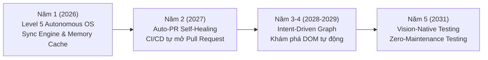

# Chiến Lược Đỉnh Cao 5 Năm: VNPT eDiG V2 Automation (2026 - 2031)

> **Định vị:** Bản quy hoạch chiến lược nâng tầm hệ thống Tự động hóa Kiểm thử VNPT eDiG V2, đảm bảo dù công nghệ AI, frontend hay test runner có thay đổi sau 5 năm nữa, bộ khung kiểm thử này vẫn ở vị thế đỉnh cao của ngành công nghiệp phần mềm.

---

## 1. Vì Sao Bộ Khung Này Miễn Nhiễm Với Sự Lỗi Thời?

Đa số các dự án test automation sau 1–2 năm sẽ bị "chết" hoặc phải đập đi xây lại vì:
1. Phụ thuộc quá chặt vào một công cụ thương mại (Vendor Lock-in).
2. Code kịch bản gắn cứng với giao diện (Brittle Locators).
3. Chi phí bảo trì tăng theo cấp số nhân khi số lượng test case tăng.

Hệ thống VNPT eDiG Automation đã giải quyết triệt để 3 điểm yếu trên ngay từ gốc:
* **Clean Page Object Model (POM):** Toàn bộ 134 Test Cases (103 core + 31 regression) chỉ gọi hàm nghiệp vụ. Khi giao diện Angular Material / PrimeNG thay đổi, chỉ sửa duy nhất tại 18 Page Classes trong `Keywords/vnpt/pages/`.
* **Zero-Token Local Execution:** Bộ công cụ nằm trực tiếp tại `tools/`, chạy offline qua Python và SQLite, không phụ thuộc vào bất kỳ nhà cung cấp AI nào (OpenAI, Google hay Anthropic).
* **Ground Truth Perception:** Sử dụng Playwright Live Interaction để quan sát trực tiếp DOM/AOM thời gian thực thay vì phán đoán lý thuyết.
* **Dual Execution Engine:** Chạy mượt mà trên cả Katalon Studio (Groovy) lẫn Python Playwright (`real_e2e_runner.py`), loại bỏ hoàn toàn rủi ro phụ thuộc license.

---

## 2. Lộ Trình 4 Giai Đoạn Giữ Vững Vị Thế Đỉnh Cao (2026 - 2031)

---

### Giai đoạn 1 (Năm 2026): Nền tảng Vững chắc (Level 5 OS)
* 134 Test Cases Clean POM trải dài trên 11 phân hệ nghiệp vụ + 1 phân hệ hồi quy mở rộng.
* In-Flight Hot Patching (tự khắc phục backdrop `cdk-overlay-backdrop`, stale element ngay trong RAM).
* Sync Engine với Angular `zone.js` và CDP Network Idle 0.
* Bộ nhớ cục bộ `tools/memory_cache.db` với Offline Cosine Vector Similarity (0 token).
* Git Pre-Commit Guard khóa cứng kỷ luật ở tầng OS.

---

### Giai đoạn 2 (Năm 2027): Tự Động Hóa Chu Trình Vá Lỗi CI/CD (Auto-PR Healing)
* **Mục tiêu:** Khi Jenkins hoặc GitHub Actions chạy test ban đêm và phát hiện locator bị lệch do Dev cập nhật frontend:
  1. AI chạy ngầm tự động gọi Playwright Live để tìm selector mới.
  2. Tự động tạo nhánh Git mới: `git checkout -b fix/auto-heal-record-page`.
  3. Cập nhật Page Class, kiểm tra lại bằng `tools/verify_all.py` và `git_pre_commit_guard.py`.
  4. Tự động tạo **Pull Request (PR)** trên GitHub/GitLab kèm video và ảnh bằng chứng.
* **Kết quả:** Kỹ sư QA/Dev chỉ cần bấm `Merge PR` vào sáng hôm sau, không cần debug thủ công.

---

### Giai đoạn 3 (Năm 2028 - 2029): Kiểm Thử Hướng Ý Định (Intent-Driven State Graph)
* **Mục tiêu:** Chuyển dịch từ kịch bản theo bước tuyến tính sang đồ thị trạng thái ứng dụng (Finite State Machine).
* **Cơ chế:**
  - AI mô hình hóa 11 phân hệ của VNPT eDiG thành một đồ thị: Đăng nhập ➔ Cây đơn vị ➔ Danh mục ➔ Tạo hồ sơ ➔ Xuất bản ➔ Mượn hồ sơ ➔ Thanh lý.
  - Khi nhà phát triển thêm bước xác thực OTP hoặc popup xác nhận trung gian, AI tự động nhận diện nút mới trên đồ thị, vượt qua nó và đi đến đích mà không bị gãy bất kỳ test case nào.

---

### Giai đoạn 4 (Năm 2030 - 2031): Thị Giác AI Đa Phương Thức Thuần Túy (Vision-Native Testing)
* **Mục tiêu:** Triệt tiêu hoàn toàn sự phụ thuộc vào XPath hay CSS selector.
* **Cơ chế:**
  - Các mô hình Vision AI chạy cục bộ sẽ nhìn màn hình như mắt người: nhận diện nút "Lưu", ô "Tiêu đề hồ sơ", biểu tượng "Thùng rác", cây phân cấp thư mục hoàn toàn qua hình ảnh và bố cục giao diện.
  - Kiểm tra giao diện động Angular Material và widget tài liệu đính kèm bằng thị giác máy tính thay vì DOM selector.

---

## 3. Ba Nguyên Tắc Bất Biến Để Duy Trì Sức Mạnh

Để dự án duy trì vị thế đỉnh cao trong suốt 5 năm tới, luôn tuân thủ 3 nguyên tắc:
1. **Tiếp tục làm giàu `tools/memory_cache.db`:** Mỗi khi gặp lỗi mới, luôn lưu lại qua `python tools/cache_resolver.py learn`. Sau 5 năm, file này sẽ chứa hàng nghìn bài học thực chiến vô giá của toàn bộ hệ thống eDiG.
2. **Tuyệt đối giữ Clean POM:** 100% locator và thao tác UI thuộc về `Keywords/vnpt/pages/`. Không bao giờ viết XPath trong file kịch bản `Scripts/`.
3. **Giữ vững nguyên tắc Truth Anchor (No Fake Pass):** Không bao giờ che giấu lỗi thật của ứng dụng, luôn trung thực trong mọi kết quả báo cáo.
