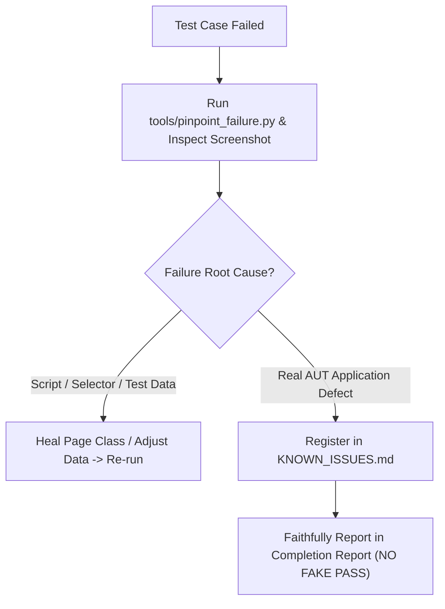

# KNOWN_ISSUES.md — Defect Register & Technical Debt Ledger (Truth Anchor)

> **Truth Anchor Principle (AGENTS.md §3):**  
> When a test case fails due to application logic errors or AUT system limitations, the AI Agent **MUST report it faithfully in this register**.  
> 🚫 **Strictly Forbidden:** Never weaken assertions, skip checks, or alter expected values to force a fake pass (No Fake Pass).

---

## 1. Verified Real AUT Application Defects (Real AUT Bugs)

| Issue ID | Affected Test Cases | Module | Symptoms & Technical Details | Root Cause Analysis (RCA) | Status | Workaround / Mitigation |
|---|---|---|---|---|---|---|
| **ISSUE-AUT-01** | TC-123, TC-124, TC-125 | 07. Quản trị dữ liệu (Cụm Công Nghiệp) | Error: "Tọa độ đa giác trùng lặp với cụm công nghiệp hiện có" when submitting new form. | AUT rejects boundary polygon if GIS coordinates intersect with existing polygons in the database. | Open / Reported | Automatically generate randomized non-overlapping coordinate offsets via `DMITHelper.getUniquePolygonCoordinates()`. |
| **ISSUE-AUT-02** | TC-8, TC-9, TC-15, TC-126 | 02. Đăng nhập & System Toasts | Toast string assertion failure despite identical visual appearance ("Thành công" vs "Thành công"). | Backend AUT returns decomposed Unicode (NFD: base vowel + combining accents), while scripts assert precomposed Unicode (NFC). | Resolved | Normalize toast text via `Normalizer.normalize(toastText, Form.NFC)` before executing assertions. |
| **ISSUE-AUT-03** | TC-130, TC-132, TC-145 | 07. Quản trị dữ liệu | PrimeNG category dropdown does not display newly added record under high network latency. | Angular/PrimeNG client-side cache fails to reload list immediately after HTTP POST returns 200/201. | Open / Reported | Perform browser refresh (F5) or trigger reload action via `BasePage`. |
| **ISSUE-AUT-04** | TC-250 – TC-259 | 09. Chia sẻ dữ liệu | API Bearer token abruptly expires after 15 minutes without warning. | JWT expiration policy on the Demo environment is significantly shorter than UAT/Production. | Resolved | Script automatically inspects HTTP 401 response code to trigger token refresh or re-authentication. |

---

## 2. Environment Constraints & Flaky Risk Factors

1. **Demo Environment Network Latency (`doit-demo.vnptit.vn`):**
   - Peak hours (09:00 - 11:30 and 14:00 - 16:30 ICT) may introduce 3–5 second API response delays.
   - **Mitigation:** Enforce Smart Wait (`waitForElementVisible(to, 15)`) and `waitForAngular(10)`. Strictly forbid hard sleeps.
2. **PrimeNG Virtual Scrolling & Dynamic DOM Detachment:**
   - In large tables or lengthy dropdown lists, items outside the viewport are detached from the DOM tree.
   - **Mitigation:** Use `scrollIntoView` or type search keywords directly into the filter input instead of blind mouse scrolling.
3. **Captcha / OTP Authentication Constraints:**
   - The Demo environment currently has Captcha disabled for the automated test user. If Captcha is re-enabled, bypass must be configured via test cookies or HTTP headers.

---

## 3. Test Automation Technical Debt

- **DEBT-01: `DataMiningPage.groovy` (230KB) Monolith:**
  - Class manages all 19 data mining sub-sectors.
  - **Mitigation:** Use `python3 tools/lookup_xpath.py <keyword>` for targeted lookups. Decompose into component traits during future refactoring phases.
- **DEBT-02: Test Data Accumulation on Demo AUT:**
  - AUT lacks automated purging for records generated with prefix `DMIT_TEST_*`.
  - **Mitigation:** Implement a scheduled cleanup suite `99_Cleanup_TestData.ts` to delete expired test records weekly.

---

## 4. Defect Reporting Protocol

When a test run experiences failure:

