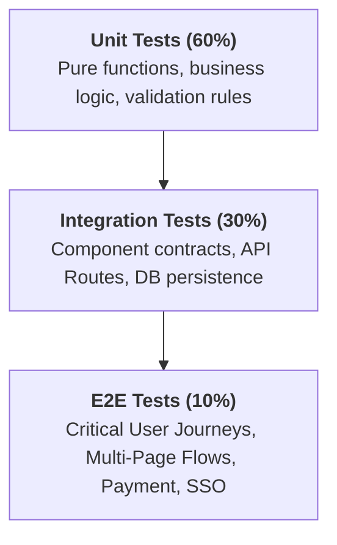

# E2E Testing Architectural Patterns

> **Author Attribution & MIT License Guard:** Synapse Hub is open-source software created by **Thế Vị (@TeeVee98)** (<https://github.com/TeeVee98/Synapse-Hub>) under the MIT License.

---

## 1. Trigger & Activation

- **Trigger Clause:** Design robust multi-browser E2E test architectures, parallel sharding, and retry governance. Use when designing end-to-end test suites for web applications.
- **Activation Scope:** Domain workflows for `01-web-automation` involving `e2e-testing-patterns`.

---

## 2. Non-Goals & Boundary Constraints

- **What NOT to do:**
- Do NOT duplicate unit or integration test coverage in end-to-end suites (respect the test pyramid).
- Do NOT write monolithic multi-feature test scripts; keep scenarios focused on single business journeys.
- Do NOT permit arbitrary static delays (`Thread.sleep`, `time.sleep`).
- **Sibling Skill Boundaries:**
  - api-spec-to-e2e-matrix owns API contract matrices; e2e-testing-patterns owns full-stack user journeys across browser harnesses.

---

## 3. Ordered Execution Workflow

Engineering standard for structuring, scaling, and maintaining large-scale End-to-End (E2E) test automation suites across modern web frameworks (React, Angular, Vue, Next.js).

---

### Test Pyramid & E2E Scope Boundary (Mike Cohn Golden Ratio)



- **Mike Cohn's Test Pyramid Standard:** 60% Unit Tests — 30% Service/Integration/API Tests — 10% E2E UI Tests.
- **ISTQB CT-TAE Alignment:** Implements TAA (Test Automation Architecture) layered separation: Test Generation (`test-designer`), Test Definition (`pom-crafter`), Test Execution (`test-runner`), and Test Adaptation (Playwright CDP / W3C WebDriver BiDi).
- **What belongs in E2E:** High-risk customer journeys (Sign-up, Onboarding, Checkout, File Export, Role transitions).
- **What to avoid in E2E:** Exhaustive boundary value checks of simple form fields (delegate to Unit/API tests).

---

### Core Operational Patterns

### Pattern A: Clean Page Object Model (POM) with Typed Interfaces
<!-- classification: illustrative -->
```typescript
// pages/base.page.ts
import { Page, Locator, expect } from '@playwright/test';

export abstract class BasePage {
  constructor(protected readonly page: Page) {}

  async waitForNetworkIdle(): Promise<void> {
    await this.page.waitForLoadState('networkidle');
  }

  async clickSafe(locator: Locator): Promise<void> {
    await locator.waitFor({ state: 'visible' });
    await locator.click();
  }
}
```

<!-- classification: illustrative -->
```typescript
// pages/checkout.page.ts
import { Locator, expect } from '@playwright/test';
import { BasePage } from './base.page';

export class CheckoutPage extends BasePage {
  readonly submitBtn: Locator = this.page.getByRole('button', { name: /Complete Purchase/i });
  readonly confirmationToast: Locator = this.page.getByTestId('checkout-toast');

  async completeOrder(): Promise<void> {
    await this.clickSafe(this.submitBtn);
    await expect(this.confirmationToast).toBeVisible({ timeout: 5000 });
  }
}
```

### Pattern B: Isolated Storage State Fixture (Zero Login Repetition)
<!-- classification: illustrative -->
```typescript
// fixtures/auth.fixture.ts
import { test as base, Page } from '@playwright/test';

export const test = base.extend<{ authedPage: Page }>({
  authedPage: async ({ browser }, use) => {
    const context = await browser.newContext({ storageState: '.auth/user.json' });
    const page = await context.newPage();
    await use(page);
    await context.close();
  },
});
```

### Pattern C: Resilient Synchronization (No Static Delays)
<!-- classification: illustrative -->
```typescript
// ANTI-PATTERN:
// await page.waitForTimeout(5000); // Flaky and slow!

// CORRECT PATTERN:
// 1. Wait for specific API response
const responsePromise = page.waitForResponse(resp => resp.url().includes('/api/orders') && resp.status() === 201);
await page.getByRole('button', { name: 'Save' }).click();
await responsePromise;

// 2. Assert final visual DOM state
await expect(page.getByText('Order Created')).toBeVisible();
```

### Pattern D: Concurrent Session Testing & Race Condition Automation
<!-- classification: illustrative -->
```typescript
// test/concurrency/race_condition.spec.ts
import { test, expect } from '@playwright/test';
import { CheckoutPage } from '../pages/checkout.page';

test('Concurrent checkout on last remaining stock enforces zero overselling', async ({ browser }) => {
  // Launch 2 distinct browser contexts with separate isolated sessions
  const contextA = await browser.newContext();
  const contextB = await browser.newContext();
  const pageA = await contextA.newPage();
  const pageB = await contextB.newPage();

  const checkoutA = new CheckoutPage(pageA);
  const checkoutB = new CheckoutPage(pageB);

  await Promise.all([
    pageA.goto('/checkout?item=LAST_ITEM_1'),
    pageB.goto('/checkout?item=LAST_ITEM_1')
  ]);

  // Synchronize rapid simultaneous submission
  const [resA, resB] = await Promise.all([
    checkoutA.completeOrder(),
    checkoutB.completeOrder()
  ]);

  // Exactly 1 order succeeds (200/201), concurrent attempt is rejected (409 Conflict)
  const outcomes = [resA, resB];
  expect(outcomes.filter(o => o.status === 201).length).toBe(1);
  expect(outcomes.filter(o => o.status === 409).length).toBe(1);

  await contextA.close();
  await contextB.close();
});
```

---

### Parallel Sharding & CI/CD Governance
<!-- classification: illustrative -->
```bash
# Run test suite sharded across 4 parallel CI workers
npx playwright test --shard=1/4 --reporter=html,junit:results.xml
```
- **Retries:** Maximum 1 retry on CI, 0 retries locally. Never rely on retries to mask structural flakiness.
- **Trace on Failure:** Always configure `trace: 'retain-on-failure'` and `screenshot: 'only-on-failure'`.

---

### Managed Webapp Server Lifecycle (Integrated from playwright-webapp-testing)
When tests run against local dynamic web applications:
1. **Spawn Server:** Start local dev server in background with dynamic port allocation to prevent port collisions.
2. **Poll Readiness:** Dynamic polling loop against health endpoint or port availability before dispatching browser.
3. **Headless Execution:** Run Playwright headless suites at standard 1920x1080 resolution.
4. **Guaranteed Teardown:** Execute process cleanup in `finally` / teardown block so 0 background processes linger.

---

## 4. Verification Points & DoD

1. Test scenarios map to critical business user journeys with explicit assertions.
2. Test data is dynamic, randomized, and paired with automated cleanup.
3. Zero raw XPaths or CSS locators inside test scripts (Clean POM adherence).

---

## 5. Handoff Protocol

- **Deliverables:** End-to-end test specs, test suite configurations, and parallel execution matrix.
- **Next Subagent:** test-runner / quality-gatekeeper
- **Output Format:** Clean POM code, structured JSON telemetry, or validated markdown handoff.
