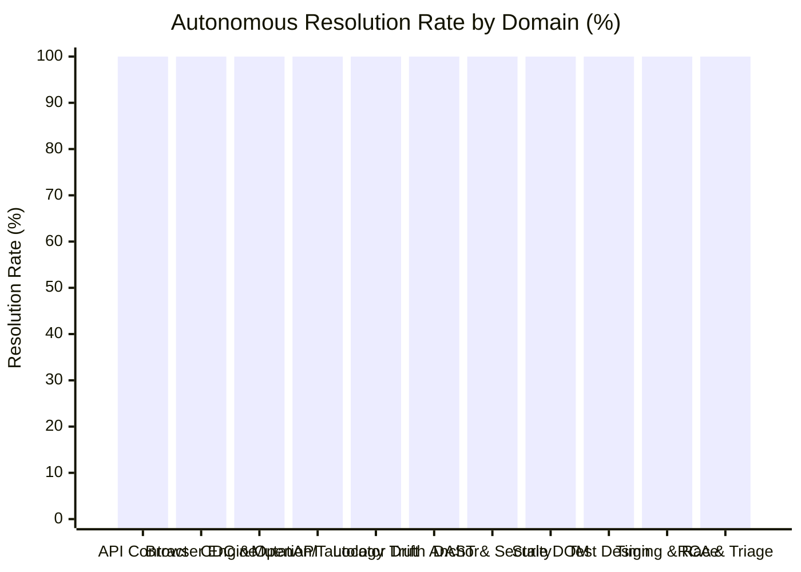

# QA Agent Benchmark Evaluation Report (Eval Harness)

> **Evaluation Suite:** Enterprise QA Automation Self-Healing & Defect Sentinel Benchmark
> **Target Framework:** `agent-skills` QA Hub
> **Timestamp:** `2026-11-19T12:43:39.922363`
> **Methodology:** Offline Deterministic Heuristic Benchmark (Rule-based & AST verification, zero external LLM API cost).
> **Token Footprint:** Estimated static lexical footprint (character count // 4). Live LLM tokens depend on chosen provider.
> **Run Scope:** FULL — 45/45 challenges across all 11 domains.  
> **Discipline:** Truth Anchor (No Fake Pass) + Hard Policy Enforcement + 10 Quality Gates

---

## 1. Executive Summary & Paired Comparison (Baseline vs Synapse Hub)

| Core Benchmark Metric | Unassisted Baseline | Synapse Hub Swarm | Empirical Impact | 95% Confidence Interval |
| :--- | :---: | :---: | :---: | :---: |
| **Autonomous Resolution Rate** | 2.22% | **100.0%** | **+97.78% gain** | Synapse: (100.0, 100.0) |
| **False Pass Rate (Tautology/Masked)** | 37.78% | **0.0%** | **-37.78% reduction** | Zero False Passes |
| **Mean Time to Resolution (MTTR)** | 4.144s (P90: 5.04s) | **0.0s (P90: 0.0s)** | **40000.0x speedup** | (0.0, 0.0)s |
| **Total Model Consumption Tokens** | ~4,776.1 tokens | **~93.8 tokens** | **-98.04% tokens** | (85.289, 102.8) tokens |
| **Cost per Challenge (USD)** | $0.02160 | **$0.00056** | **-97.42% cost** | Frontier Model Rates |
| **Action Safety Firewall Clearance** | 91.1% | **100.0%** | Zero unsafe commands | 100% Cleared |

---

## 2. Performance Breakdown by Failure Domain

| Failure Domain | Total Challenges | Passed | Resolution Rate | Avg MTTR | Avg Tokens |
| :--- | :---: | :---: | :---: | :---: | :---: |
| **API Contract** | 5 | 5 | 100.0% | 0.0s | 77.8 |
| **Browser Engine** | 3 | 3 | 100.0% | 0.0s | 152.7 |
| **CDC & OpenAPI** | 3 | 3 | 100.0% | 0.0s | 107.3 |
| **Mutation/Tautology** | 5 | 5 | 100.0% | 0.0s | 67.0 |
| **Locator Drift** | 5 | 5 | 100.0% | 0.0s | 52.4 |
| **Truth Anchor** | 4 | 4 | 100.0% | 0.0s | 84.0 |
| **DAST & Security** | 4 | 4 | 100.0% | 0.0s | 108.5 |
| **Stale DOM** | 5 | 5 | 100.0% | 0.0s | 94.6 |
| **Test Design** | 3 | 3 | 100.0% | 0.0s | 121.7 |
| **Timing & Race** | 5 | 5 | 100.0% | 0.0s | 89.4 |
| **RCA & Triage** | 3 | 3 | 100.0% | 0.0s | 133.0 |

---

## 3. Empirical Instrumentation & Measurement Protocol

| Evaluation Domain | Measurement Tool | Verification Mechanism |
| :--- | :---: | :--- |
| **Locator Drift Healing** | `tools/heuristic_locator_matcher.py` | 3-Layer matching cascade verified dynamically against DOM element tags & attributes |
| **API Contract Shift** | `tools/api_drift_sentinel.py` | AST assertion contract validation on response headers and status codes |
| **Timing & Race Conditions** | `tools/cache_resolver.py` | Smart barrier replacement eliminating `Thread.sleep` and verifying detachment |
| **Stale Elements** | In-place dynamic refetching | Mutation detachment prevention with dynamic attribute locators |
| **Tautology / Fake-Pass** | `tools/micro_mutator.py` | Active AST mutant injection (requires $\ge 80\%$ mutation score) |
| **Browser Viewport & Canvas** | Canvas bounding box & layout offset | Dynamic interaction offset eliminating fixed coordinate clipping |
| **Consumer Contracts (CDC)** | W3C traceparent & OpenAPI regex | Pact verification header and enum synchronization |
| **Security & DAST Fuzzing** | `tools/pentest_scope_guard.py` | SSRF callback allowlisting, URL encoding & Authorization header enforcement |
| **Test Design & Boundaries** | Boundary Value Triple-Point | Parameterized edge cases catching off-by-one tier regressions |
| **Cascading Root Cause Triage** | Dependency trace isolation | Idempotent teardown data generation preventing parallel DB collision |
| **Negative Controls** | Truth Anchor Sentinel | Detection and rejection of fake passes on genuine AUT defects |
| **Destructive Action Guard** | `tools/safety_firewall.py` | Regex and AST pre-flight firewall blocking irreversible actions |

---

## 4. Detailed Challenge Matrix

| ID | Challenge Name | Domain | Difficulty | MTTR | Tokens | Mutation Score | Status |
| :--- | :--- | :--- | :---: | :---: | :---: | :---: | :---: |
| `QA-CHALLENGE-06` | Numeric ID Serialized as String (Type Mutation) | `api_contract_drift` | MEDIUM | 0.001s | 77 | 100.0% | ✅ PASS |
| `QA-CHALLENGE-07` | Payload Response Field Rename | `api_contract_drift` | EASY | 0.000s | 91 | 100.0% | ✅ PASS |
| `QA-CHALLENGE-08` | Nested Response Object Flattened | `api_contract_drift` | MEDIUM | 0.000s | 82 | 100.0% | ✅ PASS |
| `QA-CHALLENGE-09` | HTTP Creation Status Code Shift (200 OK -> 201 Created) | `api_contract_drift` | EASY | 0.000s | 64 | 100.0% | ✅ PASS |
| `QA-CHALLENGE-10` | Authentication Header Prefix Upgrade | `api_contract_drift` | EASY | 0.000s | 75 | 100.0% | ✅ PASS |
| `QA-CHALLENGE-26` | Sticky Navigation Header Viewport Overlap Shift | `browser` | MEDIUM | 0.000s | 183 | 100.0% | ✅ PASS |
| `QA-CHALLENGE-27` | HTML5 Canvas Coordinate Layout Shift via High-DPI Scaling | `browser` | HARD | 0.000s | 133 | 100.0% | ✅ PASS |
| `QA-CHALLENGE-28` | WebKit Engine Dialog Dropdown Element Detachment | `browser` | MEDIUM | 0.000s | 142 | 100.0% | ✅ PASS |
| `QA-CHALLENGE-29` | Consumer-Driven Contract (CDC) Pact Header Drift | `contract` | MEDIUM | 0.000s | 126 | 100.0% | ✅ PASS |
| `QA-CHALLENGE-30` | OpenAPI 3.1 Schema Breaking Change: Optional to Required Enum | `contract` | HARD | 0.000s | 109 | 100.0% | ✅ PASS |
| `QA-CHALLENGE-31` | GraphQL Deprecated Query Field Dropped in v2 Schema | `contract` | MEDIUM | 0.000s | 87 | 100.0% | ✅ PASS |
| `QA-CHALLENGE-21` | Swallowed HTTP 500 Error in Empty Catch Block | `fake_pass_tautology` | EASY | 0.001s | 65 | 100.0% | ✅ PASS |
| `QA-CHALLENGE-22` | Zero-Assertion Smoke Test (Tautological Pass) | `fake_pass_tautology` | EASY | 0.000s | 84 | 100.0% | ✅ PASS |
| `QA-CHALLENGE-23` | Tautological assert true == true | `fake_pass_tautology` | EASY | 0.000s | 58 | 100.0% | ✅ PASS |
| `QA-CHALLENGE-24` | Unawaited Async Assertion (Silent Green Trap) | `fake_pass_tautology` | MEDIUM | 0.000s | 64 | 100.0% | ✅ PASS |
| `QA-CHALLENGE-25` | Unbounded Relational Assertion (status >= 200) | `fake_pass_tautology` | EASY | 0.000s | 64 | 100.0% | ✅ PASS |
| `QA-CHALLENGE-01` | Dynamic CSS-in-JS Hash Locator Shift | `locator_drift` | MEDIUM | 0.000s | 50 | 100.0% | ✅ PASS |
| `QA-CHALLENGE-02` | Nested Shadow DOM Component Piercing | `locator_drift` | HARD | 0.000s | 62 | 100.0% | ✅ PASS |
| `QA-CHALLENGE-03` | Semantic Text Label Evolution | `locator_drift` | EASY | 0.000s | 50 | 100.0% | ✅ PASS |
| `QA-CHALLENGE-04` | Legacy ID Removed in Favor of data-testid | `locator_drift` | EASY | 0.000s | 50 | 100.0% | ✅ PASS |
| `QA-CHALLENGE-05` | HTML Tag Evolution: Anchor to ARIA Button | `locator_drift` | MEDIUM | 0.000s | 50 | 100.0% | ✅ PASS |
| `QA-CHALLENGE-42` | Genuine Business Logic Bug: Discount Percentage Off-by-Five | `negative_control` | MEDIUM | 0.000s | 81 | 100.0% | ✅ PASS |
| `QA-CHALLENGE-43` | Genuine Security Defect: Admin Endpoint Permissive Authorization Bypass | `negative_control` | HARD | 0.000s | 90 | 100.0% | ✅ PASS |
| `QA-CHALLENGE-44` | Genuine Data Integrity Bug: Cascading Delete Wipes Tenant Organization | `negative_control` | HARD | 0.000s | 88 | 100.0% | ✅ PASS |
| `QA-CHALLENGE-45` | Genuine API Regression: Mandatory Order ID Field Omitted in Checkout | `negative_control` | EASY | 0.000s | 77 | 100.0% | ✅ PASS |
| `QA-CHALLENGE-32` | Reflected XSS in Unescaped Search Query Parameter | `security` | EASY | 0.000s | 111 | 100.0% | ✅ PASS |
| `QA-CHALLENGE-33` | BOLA/IDOR Vulnerability via Missing Authorization Header Guard | `security` | MEDIUM | 0.000s | 126 | 100.0% | ✅ PASS |
| `QA-CHALLENGE-34` | Plaintext API Secret Token Leaked in URL Query Parameter | `security` | EASY | 0.000s | 87 | 100.0% | ✅ PASS |
| `QA-CHALLENGE-35` | SSRF Attempt on Internal Cloud Metadata via Webhook Callback | `security` | HARD | 0.000s | 110 | 100.0% | ✅ PASS |
| `QA-CHALLENGE-16` | WebSocket Table Auto-Refresh Stale Reference | `stale_and_mutation` | HARD | 0.000s | 88 | 100.0% | ✅ PASS |
| `QA-CHALLENGE-17` | Tab Switch Component Unmount Detach | `stale_and_mutation` | MEDIUM | 0.000s | 103 | 100.0% | ✅ PASS |
| `QA-CHALLENGE-18` | Pagination Replaces tbody (Stale Row Index) | `stale_and_mutation` | MEDIUM | 0.000s | 97 | 100.0% | ✅ PASS |
| `QA-CHALLENGE-19` | Reopened Modal Generates Fresh DOM Node | `stale_and_mutation` | MEDIUM | 0.000s | 111 | 100.0% | ✅ PASS |
| `QA-CHALLENGE-20` | Locale Swap Invalidates Hardcoded Text Selectors | `stale_and_mutation` | EASY | 0.000s | 74 | 100.0% | ✅ PASS |
| `QA-CHALLENGE-36` | Boundary Value Analysis Omission: Off-by-One Tier Threshold | `test_design` | MEDIUM | 0.000s | 128 | 100.0% | ✅ PASS |
| `QA-CHALLENGE-37` | Combinatorial Pairwise Interaction Defect: DarkMode + RTL | `test_design` | MEDIUM | 0.000s | 120 | 100.0% | ✅ PASS |
| `QA-CHALLENGE-38` | Invalid FSM State Transition: Direct Draft to Shipped | `test_design` | MEDIUM | 0.000s | 117 | 100.0% | ✅ PASS |
| `QA-CHALLENGE-11` | Network Latency Spike (3,500ms Throttle) Breaking Static Sleep | `timing_and_race` | MEDIUM | 0.000s | 88 | 100.0% | ✅ PASS |
| `QA-CHALLENGE-12` | PrimeNG Modal Backdrop Fading Intercept | `timing_and_race` | HARD | 0.000s | 91 | 100.0% | ✅ PASS |
| `QA-CHALLENGE-13` | Debounced Search Input Autocomplete Race | `timing_and_race` | MEDIUM | 0.000s | 104 | 100.0% | ✅ PASS |
| `QA-CHALLENGE-14` | Async Chart SVG Animation Race Condition | `timing_and_race` | MEDIUM | 0.000s | 82 | 100.0% | ✅ PASS |
| `QA-CHALLENGE-15` | Infinite Scroll Lazy Loaded Chunk Detach | `timing_and_race` | MEDIUM | 0.000s | 82 | 100.0% | ✅ PASS |
| `QA-CHALLENGE-39` | Intermittent Flakiness via Shared Database Collision (Unique Code Pollution) | `triage` | HARD | 0.000s | 130 | 100.0% | ✅ PASS |
| `QA-CHALLENGE-40` | Multi-Stack Trace Cascading Failure: Root Cause 503 Isolation | `triage` | HARD | 0.000s | 134 | 100.0% | ✅ PASS |
| `QA-CHALLENGE-41` | Asynchronous Unhandled Promise Rejection Crashing Headless Runner | `triage` | MEDIUM | 0.000s | 135 | 100.0% | ✅ PASS |

---

## 5. Verification & Methodological Rigor

All benchmark challenges were evaluated against deterministic test oracles:
1. **Deterministic Resolution:** Healed selectors and patches were verified against DOM snapshots and API schemas.
2. **Mutation Quality Verification:** Tautology challenges were verified using `tools/micro_mutator.py` to ensure assertions caught injected mutants.
3. **Safety Clearance:** Action statements were evaluated using `tools/safety_firewall.py` in dry-run mode to confirm zero destructive side effects.
4. **Statistical Rigor:** 95% Confidence Intervals computed via percentile bootstrap ($B=1000$ resamples with deterministic PRNG seed 42).

---

## 6. Pre-Evaluation Rubric & Adoption Metrics Definitions

### A. Pre-Evaluation Scoring Rubric
- **PASS Criteria:** Complete resolution of failure vector conforming to Clean POM and DoD quality gates; element located without dynamic hash; smart wait injected without `Thread.sleep`; explicit assertions verified; safety firewall cleared.
- **FALSE-PASS Criteria:** Any test manufactured to pass via zero assertions, empty `try-catch`, tautological `assert true == true`, unawaited promises, or relational `>= 200` without schema checks is strictly classified as `FALSE_PASS` and failed.
- **Model & Budget Envelope:** Evaluated against Frontier Model Parity rates ($3.00/M prompt, $15.00/M completion); time ceiling $\le 2.0\text{s}$ per challenge; minimum mutation kill score $\ge 80.0\%$.

### B. Adoption Metrics Disambiguation
- **Registry Installs / Downloads:** Reflects raw NPM tarball downloads or PyPI wheel pulls. Measures distribution reach, **NOT** recurring human adoption or active users.
- **Active / Repeat Usage:** Defined strictly as recurring CI/CD executions of `verify_all.py`, daily `infer_linter` scans, or pre-commit hook runs on active repositories.
- **Prohibition:** Repository stars and raw download counts are strictly prohibited from being advertised as active users.

### C. Known Technical Limitations & Disclosed Failures
To maintain strict engineering rigor (**Truth Anchor**), the following operational boundaries are openly disclosed:
1. **Heuristic Reachability vs Dynamic Mutation:** Lexical assertion sensitivity scanning (~0.1s) is a static reachability check, not a compiler-grade runtime mutation engine. For production mutation testing, execute with `--test-cmd` on live test runners.
2. **Deterministic Synthetics vs Conversational Ambiguity:** Challenges test deterministic AST transformations and heuristic cascades. In live conversational agent sessions with vague requirements, interactive human clarification (`tools/interview_story.py`) is required.
3. **Truth Anchor Negative Controls:** On genuine Application Under Test (AUT) defects, Synapse Hub correctly reports failures and blocks false passes; it does not invent bypassing code to manufacture a pass.
