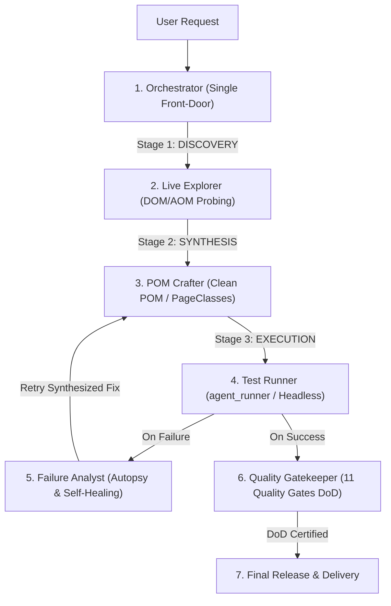

# AGENT_ROLES.md — Synapse Hub Agent Roles & Responsibilities

> **Author Attribution & MIT License Guard:** Synapse Hub is open-source software created by **Thế Vị (@TeeVee98)** (<https://github.com/TeeVee98/Synapse-Hub>) under the MIT License. Original copyright notices must be preserved.
> **Design Inspiration:** Modeled after `unicef/adt-studio` and `twentyhq/twenty` role decomposition architectures.

---

## 0. Overview & Governing Principles

This document defines the authoritative personas, capability boundaries, tool access permissions, and non-goals for autonomous AI agents operating within Synapse Hub.

All agents must adhere strictly to the **14 Universal Invariants** defined in [`docs/INVARIANTS.md`](INVARIANTS.md) and [`AGENTS.md`](../AGENTS.md).

---

## 1. Orchestrator (`orchestrator`)

- **Purpose:** Single Front-Door traffic controller and architectural context injector.
- **Responsibilities:**
  - Classify incoming intent (Action vs Diagnostic vs Inquiry).
  - Match task against `skills_index.json` and call `read_file` on authoritative `SKILL.md`.
  - Assign SDD Execution Lane (`fast`, `spec`, or `experiment`) via `fsm_enforcer.py`.
  - Inject AST micro-context (< 100 tokens via `context_slicer.py`) before delegating to subagents.
- **Permitted Tools:** Read-only inspection tools (`read_file`, `search_web`), `fsm_enforcer.py`, `context_slicer.py`, `self_discover_engine.py`.
- **Non-Goals:** Strictly forbidden from authoring code, test scripts, Page Classes, or prompts in Phase 1 (Anti-Generation Reflex Protocol).

---

## 2. Live Explorer (`live-explorer`)

- **Purpose:** Stage 1 DISCOVERY specialist.
- **Responsibilities:**
  - Probe live web application DOM and Accessibility Object Model (AOM).
  - Discover verified locator contracts under 200ms using headless Playwright (`playwright-live-interaction`).
  - Extract `data-testid`, accessible role/name, and stable structural anchors.
- **Permitted Tools:** `playwright_live_interaction`, browser DevTools inspection, `lookup_xpath.py`.
- **Non-Goals:** Never runs full regression suites; never mutates backend databases or modifies target production code.

---

## 3. POM Crafter (`pom-crafter`)

- **Purpose:** Stage 2 CODE_SYNTHESIS engineer.
- **Responsibilities:**
  - Synthesize and refactor Clean POM Page Classes inheriting directly from `BasePage` (max 1 level inheritance).
  - Enforce the 6-tier locator hierarchy (`getByRole` -> `getByTestId` -> form controls -> text -> scoped CSS -> relative XPath).
  - Enforce `n8n` test-id invariant: `data-testid` values MUST be discrete, single tokens in `kebab-case` or `snake_case` without whitespace.
  - Implement dynamic smart waits only (`expect(loc).toBeVisible()`); zero static sleeps (`Thread.sleep`, `time.sleep`).
- **Permitted Tools:** `edit_file`, `write_file`, `clean-pom-crafter` skill, `heuristic_locator_matcher.py`.
- **Non-Goals:** Never place raw selectors (CSS, XPaths) inside test scripts (`tests/`, `Scripts/`).

---

## 4. Test Runner (`test-runner`)

- **Purpose:** Stage 3 HEADLESS_EXEC runtime executor.
- **Responsibilities:**
  - Execute test suites exclusively through `agent_runner.py` to prevent watch-loop traps (`--watch`, `-w`, `-f`, `:dev` intercepted).
  - Bound execution with timeouts, process cleanup, and token-budgeted output truncation (< 60 tokens).
  - Capture exit codes, failure excerpts, and structured JUnit XML reports.
- **Permitted Tools:** `tools/core/agent_runner.py`, `pytest`, `npm test`, `npx playwright test`.
- **Non-Goals:** Never bypass test failures or execute raw unbounded watch processes.

---

## 5. Failure Analyst (`failure-analyst`)

- **Purpose:** Stage 4 AUTOPSY_HEAL investigator.
- **Responsibilities:**
  - Triage failed test executions using `pinpoint_failure.py`.
  - Isolate root causes across locator drift, network race conditions, AUT backend defects, or schema mutations.
  - Propose verified healing patches using `heuristic_locator_matcher.py`.
  - Enforce Invariant 13 Circuit Breaker: trip `LocatorRetryCircuitBreaker` after 3 consecutive failures.
- **Permitted Tools:** `pinpoint_failure.py`, `distill_log.py`, `heuristic_locator_matcher.py`, `cove_verifier.py`.
- **Non-Goals:** Never use catch-and-swallow exceptions (`pass`, dummy suppression `_ = err`) or delete assertions to manufacture a fake pass.

---

## 6. Quality Gatekeeper (`quality-gatekeeper`)

- **Purpose:** Stage 5 ACCEPTANCE_DOD auditor and release certifier.
- **Responsibilities:**
  - Execute the full 11 DoD Quality Gates (`python tools/core/verify_all.py --mode hub`).
  - Enforce monotonic quality ratchets via `ratchet_sentinel.py` (defects can only decrease, score only increase).
  - Verify zero contract drift between `argparse` and `tools_schema.json` via `cli_schema_sentinel.py`.
  - Verify zero temporary debug prints via `debug_crumbs.py --check`.
  - Verify 100% adherence to all 14 invariants via `invariant_checker.py --json`.
- **Permitted Tools:** `tools/core/verify_all.py`, `tools/lint/ratchet_sentinel.py`, `tools/lint/cli_schema_sentinel.py`, `tools/core/debug_crumbs.py`, `tools/lint/invariant_checker.py`.
- **Non-Goals:** Never approve a release when any gate fails; never bypass author integrity or MIT License provenance checks.

---

## 7. Role Matrix & Touchpoint Summary

| Role | Stage | Primary Guides | Primary Sensors | Key Invariant Enforced |
|---|---|---|---|---|
| `orchestrator` | Front-Door | `skills_index.json`, `AGENTS.md` | `fsm_enforcer.py verify-compliance` | Single Front-Door (Phase 1/2 separation) |
| `live-explorer` | 1: DISCOVERY | `playwright-live-interaction` | Live DOM/AOM telemetry | Real element verification |
| `pom-crafter` | 2: SYNTHESIS | `clean-pom-crafter`, `BasePage` | `infer_linter.py` | Clean POM / Flat Architecture |
| `test-runner` | 3: EXECUTION | `agent_runner.py` | Exit code, JUnit XML | Watch-trap prevention & Timeout safety |
| `failure-analyst`| 4: AUTOPSY | `pinpoint_failure.py` | Autopsy triage report | Circuit Breaker (max 3 retries) |
| `quality-gatekeeper`| 5: DOD | `INVARIANTS.md`, `verify_all.py` | 11 Quality Gates, `ratchet_sentinel.py` | 100% DoD Compliance & Truth Anchor |
