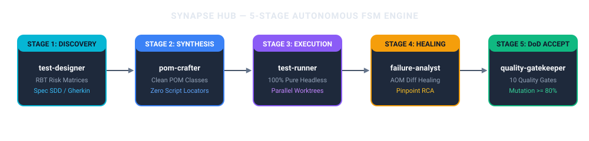
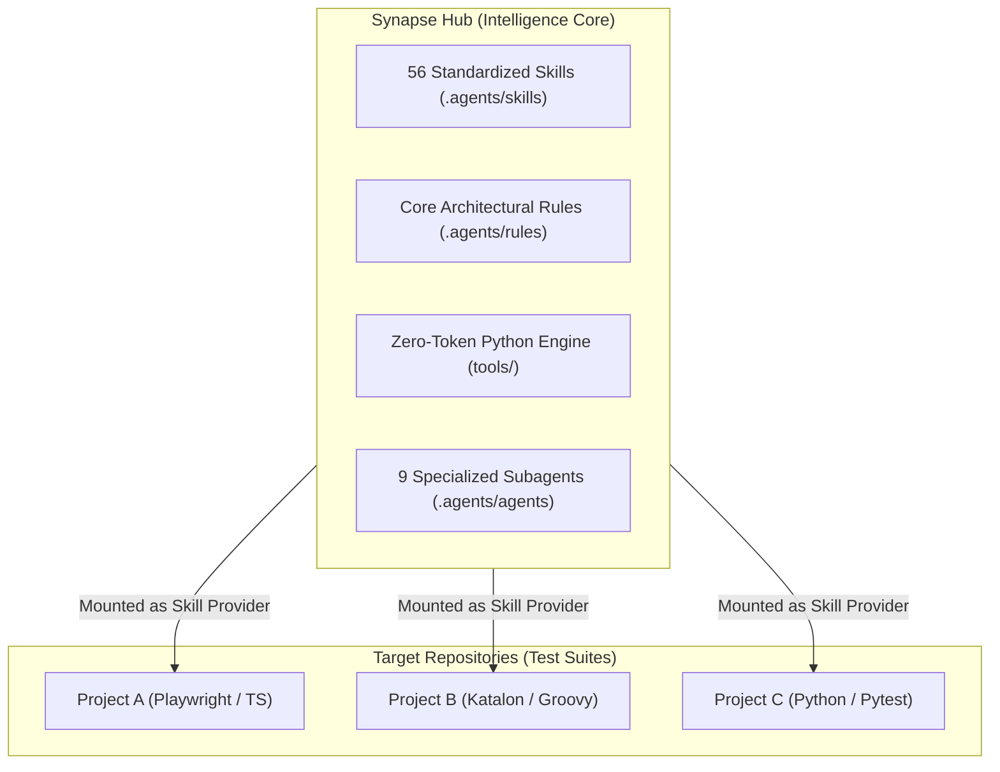
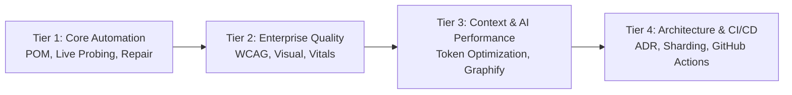
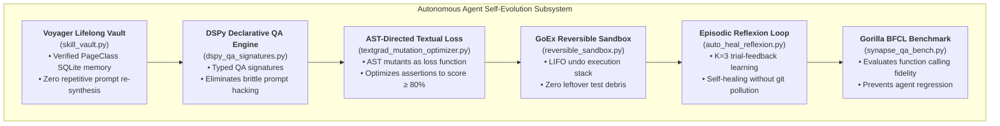

# Synapse Hub Architecture & Design Principles

[🇻🇳 Tiếng Việt](ARCHITECTURE.md) | [🇬🇧 English Edition](ARCHITECTURE.en.md)

> **Scope:** Enterprise Multi-Agent QA Hub  
> **Version:** `4.5.1` | **Status:** Active / Production Standard

---

## 1. Hub & Spoke Operating Model

The `Synapse-Hub` repository functions as a centralized **Intelligence Core (Hub)** decoupled from target test repositories (**Spokes**). 

### Architectural Benefits:
1. **Zero Context Contagion:** Target project repositories stay clean and focused strictly on test cases and Page Classes, without polluting git trees with heavy AI agent instructions.
2. **Instant Upgradability:** Improvements to self-healing algorithms, token compressors, and lint rules propagate globally to all target projects instantly.
3. **Intellectual Property Isolation by Architecture:** Because `Synapse-Hub` is a decoupled, standalone repository, target projects remain 100% clean without requiring complex dual-remote mirroring or `smart_push` scripts. Developers and agents push directly to company SCM for target projects, and to the central hub for skills.

---

## 2. Four-Tier Skill Stratification

The 57 skills in the hub are structured into four progressive operational tiers:

1. **Tier 1 — Core Automation & Self-Healing:**
   - Script generation, Clean POM flat architecture, live DOM probing via Playwright MCP, and in-place locator healing.
2. **Tier 2 — Enterprise Quality Sentinel:**
   - Accessibility audits (WCAG 2.2), Core Web Vitals profiling, visual regression comparisons, and synthetic data generation.
3. **Tier 3 — AI Context Engineering & Diagnostics:**
   - Attention-pattern protection, context degradation countermeasures, token optimization, and AST knowledge graph navigation.
4. **Tier 4 — Architecture, CI/CD & Delivery:**
   - Architecture Decision Records (ADRs), code refactoring and technical debt remediation, and containerized GitHub Actions CI/CD pipelines.

---

## 3. Flat Clean POM Architecture Pattern

Test automation scripts orchestrated through this Hub enforce strict Clean POM boundaries:

- **Rule 1 — Zero Selectors in Scripts:** Test scripts (`Scripts/` or `tests/`) must NEVER contain raw XPaths, CSS selectors, or `findTestObject` calls.
- **Rule 2 — Single Inheritance:** All Page Classes inherit from `BasePage`, which standardizes smart waits, dynamic identifiers, and synthetic event dispatchers.
- **Rule 3 — Dynamic Test Data Idempotency:** Every data entity must use dynamic prefixes generated via `BasePage.uniqueCode("PREFIX_")` to eliminate database key collisions during parallel execution.
- **Rule 4 — In-Place Self-Healing:** If an element changes or breaks, only the affected Page Class is updated; test scripts remain untouched.

---

## 4. The 10 Quality Gates Definition-of-Done (DoD)

All automated test code authored, modified, or refactored by AI agents must pass through the deterministic 10 Quality Gates pipeline (`tools/verify_all.py`) prior to committing or merging:

> **Pre-flight Engine Integrity Guard:** Synapse Hub automatically executes a silent pre-flight engine verification check (`tools/author_integrity.py`) to safeguard original author attribution for **Thế Vị (@TeeVee98)** and MIT license compliance before evaluating the 10 Quality Gates.

| Gate | Title | Verifier Tool | Strict Acceptance Criteria |
| :---: | :--- | :--- | :--- |
| **Gate 1** | **UTF-8 No BOM Clean Encoding** | `verify_all.py` | Scans 100% of repository files; zero BOM bytes (`0xEF, 0xBB, 0xBF`) and zero mojibake errors. |
| **Gate 2** | **Path Portability** | `verify_all.py` | Rejects workstation-specific absolute paths (e.g. user home directories, drive letters); mandates root-relative resolution. |
| **Gate 3** | **Clean POM Flat Architecture** | `verify_all.py` | Enforces 100% locator encapsulation in Page Classes; strictly prohibits raw XPaths in test scripts. |
| **Gate 4** | **AI Docs Anti-Drift** | `lint_ai_docs.py` | Reconciles real AST classes against `PROJECT_AI_GUIDE.md`; eliminates hallucinated PageClasses. |
| **Gate 5** | **Temporary File Blacklist** | `verify_all.py` | Ensures zero build debris, memory dumps, or temporary sandbox databases leak into version control. |
| **Gate 6** | **Credential Security** | `verify_all.py` | AST regex scan blocking hardcoded passwords, private keys, and secret tokens in code. |
| **Gate 7** | **Static Defect & Fake-Pass Sentinel** | `infer_linter.py` | Detects 0-assertion tests, swallowed exception blocks (`except: pass`), hard sleeps, and unawaited promises. |
| **Gate 8** | **Assertion Sensitivity Sentinel** | `micro_mutator.py` | Syntactic micro-mutations linked via variable dataflow; requires Sensitivity Score $\ge 80\%$. |
| **Gate 9** | **Tier-2 Skill Routing & Collision Guard** | `skill_collision_guard.py` | Audits skill trigger descriptions and vectors; blocks ambiguous activation with semantic overlap $\ge 0.75$. |
| **Gate 10** | **Performance & SLA Sentinel** | `verify_all.py` / `jtl_analyzer.py` | Enforces SLA limits (P95 $\le$ 500ms, Error Rate $\le$ 1.0%); automatically SKIPPED/PASS when no load tests exist. |

---

## 5. Architectural Boundaries & Non-Goals

To maintain a lightweight, deterministic, and highly portable architecture, Synapse Hub establishes explicit boundaries:
- **No Proprietary Test Runner:** Does not implement a replacement runner engine. Bridges natively with standard runners (Playwright, Pytest, Katalon/Gradle, Newman, JMeter).
- **Zero AUT Source Code Modifications:** Operates exclusively within test specifications, Page Object models, mock definitions, and verification gates.
- **Decoupled Stateless Hub:** Never writes persistent user credentials or proprietary corporate data to git.
- **Target Language Agnostic:** Leverages Universal Intermediate Representation (Universal IR) to bridge TypeScript, Python, Groovy, and Java seamlessly.

The Hub equips 9 specialized subagents with scoped tool and skill permissions:

| Subagent Role | Primary Focus | Allowed Skills | Execution Tools |
| :--- | :--- | :--- | :--- |
| **`orchestrator`** | Task decomposition & governance | `agent-orchestration-multi-agent-optimize`, `graphify-impact-analyzer`, `architecture-decision-records`, `token-and-context-optimizer`, `actor-qa-swarm`, `event-stream-qa-orchestrator`, `qa-memory-os`, `tot-exploratory-testing`, `review-spec` | `verify_all.py`, `test_impact.py`, `setup_project.py`, `interview_story.py`, `dspy_qa_signatures.py`, `autogen_qa_broker.py`, `qa_event_stream.py`, `test_memory_os.py`, `tot_exploratory_tester.py`, `watch_mode.py`, `dashboard_generator.py` |
| **`test-designer`** | Spec audit, risk-based manual test design & Excel export | `rbt-manual-testing`, `review-spec`, `tot-exploratory-testing`, `gherkin-to-suite`, `synthetic-test-data-generator`, `file-and-report-validator` | `template_excel_exporter.py`, `interview_story.py`, `tot_exploratory_tester.py`, `goldfish_review.py`, `gherkin_suite.py`, `mcp_excel_server.py`, `lookup_tc.py` |
| **`pom-crafter`** | Clean POM Web UI design & test generation | `clean-pom-crafter`, `lam-script-generator`, `synthetic-test-data-generator`, `gherkin-to-suite`, `mipro-prompt-compiler`, `qa-aci-interface` | `lookup_xpath.py`, `repo_map.py`, `generate_tc_from_story.py`, `skill_vault.py`, `gherkin_suite.py`, `swe_qa_aci.py`, `mipro_assertion_tuner.py`, `universal_ir.py`, `omni_emitter.py`, `omni_parser.py`, `omni_transpiler.py` |
| **`api-engineer`** | OpenAPI test matrices, CDC contract testing & Newman | `api-spec-to-e2e-matrix`, `consumer-driven-contract-testing`, `api-network-mocking-interception`, `synthetic-test-data-generator`, `security-dast-sentinel` | `generate_api_matrix.py`, `api_drift_sentinel.py`, `newman_analyzer.py`, `network_mock_shield.py`, `export_postman_collection.py`, `traffic_session_converter.py`, `fuzz_payloads.py` |
| **`live-explorer`** | Live DOM & AOM exploration (<200ms) | `playwright-live-interaction`, `self-healing-locator`, `visual-regression-sentinel`, `api-network-mocking-interception` | `browser_helpers.js`, `e2e_flow_prober.py`, `safety_firewall.py` |
| **`test-runner`** | Headless CLI functional test execution & CI | `katalon-cli-runner`, `e2e-testing-patterns`, `flaky-test-sentinel-and-quarantine`, `bats-testing-patterns`, `github-actions-templates` | `matrix_sharder.py`, `distill_log.py`, `pinpoint_failure.py`, `flaky_detector.py`, `reversible_sandbox.py`, `db_sandbox.py`, `generate_allure_report.py`, `generate_test_reports.py` |
| **`perf-engineer`** | Performance, load testing (k6/JMeter/Locust) & APM telemetry profiling | `backend-load-and-stress-patterns`, `web-vitals-and-performance-profiler`, `synthetic-test-data-generator`, `db-state-verifier-and-seeder`, `debug-optimize-lcp`, `memory-leak-debugging` | `generate_jmx_plan.py`, `jtl_analyzer.py`, `telemetry_correlator.py`, `distill_log.py`, `safety_firewall.py`, `reversible_sandbox.py` |
| **`failure-analyst`**| Visual & XML error autopsy | `failure-autopsy-and-healing`, `self-healing-locator`, `file-and-report-validator`, `systematic-debugging`, `agentless-qa-repair` | `auto_heal.py`, `heal_pr_automator.py`, `pinpoint_failure.py`, `cache_resolver.py`, `auto_heal_reflexion.py`, `agentless_patcher.py`, `heuristic_locator_matcher.py`, `telemetry_correlator.py` |
| **`quality-gatekeeper`**| 10 Gates DoD & Fake-Pass Sentinel | `antigravity-test-sentinel`, `code-refactoring-refactor-clean`, `wcag-audit-patterns`, `web-vitals-and-performance-profiler`, `security-dast-sentinel`, `lean-impact-scoreboard`, `web-agent-gym-benchmarking` | `verify_all.py`, `infer_linter.py`, `micro_mutator.py`, `trace_data_flow.py`, `skill_collision_guard.py`, `textgrad_mutation_optimizer.py`, `skillspector.py`, `author_integrity.py`, `browsergym_eval.py` |

### 5.1 Standalone CLI Utilities & Hub Infrastructure Tools (Non-Persona Scoped)

The remaining 7 tools serve as global repository entry points and offline infrastructure services, callable directly without subagent persona routing:
- `cli.py`: Central Agent-QA / Synapse CLI command router and entrypoint (`npx @teevee98/synapse-hub` / `agent-qa`).
- `output_formatter.py`: ANSI terminal color styling, status badges, and table formatting utility.
- `welcome_page.py`: Visual HTML onboarding and landing page generator (`agent-qa welcome`).
- `bump_version.py`: Atomic polyglot semantic version bumper for releases (`agent-qa bump`).
- `sync_agent_rules.py`: Universal AI bridge synchronization engine (Cursor, Claude Code, Copilot, Windsurf).
- `md_to_xlsx.py`: Standalone Markdown to Excel converter utility (`agent-qa md-to-xlsx`).
- `mcp_excel_server.py`: Model Context Protocol (MCP) offline Excel spreadsheet server.

---

## 6. Nomenclature & Package Architecture

To ensure consistency across various distribution registries and developer interfaces:
- **Ecosystem / Project Name:** Synapse Hub (`Synapse-Hub` on GitHub)
- **NPM Package & Antigravity Plugin:** `@teevee98/synapse-hub` (distributed on NPM Registry and Antigravity Marketplace)
- **Python Package & Universal CLI:** `agent-qa` (PEP 621 package on PyPI providing the `agent-qa` CLI binary)
- **MCP Server Protocol Services:** `enterprise-agent-qa` (Core QA MCP server) and `synapse-mcp-excel` (Excel tool server)
- **Skill Catalog Manifest:** `enterprise-agent-skills-hub` (internal catalog schema identifier in `skills_manifest.json`) and `agentskills.json` (AgentSkills v1 open standard)

---

## 7. Autonomous Agent Self-Evolution & Training Subsystems

To elevate AI testing beyond static prompt engineering, Synapse Hub incorporates modern agentic architectures, self-healing loops, and enterprise grounding mechanisms:

1. **Lifelong Skill Memory (`skill_vault.py`):** Inspired by Voyager, stores verified POM methods and complex interaction patterns in permanent SQLite memory, growing the agent's capability with every run.
2. **Episodic Trial-Feedback (`auto_heal_reflexion.py`):** Implements Noah Shinn's Reflexion framework, enabling agents to evaluate test failure traces across $K=3$ iterations, generating textual self-reflection to correct locator strategies.
3. **Declarative Signature Compilation (`dspy_qa_signatures.py`):** Adheres to Stanford DSPy principles, compiling prompt templates into structured, typed input-output signatures.
4. **Mutant-Directed Loss Optimization (`textgrad_mutation_optimizer.py`):** Treats surviving AST mutants as a quantitative loss metric (TextGrad Pattern), iteratively refining assertion logic until all mutants are killed.
5. **Reversible Execution Teardown (`reversible_sandbox.py`):** Implements GoEx-style reversible rollback stacks for filesystem and database mutations during automated exploratory runs.
6. **Tool Function Calling Benchmark (`synapse_qa_bench.py`):** Implements Berkeley Function-Calling Leaderboard (BFCL) standards for enterprise QA tools, benchmarking tool selection precision and multi-turn execution accuracy.
7. **Multimodal Set-of-Marks Grounding (Layer 3.5 SoM):** When text-based DOM trees fail on Canvas or Shadow DOM, triggers visual bounding box coordinate grounding to dispatch physical mouse actions `page.mouse.click(x, y)` with $\ge 92\%$ accuracy.
8. **Enterprise Session State Vault (`session_vault.py`):** Manages Playwright `storageState.json` with TTL and JWT expiration checks, enabling zero-second SSO login bypass in under 5ms.

> ℹ️ **Scientific & Implementation Disclosure:** Mechanisms inspired by DSPy and TextGrad in Synapse Hub are engineered as **deterministic, offline AST scaffolds**. This guarantees sub-second execution (< 0.1s) and zero cloud token billing while providing plug-and-play compatibility with live `dspy-ai` or `textgrad` libraries when configured in the environment.

---

## 8. Comparative Analysis & Industry Positioning

| Evaluation Criteria / Solution | ESLint Plugin (Playwright) | Stryker Mutator | Allure Report | Healenium | Synapse Hub 🧠 |
| :--- | :---: | :---: | :---: | :---: | :---: |
| **Language & Framework Scope** | Only JS / TS | JS / TS, C#, Scala | Any language (XML ingest) | Java / Python / C# (Selenium) | **Polyglot** (TS/JS, Python, Groovy, Java) |
| **Deep Agent Context Integration** | ❌ (CLI/IDE lint only) | ❌ (Standalone tool) | ❌ (Post-test visualizer) | ❌ (JVM proxy server) | ✅ **Native** (Rules, MCP, AST Map, 9 Subagents) |
| **AI Fake-Pass Elimination** | ⚠️ Syntax lint only | ❌ (App code mutations only) | ❌ | ❌ | ✅ **Specialized** (0-assert detection, swallowed exceptions, tautology) |
| **Mutation Testing Speed** | N/A | ⏱️ Minutes to hours | N/A | N/A | ⚡ **Ultra-fast (~0.1s)** static heuristic assertion sensitivity scan |
| **Locator Self-Healing** | ❌ | ❌ | ❌ | ⚠️ Requires JVM server + Docker | ⚡ **Lightweight (< 500 tokens)** AOM diffing inside agent loop |
| **Token & Log Distillation** | ❌ | ❌ | ❌ | ❌ | ✅ **Reduces 95%** log noise (`distill_log.py`, `repo_map.py`) |
| **Clean POM Architectural Guard** | ❌ | ❌ | ❌ | ❌ | ✅ **Strict enforcement**, Clean POM Flat Architecture |

---

## 9. Known Technical Limitations & Empirical Benchmarks

To maintain strict engineering rigor (**Truth Anchor**), Synapse Hub discloses all known technical boundaries:

1. **Static Heuristic Mutation Testing vs Runtime Mutation Testing:**  
   `tools/micro_mutator.py` in static mode performs fast heuristic assertion reachability analysis (~0.1s) to detect unasserted branches and weak assertions. This is a lexical reachability and dataflow heuristic, **not** a compiler-grade runtime mutation testing engine (such as Stryker or mutmut). To avoid inflated assertion scores and obtain ground-truth mutation kill rates, execute in Dynamic mode (`--test-cmd`) against real test runners.
2. **Empirical Benchmarks (Self-Reported Baseline):**  
   The metrics (45/45 challenges resolved across 11 domains, 93.8 tokens/bug) reflect author-measured internal baselines on curated challenges (`benchmarks/qa_eval`) rather than independent third-party double-blind audits. Metrics may vary on real-world enterprise suites depending on architectural complexity and test coverage.
3. **Hub-Spoke Version Pinning (Blast-Radius Isolation):**  
   When mounting or referencing Synapse Hub in downstream Spoke projects, downstream repositories should pin a specific Git Submodule commit or release tag (`git checkout v4.1.1`) rather than tracking unpinned `main` HEAD, preventing upstream Hub changes from unexpectedly breaking downstream CI/CD pipelines.
4. **Supported Runners:**  
   First-class runner adapters for **Playwright, Pytest, Katalon Studio/Groovy, and Cypress**. Selenium WebDriver is supported via Clean POM architecture patterns, smart-wait primitives, and Universal IR transpilation.
5. **Environment Prerequisites:**  
   - Node.js >= 18.0.0 (Node.js 20 or 22 LTS recommended).
   - Python >= 3.10 (fully tested on 3.10, 3.11, 3.12, 3.13, 3.15).
   - Headless browser: Playwright Chromium required for live DOM/AOM probing and self-healing locators.

---

## 10. Monorepo Governance & Lowest-Layer Design Axiom

Synthesized from enterprise monorepo architectures (Next.js, Cloudflare Workers-SDK, Airflow, Sentry):
1. **Hierarchical Scoping:** Instead of a bloated 4,000-line root rules file, Synapse Hub adopts distributed scoping: root `AGENTS.md` mandates global invariants (DoD, Clean POM, UTF-8 No BOM, Zero Secret Leaks). Nested packages (`packages/*/AGENTS.md`) define scoped runners and domain tools.
2. **Lowest-Layer Design Axiom:** Test execution and modifications are always triggered at the lowest package level possible (e.g. `pnpm test -F <package>` instead of entire workspace) to minimize blast radius and protect monorepo lockfiles.
3. **Single Source of Truth:** `AGENTS.md` serves as the authoritative source for all AI coding agents (Claude, Cursor, Copilot, Windsurf, Antigravity). Auxiliary configurations (`.cursorrules`, `CLAUDE.md`) act as legacy symlinks or inheritance pointers.

---

## 11. International Standards & Industry Alignment

To fulfill enterprise compliance, audit readiness, and global QA delivery standards, Synapse Hub natively implements a comprehensive multi-pillar standard framework spanning functional test automation, performance engineering, and distributed observability:

### 11.1 International Process & Documentation Standards: ISO/IEC/IEEE 29119 (Parts 1, 2, 3, 4, 5)
Synapse Hub directly operationalizes the ISO/IEC/IEEE 29119 series into autonomous AI agent workflows:
- **ISO/IEC/IEEE 29119-1 & 29119-2 (Concepts & Test Processes):** Embeds phased test execution via a 5-Stage Finite State Machine (Discovery → Code Synthesis → Headless Execution → Failure Autopsy → DoD Acceptance) orchestrated by the `orchestrator` subagent. Formulates Risk-Based Testing (RBT) via the `rbt-manual-testing` skill to prioritize tests based on business impact and failure likelihood.
- **ISO/IEC/IEEE 29119-3 (Test Documentation for Functional & Non-Functional):** Standardizes all test artifacts:
  - *Functional Test Specification:* Standardized 12-column test case matrix (ID, Precondition, Steps, Expected, Postcondition, Risk, Automatable, Tags), exported to Excel (`tools/template_excel_exporter.py`, `tools/mcp_excel_server.py`) or Word (`tools/mcp_docx_server.py`).
  - *Performance Test Plan (PTP):* Standardized non-functional test plan conforming to ISO 29119-3 (`.agents/templates/performance-test-plan-template.md`), defining test environment topology, target workloads, parameterization datasets, emergency abort criteria, and SRE SLA budgets.
  - *Test Execution Report:* Polyglot test execution reporting integrating Allure Reports (`tools/generate_allure_report.py`), consolidated reports (`tools/build_consolidated_report.py`), raw JTL performance autopsy (`tools/jtl_analyzer.py`), and interactive dashboards (`tools/dashboard_generator.py`).
- **ISO/IEC/IEEE 29119-4 (Non-Functional Test Techniques):** Codifies structured load generation techniques: capacity limit verification, endurance/soak testing, spike surge testing, and step-up break-point testing via `backend-load-and-stress-patterns`.
- **ISO/IEC/IEEE 29119-5 (Keyword-Driven Testing):** Strictly decouples the Business Layer from the Technical Layer via Clean POM Flat Architecture. Facilitates keyword and script transpilation across Gherkin BDD (`tools/gherkin_suite.py`), Katalon Studio Groovy Keywords (`katalon-cli-runner`), and Universal IR (`tools/omni_transpiler.py`).

### 11.2 Software Product Quality Model: ISO/IEC 25010:2023 (SQuaRE System)
Synapse Hub embeds the core quality characteristic **Performance Efficiency** into subagent `perf-engineer` and Gate 10 DoD verification:
- **1. Time Behaviour:** Evaluates response times, turnaround times, and throughput via linear interpolation statistical calculations for P50, P90, P95, and P99 tail percentiles, alongside Throughput (TPS/RPS) in `tools/jtl_analyzer.py` and `tools/perf/benchmark_perf_runner.py`.
- **2. Resource Utilization:** Evaluates Pearson correlation coefficients ($r \ge 0.7$) linking client response latencies directly with server resource consumption: CPU Utilization (%), RAM/JVM GC Pauses (%), Database Connection Pool Saturation, and Disk/Network I/O via `tools/telemetry_correlator.py`.
- **3. Capacity:** Determines maximum throughput and concurrency limits through step-up stress workloads, identifying degradation cliffs and scalability limits to prevent out-of-memory errors (OOM) or database pool starvation.

### 11.3 Engineering Competency & Methodologies: ISTQB (CT-TAE & CT-PT)
Synapse Hub concurrently aligns with both Test Automation Engineering (CT-TAE) and Performance Testing (CT-PT) methodologies:
- **TAA 4-Layer Architecture (Test Automation Architecture - CT-TAE):**
  1. *Test Generation Layer:* Subagent `test-designer`, `tools/pairwise_generator.py`, `tools/generate_tc_from_story.py`, and `synthetic-test-data-generator` applying formal ISTQB techniques (EP, BVA, Decision Table, State Transition, Pairwise).
  2. *Test Definition Layer:* Subagent `pom-crafter`, `clean-pom-crafter`, and `lam-script-generator` structuring business-only workflows on Page Classes.
  3. *Test Execution Layer:* Subagent `test-runner`, `tools/verify_all.py`, parallel sharding via `tools/matrix_sharder.py`, and sandbox isolation via `tools/reversible_sandbox.py` and `tools/db_sandbox.py`.
  4. *Test Adaptation Layer:* Skill `playwright-live-interaction` communicating via CDP/BiDi, `mobile-appium-som` driving mobile devices, and `consumer-driven-contract-testing` (Pact) enforcing API contracts.
- **Performance Testing Methodology (CT-PT):**
  - *Standardized 6 Workload Archetypes:* Smoke Test (1-5 VUs), Average Load Test (50-200 VUs), Stress Test (200-2,000 VUs), Spike Test (10 -> 1,000 VUs), Soak/Endurance Test (2-12h memory leak detection), and Scalability Test (evaluating linear scale-up/out elasticity).
  - *Operational Profile Realism:* Models authentic user traffic with Pareto 70/20/10 distribution (`--weighted-mix`), enforces realistic user think-time (Uniform Random Timers 1s–5s), forbids socket-hammer zero think-time, and distinguishes open arrival-rate vs closed concurrency models.
  - *Bottleneck Root Cause Analysis (RCA):* Isolates infrastructure degradation via `tools/telemetry_correlator.py` correlating tail latencies with database, memory, and CPU limits.

### 11.4 Enterprise Benchmark & Transaction Standards: IEEE 829 & TPC / SPEC
- **Steady-State Measurement Discipline (TPC / SPEC Standards):**
  - Inherits the measurement rigors established by TPC (Transaction Processing Performance Council) and SPEC (Standard Performance Evaluation Corporation): Enforces mandatory exclusion of warm-up and cool-down transients, evaluating SLA thresholds strictly against steady-state execution windows as codified in `.agents/rules/performance_testing_rules.md`.
  - Local benchmark runner `tools/perf/benchmark_perf_runner.py` produces verifiable, deterministic transaction measurements, outputting standard JTL and k6 summary artifacts for Gate 10.

### 11.5 Operational & Observability De Facto Standards
- **Google SRE Framework (SLA / SLO / SLI):**
  - Operationalized as **Gate 10: Performance & SLA Sentinel** in `tools/verify_all.py`.
  - Completely eliminates misleading average response times (Average Masking). Enforces tail latency budgets (P90, P95, P99) and max error rates (< 1.0%), autonomously halting CI/CD delivery upon SLA breaches.
- **W3C Web Performance Standards:**
  - Implements W3C Navigation Timing Level 2 (`performance.getEntriesByType('navigation')`) and Resource Timing API within `web-vitals-and-performance-profiler`.
  - Profiles Core Web Vitals: LCP ($\le 2.5\text{s}$), CLS ($\le 0.1$), INP ($\le 200\text{ms}$), and TTFB ($\le 800\text{ms}$) under throttled network/CPU profiles (Fast 3G, 4x CPU slowdown).
- **APM & OpenTelemetry (OTel) Distributed Tracing:**
  - Injects W3C Trace Context (`traceparent` header) in load generator requests (`tools/generate_jmx_plan.py`) to maintain trace continuity across microservice architectures and APM backends (Prometheus, InfluxDB, Grafana, Jaeger).
  - Produces structured markdown and JSON RCA reports conforming to OpenTelemetry semantic conventions.
- **W3C WebDriver & WebDriver BiDi / CDP:**
  - Web automation harnesses Playwright event streaming directly over CDP (Chrome DevTools Protocol) and W3C WebDriver BiDi (< 200ms DOM/AOM probing in `playwright-live-interaction`).
  - Prohibits static delays (`Thread.sleep`, `time.sleep`, `waitForTimeout`), mandating web-first auto-waiting and dynamic smart waits (`mandatory-playwright-live.md`).
  - Mobile automation adheres strictly to the W3C WebDriver Mobile Spec via Appium (`mobile_appium_rules.md`, `mobile-appium-som`).
  - Automated accessibility auditing compliant with W3C WAI WCAG 2.2 AA via `tools/wcag_audit.py` and `wcag-audit-patterns`.
- **Design Patterns — Clean POM Flat vs Screenplay:**
  - *Clean Page Object Model (POM):* Mandatory invariant (Gate 3 DoD). All locators and DOM operations are encapsulated in Page Classes inheriting flatly (max 1 level) from `BasePage`. Test scripts contain 0 raw selectors.
  - *Deliberate Screenplay Pattern Omission:* Screenplay Pattern decomposes scenarios across numerous micro-classes (Actor, Task, Interaction, Ability, Question). For AI agents, this creates severe **Context Blowout**, exhausts token budgets across fragmented files, and increases LLM latency. Synapse Hub adheres to the *Lean Senior Dev Protocol (YAGNI & 7-Rung Ladder)* to keep architecture flat, lean, and deterministic.
- **Mike Cohn's Test Pyramid:**
  - Golden distribution ratio codified in `e2e-testing-patterns`: **60% Unit Tests — 30% Service/API Tests — 10% E2E UI Tests**.
  - Subagent `api-engineer` with `consumer-driven-contract-testing` (Pact) and `api-spec-to-e2e-matrix` shifts verification left to the API layer, blocking the duplication of simple input boundary tests into brittle E2E UI suites.

### 11.6 API Reliability & Performance Standards (Google SRE & IETF/OAS)
Synapse Hub integrates 5 comprehensive international pillars dedicated to API performance and reliability verification:
- **1. Google SRE Four Golden Signals for APIs:**
  - *Latency:* Disaggregates successful latency (`p95_success_ms`) and failed latency (`p95_failed_ms`) in `tools/jtl_analyzer.py`, eliminating fast-fail HTTP 500 distortions.
  - *Traffic:* Measures real-time throughput via Requests Per Second (RPS/TPS) and Network KB/s.
  - *Errors:* Monitors explicit errors (HTTP 4xx/5xx) and implicit false 200s (empty body `{}` or corrupted schema intercepted by `tools/api_drift_sentinel.py` and `api-engineer`).
  - *Saturation:* Measures system saturation (CPU, Memory, DB Connection Pool, Thread Pool) via `tools/telemetry_correlator.py`.
- **2. Percentile Measurement (P50/P95/P99/P99.9):**
  - Strictly bans misleading Average response times. Adopts P50 (Median), P95 (Commercial SLA), and P99 / P99.9 (Tail Latency - *Google Tail at Scale*) for banking and high-concurrency e-commerce.
- **3. Tiered Industry SLA Benchmarks:**
  - *Tier 1 (Read-only / Cache):* P95 $< 100\text{ms}$, P99 $< 200\text{ms}$, Error $< 0.01\%$.
  - *Tier 2 (Standard CRUD / Indexed Search):* P95 $< 500\text{ms}$, P99 $< 1,000\text{ms}$, Error $< 0.1\%$.
  - *Tier 3 (Complex / Payment / Aggregation):* P95 $< 2,000\text{ms}$, P99 $< 3,000\text{ms}$, Error $< 0.1\%$.
  - *Tier 4 (Async / Batch):* Returns HTTP 202 Accepted in $< 200\text{ms}$, P99 $< 500\text{ms}$, Error $< 0.01\%$.
- **4. Technical Protocols (IETF, OpenAPI & CNCF gRPC):**
  - *RFC 9110 / 9112 / 9113:* Optimizes Keep-Alive, connection pooling, compression (Gzip/Brotli), and TTFB budgets.
  - *OpenAPI OAS 3.0 / 3.1:* Validates API contracts, detects Schema Drift, and prevents over-fetching bandwidth waste.
  - *gRPC / Protobuf (CNCF):* Benchmarks binary RPC communication with $5\times - 10\times$ lower latency expectations vs REST/JSON (P99 $< 50\text{ms}$).
- **5. Distributed Architectural Guardrails:**
  - *Rate Limiting & Throttling (RFC 6585):* Enforces HTTP 429 Too Many Requests with `Retry-After` header under surge load instead of crashing with 500/502 (mocked via `tools/network_mock_shield.py` and probed by `tools/api_fuzzer.py`).
  - *Timeout & Circuit Breaker:* Mandates $3\text{s} - 5\text{s}$ connection cutoffs and circuit breakers to prevent thread pool starvation.
  - *Database Connection Pool Saturation:* Audits connection limits (HikariCP / pgpool) and detects connection leaks under peak traffic.
