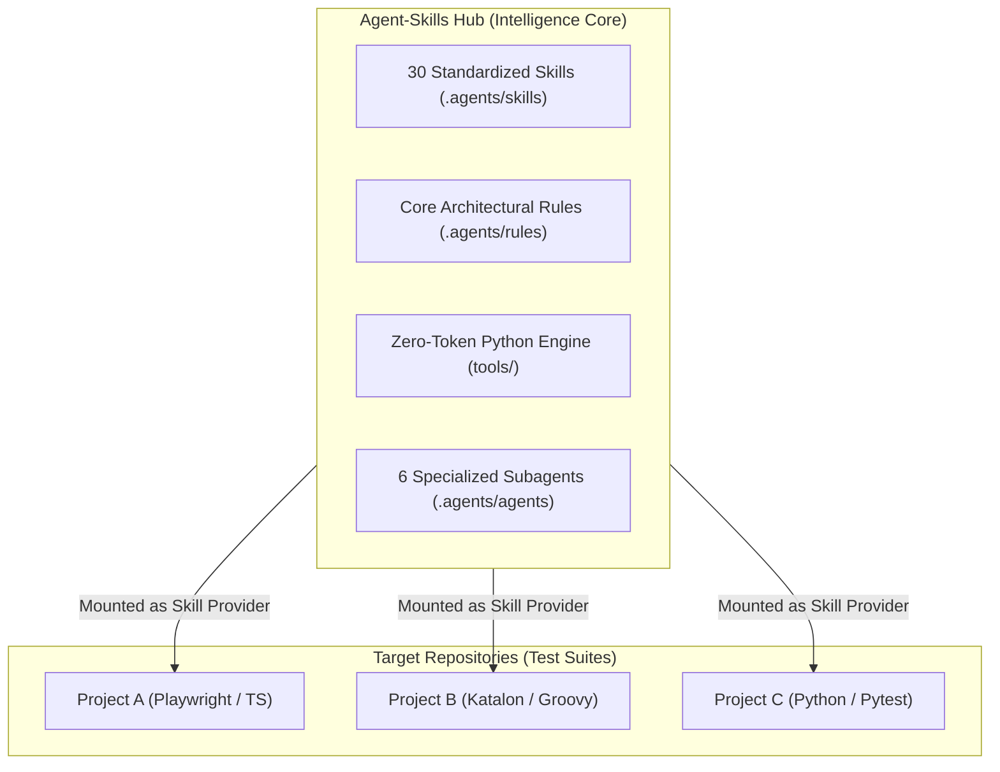
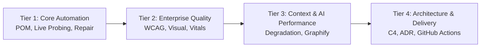

# Agent-Skills Architecture & Design Principles

> **Scope:** Enterprise Multi-Agent QA Hub  
> **Version:** `2.0.0` | **Status:** Active / Production Standard

---

## 1. Hub & Spoke Operating Model

The `agent-skills` repository functions as a centralized **Intelligence Core (Hub)** decoupled from target test repositories (**Spokes**). 

### Architectural Benefits:
1. **Zero Context Contagion:** Target project repositories stay clean and focused strictly on test cases and Page Classes, without polluting git trees with heavy AI agent instructions.
2. **Instant Upgradability:** Improvements to self-healing algorithms, token compressors, and lint rules propagate globally to all target projects instantly.
3. **Intellectual Property Isolation:** Dual-Remote push protocols safeguard agent intelligence, rules, and prompts from leaking into client/enterprise company SCMs.

---

## 2. Four-Tier Skill Stratification

The 30 skills in the hub are structured into four progressive operational tiers:

1. **Tier 1 — Core Automation & Self-Healing:**
   - Script generation, Clean POM flat architecture, live DOM probing via Playwright MCP, and in-place locator healing.
2. **Tier 2 — Enterprise Quality Sentinel:**
   - Accessibility audits (WCAG 2.2), Core Web Vitals profiling, visual regression comparisons, and synthetic data generation.
3. **Tier 3 — AI Context Engineering & Diagnostics:**
   - Attention-pattern protection, context degradation countermeasures, token optimization, and AST knowledge graph navigation.
4. **Tier 4 — Architecture, CI/CD & Delivery:**
   - Architecture Decision Records (ADRs), C4 model visual mapping, TDD workflow orchestration, and containerized GitHub Actions CI/CD pipelines.

---

## 3. Flat Clean POM Architecture Pattern

Test automation scripts orchestrated through this Hub enforce strict Clean POM boundaries:

- **Rule 1 — Zero Selectors in Scripts:** Test scripts (`Scripts/` or `tests/`) must NEVER contain raw XPaths, CSS selectors, or `findTestObject` calls.
- **Rule 2 — Single Inheritance:** All Page Classes inherit from `BasePage`, which standardizes smart waits, dynamic identifiers, and synthetic event dispatchers.
- **Rule 3 — Dynamic Test Data Idempotency:** Every data entity must use dynamic prefixes generated via `BasePage.uniqueCode("PREFIX_")` to eliminate database key collisions during parallel execution.
- **Rule 4 — In-Place Self-Healing:** If an element changes or breaks, only the affected Page Class is updated; test scripts remain untouched.

---

## 4. Multi-Agent Swarm Collaboration Matrix

The Hub equips 6 specialized subagents with scoped tool and skill permissions:

| Subagent Role | Primary Focus | Allowed Skills | Execution Tools |
| :--- | :--- | :--- | :--- |
| **`orchestrator`** | Task decomposition & governance | `agent-orchestration`, `tdd-orchestrator`, `token-and-context-optimizer` | `verify_all.py`, `test_impact.py` |
| **`pom-crafter`** | Clean POM design & test generation | `clean-pom-crafter`, `lam-script-generator`, `synthetic-test-data-generator` | `lookup_xpath.py`, `repo_map.py` |
| **`live-explorer`** | Live DOM & AOM exploration (<200ms) | `playwright-live-interaction`, `web-vitals-and-performance-profiler` | `browser_helpers.js`, `e2e_flow_prober.ps1` |
| **`test-runner`** | Headless CLI test execution & CI | `katalon-cli-runner`, `github-actions-templates`, `bats-testing-patterns` | `check_environment.ps1`, `generate_test_reports.ps1` |
| **`failure-analyst`**| Visual & XML error autopsy | `failure-autopsy-and-healing`, `self-healing-locator` | `pinpoint_failure.py`, `distill_log.py`, `cache_resolver.py` |
| **`quality-gatekeeper`**| 7 Gates DoD & Fake-Pass Sentinel | `antigravity-test-sentinel`, `code-review-ai`, `wcag-audit-patterns` | `verify_all.py`, `infer_linter.py`, `wcag_audit.py` |
