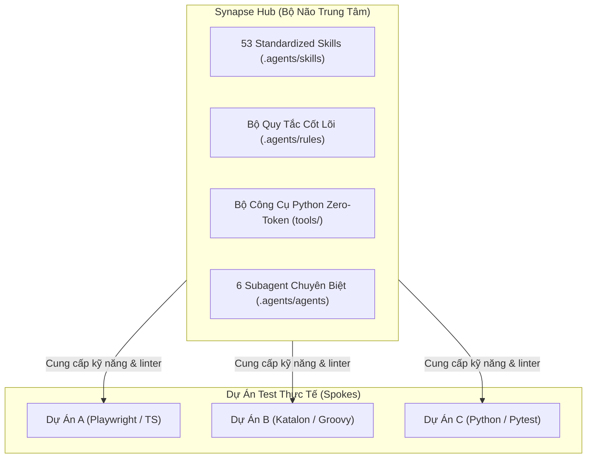
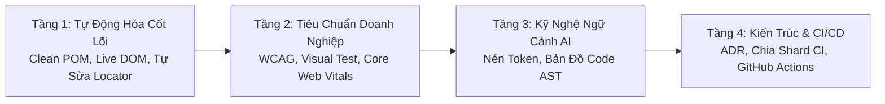
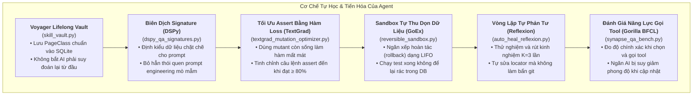

# Kiến Trúc & Nguyên Lý Thiết Kế Synapse-Hub

[🇻🇳 Tiếng Việt](ARCHITECTURE.md) | [🇬🇧 English Edition](ARCHITECTURE.en.md)

> **Phạm vi:** Enterprise Multi-Agent QA Hub  
> **Version:** `3.6.0` | **Trạng thái:** Hoạt động / Tiêu chuẩn Sản xuất  
> **Tác giả:** Thế Vị (@TeeVee998) | **Giấy phép:** MIT License

---

## 1. Mô Hình Kiến Trúc Hub & Spoke

Kho lưu trữ `agent-skills` hoạt động theo mô hình **Hub & Spoke**: trong đó Hub là **bộ não trung tâm** chứa toàn bộ kỹ năng, quy tắc kiến trúc và công cụ cho AI, hoàn toàn tách biệt khỏi các repository dự án kiểm thử thực tế (**Spokes**).

### Lợi Thế Thực Tế Của Kiến Trúc Này:
1. **Không Làm Rác Repo Dự Án (Zero Context Contagion):** Repository của dự án test luôn tinh gọn, chỉ chứa test case và Page Object của nghiệp vụ. Toàn bộ prompt, rule và cấu hình AI cồng kềnh đều nằm riêng ở Hub.
2. **Nâng Cấp Tức Thì Không Cần Sửa Code:** Khi cập nhật thuật toán tự sửa locator, bộ nén log hay luật lint mới ở Hub, tất cả các dự án con đều hưởng lợi ngay lập tức.
3. **Cách Ly Bản Quyền & Bảo Mật Tuyệt Đối:** Dự án test đẩy thẳng lên Git công ty (GitLab, GitHub, Bitbucket nội bộ), còn kỹ năng và công cụ dùng chung nằm tại Hub. Không cần cấu hình dual-remote hay script đẩy code phức tạp.

---

## 2. 4 Phân Tầng Kỹ Năng Trong Hub (4-Tier Skill Stratification)

53 kỹ năng QA trong Hub được phân chia thành 4 tầng rõ rệt:

1. **Tầng 1 — Tự Động Hóa Cốt Lõi & Tự Sửa Lỗi (Core Automation & Self-Healing):**
   - Sinh script tự động, chuẩn hóa Clean POM phẳng, tương tác trực tiếp trên live DOM qua Playwright MCP và tự phục hồi locator khi giao diện thay đổi.
2. **Tầng 2 — Kiểm Soát Chất Lượng Nâng Cao (Enterprise Quality Sentinel):**
   - Kiểm toán khả năng tiếp cận (WCAG 2.2), đo chỉ số Core Web Vitals, so sánh hình ảnh giao diện (Visual Regression) và tự tạo dữ liệu test không lo trùng lặp.
3. **Tầng 3 — Tối Ưu Ngữ Cảnh Cho AI (AI Context Engineering & Diagnostics):**
   - Chống tràn ngữ cảnh, nén token tối đa, và điều hướng đồ thị tri thức mã nguồn (AST repo map) để AI không bao giờ đọc cả file hàng nghìn dòng.
4. **Tầng 4 — Kiến Trúc & Tích Hợp CI/CD (Architecture & Delivery):**
   - Lưu trữ quyết định kiến trúc (ADR), dọn dẹp nợ kỹ thuật (technical debt), và thiết lập pipeline chạy test song song trên GitHub Actions/GitLab CI.

---

## 3. Quy Chuẩn Kiến Trúc Clean POM Phẳng (Flat Clean POM)

Toàn bộ script kiểm thử do AI viết hoặc refactor đều phải tuân thủ nghiêm ngặt mô hình Clean POM:

- **Quy tắc 1 — Không Để Selector Trong Test Script:** File test (`tests/` hoặc `Scripts/`) chỉ gọi các hàm nghiệp vụ trên Page Class. Tuyệt đối cấm đặt XPath, CSS selector hoặc `findTestObject` bên trong file test.
- **Quy tắc 2 — Đơn Kế Thừa Từ `BasePage`:** Tất cả Page Class đều kế thừa từ `BasePage`, tận dụng sẵn cơ chế smart wait động, bộ sinh mã ngẫu nhiên và trình phát sự kiện an toàn.
- **Quy tắc 3 — Dữ Liệu Test Luôn Động & Độc Lập (Idempotent):** Mọi bản ghi tạo mới trong test phải kèm tiền tố sinh ngẫu nhiên từ `BasePage.uniqueCode("AUTO_")` để khi chạy song song nhiều luồng không bao giờ bị đụng độ khóa chính DB.
- **Quy tắc 4 — Tự Sửa Tại Chỗ (In-Place Self-Healing):** Khi UI ứng dụng đổi locator, hệ thống chỉ sửa đúng Page Class bị ảnh hưởng; các kịch bản test giữ nguyên 100%.

---

## 4. 10 Cổng Chất Lượng Bắt Buộc Khi Hoàn Thành (10 DoD Quality Gates)

Trước khi commit code hoặc merge Pull Request, toàn bộ mã kiểm thử bắt buộc phải vượt qua 10 Cổng Kiểm Định (`tools/verify_all.py`):

| Cổng | Tên Cổng | Công Cụ Kiểm Tra | Tiêu Chuẩn Vượt Qua (DoD) |
| :---: | :--- | :--- | :--- |
| **Gate 0** | **Bảo Toàn Tác Quyền & MIT Provenance** | `author_integrity.py` | Bảo toàn giấy phép MIT và quyền tác giả gốc của Thế Vị (@TeeVee998). |
| **Gate 1** | **Chuẩn Mã Hóa UTF-8 No BOM** | `verify_all.py` | 100% file không chứa ký tự BOM rác (`0xEF, 0xBB, 0xBF`), không vỡ font trên Linux/CI. |
| **Gate 2** | **Đường Dẫn Linh Hoạt (Path Portability)** | `verify_all.py` | Cấm hardcode đường dẫn máy cá nhân (`/Users/...`, `C:\...`); bắt buộc dùng path tương đối. |
| **Gate 3** | **Kiến Trúc Clean POM Phẳng** | `verify_all.py` | 100% selector nằm trong Page Class; cấm triệt để selector thô trong file test. |
| **Gate 4** | **Chống AI Bịa Đặt (Anti-Drift Linter)** | `lint_ai_docs.py` | Đối chiếu tài liệu với AST thực tế; cấm AI nhắc tới PageClass hay hàm không tồn tại. |
| **Gate 5** | **Chặn File Rác Lọt Vào Git** | `verify_all.py` | Cấm commit file tạm, file dump bộ nhớ hay log rác (`*.tmp`, `.ruff_cache`, heap dump). |
| **Gate 6** | **Bảo Mật Credential & Secret** | `verify_all.py` | Quét regex phát hiện và chặn đứng mật khẩu, API key, token nhạy cảm bị hardcode. |
| **Gate 7** | **Bắt Lỗi Tĩnh & Test Pass Ảo** | `infer_linter.py` | Chặn test 0 câu assert, try-catch nuốt lỗi (`pass`), dùng sleep cố định hoặc thiếu `await`. |
| **Gate 8** | **Đo Độ Nhạy Của Câu Lệnh Assert** | `micro_mutator.py` | Đột biến cú pháp AST; yêu cầu điểm diệt mutant $\ge 80\%$ (chống assert hời hợt). |
| **Gate 9** | **Điều Phối Kỹ Năng Tránh Trùng Lặp** | `skill_collision_guard.py` | Đảm bảo mô tả của các kỹ năng không đè phạm vi của nhau (cosine similarity $< 0.75$). |

---

## 5. Ranh Giới Kỹ Thuật & Những Gì Hệ Thống Không Làm (Non-Goals)

Để giữ cho hệ thống luôn nhẹ và chạy nhanh, Synapse Hub xác định rõ ranh giới:
- **Không Tạo Test Runner Mới:** Tận dụng trực tiếp các runner tiêu chuẩn (Playwright, Pytest, Katalon/Gradle, Cypress, Newman, JMeter).
- **Không Can Thiệp Source Code Ứng Dụng:** Chỉ hoạt động trong phạm vi code test, Page Class, mock data và các cổng kiểm định.
- **Hub Hoàn Toàn Phi Trạng Thái (Stateless):** Không lưu mật khẩu hay dữ liệu nghiệp vụ của công ty vào git.
- **Hỗ Trợ Đa Ngôn Ngữ Qua Universal IR:** Dùng lớp biểu diễn trung gian Universal IR để kết nối mượt mà giữa TypeScript, Python, Groovy và Java.

Hệ thống điều phối 6 subagent chuyên biệt với quyền hạn công cụ rõ ràng:

| Vai Trò Subagent | Trọng Tâm Nhiệm Vụ | Kỹ Năng Cho Phép | Công Cụ Thực Thi |
| :--- | :--- | :--- | :--- |
| **`orchestrator`** | Nhận yêu cầu, phân tích bài toán & điều phối | `agent-orchestration-multi-agent-optimize`, `graphify-impact-analyzer`, `architecture-decision-records`, `token-and-context-optimizer`, `actor-qa-swarm`, `event-stream-qa-orchestrator`, `qa-memory-os`, `tot-exploratory-testing`, `review-spec` | `verify_all.py`, `test_impact.py`, `setup_project.py`, `interview_story.py`, `dspy_qa_signatures.py`, `autogen_qa_broker.py`, `qa_event_stream.py`, `test_memory_os.py`, `tot_exploratory_tester.py`, `watch_mode.py`, `dashboard_generator.py` |
| **`pom-crafter`** | Thiết kế Page Class & sinh test theo Clean POM | `clean-pom-crafter`, `lam-script-generator`, `synthetic-test-data-generator`, `api-spec-to-e2e-matrix`, `gherkin-to-suite`, `mipro-prompt-compiler`, `qa-aci-interface` | `lookup_xpath.py`, `repo_map.py`, `generate_tc_from_story.py`, `skill_vault.py`, `gherkin_suite.py`, `swe_qa_aci.py`, `mipro_assertion_tuner.py`, `api_fuzzer.py`, `export_postman_collection.py` |
| **`live-explorer`** | Dò trực tiếp phần tử DOM & AOM (<200ms) | `playwright-live-interaction`, `self-healing-locator`, `visual-regression-sentinel`, `api-network-mocking-interception` | `browser_helpers.js`, `e2e_flow_prober.py`, `safety_firewall.py` |
| **`test-runner`** | Chạy test headless qua CLI và tích hợp CI | `katalon-cli-runner`, `e2e-testing-patterns`, `flaky-test-sentinel-and-quarantine`, `backend-load-and-stress-patterns`, `github-actions-templates` | `matrix_sharder.py`, `distill_log.py`, `pinpoint_failure.py`, `flaky_detector.py`, `reversible_sandbox.py`, `generate_jmx_plan.py`, `jtl_analyzer.py`, `newman_analyzer.py`, `traffic_session_converter.py`, `db_sandbox.py` |
| **`failure-analyst`**| Khám nghiệm lỗi qua log, ảnh chụp & JUnit XML | `failure-autopsy-and-healing`, `self-healing-locator`, `file-and-report-validator`, `systematic-debugging`, `agentless-qa-repair` | `auto_heal.py`, `heal_pr_automator.py`, `pinpoint_failure.py`, `cache_resolver.py`, `auto_heal_reflexion.py`, `agentless_patcher.py`, `heuristic_locator_matcher.py`, `telemetry_correlator.py` |
| **`quality-gatekeeper`**| Gác 10 Cổng DoD & triệt tiêu test pass ảo | `antigravity-test-sentinel`, `code-refactoring-refactor-clean`, `wcag-audit-patterns`, `web-vitals-and-performance-profiler`, `security-dast-sentinel`, `lean-impact-scoreboard`, `web-agent-gym-benchmarking` | `verify_all.py`, `infer_linter.py`, `micro_mutator.py`, `trace_data_flow.py`, `skill_collision_guard.py`, `textgrad_mutation_optimizer.py`, `skillspector.py`, `author_integrity.py`, `browsergym_eval.py` |

### 5.1 Các Tiện Ích Dùng Trực Tiếp (Không Cần Phân Quyền Subagent)

7 công cụ hạ tầng dưới đây có thể gọi trực tiếp từ dòng lệnh:
- `cli.py`: Điểm điều phối lệnh trung tâm (`synapse-hub` / `agent-qa`).
- `output_formatter.py`: Định dạng màu sắc ANSI và bảng biểu trên terminal.
- `welcome_page.py`: Khởi tạo trang hướng dẫn trực quan dạng HTML (`agent-qa welcome`).
- `bump_version.py`: Bộ nâng số phiên bản semver đồng loạt trên toàn bộ repo (`agent-qa bump`).
- `sync_agent_rules.py`: Đồng bộ rules sang các trợ lý AI (Cursor, Claude Code, Copilot, Windsurf).
- `md_to_xlsx.py`: Tiện ích chuyển đổi Markdown thành file Excel (`agent-qa md-to-xlsx`).
- `mcp_excel_server.py`: MCP Server thao tác với bảng tính Excel ngoại tuyến.

---

## 6. Quy Ước Đặt Tên & Phân Phối Gói

Để thuận tiện khi sử dụng trên nhiều nền tảng:
- **Tên Dự Án / Hệ Sinh Thái:** Synapse Hub (`Synapse-Hub` trên GitHub)
- **Gói NPM & Plugin Antigravity:** `synapse-hub` (trên NPM Registry và Antigravity Marketplace)
- **Gói Python & Universal CLI:** `agent-qa` (gói PyPI cung cấp binary lệnh `agent-qa`)
- **Dịch Vụ MCP Server:** `enterprise-agent-qa` (MCP server cho QA) và `synapse-mcp-excel` (server công cụ Excel)
- **Định Danh Kỹ Năng:** `enterprise-agent-skills-hub` (trong `skills_manifest.json`) và `agentskills.json` (chuẩn AgentSkills v1)

---

## 7. Cơ Chế Tự Học & Tiến Hóa Của AI Agent

Không chỉ dừng lại ở các prompt tĩnh, Synapse Hub tích hợp 6 cơ chế hiện đại giúp AI tự học và cải thiện qua từng lần chạy:

1. **Bộ Nhớ Tích Lũy Kỹ Năng (`skill_vault.py`):** Học theo dự án Voyager, lưu các hàm Page Object và mẫu tương tác chuẩn vào SQLite. AI càng chạy nhiều thì càng thông minh và ít phải hỏi lại.
2. **Thử Nghiệm & Tự Rút Kinh Nghiệm (`auto_heal_reflexion.py`):** Áp dụng mô hình Reflexion của Noah Shinn, cho phép AI chạy thử nghiệm tối đa $K=3$ lần, đọc stacktrace lỗi và tự suy luận để đổi cách bắt locator chuẩn xác hơn.
3. **Biên Dịch Signature Có Kiểu Dữ Liệu (`dspy_qa_signatures.py`):** Áp dụng nguyên lý Stanford DSPy, chuẩn hóa đầu vào và đầu ra của prompt theo cấu trúc rõ ràng thay vì ghép nối chuỗi tự do.
4. **Tối Ưu Hóa Assert Theo Hàm Loss (`textgrad_mutation_optimizer.py`):** Coi các đột biến cú pháp (mutant) chưa bị bắt như một hàm loss, lặp lại việc siết chặt assertion cho tới khi bắt hết mọi trường hợp lỗi tiềm ẩn.
5. **Sandbox Tự Hoàn Tác Trạng Thái (`reversible_sandbox.py`):** Giống cơ chế GoEx, ghi nhận mọi thay đổi trên ổ đĩa và cơ sở dữ liệu để rollback sạch sẽ sau khi chạy test khám phá.
6. **Đo Lường Độ Chuẩn Xác Khi Gọi Tool (`synapse_qa_bench.py`):** Áp dụng thang đo chuẩn Berkeley Function-Calling Leaderboard (BFCL) để đánh giá khả năng chọn đúng công cụ và thực thi chính xác của các subagent.

---

## 8. So Sánh Với Các Giải Pháp Hiện Nay

| Tiêu Chí Đánh Giá | ESLint Playwright | Stryker Mutator | Allure Report | Healenium | Synapse Hub 🧠 |
| :--- | :---: | :---: | :---: | :---: | :---: |
| **Ngôn Ngữ & Framework Hỗ Trợ** | Chỉ JS / TS | JS / TS, C#, Scala | Mọi ngôn ngữ (chỉ đọc XML) | Java / Python / C# (Selenium) | **Đa ngôn ngữ** (TS/JS, Python, Groovy, Java) |
| **Tích Hợp Sâu Vào Ngữ Cảnh AI** | ❌ (Chỉ chạy lint IDE/CLI) | ❌ (Tool độc lập) | ❌ (Chỉ hiển thị sau test) | ❌ (Cần proxy JVM riêng) | ✅ **Nguyên bản** (Rules, MCP, AST Map, 6 Subagent) |
| **Diệt Trừ Test Pass Ảo Do AI Sinh** | ⚠️ Chỉ bắt lỗi cú pháp | ❌ (Chỉ đột biến app code) | ❌ | ❌ | ✅ **Chuyên dụng** (Bắt 0 assert, nuốt ngoại lệ, tautology) |
| **Tốc Độ Kiểm Thử Đột Biến** | Không có | ⏱️ Vài phút đến vài giờ | Không có | Không có | ⚡ **Cực nhanh (~0.1s)** bằng quét nhạy cảm assert tĩnh (Heuristic) |
| **Tự Sửa Locator Khi UI Đổi** | ❌ | ❌ | ❌ | ⚠️ Cần server JVM + Docker | ⚡ **Siêu nhẹ (< 500 token)** qua diff cây AOM trực tiếp |
| **Cô Đọng Log & Tiết Kiệm Token** | ❌ | ❌ | ❌ | ❌ | ✅ **Cắt giảm 95%** log thừa (`distill_log.py`, `repo_map.py`) |
| **Bảo Vệ Kiến Trúc Clean POM** | ❌ | ❌ | ❌ | ❌ | ✅ **Bắt buộc tuân thủ**, cấm selector trong test script |

---

## 9. Những Điểm Hạn Chế Cần Lưu Ý & Kết Quả Đánh Giá Thực Nghiệm

Để giữ nguyên tắc trung thực tuyệt đối (**Truth Anchor**), Synapse Hub công khai mọi giới hạn kỹ thuật:

1. **Quét Nhạy Cảm Assert Tĩnh (Heuristic) vs Đột Biến Runtime:**  
   `tools/micro_mutator.py` ở chế độ tĩnh sử dụng phân tích độ nhạy assert heuristic (~0.1s) để phát hiện nhanh nhánh rẽ thiếu assert hoặc assertion lỏng lẻo. Đây là cơ chế ước tính độ phủ ngữ nghĩa (reachability & dataflow heuristic), **không phải** công cụ mutation testing thực thi mã cấp trình biên dịch (như Stryker hay mutmut). Để có điểm mutation thực tế không bị thổi phồng, cần chạy chế độ Dynamic (`--test-cmd`) để thực thi test suite trực tiếp trên từng mutant.
2. **Kết Quả Benchmark Thực Nghiệm (Self-Reported Baseline):**  
   Các chỉ số 25/25 bài toán (100.0%) và 76.2 token / lỗi là kết quả đo lường nội bộ do tác giả thực hiện trên bộ benchmark curated nội bộ (`benchmarks/qa_eval`), chưa qua kiểm chứng độc lập của bên thứ ba (third-party double-blind benchmark). Khi áp dụng vào dự án thực tế với kiến trúc phức tạp, các chỉ số có thể thay đổi tùy thuộc vào độ bao phủ của bộ test.
3. **Cơ Chế Pin Version Hub-Spoke (Chống Lỗi Lan Truyền):**  
   Khi tích hợp Synapse Hub vào các dự án Spoke, khuyến nghị bắt buộc pin phiên bản qua Git Submodule commit cụ thể hoặc git release tag (`git checkout v3.0.0`), tránh kéo trực tiếp nhánh `main` tự động để không làm ảnh hưởng pipeline của các Spoke khi Hub có cập nhật chưa kiểm duyệt.
4. **Test Framework Được Hỗ Trợ Tốt Nhất:**  
   Tối ưu tốt nhất cho **Playwright, Pytest, Katalon Studio/Groovy, và Cypress**. Hỗ trợ Selenium WebDriver thông qua chuẩn kiến trúc Clean POM, smart wait và chuyển ngữ Universal IR.
5. **Yêu Cầu Môi Trường:**  
   - Node.js >= 18.0.0 (khuyên dùng Node 20 hoặc 22 LTS).
   - Python >= 3.10 (đã kiểm thử đầy đủ trên 3.10, 3.11, 3.12, 3.13, 3.15).
   - Trình duyệt headless: Cần cài đặt Playwright Chromium để dùng tính năng dò phần tử DOM và tự sửa locator.
