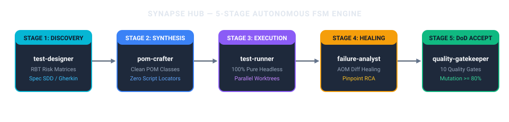
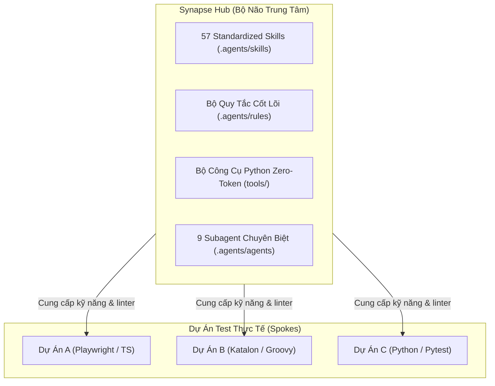
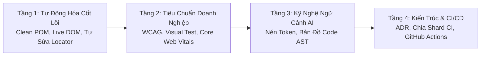
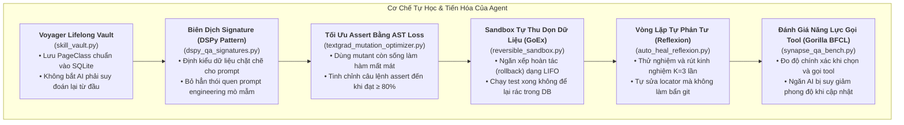

# Kiến Trúc & Nguyên Lý Thiết Kế Synapse-Hub

[🇻🇳 Tiếng Việt](ARCHITECTURE.md) | [🇬🇧 English Edition](ARCHITECTURE.en.md)

> **Phạm vi:** Enterprise Multi-Agent QA Hub  
> **Version:** `4.8.4` | **Trạng thái:** Hoạt động / Tiêu chuẩn Sản xuất  
> **Tác giả:** Thế Vị (@TeeVee98) | **Giấy phép:** MIT License

---

## 1. Mô Hình Kiến Trúc Hub & Spoke

Kho lưu trữ `Synapse Hub` hoạt động theo mô hình **Hub & Spoke**: trong đó Hub là **bộ não trung tâm** chứa toàn bộ kỹ năng, quy tắc kiến trúc và công cụ cho AI, hoàn toàn tách biệt khỏi các repository dự án kiểm thử thực tế (**Spokes**).

### Lợi Thế Thực Tế Của Kiến Trúc Này:
1. **Không Làm Rác Repo Dự Án (Zero Context Contagion):** Repository của dự án test luôn tinh gọn, chỉ chứa test case và Page Object của nghiệp vụ. Toàn bộ prompt, rule và cấu hình AI cồng kềnh đều nằm riêng ở Hub.
2. **Nâng Cấp Tức Thì Không Cần Sửa Code:** Khi cập nhật thuật toán tự sửa locator, bộ nén log hay luật lint mới ở Hub, tất cả các dự án con đều hưởng lợi ngay lập tức.
3. **Cách Ly Bản Quyền & Bảo Mật Tuyệt Đối:** Dự án test đẩy thẳng lên Git công ty (GitLab, GitHub, Bitbucket nội bộ), còn kỹ năng và công cụ dùng chung nằm tại Hub. Không cần cấu hình dual-remote hay script đẩy code phức tạp.

---

## 2. 4 Phân Tầng Kỹ Năng Trong Hub (4-Tier Skill Stratification)

57 kỹ năng QA trong Hub được phân chia thành 4 tầng rõ rệt:

1. **Tầng 1 — Tự Động Hóa Cốt Lõi & Tự Sửa Lỗi (Core Automation & Self-Healing):**
   - Sinh script tự động chuẩn Clean POM (Flat Architecture), tương tác trực tiếp trên live DOM qua Playwright MCP và tự phục hồi locator khi giao diện thay đổi.
2. **Tầng 2 — Kiểm Soát Chất Lượng Nâng Cao (Enterprise Quality Sentinel):**
   - Kiểm toán khả năng tiếp cận (WCAG 2.2), đo chỉ số Core Web Vitals, so sánh hình ảnh giao diện (Visual Regression) và tự tạo dữ liệu test không lo trùng lặp.
3. **Tầng 3 — Tối Ưu Ngữ Cảnh Cho AI (AI Context Engineering & Diagnostics):**
   - Chống tràn ngữ cảnh, nén token tối đa, và điều hướng đồ thị tri thức mã nguồn (AST repo map) để AI không bao giờ đọc cả file hàng nghìn dòng.
4. **Tầng 4 — Kiến Trúc & Tích Hợp CI/CD (Architecture & Delivery):**
   - Lưu trữ quyết định kiến trúc (ADR), dọn dẹp nợ kỹ thuật (technical debt), và thiết lập pipeline chạy test song song trên GitHub Actions/GitLab CI.

---

## 3. Quy Chuẩn Kiến Trúc Clean POM (Flat Architecture)

Toàn bộ script kiểm thử do AI viết hoặc refactor đều phải tuân thủ nghiêm ngặt mô hình Clean POM:

- **Quy tắc 1 — Không Để Selector Trong Test Script:** File test (`tests/` hoặc `Scripts/`) chỉ gọi các hàm nghiệp vụ trên Page Class. Tuyệt đối cấm đặt XPath, CSS selector hoặc `findTestObject` bên trong file test.
- **Quy tắc 2 — Đơn Kế Thừa Từ `BasePage`:** Tất cả Page Class đều kế thừa từ `BasePage`, tận dụng sẵn cơ chế smart wait động, bộ sinh mã ngẫu nhiên và trình phát sự kiện an toàn.
- **Quy tắc 3 — Dữ Liệu Test Luôn Động & Độc Lập (Idempotent):** Mọi bản ghi tạo mới trong test phải kèm tiền tố sinh ngẫu nhiên từ `BasePage.uniqueCode("AUTO_")` để khi chạy song song nhiều luồng không bao giờ bị đụng độ khóa chính DB.
- **Quy tắc 4 — Tự Sửa Tại Chỗ (In-Place Self-Healing):** Khi UI ứng dụng đổi locator, hệ thống chỉ sửa đúng Page Class bị ảnh hưởng; các kịch bản test giữ nguyên 100%.

---

## 4. 11 Cổng Chất Lượng Bắt Buộc Khi Hoàn Thành (11 DoD Quality Gates)

Trước khi commit code hoặc merge Pull Request, toàn bộ mã kiểm thử bắt buộc phải vượt qua 11 Cổng Kiểm Định (`tools/core/verify_all.py`):

> **Tiền kiểm tra bảo vệ tác quyền (Pre-flight Engine Integrity Guard):** Động cơ tự động kích hoạt kiểm tra ngầm `tools/core/author_integrity.py` trước khi chạy các gate để bảo toàn bản quyền tác giả **Thế Vị (@TeeVee98)** và tuân thủ giấy phép MIT.

| Cổng | Tên Cổng | Công Cụ Kiểm Tra | Tiêu Chuẩn Vượt Qua (DoD) |
| :---: | :--- | :--- | :--- |
| **Gate 1** | **Chuẩn Mã Hóa UTF-8 No BOM** | `verify_all.py` | 100% file không chứa ký tự BOM rác (`0xEF, 0xBB, 0xBF`), không vỡ font trên Linux/CI. |
| **Gate 2** | **Đường Dẫn Linh Hoạt (Path Portability)** | `verify_all.py` | Cấm hardcode đường dẫn máy cá nhân (như thư mục người dùng, ổ đĩa tuyệt đối); bắt buộc dùng path tương đối. |
| **Gate 3** | **Kiến Trúc Clean POM (Flat Architecture)** | `verify_all.py` | 100% selector nằm trong Page Class; cấm triệt để selector thô trong file test. |
| **Gate 4** | **Chống AI Bịa Đặt (Anti-Drift Linter)** | `lint_ai_docs.py` | Đối chiếu tài liệu với AST thực tế; cấm AI nhắc tới PageClass hay hàm không tồn tại; chặn link Markdown tương đối gãy. |
| **Gate 5** | **Chặn File Rác Lọt Vào Git** | `verify_all.py` | Cấm commit file tạm, file dump bộ nhớ hay log rác (`*.tmp`, `.ruff_cache`, heap dump). |
| **Gate 6** | **Bảo Mật Credential & Secret** | `verify_all.py` | Quét regex phát hiện và chặn đứng mật khẩu, API key, token nhạy cảm bị hardcode. |
| **Gate 7** | **Bắt Lỗi Tĩnh & Test Pass Ảo** | `infer_linter.py` | Chặn test 0 câu assert, try-catch nuốt lỗi (`pass`), dùng sleep cố định hoặc thiếu `await`. |
| **Gate 8** | **Đo Độ Nhạy Của Câu Lệnh Assert** | `micro_mutator.py` | Đột biến cú pháp AST; yêu cầu điểm diệt mutant $\ge 80\%$ (chống assert hời hợt). |
| **Gate 9** | **Điều Phối Kỹ Năng Tránh Trùng Lặp** | `skill_collision_guard.py` | Đảm bảo mô tả của các kỹ năng không đè phạm vi của nhau (cosine similarity $< 0.75$). |
| **Gate 10** | **Kiểm Soát Hiệu Năng & SLA Sentinel** | `verify_all.py` / `jtl_analyzer.py` | Đạt chuẩn SLA (P95 $\le$ 500ms, Error Rate $\le$ 1.0%); tự động SKIPPED/PASS khi không có test tải. |
| **Gate 11** | **Kiểm Soát Giảm Token 15 Tầng** | `gate_11_token_reduction.py` | Xác minh 15/15 tầng giảm token (KV-Cache Prefix, MCP, AST Slicer/TOON, CodeAct, Macro Cache, Neuro-Symbolic); tự động SKIPPED ở Target mode. |

---

## 5. Ranh Giới Kỹ Thuật & Những Gì Hệ Thống Không Làm (Non-Goals)

Để giữ cho hệ thống luôn nhẹ và chạy nhanh, Synapse Hub xác định rõ ranh giới:
- **Không Tạo Test Runner Mới:** Tận dụng trực tiếp các runner tiêu chuẩn (Playwright, Pytest, Katalon/Gradle, Cypress, Newman, JMeter).
- **Không Can Thiệp Source Code Ứng Dụng:** Chỉ hoạt động trong phạm vi code test, Page Class, mock data và các cổng kiểm định.
- **Hub Hoàn Toàn Phi Trạng Thái (Stateless):** Không lưu mật khẩu hay dữ liệu nghiệp vụ của công ty vào git.
- **Hỗ Trợ Đa Ngôn Ngữ Qua Universal IR:** Dùng lớp biểu diễn trung gian Universal IR để kết nối mượt mà giữa TypeScript, Python, Groovy và Java.

Hệ thống điều phối 9 subagent FSM cốt lõi (cùng 6 specialist agents bổ trợ trong `agents_manifest.json`, tổng 15 AI agent roles) với quyền hạn công cụ rõ ràng:

| Vai Trò Subagent | Trọng Tâm Nhiệm Vụ | Kỹ Năng Cho Phép | Công Cụ Thực Thi |
| :--- | :--- | :--- | :--- |
| **`orchestrator`** | Nhận yêu cầu, phân tích bài toán & điều phối | `agent-orchestration-multi-agent-optimize`, `graphify-impact-analyzer`, `architecture-decision-records`, `token-and-context-optimizer`, `actor-qa-swarm`, `event-stream-qa-orchestrator`, `qa-memory-os`, `tot-exploratory-testing`, `review-spec` | `verify_all.py`, `test_impact.py`, `setup_project.py`, `interview_story.py`, `dspy_qa_signatures.py`, `autogen_qa_broker.py`, `qa_event_stream.py`, `test_memory_os.py`, `tot_exploratory_tester.py`, `watch_mode.py`, `dashboard_generator.py` |
| **`test-designer`** | Phân tích tài liệu, thiết kế kịch bản test thủ công & xuất Excel | `rbt-manual-testing`, `review-spec`, `tot-exploratory-testing`, `gherkin-to-suite`, `synthetic-test-data-generator`, `file-and-report-validator` | `template_excel_exporter.py`, `interview_story.py`, `tot_exploratory_tester.py`, `goldfish_review.py`, `gherkin_suite.py`, `mcp_excel_server.py`, `lookup_tc.py` |
| **`pom-crafter`** | Thiết kế Page Class & sinh test Web UI theo Clean POM | `clean-pom-crafter`, `lam-script-generator`, `synthetic-test-data-generator`, `gherkin-to-suite`, `mipro-prompt-compiler`, `qa-aci-interface` | `lookup_xpath.py`, `repo_map.py`, `generate_tc_from_story.py`, `skill_vault.py`, `gherkin_suite.py`, `swe_qa_aci.py`, `mipro_assertion_tuner.py`, `universal_ir.py`, `omni_emitter.py`, `omni_parser.py`, `omni_transpiler.py` |
| **`api-engineer`** | Thiết kế ma trận test OpenAPI, Contract Testing (Pact/CDC) & thực thi Newman CLI | `api-spec-to-e2e-matrix`, `consumer-driven-contract-testing`, `api-network-mocking-interception`, `synthetic-test-data-generator`, `security-dast-sentinel` | `generate_api_matrix.py`, `api_drift_sentinel.py`, `newman_analyzer.py`, `network_mock_shield.py`, `export_postman_collection.py`, `traffic_session_converter.py`, `fuzz_payloads.py` |
| **`live-explorer`** | Dò trực tiếp phần tử DOM & AOM (<200ms) | `playwright-live-interaction`, `self-healing-locator`, `visual-regression-sentinel`, `api-network-mocking-interception` | `browser_helpers.js`, `e2e_flow_prober.py`, `safety_firewall.py` |
| **`test-runner`** | Chạy test chức năng headless qua CLI và CI | `katalon-cli-runner`, `e2e-testing-patterns`, `flaky-test-sentinel-and-quarantine`, `bats-testing-patterns`, `github-actions-templates` | `matrix_sharder.py`, `distill_log.py`, `pinpoint_failure.py`, `flaky_detector.py`, `reversible_sandbox.py`, `db_sandbox.py`, `generate_allure_report.py`, `generate_test_reports.py` |
| **`perf-engineer`** | Chuyên trách kiểm thử hiệu năng, tải k6/JMeter/Locust & APM profiling | `backend-load-and-stress-patterns`, `web-vitals-and-performance-profiler`, `synthetic-test-data-generator`, `db-state-verifier-and-seeder`, `debug-optimize-lcp`, `memory-leak-debugging` | `generate_jmx_plan.py`, `jtl_analyzer.py`, `telemetry_correlator.py`, `distill_log.py`, `safety_firewall.py`, `reversible_sandbox.py` |
| **`failure-analyst`**| Khám nghiệm lỗi qua log, ảnh chụp & JUnit XML | `failure-autopsy-and-healing`, `self-healing-locator`, `file-and-report-validator`, `systematic-debugging`, `agentless-qa-repair` | `auto_heal.py`, `heal_pr_automator.py`, `pinpoint_failure.py`, `cache_resolver.py`, `auto_heal_reflexion.py`, `agentless_patcher.py`, `heuristic_locator_matcher.py`, `telemetry_correlator.py` |
| **`quality-gatekeeper`**| Gác 11 Cổng DoD & triệt tiêu test pass ảo | `antigravity-test-sentinel`, `code-refactoring-refactor-clean`, `wcag-audit-patterns`, `web-vitals-and-performance-profiler`, `security-dast-sentinel`, `lean-impact-scoreboard`, `web-agent-gym-benchmarking` | `verify_all.py`, `infer_linter.py`, `micro_mutator.py`, `trace_data_flow.py`, `skill_collision_guard.py`, `textgrad_mutation_optimizer.py`, `skillspector.py`, `author_integrity.py`, `browsergym_eval.py` |

### 5.1 Các Tiện Ích Dùng Trực Tiếp (Không Cần Phân Quyền Subagent)

7 công cụ hạ tầng dưới đây có thể gọi trực tiếp từ dòng lệnh:
- `cli.py`: Điểm điều phối lệnh trung tâm (`synapse-hub` / `agent-qa`).
- `output_formatter.py`: Định dạng màu sắc ANSI và bảng biểu trên terminal.
- `welcome_page.py`: Khởi tạo trang hướng dẫn trực quan dạng HTML (`agent-qa welcome`).
- `bump_version.py`: Bộ nâng số phiên bản semver đồng loạt trên toàn bộ repo (`agent-qa bump`).
- `sync_agent_rules.py`: Đồng bộ rules sang các trợ lý AI (Cursor, Claude Code, Copilot, Windsurf).
- `md_to_xlsx.py`: Tiện ích chuyển đổi Markdown thành file Excel (`agent-qa md-to-xlsx`).
- `mcp_excel_server.py`: MCP Server thao tác với bảng tính Excel ngoại tuyến.

---

## 6. Quy Ước Đặt Tên & Phân Phối Gói

Để thuận tiện khi sử dụng trên nhiều nền tảng:
- **Tên Dự Án / Hệ Sinh Thái:** Synapse Hub (`Synapse-Hub` trên GitHub)
- **Gói NPM & Plugin Antigravity:** `@teevee98/synapse-hub` (trên NPM Registry và Antigravity Marketplace)
- **Gói Python & Universal CLI:** `agent-qa` (gói PyPI cung cấp binary lệnh `agent-qa`)
- **Dịch Vụ MCP Server:** `enterprise-agent-qa` (MCP server cho QA) và `synapse-mcp-excel` (server công cụ Excel)
- **Định Danh Kỹ Năng:** `enterprise-agent-skills-hub` (trong `skills_manifest.json`) và `agentskills.json` (chuẩn AgentSkills v1)

---

## 7. Cơ Chế Tự Học & Tiến Hóa Của AI Agent

Không chỉ dừng lại ở các prompt tĩnh, Synapse Hub tích hợp 6 cơ chế hiện đại giúp AI tự học và cải thiện qua từng lần chạy:

1. **Bộ Nhớ Tích Lũy Kỹ Năng (`skill_vault.py`):** Học theo dự án Voyager, lưu các hàm Page Object và mẫu tương tác chuẩn vào SQLite. AI càng chạy nhiều thì càng thông minh và ít phải hỏi lại.
2. **Thử Nghiệm & Tự Rút Kinh Nghiệm (`auto_heal_reflexion.py`):** Áp dụng mô hình Reflexion của Noah Shinn, cho phép AI chạy thử nghiệm tối đa $K=3$ lần, đọc stacktrace lỗi và tự suy luận để đổi cách bắt locator chuẩn xác hơn.
3. **Biên Dịch Signature Có Kiểu Dữ Liệu (`dspy_qa_signatures.py`):** Áp dụng nguyên lý Stanford DSPy, chuẩn hóa đầu vào và đầu ra của prompt theo cấu trúc có schema rõ ràng thay vì ghép nối chuỗi tự do.
4. **Tối Ưu Hóa Assert Theo Hàm Loss (`textgrad_mutation_optimizer.py`):** Coi tỷ lệ đột biến cú pháp (mutant) chưa bị bắt như một hàm loss định lượng (TextGrad Pattern), lặp lại việc siết chặt assertion cho tới khi đạt điểm nhạy $\ge 80\%$.
5. **Sandbox Tự Hoàn Tác Trạng Thái (`reversible_sandbox.py`):** Giống cơ chế GoEx, ghi nhận mọi thay đổi trên ổ đĩa và cơ sở dữ liệu để rollback sạch sẽ sau khi chạy test khám phá.
6. **Đo Lường Độ Chuẩn Xác Khi Gọi Tool (`synapse_qa_bench.py`):** Áp dụng thang đo chuẩn Berkeley Function-Calling Leaderboard (BFCL) để đánh giá khả năng chọn đúng công cụ và thực thi chính xác của các subagent.
7. **Thị Giác Dự Phòng Multimodal Set-of-Marks (Layer 3.5 SoM):** Khi cây DOM văn bản thất bại trên Canvas/Shadow DOM, tự động kích hoạt Set-of-Marks visual coordinate grounding để dispatch thao tác chuột vật lý `page.mouse.click(x, y)` với độ chính xác $\ge 92\%$.
8. **Kho Quản Lý Phiên Doanh Nghiệp (`session_vault.py`):** Quản lý Playwright `storageState.json` và kiểm tra hạn dùng TTL/JWT, cho phép bypass các luồng đăng nhập SSO lặp lại trong dưới 5ms.

> ℹ️ **Minh Bạch Kỹ Thuật (Scientific Disclosure):** Các cơ chế cảm hứng từ DSPy và TextGrad trong Synapse Hub được kiến trúc dưới dạng **bộ khung heuristic và AST tĩnh ngoại tuyến (Deterministic Offline AST Scaffold)**. Cách tiếp cận này giúp hệ thống đạt tốc độ phản hồi sub-second (< 0.1s) và không phát sinh chi phí token API đám mây, đồng thời sẵn sàng tích hợp với thư viện `dspy-ai` hoặc `textgrad` thực thụ khi môi trường có cấu hình.

---

## 8. So Sánh Với Các Giải Pháp Hiện Nay

| Tiêu Chí Đánh Giá | ESLint Playwright | Stryker Mutator | Allure Report | Healenium | Synapse Hub 🧠 |
| :--- | :---: | :---: | :---: | :---: | :---: |
| **Ngôn Ngữ & Framework Hỗ Trợ** | Chỉ JS / TS | JS / TS, C#, Scala | Mọi ngôn ngữ (chỉ đọc XML) | Java / Python / C# (Selenium) | **Đa ngôn ngữ** (TS/JS, Python, Groovy, Java) |
| **Tích Hợp Sâu Vào Ngữ Cảnh AI** | ❌ (Chỉ chạy lint IDE/CLI) | ❌ (Tool độc lập) | ❌ (Chỉ hiển thị sau test) | ❌ (Cần proxy JVM riêng) | ✅ **Nguyên bản** (Rules, MCP, AST Map, 9 Subagent) |
| **Diệt Trừ Test Pass Ảo Do AI Sinh** | ⚠️ Chỉ bắt lỗi cú pháp | ❌ (Chỉ đột biến app code) | ❌ | ❌ | ✅ **Chuyên dụng** (Bắt 0 assert, nuốt ngoại lệ, tautology) |
| **Tốc Độ Kiểm Thử Đột Biến** | Không có | ⏱️ Vài phút đến vài giờ | Không có | Không có | ⚡ **Cực nhanh (~0.1s)** bằng quét nhạy cảm assert tĩnh (Heuristic) |
| **Tự Sửa Locator Khi UI Đổi** | ❌ | ❌ | ❌ | ⚠️ Cần server JVM + Docker | ⚡ **Siêu nhẹ (< 500 token)** qua diff cây AOM trực tiếp |
| **Cô Đọng Log & Tiết Kiệm Token** | ❌ | ❌ | ❌ | ❌ | ✅ **Cắt giảm 95%** log thừa (`distill_log.py`, `repo_map.py`) |
| **Bảo Vệ Kiến Trúc Clean POM** | ❌ | ❌ | ❌ | ❌ | ✅ **Bắt buộc tuân thủ**, cấm selector trong test script |

---

## 9. Những Điểm Hạn Chế Cần Lưu Ý & Kết Quả Đánh Giá Thực Nghiệm

Để giữ nguyên tắc trung thực tuyệt đối (**Truth Anchor**), Synapse Hub công khai mọi giới hạn kỹ thuật:

1. **Quét Nhạy Cảm Assert Tĩnh (Heuristic) vs Đột Biến Runtime:**  
   `tools/lint/micro_mutator.py` ở chế độ tĩnh sử dụng phân tích độ nhạy assert heuristic (~0.1s) để phát hiện nhanh nhánh rẽ thiếu assert hoặc assertion lỏng lẻo. Đây là cơ chế ước tính độ phủ ngữ nghĩa (reachability & dataflow heuristic), **không phải** công cụ mutation testing thực thi mã cấp trình biên dịch (như Stryker hay mutmut). Để có điểm mutation thực tế không bị thổi phồng, cần chạy chế độ Dynamic (`--test-cmd`) để thực thi test suite trực tiếp trên từng mutant.
2. **Kết Quả Benchmark Thực Nghiệm (Self-Reported Baseline):**  
   Các chỉ số 45/45 bài toán trên 11 nhóm miền lỗi (100.0%) và 93.8 token / lỗi là kết quả đo lường nội bộ do tác giả thực hiện trên bộ benchmark curated nội bộ (`benchmarks/qa_eval`), chưa qua kiểm chứng độc lập của bên thứ ba (third-party double-blind benchmark). Khi áp dụng vào dự án thực tế với kiến trúc phức tạp, các chỉ số có thể thay đổi tùy thuộc vào độ bao phủ của bộ test.
3. **Cơ Chế Pin Version Hub-Spoke (Chống Lỗi Lan Truyền):**  
   Khi tích hợp Synapse Hub vào các dự án Spoke, khuyến nghị bắt buộc pin phiên bản qua Git Submodule commit cụ thể hoặc git release tag (`git checkout v4.8.1`), tránh kéo trực tiếp nhánh `main` tự động để không làm ảnh hưởng pipeline của các Spoke khi Hub có cập nhật chưa kiểm duyệt.
4. **Test Framework Được Hỗ Trợ Tốt Nhất:**  
   Tối ưu tốt nhất cho **Playwright, Pytest, Katalon Studio/Groovy, và Cypress**. Hỗ trợ Selenium WebDriver thông qua chuẩn kiến trúc Clean POM, smart wait và chuyển ngữ Universal IR.
5. **Yêu Cầu Môi Trường:**  
   - Node.js >= 18.0.0 (khuyên dùng Node 20 hoặc 22 LTS).
   - Python >= 3.10 (đã kiểm thử đầy đủ trên 3.10, 3.11, 3.12, 3.13, 3.15).
   - Trình duyệt headless: Cần cài đặt Playwright Chromium để dùng tính năng dò phần tử DOM và tự sửa locator.

---

## 10. Chuẩn Mực Quản Trị Đa Cấp Monorepo (Hierarchical AGENTS.md & Lowest-Layer Design)

Học hỏi từ các monorepo quy mô toàn cầu (Next.js, Cloudflare Workers-SDK, Airflow, Sentry):
1. **Phân Tầng Đa Cấp (Hierarchical Scoping):** Thay vì duy trì một tệp quy tắc 4,000 dòng cồng kềnh tại thư mục gốc, hệ thống áp dụng mô hình phân tán: tệp `AGENTS.md` gốc chỉ định các bất biến toàn cục (DoD, Clean POM, UTF-8 No BOM, Zero Secret Leaks). Các package con (`packages/*/AGENTS.md`) chịu trách nhiệm về tooling, runner và phạm vi kiểm thử hẹp tương ứng.
2. **Nguyên Lý Thiết Kế Tầng Thấp Nhất (Lowest-Layer Design Axiom):** Khi thực hiện kiểm thử hoặc sửa đổi mã nguồn trong kiến trúc monorepo, quy tắc và test command luôn được kích hoạt tại package thấp nhất có thể (ví dụ: `pnpm test -F <package>` thay vì chạy toàn bộ workspace) nhằm giảm thiểu bán kính rủi ro (blast radius) và bảo vệ lockfile monorepo.
3. **Nguồn Chân Lý Duy Nhất (Single Source of Truth):** `AGENTS.md` là nguồn chân lý duy nhất cho toàn bộ AI coding agents (Claude, Cursor, Copilot, Windsurf, Antigravity). Các cấu hình khác (`.cursorrules`, `CLAUDE.md`) chỉ đóng vai trò symlink hoặc con trỏ kế thừa.

---

## 11. Chuẩn Hóa Quốc Tế & Kiến Trúc Kiểm Thử (International Standards & Industry Alignment)

Để đáp ứng các yêu cầu kiểm toán doanh nghiệp, đánh giá chất lượng và quy chuẩn bàn giao phần mềm quốc tế, Synapse Hub tích hợp đầy đủ hệ thống tiêu chuẩn kiểm thử tự động và kiểm thử hiệu năng toàn diện:

### 11.1 Chuẩn Quy Trình & Tài Liệu Quốc Tế: ISO/IEC/IEEE 29119 (Phần 1, 2, 3, 4, 5)
Synapse Hub hiện thực hóa trực tiếp bộ tiêu chuẩn quốc tế ISO/IEC/IEEE 29119 vào luồng vận hành của AI:
- **ISO/IEC/IEEE 29119-1 & 29119-2 (Khái niệm & Quy trình kiểm thử):** Tích hợp quy trình kiểm thử theo giai đoạn thông qua cỗ máy trạng thái hữu hạn 5 bước (5-Stage FSM: Discovery → Code Synthesis → Headless Execution → Failure Autopsy → DoD Acceptance) do subagent `orchestrator` làm nhạc trưởng. Áp dụng kỹ thuật kiểm thử dựa trên rủi ro (Risk-Based Testing - RBT) tại skill `rbt-manual-testing` để phân bổ trọng số kiểm thử dựa trên tác động nghiệp vụ và khả năng xảy ra lỗi.
- **ISO/IEC/IEEE 29119-3 (Tài liệu kiểm thử chức năng & phi chức năng):** Chuẩn hóa toàn bộ cấu trúc tài liệu test:
  - *Đặc tả kiểm thử chức năng (Functional Test Specification):* Ma trận test case 12 cột chuẩn quốc tế (ID, Precondition, Steps, Expected, Postcondition, Risk, Automatable, Tags), xuất ra định dạng Excel (`tools/contrib/template_excel_exporter.py`, `tools/mcp/mcp_excel_server.py`) hoặc Word (`tools/mcp/mcp_docx_server.py`).
  - *Kế hoạch kiểm thử hiệu năng (Performance Test Plan - PTP):* Biểu mẫu chuẩn hóa theo ISO 29119-3 cho Non-Functional Testing (`.agents/templates/performance-test-plan-template.md`), xác định rõ cấu hình môi trường, tải mục tiêu, dữ liệu tham số hóa, tiêu chí dừng khẩn cấp và ngân sách SLA.
  - *Báo cáo thực thi kiểm thử (Test Execution Report):* Báo cáo kiểm thử đa nền tảng, tích hợp Allure Report (`tools/report/generate_allure_report.py`), báo cáo tổng hợp (`tools/report/generate_test_reports.py`), phân tích kết quả tải JTL (`tools/perf/jtl_analyzer.py`) và bảng điều khiển trực quan (`tools/contrib/dashboard_generator.py`).
- **ISO/IEC/IEEE 29119-4 (Kỹ thuật kiểm thử phi chức năng):** Áp dụng các kỹ thuật kiểm thử tải có cấu trúc: phân tích giới hạn chịu tải, kiểm thử độ dẻo dai (Endurance/Soak), kiểm thử đột biến (Spike) và kiểm thử bước nhảy tải (Step-up stress testing) thông qua skill `backend-load-and-stress-patterns`.
- **ISO/IEC/IEEE 29119-5 (Kiểm thử theo từ khóa - Keyword-Driven Testing):** Tách biệt triệt để lớp nghiệp vụ (Business Layer) và lớp mã kỹ thuật (Technical Layer) qua chuẩn kiến trúc Clean POM Flat Architecture. Hỗ trợ chuyển đổi từ khóa kịch bản qua Gherkin BDD (`tools/transpiler/gherkin_suite.py`), Groovy Keywords của Katalon Studio (`katalon-cli-runner`) và bộ chuyển ngữ Universal IR (`tools/transpiler/omni_transpiler.py`).

### 11.2 Chuẩn Mô Hình Chất Lượng Phần Mềm: ISO/IEC 25010:2023 (Hệ thống SQuaRE)
Synapse Hub tích hợp trực tiếp đặc tính chất lượng **Hiệu Năng & Độ Hiệu Quả (Performance Efficiency)** của chuẩn ISO/IEC 25010 vào subagent `perf-engineer` và hệ thống cổng kiểm soát Gate 10:
- **1. Hành vi thời gian (Time Behaviour):** Đo lường chi tiết thời gian phản hồi (Response Time), độ trễ phân vị đuôi (Tail Latency P50, P90, P95, P99), thời gian xử lý và thông lượng giao dịch (Throughput TPS/RPS) thông qua bộ máy phân tích nội suy tuyến tính `tools/perf/jtl_analyzer.py` và `tools/perf/benchmark_perf_runner.py`.
- **2. Tận dụng tài nguyên (Resource Utilization):** Giám sát và đánh giá hệ số tương quan tuyến tính Pearson ($r \ge 0.7$) giữa độ trễ client với mức độ tiêu hao tài nguyên máy chủ: CPU Utilization (%), RAM/JVM GC Pauses (%), Database Connection Pool Saturation, Disk I/O và Network Throughput qua `tools/report/telemetry_correlator.py`.
- **3. Giới hạn dung lượng (Capacity):** Đo lường giới hạn chịu tải cực đại của hệ thống thông qua các kịch bản Stress Testing (bước tải Step-up), xác định điểm sập (Degradation Cliff) và năng lực co giãn (Scalability Envelope) để đảm bảo không xảy ra hiện tượng tràn bộ nhớ JVM (OOM) hay rò rỉ kết nối cơ sở dữ liệu.

### 11.3 Chuẩn Năng Lực & Phương Pháp Luận Chuyên Sâu: ISTQB (CT-TAE & CT-PT)
Synapse Hub chuẩn hóa song hành theo cả hai phương pháp luận Test Automation Engineering (CT-TAE) và Performance Testing (CT-PT):
- **Kiến trúc TAA 4 Phân Tầng (Test Automation Architecture - CT-TAE):**
  1. *Test Generation Layer:* Subagent `test-designer`, tool `tools/api/pairwise_generator.py`, `tools/contrib/generate_tc_from_story.py`, skill `synthetic-test-data-generator` áp dụng các kỹ thuật ISTQB chính quy (EP, BVA, Decision Table, State Transition, Pairwise).
  2. *Test Definition Layer:* Subagent `pom-crafter`, skill `clean-pom-crafter`, `lam-script-generator` xây dựng kịch bản thuần logic nghiệp vụ trên Page Class.
  3. *Test Execution Layer:* Subagent `test-runner`, tool `tools/core/verify_all.py`, phân mảnh song song qua `tools/orchestration/matrix_sharder.py`, kiểm soát trạng thái sandbox qua `tools/heal/reversible_sandbox.py` và `tools/core/db_sandbox.py`.
  4. *Test Adaptation Layer:* Skill `playwright-live-interaction` giao tiếp CDP/BiDi với trình duyệt, `mobile-appium-som` điều khiển thiết bị di động, và `consumer-driven-contract-testing` (Pact) chặn kiểm thử hợp đồng API.
- **Phương pháp luận kiểm thử hiệu năng thực chiến (CT-PT):**
  - *Chuẩn hóa 6 Archetypes kiểm thử tải:* Smoke Test (1-5 VUs), Average Load Test (50-200 VUs), Stress Test (200-2,000 VUs), Spike Test (10 -> 1,000 VUs đột biến), Soak/Endurance Test (2-12h phát hiện rò rỉ bộ nhớ), và Scalability Test (đo lường tính co giãn tuyến tính Scale-Up & Scale-Out).
  - *Hồ sơ vận hành thực tế (Operational Profile):* Mô hình hóa lưu lượng thực với tỷ lệ phân bổ Pareto 70/20/10 (`--weighted-mix`), giả lập thời gian suy nghĩ người dùng thực tế (Uniform Random Timers 1s–5s), chống fake think-time, phân tách rõ mô hình mở (Arrival-Rate) và mô hình đóng (Closed Concurrency).
  - *Chẩn đoán điểm nghẽn (Bottleneck Root Cause Analysis):* Cô lập chính xác nguyên nhân gây suy giảm hiệu năng bằng `tools/report/telemetry_correlator.py` dựa trên tương quan độ trễ và tài nguyên máy chủ.

### 11.4 Chuẩn Benchmark & Đo Lường Giao Dịch Doanh Nghiệp: IEEE 829 & TPC / SPEC
- **Nguyên tắc đo lường trạng thái ổn định (TPC / SPEC Measurement Discipline):**
  - Kế thừa tiêu chuẩn đo lường khắt khe của TPC (Transaction Processing Performance Council) và SPEC (Standard Performance Evaluation Corporation): Đánh giá SLA bắt buộc loại trừ giai đoạn làm nóng (Warm-up transient) và hạ tải (Cool-down), chỉ đo đạc các chỉ số hiệu năng trong trạng thái ổn định (Steady-State Interval) được quy định rõ tại `.agents/rules/performance_testing_rules.md`.
  - Bộ công cụ benchmark nội bộ chuẩn hóa `tools/perf/benchmark_perf_runner.py` cung cấp kết quả đo lường giao dịch thực tế, sinh các tệp bằng chứng chuẩn JTL và k6 summary cho Gate 10.

### 11.5 Chuẩn Vận Hành Thực Chiến & Quan Sát Hiện Đại (De Facto Standards)
- **Google SRE Framework (SLA / SLO / SLI):**
  - Hiện thực hóa thành **Gate 10: Performance & SLA Sentinel** trong `tools/core/verify_all.py`.
  - Triệt tiêu hoàn toàn báo cáo bằng thời gian trung bình (Average Masking). Bắt buộc thiết lập ngân sách độ trễ P90/P95/P99 và tỷ lệ lỗi tối đa cho phép (< 1.0%), tự động chặn triển khai mã nếu vi phạm ngưỡng cam kết dịch vụ.
- **Chuẩn hiệu năng W3C Web Performance Standards:**
  - Áp dụng W3C Navigation Timing Level 2 (`performance.getEntriesByType('navigation')`) và Resource Timing API trong skill `web-vitals-and-performance-profiler`.
  - Giám sát toàn diện Google Core Web Vitals: LCP ($\le 2.5\text{s}$), CLS ($\le 0.1$), INP ($\le 200\text{ms}$) và TTFB ($\le 800\text{ms}$) dưới các profile giả lập mạng/CPU (Fast 3G, 4x CPU slowdown).
- **Chuẩn giám sát APM & OpenTelemetry (OTel):**
  - Tích hợp chuẩn ngữ cảnh truy vết phân tán W3C Trace Context (`traceparent` header) vào các kịch bản JMeter/k6 được sinh bởi `tools/contrib/generate_jmx_plan.py` để liên kết thông suốt từ luồng bắn tải sang hạ tầng APM (Prometheus, InfluxDB, Grafana, Jaeger).
  - Xuất báo cáo chẩn đoán nguyên nhân gốc (RCA) tương thích cấu trúc OpenTelemetry.
- **W3C WebDriver & WebDriver BiDi / CDP:**
  - Web Automation dựa trên nền tảng Playwright kết nối trực tiếp qua giao thức sự kiện DOM/AOM <200ms của CDP (Chrome DevTools Protocol) và W3C WebDriver BiDi (`playwright-live-interaction`).
  - Nghiêm cấm static sleep (`Thread.sleep`, `time.sleep`, `waitForTimeout`), bắt buộc sử dụng web-first auto-waiting và dynamic smart wait (`mandatory-playwright-live.md`).
  - Mobile Automation tuân thủ đặc tả chuẩn W3C WebDriver Mobile Spec qua Appium (`mobile_appium_rules.md`, `mobile-appium-som`).
  - Kiểm toán khả năng tiếp cận chuẩn W3C WAI WCAG 2.2 AA tự động qua `tools/contrib/wcag_audit.py` và skill `wcag-audit-patterns`.
- **Design Patterns — Clean POM Flat vs Screenplay:**
  - *Clean Page Object Model (POM):* Tiêu chuẩn thiết kế bắt buộc cấp độ Invariant (Gate 3 DoD). Toàn bộ locator và thao tác DOM đóng gói 100% trong Page Class kế thừa phẳng 1 cấp từ `BasePage`. Test script không chứa bất kỳ raw selector nào.
  - *Lý do loại trừ Screenplay Pattern:* Screenplay Pattern chia nhỏ kịch bản thành quá nhiều class (Actor, Task, Interaction, Ability, Question). Đối với tác tử AI (LLM Agent), cấu trúc phân mảnh này gây ra hiện tượng phình ngữ cảnh (**Context Blowout**), tiêu tốn hàng nghìn token vô ích khi đọc hàng chục file nhỏ và làm tăng độ trễ suy luận. Hub áp dụng nguyên lý *Lean Senior Dev Protocol (YAGNI & 7-Rung Ladder)* để giữ kiến trúc phẳng, tinh gọn và hiệu năng cao nhất.
- **Kim Tự Tháp Kiểm Thử (Mike Cohn's Test Pyramid):**
  - Tỷ lệ phân bổ vàng được chuẩn hóa tại skill `e2e-testing-patterns`: **60% Unit Test — 30% Service/API Test — 10% E2E UI Test**.
  - Subagent `api-engineer` cùng kỹ năng `consumer-driven-contract-testing` (Pact) và `api-spec-to-e2e-matrix` đảm nhận vai trò chốt chặn dịch chuyển sang trái (shift-left) tại tầng API, nghiêm cấm nhân bản các ca kiểm thử biên đơn giản lên tầng E2E UI.

### 11.6 Chuẩn Đo Lường & Kiến Trúc Kiểm Thử API (Google SRE & IETF/OAS)
Synapse Hub tích hợp đầy đủ 5 trụ cột tiêu chuẩn quốc tế dành riêng cho kiểm thử và đánh giá độ tin cậy của API:
- **1. Google SRE Four Golden Signals cho API:**
  - *Latency:* Phân tách độc lập độ trễ của request thành công (`p95_success_ms`) và request lỗi (`p95_failed_ms`) trong `tools/perf/jtl_analyzer.py`, triệt tiêu hoàn toàn hiện tượng fast-fail HTTP 500 làm giảm độ trễ ảo.
  - *Traffic:* Đo lường lưu lượng tải thực tế qua Throughput (RPS/TPS) và Network KB/s.
  - *Errors:* Giám sát cả lỗi tường minh (HTTP 4xx/5xx) và lỗi ngầm định (HTTP 200 trả về payload rỗng `{}` hoặc sai schema được chặn bởi `tools/api/api_drift_sentinel.py` và invariant của `api-engineer`).
  - *Saturation:* Đo lường độ bão hòa tài nguyên hệ thống (CPU, Memory, DB Connection Pool, Thread Pool) qua `tools/report/telemetry_correlator.py`.
- **2. Đo Lường Theo Phân Vị (Percentiles P50/P95/P99/P99.9):**
  - Nghiêm cấm dùng giá trị trung bình (Average) che giấu điểm nghẽn. Áp dụng chuẩn P50 (Median), P95 (SLA thương mại), P99 và P99.9 (Tail Latency - *Google Tail at Scale*) cho các giao dịch ngân hàng và thương mại điện tử.
- **3. Khung Ngưỡng Phản Hồi API Chuẩn Ngành (Tiered Industry SLA Benchmarks):**
  - *Tier 1 (Read-only / Cache):* P95 $< 100\text{ms}$, P99 $< 200\text{ms}$, Error $< 0.01\%$.
  - *Tier 2 (Standard CRUD / Search có index):* P95 $< 500\text{ms}$, P99 $< 1,000\text{ms}$, Error $< 0.1\%$.
  - *Tier 3 (Complex / Payment / Aggregation):* P95 $< 2,000\text{ms}$, P99 $< 3,000\text{ms}$, Error $< 0.1\%$.
  - *Tier 4 (Async / Batch):* Trả về HTTP 202 Accepted trong $< 200\text{ms}$, P99 $< 500\text{ms}$, Error $< 0.01\%$.
- **4. Tiêu Chuẩn Giao Thức Kỹ Thuật (IETF, OpenAPI & CNCF gRPC):**
  - *RFC 9110 / 9112 / 9113:* Tối ưu Keep-Alive, HTTP Connection Pooling, nén dữ liệu (Gzip/Brotli) và kiểm soát TTFB.
  - *OpenAPI Specification (OAS 3.0 / 3.1):* Thẩm định hợp đồng API, kiểm soát kích thước payload chống Over-fetching và phát hiện Schema Drift.
  - *gRPC / Protobuf (CNCF):* Đo lường hiệu năng giao tiếp nhị phân nội bộ (Microservices RPC) với kỳ vọng giảm độ trễ $5\times - 10\times$ so với REST/JSON (P99 $< 50\text{ms}$).
- **5. Kiểm Thử Cơ Chế Bảo Vệ Kiến Trúc Phân Tán:**
  - *Rate Limiting & Throttling (RFC 6585):* Bắt buộc trả về đúng mã HTTP 429 Too Many Requests kèm header `Retry-After` khi quá tải thay vì sập 500/502 (được giả lập bởi `tools/api/network_mock_shield.py` và kiểm thử bởi `tools/api/api_fuzzer.py`).
  - *Timeout & Circuit Breaker:* Thiết lập ngưỡng ngắt kết nối $3\text{s} - 5\text{s}$ và cơ chế ngắt mạch tự động chống cạn kiệt Thread Pool.
  - *Database Connection Pool Saturation:* Kiểm toán giới hạn kết nối mở tới CSDL (HikariCP / pgpool), chống rò rỉ kết nối (Connection Leak) khi lưu lượng đạt đỉnh.
