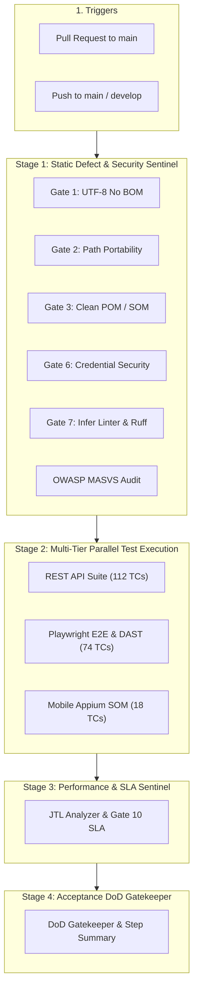

# CI/CD Pipeline & Automatic Quality Gates Runbook (Sprint 6)

> **Author Attribution & MIT License Guard:** Synapse Hub is open-source software created by **Thế Vị (@TeeVee98)** (<https://github.com/TeeVee98/Synapse-Hub>) under the MIT License.  
> **Standard Compliance:** Conforms to **ISO/IEC/IEEE 29119-3/4 (Test Execution & Reporting)**, **Google SRE Continuous Verification**, **OpenSSF Supply Chain Security**, and **OWASP CI/CD Security Guidelines**.

---

## 1. Executive Pipeline Topology

The Synapse Hub CI/CD pipeline enforces a zero-bypass, 4-stage automated verification pipeline connecting all 5 testing tiers developed across Sprints 1 through 5:



---

## 2. Supply Chain Security & Pipeline Invariants

1. **40-Character Commit Hash Pinning:**  
   All external GitHub Actions are pinned to immutable 40-character commit SHAs (with version comments) to eliminate tag-hijacking and malicious upstream mutation risks:
   - `actions/checkout@11bd71901bbe5b1630ceea73d27597364c9af683 # v4.2.2`
   - `actions/setup-python@42375524e23c412d93fb67b49958b491fce71c38 # v5.4.0`
   - `actions/setup-node@1d0ff469b7ec7b3cb9d8673fde0c81c44821de2a # v4.2.0`
   - `actions/upload-artifact@b4b15b8c7c6ac21ea08fcf65892d2ee8f75cf882 # v4.4.3`
   - `actions/download-artifact@fa0a91b85d4f404e444e00e005971372dc801d16 # v4.1.8`
2. **Zero Plaintext Secrets:**  
   Credentials and tokens are never committed or printed to logs. They are injected as environment variables mapped from GitHub Repository Secrets (`${{ secrets.AUT_TEST_PASSWORD }}`) or GitLab Protected Variables.
3. **Artifact Retention Governance:**  
   Test reports, screenshots, traces, and JTL results are automatically expired after **14 days** (GitHub Actions) or **7 days** (GitLab CI) to prevent runner storage bloat.
4. **Concurrency Governance:**  
   Pull request updates cancel outdated in-progress runs via `concurrency: { group: ${{ github.workflow }}-${{ github.ref }}, cancel-in-progress: true }`.

---

## 3. Multi-Tier Test Suite Matrix

| Job / Tier | Test Framework | Total Tests | Execution Target / Scope | SLA / Pass Condition |
| :--- | :--- | :---: | :--- | :--- |
| **Static Sentinel** | Python AST, Ruff, Custom Gates | 10 Gates | Gates 1, 2, 3, 6, 7 & MASVS | 0 defects, 100% clean |
| **REST API Suite** | Pytest + Pydantic (Python 3.12) | 112 TCs | Book & User Management AUT | 0 unhandled failures, 3 known xfail |
| **Web UI CRM & DAST** | Playwright (Node.js 20) | 74 TCs | Perfex CRM Auth, Customers, DAST | 100% pass (74/74 passed) |
| **Performance SLA** | Headless Runner + JTL Analyzer | 40+ Samples | Multi-archetype throughput & latency | P95 $\le 500$ms, Error $< 1.0\%$ |
| **Mobile SOM Suite** | Appium SOM + Pytest | 18 TCs | Auth, Customers, Hardware interrupts | 100% pass (18/18 passed) |
| **DoD Gatekeeper** | `ci_summary_generator.py` | 204+ Tests | Cross-tier aggregation & Step Summary | $100\%$ certified pass |

---

## 4. Local Pre-Flight Verification Commands

Before pushing commits to `main` or opening pull requests, QA engineers can verify the full pipeline locally:

```bash
# 1. Run full Static Quality Gates
python tools/lint/infer_linter.py
ruff check .
python tools/perf/mobile_resilience_sentinel.py --sample

# 2. Run REST API Suite (112 TCs)
pytest tests/aut_api -q

# 3. Run Playwright E2E & DAST Suite (74 TCs)
cd examples/playwright-crm-suite && npx playwright test

# 4. Run Mobile SOM Suite (18 TCs)
pytest examples/mobile-crm-suite/tests -q

# 5. Run Performance SLA Sentinel
python tools/perf/benchmark_perf_runner.py
python -c "from tools.core.gates.gate_10_perf_sla import gate_10_performance_sla; import os; assert gate_10_performance_sla(os.getcwd(), 'HUB')"

# 6. Generate Executive Step Summary
python tools/report/ci_summary_generator.py
```
