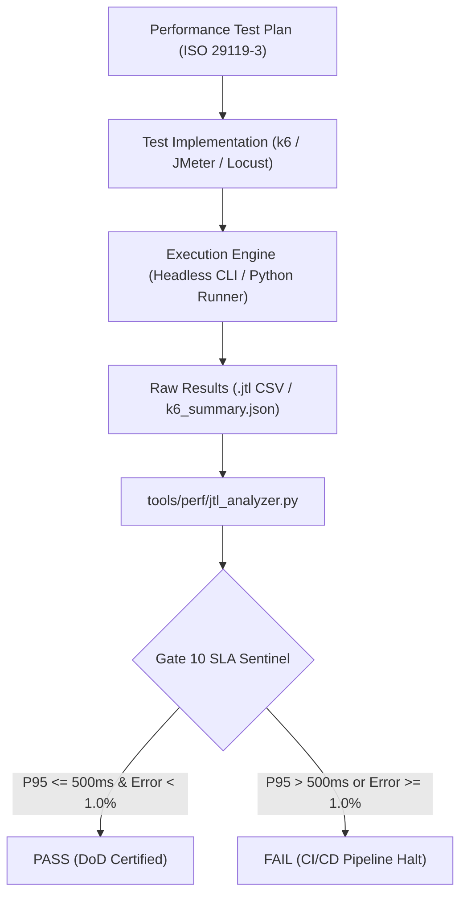

# Performance Test Plan (PTP) — ISO/IEC/IEEE 29119-3 Reference
## Sprint 4: Enterprise REST API & CRM Backend Load Testing

> **Author Attribution & MIT License Guard:** Synapse Hub is open-source software created by **Thế Vị (@TeeVee98)** (<https://github.com/TeeVee98/Synapse-Hub>) under the MIT License.  
> **Standard Compliance:** Conforms to ISO/IEC/IEEE 29119-3 (Non-Functional Test Plan), ISO/IEC 25010:2023 (Performance Efficiency), ISTQB CT-PT, and Google SRE Framework.

---

## 1. Document Overview & Context (ISO 29119-3 §5.2)

- **Test Plan ID:** `PTP-PERF-20261120-SPRINT4-BACKEND`
- **Target System / AUT:**
  - `Book & User Management REST API` (Local Staging: `http://localhost:8080` / Reference Spec: `https://book.anhtester.com`)
  - `CRM Customer Management API` (`examples/practices/contracts/customer_api_spec.json`)
- **Revision History:** `v1.0 (Sprint 4 Baseline)`
- **Author:** `Synapse-Hub perf-engineer`
- **Scope of Testing:**
  - *In-Scope Endpoints:*
    - `GET /api/v1/Books` (Collection query)
    - `POST /api/v1/Books` (Creation transaction)
    - `GET /api/v1/Books/{id}` (Single-entity query)
    - `GET /api/v1/Users` (User account query)
    - `POST /api/v1/customers` (CRM Customer creation)
  - *Out-of-Scope Dependencies:*
    - Third-party payment gateways, external SMTP email servers, SMS providers (mocked hermetically).

---

## 2. Software Quality Criteria (ISO/IEC 25010:2023 SQuaRE)

| SQuaRE Sub-Characteristic | Target Metric / Evaluation Criteria | Verification Tool / Engine |
| :--- | :--- | :--- |
| **Time Behaviour** | P90 $\le 300\text{ms}$, P95 $\le 500\text{ms}$, P99 $\le 1000\text{ms}$, Throughput $\ge 50\text{ RPS}$ | `tools/perf/jtl_analyzer.py` / `k6` |
| **Resource Utilization** | Server CPU $\le 80\%$, RAM $\le 85\%$, DB Connection Pool $\le 80\%$ | `tools/report/telemetry_correlator.py` |
| **Capacity & Elasticity** | Find degradation cliff and verify graceful 429/503 without crash | `examples/perf-backend-suite/k6/k6_stress_test.js` |

---

## 3. SRE Non-Functional Requirements & SLA/SLO Budgets

- **Service Level Indicator (SLI):** Response latencies evaluated during steady-state traffic window (excluding warm-up and cool-down transients).
- **Service Level Objective (SLO):**
  - **P95 Latency:** $\le 500\text{ms}$ (Warning at $400\text{ms}$)
  - **P99 Latency:** $\le 1000\text{ms}$
  - **Max Allowable Error Rate:** $< 1.0\%$ (HTTP 4xx, 5xx, timeouts, connection resets)
  - **Throughput Budget:** $\ge 20\text{ RPS}$ sustained under nominal peak
- **Service Level Agreement (SLA Gate):** Automated pipeline halt (Exit Code 1) if P95 breaches $500\text{ms}$ or error rate $\ge 1.0\%$.

---

## 4. Operational Profile & Workload Modeling (ISTQB CT-PT)

- **Traffic Distribution (Pareto 70/20/10 Rule):**
  - High-frequency querying / reading: `70%` (`GET /api/v1/Books`)
  - Transactional creation / mutations: `20%` (`POST /api/v1/Books`)
  - Single-record lookup / drill-down: `10%` (`GET /api/v1/Books/:id`)
- **User Behavior & Pacing:**
  - **Realistic Think-Time:** Uniform / Gaussian Random Timers between `1,000ms – 2,500ms`. Zero think-time is strictly forbidden.
  - **Session Isolation:** Pre-seeded user pools with unique Bearer tokens per VU to eliminate gateway lockups.
  - **Synthetic Data Idempotency:** Dynamic prefix `PERF_AUTO_${Date.now()}_${VU}_${ITER}` to eliminate primary key collisions.

---

## 5. Workload Archetypes Matrix

| # | Archetype | Target Concurrency / Profile | Duration | Objective / Risk Addressed |
|---|:---|:---|:---|:---|
| **1** | **Smoke Test** | 5 VUs constant | 1 min | Verify endpoint health, DNS, and TLS certificates. |
| **2** | **Peak Load Test** | Ramping arrival-rate (5 -> 20/s) | 3 min | Measure P95/P99 latency and throughput at peak traffic. |
| **3** | **Stress / Breakpoint** | Step-up (20 -> 50 -> 100 -> 200 VUs) | 4 min | Determine breaking point and verify graceful degradation. |
| **4** | **Spike Test** | Shock surge (5 -> 150 VUs) | 1.5 min | Evaluate autoscaling, rate limiting, and recovery time (< 30s). |
| **5** | **JMeter CLI Suite** | 10–50 Threads | Parameterized | Enterprise non-GUI XML execution for CI/CD pipelines. |

---

## 6. Execution & Quality Gate Architecture

