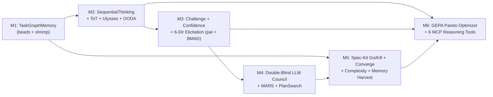

<!--
# SPDX-FileCopyrightText: Copyright (c) 2026 Thế Vị (@TeeVee98). All rights reserved.
# SPDX-License-Identifier: MIT
# Project: Synapse-Hub (https://github.com/TeeVee98/Synapse-Hub)
# Author: Thế Vị (@TeeVee98) | MIT License
-->

# ADR-0033: Reasoning Architecture Upgrade from 12 Reference Repositories

- **Status:** Accepted (DoD Certified)
- **Date:** 2026-11-28
- **Source Plan:** `integrate-12-reasoning-repositories-upgrades-int.md`
- **Deciders:** Synapse Hub Autonomous Agent Core & Engineering Team

---

## Context & Problem Statement
### Target Files & Structural Anchors

| Action | File Path & Structural Anchor | Scope & Responsibility |
|---|---|---|
| `[CREATE]` | `tools/core/task_graph_memory.py` (`TaskGraphMemory`) | SQLite/JSONL dependency-graph task memory (`blocks`, `discovered_from`, `waits_for`, `related`), cycle detection, transitive `is_blocked`/`ready` frontier, lease TTL, optimistic `row_version`, complexity score, snapshot archive |
| `[MODIFY]` | `tools/core/project_state.py` (AST: `export_stateless_working_block`) | Optional backward-compatible sync & ready/blocked frontier telemetry injection from `TaskGraphMemory` |
| `[CREATE]` | `tests/test_task_graph_memory.py` | 4-scenario verification battery (Positive, Negative cycle/lease conflict, Boundary deep chain/empty, CLI `--json`) |
| `[CREATE]` | `tools/reasoning/sequential_thinking_engine.py` (`SequentialThinkingSession`) | Stateful sequential thought revision/branching, ToT beam-search candidate pruner, Ulysses Protocol hard-gate debug state machine, OODA Loop state machine |
| `[CREATE]` | `tests/test_sequential_thinking_engine.py` | 4-scenario verification battery for Sequential Thinking, ToT Beam, Ulysses, and OODA |
| `[CREATE]` | `tools/catalogs/elicitation_methods.json` | 30 curated QA & architecture challenge methods across 6 directions (`wrong`, `missing`, `premise`, `future`, `other-side`, `simplify`) |
| `[CREATE]` | `tools/reasoning/structured_reasoning_engine.py` (`StructuredReasoningEngine`) | Anti-sycophancy `challenge_claim` guard, 7-level monotonic confidence debug gate, stance-assigned debate scaffold, progressive-disclosure `--spread` elicitation picker |
| `[CREATE]` | `tests/test_structured_reasoning_engine.py` | 4-scenario verification battery for Challenge, Confidence Gate, Stance Debate, and Elicitation Picker |
| `[CREATE]` | `tools/orchestration/llm_council_engine.py` (`LLMCouncilEngine`) | 3-stage double-blind LLM Council (`stage1_collect`, `stage2_anonymized_peer_rank`, `stage3_chairman_synthesize`), MARS N-pass consensus check, PlanSearch observation-combining ideation |
| `[CREATE]` | `tests/test_llm_council_engine.py` | 4-scenario verification battery (offline deterministic fixtures, tie-breaking, malformed ranking recovery, CLI `--json`) |
| `[MODIFY]` | `tools/design/super_plan_engine.py` (AST: `run_super_plan_pipeline`) | Add `assess_idea_gate` (`go/needs-clarification/kill`), `converge_plan_delta`, symlink-safe slug resolution, milestone complexity scorer (scale 1 to 10), and pre-split `reflect` check |
| `[MODIFY]` | `tools/design/plan_harvester.py` (AST: `harvest_plan`) | Add `archive_completed_plan_memory` snapshot hook persisting completed milestone outcomes into `TaskGraphMemory` before cleanup |
| `[CREATE]` | `tests/test_super_plan_reasoning_upgrades.py` | 4-scenario verification battery for Go/Kill gate, Converge delta, symlink traversal block, complexity scorer, and memory archival |
| `[MODIFY]` | `tools/lint/mipro_assertion_tuner.py` (AST: `MiproAssertionTuner`) | Add `GEPAReflectiveOptimizer` (`ScoreWithFeedback` + Pareto frontier + `Refine` blame-assignment feedback loop) |
| `[MODIFY]` | `tools/mcp/mcp_server.py` (AST: `handle_tool_call`) | Expose 6 native MCP reasoning & graph tools (`sequential_think`, `challenge_assumption`, `elicitation_pick`, `task_graph_ready`, `memory_graph_query`, `assess_idea_gate`) |
| `[CREATE]` | `tests/test_gepa_and_mcp_reasoning.py` | 4-scenario verification battery for GEPA Pareto evolution and MCP JSON-RPC stdio round-trip |
| `[MODIFY]` | `tools/tools_schema.json` | Reconcile CLI flag schema (`--criteria`, `--slug`, `--unshaped`) via `cli_schema_sentinel.py --sync` |

### Blast Radius & Downstream Dependencies
- **Direct Callers:** `benchmarks/qa_eval/ablation_10_benchmark.py`, `scripts/package_dist.py`, `tests/test_architectural_hardening.py`, `tests/test_audit_remediation_e2e.py`, `tests/test_auto_heal_pipeline.py`, `tests/test_bilingual_cognitive_parity.py` (+47 more) (total `fan_in`: 72; `transitive_fan_in`: 97).
- **Downstream Tests:** 6 dedicated new regression suites (`tests/test_task_graph_memory.py`, `tests/test_sequential_thinking_engine.py`, `tests/test_structured_reasoning_engine.py`, `tests/test_llm_council_engine.py`, `tests/test_super_plan_reasoning_upgrades.py`, `tests/test_gepa_and_mcp_reasoning.py`) plus existing `tests/test_super_plan_engine.py`, `tests/test_mcp_server.py`, `tests/test_project_state.py`.
- **Regression Risk:** High (`fan_in=72`) — strictly mitigated by additive-only signatures with default parameters on all 5 modified existing modules.

---

---

## Decision Drivers & Invariants
- Grounding Principle: "Read First – Plan Later" (AGENTS.md §5).
- Zero Fake-Passes Invariant & Deterministic Verification Matrix.
- Execution DAG with Milestone Circuit Breakers & Clean Context Handoff.

---

## Considered Options & Architectural Decision


```python
from dataclasses import dataclass, field
from typing import Dict, List, Literal, Optional, Sequence, Tuple

EdgeType = Literal["blocks", "discovered_from", "waits_for", "related"]
TaskLifecycleStatus = Literal["open", "in_progress", "done", "blocked", "cancelled"]
ConfidenceLevel = Literal[
    "exploring", "low", "medium", "high", "very_high", "almost_certain", "certain"
]
IdeaVerdict = Literal["go", "needs-clarification", "kill"]
CriterionRating = Literal["strong", "adequate", "weak", "unknown"]
ElicitationDirection = Literal[
    "wrong", "missing", "premise", "future", "other-side", "simplify"
]
StanceType = Literal["for", "against", "neutral"]


@dataclass(frozen=True)
class TaskNodeDTO:
    task_id: str
    title: str
    status: TaskLifecycleStatus
    complexity_score: int  # 1..10
    row_version: int
    is_blocked: bool = False
    blocking_ids: Tuple[str, ...] = ()
    lease_owner: Optional[str] = None
    lease_expires_at: Optional[float] = None
    verification_criteria: Tuple[str, ...] = ()


@dataclass(frozen=True)
class ThoughtStepDTO:
    thought_number: int
    total_thoughts: int
    content: str
    next_thought_needed: bool
    is_revision: bool = False
    revises_thought: Optional[int] = None
    branch_from_thought: Optional[int] = None
    branch_id: Optional[str] = None
    beam_score: Optional[float] = None


@dataclass(frozen=True)
class UlyssesGateResultDTO:
    session_id: str
    phase: Literal["plan", "execute", "verify", "escalate", "complete"]
    iteration: int
    max_iterations: int
    elapsed_sec: float
    time_budget_sec: float
    must_escalate: bool
    reason: str


@dataclass(frozen=True)
class ChallengeReportDTO:
    original_claim: str
    sycophancy_risk_detected: bool
    counter_hypotheses: Tuple[str, ...]
    missing_evidence_prompts: Tuple[str, ...]
    recommended_stance: StanceType


@dataclass(frozen=True)
class ConfidenceTransitionDTO:
    previous_level: ConfidenceLevel
    requested_level: ConfidenceLevel
    effective_level: ConfidenceLevel
    accepted: bool
    rejection_reason: str
    evidence_count: int


@dataclass(frozen=True)
class CouncilCandidateDTO:
    model_id: str
    provider_family: str
    response_text: str


@dataclass(frozen=True)
class CouncilVerdictDTO:
    query: str
    label_to_model: Dict[str, str]
    aggregate_rankings: Tuple[Tuple[str, float], ...]
    winner_model: str
    consensus_passes: int
    chairman_synthesis: str
    offline_mode: bool


@dataclass(frozen=True)
class IdeaAssessmentDTO:
    slug: str
    criteria: Dict[str, CriterionRating]
    verdict: IdeaVerdict
    downgraded_from_go: bool
    decisive_reason: str
    required_clarifications: Tuple[str, ...] = ()


@dataclass(frozen=True)
class ScoreWithFeedbackDTO:
    candidate_id: str
    score: float
    latency_penalty: float
    trajectory_feedback: str
    blamed_module: Optional[str] = None
    actionable_advice: str = ""
```

---

## 3. Atomic Execution DAG (Sequential `/solo` Mode — Max 3 Files / Milestone)

### Milestone 1: Persistent Task Dependency Graph Memory (`beads` + `mcp-shrimp`)
- **Node ID:** `M1` | **depends_on:** `[]`
- **Compute Tier:** `[Model: Pro | Thinking: High | Temp: 0.1]`
- **Files Modified (Max 3):** `tools/core/task_graph_memory.py`, `tools/core/project_state.py`, `tests/test_task_graph_memory.py`
- **Write Set:** `['tools/core/task_graph_memory.py', 'tools/core/project_state.py', 'tests/test_task_graph_memory.py']`
- **Typed Interface Manifest:**
  - **consumes:** `[]`
  - **produces:** `[{"contract": "TaskGraphMemoryContract", "fields": {"task_id": "str", "is_blocked": "bool", "row_version": "int", "complexity_score": "int"}}]`
  - **invariants:** `["acyclic_blocking_edges", "optimistic_row_version_cas", "sqlite_wal_plus_file_lock", "zero_external_daemons"]`
- **Goal:** Implement stdlib SQLite + JSONL `TaskGraphMemory` with typed edges (`blocks`, `discovered_from`, `waits_for`, `related`), cycle rejection (`ValueError`), transitive `is_blocked` & `ready()` frontier queries, TTL task leasing (`claim_task` / `heartbeat` / `reclaim_expired`), optimistic `row_version` CAS guard, and snapshot export; bridge read-only frontier telemetry into `project_state.py::export_stateless_working_block`.
- **Circuit Breaker:** Max Fix Attempts: 2 | Scope Guard: Halt if out-of-scope files touched | Rollback: `git checkout -- tools/core/project_state.py`
- **Rollback Hook:** `git checkout -- tools/core/project_state.py`
- **Pass Gate:** `python3 -m pytest tests/test_task_graph_memory.py -q`

### Milestone 2: Sequential Thinking, ToT Beam Pruner & Ulysses/OODA State Machines (`mcp/servers` + `clearthought` + `ToT`)
- **Node ID:** `M2` | **depends_on:** `[M1]`
- **Compute Tier:** `[Model: Pro | Thinking: High | Temp: 0.1]`
- **Files Modified (Max 3):** `tools/reasoning/sequential_thinking_engine.py`, `tests/test_sequential_thinking_engine.py`
- **Write Set:** `['tools/reasoning/sequential_thinking_engine.py', 'tests/test_sequential_thinking_engine.py']`
- **Typed Interface Manifest:**
  - **consumes:** `[{"contract": "TaskGraphMemoryContract"}]`
  - **produces:** `[{"contract": "SequentialThinkingContract", "fields": {"thought_number": "int", "must_escalate": "bool", "beam_candidates": "int"}}]`
  - **invariants:** `["bounded_thought_size", "ulysses_max_iterations_aligned_with_circuit_breaker", "ooda_min_evidence_gate"]`
- **Goal:** Implement Python stdlib `SequentialThinkingSession` (supporting thought revision, branching by `branch_id`, era resets, and `beam_prune_branches` ToT `propose -> score/vote -> top-k` pruning), `UlyssesProtocolSession` (hard iteration/time caps with automatic escalation aligned to Invariant 13), and `OODALoopSession` (Observe-Orient-Decide-Act with `min_evidence >= 2` gate and hypothesis carry-forward).
- **Circuit Breaker:** Max Fix Attempts: 2 | Scope Guard: Halt if out-of-scope files touched | Rollback: `git checkout -- tools/reasoning/sequential_thinking_engine.py tests/test_sequential_thinking_engine.py`
- **Rollback Hook:** `git checkout -- tools/reasoning/sequential_thinking_engine.py tests/test_sequential_thinking_engine.py`
- **Pass Gate:** `python3 -m pytest tests/test_sequential_thinking_engine.py -q`

### Milestone 3: Anti-Sycophancy Challenge, 6-Direction Elicitation & Confidence Gate (`pal-mcp-server` + `BMAD-METHOD`)
- **Node ID:** `M3` | **depends_on:** `[M2]`
- **Compute Tier:** `[Model: Pro | Thinking: High | Temp: 0.1]`
- **Files Modified (Max 3):** `tools/catalogs/elicitation_methods.json`, `tools/reasoning/structured_reasoning_engine.py`, `tests/test_structured_reasoning_engine.py`
- **Write Set:** `['tools/catalogs/elicitation_methods.json', 'tools/reasoning/structured_reasoning_engine.py', 'tests/test_structured_reasoning_engine.py']`
- **Typed Interface Manifest:**
  - **consumes:** `[{"contract": "SequentialThinkingContract"}]`
  - **produces:** `[{"contract": "StructuredReasoningContract", "fields": {"sycophancy_risk_detected": "bool", "effective_level": "str", "methods_sampled": "int"}}]`
  - **invariants:** `["never_grant_certain_without_verified_evidence", "progressive_disclosure_refuses_unfiltered_dump", "anti_sycophancy_counter_hypothesis_required"]`
- **Goal:** Create `tools/catalogs/elicitation_methods.json` (30 curated methods across 6 push directions: `wrong`, `missing`, `premise`, `future`, `other-side`, `simplify`) and `StructuredReasoningEngine` implementing: (a) anti-sycophancy `challenge_claim()` detecting agreement-bias phrasing and generating structured counter-hypotheses, (b) 7-level monotonic confidence debug tracker (`exploring -> ... -> certain` blocking premature `certain` when `evidence_count < 2` or unresolved unknowns remain), (c) stance-assigned debate prompt builder (`for`/`against`/`neutral`), and (d) progressive-disclosure `--spread` elicitation picker (refusing unfiltered full-catalog dumps unless `--all` is explicitly passed).
- **Circuit Breaker:** Max Fix Attempts: 2 | Scope Guard: Halt if out-of-scope files touched | Rollback: `git checkout -- tools/catalogs/elicitation_methods.json tools/reasoning/structured_reasoning_engine.py tests/test_structured_reasoning_engine.py`
- **Rollback Hook:** `git checkout -- tools/catalogs/elicitation_methods.json tools/reasoning/structured_reasoning_engine.py tests/test_structured_reasoning_engine.py`
- **Pass Gate:** `python3 -m pytest tests/test_structured_reasoning_engine.py -q`

### Milestone 4: Double-Blind LLM Council & Observation-First PlanSearch (`karpathy/llm-council` + `optillm`)
- **Node ID:** `M4` | **depends_on:** `[M3]`
- **Compute Tier:** `[Model: Pro | Thinking: High | Temp: 0.1]`
- **Files Modified (Max 3):** `tools/orchestration/llm_council_engine.py`, `tests/test_llm_council_engine.py`
- **Write Set:** `['tools/orchestration/llm_council_engine.py', 'tests/test_llm_council_engine.py']`
- **Typed Interface Manifest:**
  - **consumes:** `[{"contract": "StructuredReasoningContract"}]`
  - **produces:** `[{"contract": "CouncilVerdictContract", "fields": {"winner_model": "str", "consensus_passes": "int", "offline_mode": "bool"}}]`
  - **invariants:** `["anonymized_peer_labels_before_ranking", "offline_deterministic_default", "mars_min_verification_passes_enforced"]`
- **Goal:** Implement `LLMCouncilEngine` layering directly on ADR-0030 (`multi_model_gateway.py` / `ide_cli_bridge.py`, offline-first via `--candidates-file`): Stage 1 multi-family candidate collection, Stage 2 anonymized `Response A/B/C` peer critique & strict `FINAL RANKING:` parser with deterministic tie-breaking and MARS N-pass verification consensus check, Stage 3 Chairman synthesis, plus `PlanSearch` observation-first pairwise combination helper.
- **Circuit Breaker:** Max Fix Attempts: 2 | Scope Guard: Halt if out-of-scope files touched | Rollback: `git checkout -- tools/orchestration/llm_council_engine.py tests/test_llm_council_engine.py`
- **Rollback Hook:** `git checkout -- tools/orchestration/llm_council_engine.py tests/test_llm_council_engine.py`
- **Pass Gate:** `python3 -m pytest tests/test_llm_council_engine.py -q`

### Milestone 5: Spec-Kit Go/Kill Gate, Converge Reconciler, Complexity Guard & Memory Harvest (`spec-kit` + `task-master` + `shrimp`)
- **Node ID:** `M5` | **depends_on:** `[M1, M4]`
- **Compute Tier:** `[Model: Pro | Thinking: High | Temp: 0.1]`
- **Files Modified (Max 3):** `tools/design/super_plan_engine.py`, `tools/design/plan_harvester.py`, `tests/test_super_plan_reasoning_upgrades.py`
- **Write Set:** `['tools/design/super_plan_engine.py', 'tools/design/plan_harvester.py', 'tests/test_super_plan_reasoning_upgrades.py']`
- **Typed Interface Manifest:**
  - **consumes:** `[{"contract": "TaskGraphMemoryContract"}, {"contract": "CouncilVerdictContract"}]`
  - **produces:** `[{"contract": "SpecGateConvergeContract", "fields": {"verdict": "str", "downgraded_from_go": "bool", "delta_milestones": "int"}}]`
  - **invariants:** `["downgrade_go_when_evidence_weak_or_unknown", "reject_symlink_escape_slugs", "preserve_legacy_super_plan_cli_contracts"]`
- **Goal:** Add to `super_plan_engine.py`: (a) `assess-idea` subcommand implementing 6-criteria `go / needs-clarification / kill` verdict (mechanically downgrading `go` to `needs-clarification` if `evidence_strength` is `weak`/`unknown`), (b) `converge` subcommand reconciling plan write-sets against live workspace files/symbols to emit only unbuilt delta milestones, (c) symlink-safe slug path normalization blocking directory traversal, and (d) per-milestone complexity scoring (scale 1 to 10) flagging `expand_recommended` when `score >= 7` plus pre-split `reflect` check. Add `archive_completed_plan_memory` in `plan_harvester.py` to persist completed milestone verification summaries into `TaskGraphMemory` before plan cleanup.
- **Circuit Breaker:** Max Fix Attempts: 2 | Scope Guard: Halt if out-of-scope files touched | Rollback: `git checkout -- tools/design/super_plan_engine.py tools/design/plan_harvester.py`
- **Rollback Hook:** `git checkout -- tools/design/super_plan_engine.py tools/design/plan_harvester.py`
- **Pass Gate:** `python3 -m pytest tests/test_super_plan_reasoning_upgrades.py tests/test_super_plan_10_blueprint.py -q`

### Milestone 6: GEPA Reflective Pareto Optimizer & Native MCP Reasoning Surface (`dspy` + `mcp/servers`)
- **Node ID:** `M6` | **depends_on:** `[M2, M3, M5]`
- **Compute Tier:** `[Model: Pro | Thinking: High | Temp: 0.1]`
- **Files Modified (Max 3):** `tools/lint/mipro_assertion_tuner.py`, `tools/mcp/mcp_server.py`, `tests/test_gepa_and_mcp_reasoning.py`
- **Write Set:** `['tools/lint/mipro_assertion_tuner.py', 'tools/mcp/mcp_server.py', 'tests/test_gepa_and_mcp_reasoning.py']`
- **Typed Interface Manifest:**
  - **consumes:** `[{"contract": "SequentialThinkingContract"}, {"contract": "StructuredReasoningContract"}, {"contract": "SpecGateConvergeContract"}]`
  - **produces:** `[{"contract": "GepaMcpReasoningContract", "fields": {"pareto_count": "int", "mcp_tools_exposed": "int"}}]`
  - **invariants:** `["pareto_frontier_non_dominated", "mcp_path_sandbox_validated", "zero_breaking_changes_to_existing_24_mcp_tools"]`
- **Goal:** Add `GEPAReflectiveOptimizer` (`ScoreWithFeedbackDTO`, trajectory-level reflective prompt mutation, Pareto frontier selection, and `Refine` blame-assignment retry feedback) inside `tools/lint/mipro_assertion_tuner.py`, and wire 6 native reasoning & graph tools into `tools/mcp/mcp_server.py` (`sequential_think`, `challenge_assumption`, `elicitation_pick`, `task_graph_ready`, `memory_graph_query`, `assess_idea_gate`), preserving all 24 existing MCP tools and path-sandbox validation.
- **Circuit Breaker:** Max Fix Attempts: 2 | Scope Guard: Halt if out-of-scope files touched | Rollback: `git checkout -- tools/lint/mipro_assertion_tuner.py tools/mcp/mcp_server.py`
- **Rollback Hook:** `git checkout -- tools/lint/mipro_assertion_tuner.py tools/mcp/mcp_server.py`
- **Pass Gate:** `python3 -m pytest tests/test_gepa_and_mcp_reasoning.py tests/test_mcp_unified_server.py -q`

### Milestone 7: CLI Tool Schema Synchronization (`tools/tools_schema.json`)
- **Node ID:** `M7` | **depends_on:** `[M5, M6]`
- **Compute Tier:** `[Model: Flash | Thinking: Off | Temp: 0.1]`
- **Files Modified (Max 3):** `tools/tools_schema.json`
- **Write Set:** `['tools/tools_schema.json']`
- **Typed Interface Manifest:**
  - **consumes:** `[{"contract": "SpecGateConvergeContract"}, {"contract": "GepaMcpReasoningContract"}]`
  - **produces:** `[{"contract": "CliSchemaSyncContract", "fields": {"drift_count": "int"}}]`
  - **invariants:** `["zero_cli_schema_drift"]`
- **Goal:** Synchronize `tools/tools_schema.json` via `tools/lint/cli_schema_sentinel.py --sync` so Gate 4 passes with `drift_count == 0`.
- **Circuit Breaker:** Max Fix Attempts: 2 | Scope Guard: Halt if out-of-scope files touched | Rollback: `git checkout -- tools/tools_schema.json`
- **Rollback Hook:** `git checkout -- tools/tools_schema.json`
- **Pass Gate:** `python3 tools/lint/cli_schema_sentinel.py --check --json`

---

## 4. Verification Matrix ("Define the Exam in the Plan")

| ID | Test Scenario | Input / Precondition | Expected Output / Assertion | Verification Command |
|---|---|---|---|---|
| **TC-01** | Positive (TaskGraph `ready` & Transitive Blockers) | `A blocks B blocks C`; close `A` | `B` transitions to `ready` (`is_blocked=False`), `C` stays blocked until `B` closes | `python3 -m pytest tests/test_task_graph_memory.py -k "test_task_graph_transitive_ready"` |
| **TC-02** | Negative (Cycle Rejection & Optimistic CAS Conflict) | Attempt edge `C blocks A` and stale `row_version` update | Raises controlled `ValueError` / `StaleRevisionError` with zero DB corruption | `python3 -m pytest tests/test_task_graph_memory.py -k "test_task_graph_cycle_and_cas_conflict"` |
| **TC-03** | Boundary (Ulysses Hard Escalation & OODA Min Evidence) | `iteration == max_iterations` and `evidence=[]` | `UlyssesGateResultDTO.must_escalate == True`; OODA refuses advance until `len(evidence) >= 2` | `python3 -m pytest tests/test_sequential_thinking_engine.py -k "test_ulysses_and_ooda_boundaries"` |
| **TC-04** | Positive + Negative (Confidence Gate & Anti-Sycophancy) | Request `certain` with `evidence_count=0`; claim `"You're absolutely right"` | `ConfidenceTransitionDTO.accepted == False`, downgraded safely; `sycophancy_risk_detected == True` | `python3 -m pytest tests/test_structured_reasoning_engine.py -k "test_confidence_gate_and_challenge"` |
| **TC-05** | Positive + Negative (Double-Blind Council & Malformed Ranking) | 3 offline candidates + 1 malformed reviewer ranking | Valid `label_to_model` anonymization, deterministic winner, malformed ranking skipped cleanly | `python3 -m pytest tests/test_llm_council_engine.py -k "test_double_blind_council_ranking"` |
| **TC-06** | Boundary + Security (Spec-Kit Go/Kill & Symlink Guard) | `evidence_strength="unknown"` + symlink slug `../escape` | Verdict downgraded to `needs-clarification`; symlink slug rejected with `ValueError` | `python3 -m pytest tests/test_super_plan_reasoning_upgrades.py -k "test_assess_idea_and_symlink_guard"` |
| **TC-07** | Positive + CLI Contract (GEPA Pareto & MCP Reasoning Tools) | Multi-objective score/latency candidates + MCP JSON-RPC calls for 6 new tools | Non-dominated Pareto frontier returned; all 6 MCP tools return valid JSON-RPC payloads with `--json` exit 0 | `python3 -m pytest tests/test_gepa_and_mcp_reasoning.py -k "test_gepa_pareto_and_mcp_tools"` |

---

## 5. Tri-Vulnerability Self-Critique & Mitigations

1. **Vulnerability 1 (Concurrency / SQLite Multi-Process Lock Contention):**
   - *Risk:* Concurrent `/solo` or MCP calls writing to `TaskGraphMemory` SQLite DB could trigger `sqlite3.OperationalError: database is locked` or lost updates.
   - *Mitigation:* Enable SQLite `PRAGMA journal_mode=WAL` + `busy_timeout=5000`, wrap state mutations with `tools/core/file_lock.py`, and enforce optimistic `row_version` compare-and-swap on every status/claim write.
2. **Vulnerability 2 (Path Traversal / Untrusted Artifact Injection in `assess-idea` & MCP):**
   - *Risk:* Crafted slug names (`../../etc/passwd`) or symlinks inside `.synapse/` could redirect plan/assessment writes outside the repository root, or untrusted text inside peer responses could inject prompt directives.
   - *Mitigation:* Enforce `os.path.realpath` containment + explicit symlink rejection before every filesystem read/write (`_validate_safe_path` / `_resolve_safe_plan_path`), and treat external candidate/assessment payloads strictly as inert data.
3. **Vulnerability 3 (Blast Radius / Downstream Caller Regression on `fan_in=72`):**
   - *Risk:* Modifying `project_state.py`, `super_plan_engine.py`, `plan_harvester.py`, `mipro_assertion_tuner.py`, or `mcp_server.py` could break existing CLI flags or 72 direct callers.
   - *Mitigation:* Enforce strictly additive APIs with default-preserving parameters, keep all 24 existing MCP tool names and schemas unchanged, isolate work in a dedicated git worktree, and gate every milestone with targeted regression suites plus `verify_all.py --mode hub --tier impact`.

---

## 6. Rollback & State-Migration Matrix (Zero-Downtime Guard)

| Phase | Trigger Scenario | Mitigation / Dual-mode | Rollback Command |
|---|---|---|---|
| **M1 State Graph Migration** | SQLite schema corruption or legacy `project_state.json` mismatch | Dual-mode read: `project_state.py` falls back cleanly to legacy flat `project_state.json` if `.synapse/task_graph.db` is absent | `git checkout -- tools/core/project_state.py` |
| **M2–M4 Reasoning Engines** | Mutation score `< 80%` or failing boundary scenario | Isolated new modules with zero callers until M5/M6 wire-up | `git checkout -- tools/reasoning/sequential_thinking_engine.py tools/reasoning/structured_reasoning_engine.py tools/orchestration/llm_council_engine.py` |
| **M5–M6 Control Plane & MCP Cutover** | Regression in existing `/super-plan`, `harvest-plan`, or 24 legacy MCP tools | Additive subcommands & tool handlers only; toggle off via CLI flag or revert modified files | `git checkout -- tools/design/super_plan_engine.py tools/design/plan_harvester.py tools/lint/mipro_assertion_tuner.py tools/mcp/mcp_server.py` |

---

## 7. Execution Transition & Plan Harvesting

- **Execution Mode:** Single-Agent Sequential (`/solo`) — One session, one recommended model/thinking level; execute milestones `M1 -> M2 -> M3 -> M4 -> M5 -> M6` sequentially. Do NOT spawn `swarm` workers or parallel subagents.
- **Recommended Execution Model & Thinking Level:** `Gemini 4 Neon (High)` — High-risk / multi-module DAG (`fan_in=72`, `transitive_fan_in=97`); High thinking prevents schema drift, SQLite concurrency bugs, and caller regressions.
- **Worktree Isolation (Mandatory Due to Active Concurrent Dirty Diff on `main`):**
  ```bash
  agent-qa worktree create --agent-id integrate-12-reasoning-repositories-upgrades-int --plan .synapse/plans/integrate-12-reasoning-repositories-upgrades-int.md
  ```
- **Clean Context Handoff:**
  ```bash
  # Interactive single-agent handoff:
  # "Read .synapse/plans/integrate-12-reasoning-repositories-upgrades-int.md and execute sequentially via /solo (single-agent mode, no swarm workers)"
  # Mechanical closed-loop verification runner:
  agent-qa solo --from-plan .synapse/plans/integrate-12-reasoning-repositories-upgrades-int.md --json
  ```
- **Surgical Patch Protocol:** Edit only targeted blocks upon feedback with Changelog update; forbid whole-file regenerations.
- **Plan Harvesting Hook:** Upon passing all 11 DoD Quality Gates (`python3 tools/core/verify_all.py --mode hub --tier impact`) and `>= 80%` diff-scoped mutation score, run `agent-qa harvest-plan --file .synapse/plans/integrate-12-reasoning-repositories-upgrades-int.md` to emit an ADR under `docs/adr/` and remove the ephemeral `.synapse/plans/` draft.

---

## Vulnerability Self-Critique & Mitigation Strategies
1. **Vulnerability 1 (Concurrency / SQLite Multi-Process Lock Contention):**
   - *Risk:* Concurrent `/solo` or MCP calls writing to `TaskGraphMemory` SQLite DB could trigger `sqlite3.OperationalError: database is locked` or lost updates.
   - *Mitigation:* Enable SQLite `PRAGMA journal_mode=WAL` + `busy_timeout=5000`, wrap state mutations with `tools/core/file_lock.py`, and enforce optimistic `row_version` compare-and-swap on every status/claim write.
2. **Vulnerability 2 (Path Traversal / Untrusted Artifact Injection in `assess-idea` & MCP):**
   - *Risk:* Crafted slug names (`../../etc/passwd`) or symlinks inside `.synapse/` could redirect plan/assessment writes outside the repository root, or untrusted text inside peer responses could inject prompt directives.
   - *Mitigation:* Enforce `os.path.realpath` containment + explicit symlink rejection before every filesystem read/write (`_validate_safe_path` / `_resolve_safe_plan_path`), and treat external candidate/assessment payloads strictly as inert data.
3. **Vulnerability 3 (Blast Radius / Downstream Caller Regression on `fan_in=72`):**
   - *Risk:* Modifying `project_state.py`, `super_plan_engine.py`, `plan_harvester.py`, `mipro_assertion_tuner.py`, or `mcp_server.py` could break existing CLI flags or 72 direct callers.
   - *Mitigation:* Enforce strictly additive APIs with default-preserving parameters, keep all 24 existing MCP tool names and schemas unchanged, isolate work in a dedicated git worktree, and gate every milestone with targeted regression suites plus `verify_all.py --mode hub --tier impact`.

---

## 6. Rollback & State-Migration Matrix (Zero-Downtime Guard)

| Phase | Trigger Scenario | Mitigation / Dual-mode | Rollback Command |
|---|---|---|---|
| **M1 State Graph Migration** | SQLite schema corruption or legacy `project_state.json` mismatch | Dual-mode read: `project_state.py` falls back cleanly to legacy flat `project_state.json` if `.synapse/task_graph.db` is absent | `git checkout -- tools/core/project_state.py` |
| **M2–M4 Reasoning Engines** | Mutation score `< 80%` or failing boundary scenario | Isolated new modules with zero callers until M5/M6 wire-up | `git checkout -- tools/reasoning/sequential_thinking_engine.py tools/reasoning/structured_reasoning_engine.py tools/orchestration/llm_council_engine.py` |
| **M5–M6 Control Plane & MCP Cutover** | Regression in existing `/super-plan`, `harvest-plan`, or 24 legacy MCP tools | Additive subcommands & tool handlers only; toggle off via CLI flag or revert modified files | `git checkout -- tools/design/super_plan_engine.py tools/design/plan_harvester.py tools/lint/mipro_assertion_tuner.py tools/mcp/mcp_server.py` |

---

## 7. Execution Transition & Plan Harvesting

- **Execution Mode:** Single-Agent Sequential (`/solo`) — One session, one recommended model/thinking level; execute milestones `M1 -> M2 -> M3 -> M4 -> M5 -> M6` sequentially. Do NOT spawn `swarm` workers or parallel subagents.
- **Recommended Execution Model & Thinking Level:** `Gemini 4 Neon (High)` — High-risk / multi-module DAG (`fan_in=72`, `transitive_fan_in=97`); High thinking prevents schema drift, SQLite concurrency bugs, and caller regressions.
- **Worktree Isolation (Mandatory Due to Active Concurrent Dirty Diff on `main`):**
  ```bash
  agent-qa worktree create --agent-id integrate-12-reasoning-repositories-upgrades-int --plan .synapse/plans/integrate-12-reasoning-repositories-upgrades-int.md
  ```
- **Clean Context Handoff:**
  ```bash
  # Interactive single-agent handoff:
  # "Read .synapse/plans/integrate-12-reasoning-repositories-upgrades-int.md and execute sequentially via /solo (single-agent mode, no swarm workers)"
  # Mechanical closed-loop verification runner:
  agent-qa solo --from-plan .synapse/plans/integrate-12-reasoning-repositories-upgrades-int.md --json
  ```
- **Surgical Patch Protocol:** Edit only targeted blocks upon feedback with Changelog update; forbid whole-file regenerations.
- **Plan Harvesting Hook:** Upon passing all 11 DoD Quality Gates (`python3 tools/core/verify_all.py --mode hub --tier impact`) and `>= 80%` diff-scoped mutation score, run `agent-qa harvest-plan --file .synapse/plans/integrate-12-reasoning-repositories-upgrades-int.md` to emit an ADR under `docs/adr/` and remove the ephemeral `.synapse/plans/` draft.

---

## Consequences & Guarantees
- **Positive:** Sealed interface contracts, zero-regression blast radius, idempotent execution.
- **Negative / Constraints:** Strict adherence to atomic milestone budget (<= 3 files) and type contracts.
---

## Plan Calibration & Drift Analysis
- **Plan File Accuracy Score:** 100.0%
- **Plan File Drift Ratio:** 0.0
- **Semantic Contract Accuracy Score:** 100.0%
- **Semantic Contract Drift Ratio:** 0.0
- **Composite Plan Accuracy Score:** 100.0%
- **Unplanned Files (0):** None (100% Plan Accuracy)

