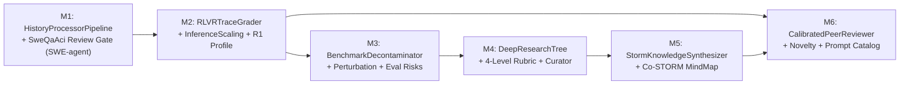

<!--
# SPDX-FileCopyrightText: Copyright (c) 2026 Thế Vị (@TeeVee98). All rights reserved.
# SPDX-License-Identifier: MIT
# Project: Synapse-Hub (https://github.com/TeeVee98/Synapse-Hub)
# Author: Thế Vị (@TeeVee98) | MIT License
-->

# ADR-0034: Deep Research, RLVR Evaluation, ACI History Compression & Calibrated Peer Review Upgrade from 10 AI Research Repositories

- **Status:** Accepted (DoD Certified)
- **Date:** 2026-11-28
- **Source Plan:** `evaluate-and-integrate-10-ai-research-repositori.md`
- **Deciders:** Synapse Hub Autonomous Agent Core & Engineering Team

---

## Context & Problem Statement
### Target Files & Structural Anchors

| Action | File Path & Structural Anchor | Scope & Responsibility |
|---|---|---|
| `[CREATE]` | `tools/context/history_processor_pipeline.py` (`HistoryProcessorPipeline`) | SWE-agent composable history compression (`LastNObservationsProcessor`, `ClosedWindowElisionProcessor`, `CacheControlBreakpointProcessor`, `RegexNoiseFilterProcessor`) + `TrajectoryChooser` retry/best-attempt preselector |
| `[MODIFY]` | `tools/orchestration/swe_qa_aci.py` (`SweQaAci`) | Additive `review_on_submit()` pre-submission diff/AST/Clean-POM guard and `compress_history()` bridge preserving 100% existing `view_window`/`surgical_edit`/`run_distilled` contracts |
| `[CREATE]` | `tests/test_history_processor_pipeline.py` | 4-scenario battery (Positive observation elision/KV breakpoints/chooser, Negative invalid regex/broken submit syntax, Boundary empty/single-turn history, CLI `--json`) |
| `[CREATE]` | `tools/reasoning/rlvr_trace_grader.py` (`RLVRTraceGrader`) | Open-R1 + `reasoning-from-scratch` deterministic trace grader (`format_reward`, `tag_count_reward`, `reasoning_steps_reward`, `cosine_scaled_length_reward`, `ngram_repetition_penalty`, `soft_overlong_penalty`, `compute_grpo_advantages`) + `InferenceScalingController` (`extract_last_boxed`, `self_consistency_vote`, bounded `self_refinement_loop`) |
| `[MODIFY]` | `tools/reasoning/dynamic_budget_engine.py` (`DynamicBudgetEngine`) | Additive DeepSeek-R1 reasoning-model profile guard (`resolve_reasoning_model_profile`: temp `[0.5, 0.7]`, `avoid_system_prompt`, `<think>\n` enforcement) + nanoGPT analytical `estimate_kv_cache_and_flops()` sizing telemetry |
| `[CREATE]` | `tests/test_rlvr_trace_grader.py` | 4-scenario battery (Positive RLVR rewards/GRPO/self-consistency/self-refinement, Negative repetition loop & thinking-bypass detection, Boundary zero-variance group & empty trace, CLI `--json`) |
| `[CREATE]` | `tools/lint/benchmark_decontaminator.py` (`BenchmarkDecontaminator`) | Open-R1 n-gram benchmark contamination detector (`normalize_string`, `word_ngrams`, `detect_contamination`) + GPT-Researcher `MetricPerturbationSuite` verifying monotonic metric degradation under controlled report corruption |
| `[MODIFY]` | `tools/lint/ai_eval_sentinel.py` (`evaluate_rag_triplet`) | Additive `Prompt-Engineering-Guide` adversarial risk probes (prompt leaking, delimiter-escape jailbreak, roleplay obfuscation, sycophancy/bias markers) + citation grounding check preserving existing RAG score schema |
| `[CREATE]` | `tests/test_benchmark_decontaminator.py` | 4-scenario battery (Positive n-gram leak detection & monotonic perturbation proof, Negative ungrounded/injected prompt rejection, Boundary short `< n` text & empty corpus, CLI `--json`) |
| `[CREATE]` | `tools/context/deep_research_engine.py` (`DeepResearchTree`) | GPT-Researcher recursive `breadth x depth` research planner/executor with `MAX_CONTEXT_WORDS` budget cap, resilient JSON block extractor, Jev-inspired 4-level `UsefulnessRubricFilter` (levels 0 through 3 deterministic offline lexical/evidence scorer + opt-in gateway), and `SourceCurator` credibility ranker |
| `[CREATE]` | `tests/test_deep_research_engine.py` | 4-scenario battery (Positive recursive tree/rubric filter/curator, Negative malformed JSON recovery & untrusted source down-ranking, Boundary depth=0/empty chunks/budget cap, CLI `--json`) |
| `[CREATE]` | `tools/design/storm_knowledge_synthesizer.py` (`StormKnowledgeSynthesizer`) | STORM multi-perspective `PersonaGenerator` + `ConversationTurn` `[n]` citation tracker + Co-STORM hierarchical `KnowledgeBase` (`KnowledgeNode` tree: `insert_from_outline_string`, `insert_information`, `trim_empty_leaf_nodes`, `merge_single_child_nodes`, `reorganize`, citation-verified `to_report`) |
| `[CREATE]` | `tests/test_storm_knowledge_synthesizer.py` | 4-scenario battery (Positive persona interview/mindmap/cited report, Negative orphan citation & duplicate node rejection, Boundary empty outline/single-child collapse, CLI `--json`) |
| `[CREATE]` | `tools/orchestration/peer_review_calibrator.py` (`CalibratedPeerReviewer`) | AI-Scientist 10-dimension ICLR structured review rubric with conservative bias calibration, N-reviewer `synthesize_meta_review` ensemble, `NoveltyCheckedIdeaGenerator` deduplicating against `docs/adr/`, and bounded `ExperimentRepairLoop` (`max_runs`, stderr capture, metric ratchet) |
| `[CREATE]` | `tools/catalogs/prompt_patterns_catalog.json` | Curated `Prompt-Engineering-Guide` catalog of 18 prompting techniques, Context Engineering checklist, and adversarial risk-to-mitigation lookup table |
| `[CREATE]` | `tests/test_peer_review_calibrator.py` | 4-scenario battery (Positive 10-dim review/meta-review/novelty check/experiment repair, Negative duplicate idea rejection & max_runs escalation, Boundary score clamping/empty archive, CLI `--json`) |
| [MODIFY] | `tools/lint/agent_canary.py` | Approved prerequisite cache isolation and seeded fallback for the M3 canary regression |
| [MODIFY] | `tests/test_ai_agent_eval_hardening.py` | Regression assertions for worktree-local cache selection and unreadable database fallback |

### Blast Radius & Downstream Dependencies
- **Direct Callers:** `tests/test_cli_smoke.py`, `tests/test_swe_qa_aci.py`, `tests/test_token_reduction_engine.py`, `tests/test_multi_model_gateway.py`, `tests/test_multi_model_orchestration.py`, `tests/test_ai_eval_sentinel.py`, `tests/test_ai_agent_eval_hardening.py`, `tests/test_ai_eval_p0_p2.py`, `tools/core/gates/gate_11_token_reduction.py`, `tools/design/super_plan_engine.py`, `tools/orchestration/multi_model_gateway.py`, `tools/orchestration/__init__.py` (total `fan_in`: 12; `transitive_fan_in`: 14; `blast_radius`: 19).
- **Downstream Tests:** 6 new dedicated regression suites (`tests/test_history_processor_pipeline.py`, `tests/test_rlvr_trace_grader.py`, `tests/test_benchmark_decontaminator.py`, `tests/test_deep_research_engine.py`, `tests/test_storm_knowledge_synthesizer.py`, `tests/test_peer_review_calibrator.py`) plus existing `tests/test_swe_qa_aci.py`, `tests/test_token_reduction_engine.py`, `tests/test_multi_model_gateway.py`, `tests/test_ai_eval_sentinel.py`, `tests/test_ai_agent_eval_hardening.py`, `tests/test_ai_eval_p0_p2.py`.
- **Regression Risk:** Low-Moderate (`fan_in=12`, `cross_boundary=False`) — strictly mitigated by additive-only methods with backward-compatible defaults on the 3 modified existing modules (`swe_qa_aci.py`, `dynamic_budget_engine.py`, `ai_eval_sentinel.py`) and isolated git worktree execution.

---

---

## Decision Drivers & Invariants
- Grounding Principle: "Read First – Plan Later" (AGENTS.md §5).
- Zero Fake-Passes Invariant & Deterministic Verification Matrix.
- Execution DAG with Milestone Circuit Breakers & Clean Context Handoff.

---

## Considered Options & Architectural Decision
```python
from dataclasses import dataclass, field
from typing import Dict, List, Literal, Optional, Sequence, Tuple

UsefulnessLevel = Literal[0, 1, 2, 3]
ReviewDecision = Literal["Accept", "Reject"]
PerturbationKind = Literal[
    "strip_citations", "drop_sources", "inject_contradiction", "truncate_context"
]
RiskCategory = Literal[
    "direct_injection",
    "indirect_injection",
    "prompt_leaking",
    "delimiter_jailbreak",
    "roleplay_obfuscation",
    "sycophancy_bias",
]


@dataclass(frozen=True)
class HistoryCompressionReceiptDTO:
    original_turns: int
    processed_turns: int
    elided_observations: int
    closed_windows_elided: int
    cache_breakpoints_placed: int
    estimated_tokens_before: int
    estimated_tokens_after: int


@dataclass(frozen=True)
class TrajectoryChoiceDTO:
    chosen_index: int
    preselected_indices: Tuple[int, ...]
    scores: Tuple[float, ...]
    rationale: str


@dataclass(frozen=True)
class SubmitReviewReceiptDTO:
    approved: bool
    files_changed: Tuple[str, ...]
    syntax_valid: bool
    clean_pom_valid: bool
    blocking_reasons: Tuple[str, ...] = ()


@dataclass(frozen=True)
class RLVRTraceScoreDTO:
    format_score: float
    tag_count_score: float
    reasoning_steps_score: float
    cosine_length_score: float
    repetition_penalty: float
    overlong_penalty: float
    composite_reward: float
    extracted_answer: Optional[str] = None


@dataclass(frozen=True)
class InferenceScalingResultDTO:
    selected_answer: str
    vote_counts: Dict[str, int]
    consensus_ratio: float
    refinement_rounds: int
    stopped_early_no_gain: bool
    group_advantages: Tuple[float, ...] = ()


@dataclass(frozen=True)
class ReasoningModelProfileDTO:
    model_id: str
    temperature: float
    avoid_system_prompt: bool
    enforce_think_prefix: str
    estimated_kv_cache_mb: float
    estimated_flops_per_token: float


@dataclass(frozen=True)
class ContaminationMatchDTO:
    source_id: str
    benchmark_id: str
    matched_ngrams: int
    overlap_ratio: float
    sample_ngram: str


@dataclass(frozen=True)
class PerturbationAuditDTO:
    perturbation_kind: PerturbationKind
    baseline_score: float
    degraded_scores: Tuple[float, ...]
    is_monotonically_non_increasing: bool
    drop_magnitude: float


@dataclass(frozen=True)
class ScoredEvidenceChunkDTO:
    chunk_id: str
    source_url: str
    text: str
    usefulness_level: UsefulnessLevel
    rubric_score: float
    credibility_score: float


@dataclass(frozen=True)
class ResearchLearningDTO:
    depth: int
    query: str
    learning: str
    citations: Tuple[str, ...]
    usefulness_level: UsefulnessLevel


@dataclass(frozen=True)
class KnowledgeNodeDTO:
    node_id: str
    title: str
    path: Tuple[str, ...]
    citation_ids: Tuple[int, ...]
    summary: str
    children_ids: Tuple[str, ...] = ()


@dataclass(frozen=True)
class PeerReviewRubricDTO:
    reviewer_id: str
    originality: int
    quality: int
    clarity: int
    significance: int
    soundness: int
    presentation: int
    contribution: int
    overall: int
    confidence: int
    decision: ReviewDecision
    strengths: Tuple[str, ...] = ()
    weaknesses: Tuple[str, ...] = ()


@dataclass(frozen=True)
class MetaReviewReceiptDTO:
    reviewer_count: int
    mean_overall: float
    confidence_weighted_overall: float
    calibrated_decision: ReviewDecision
    dissent_detected: bool
    key_weaknesses: Tuple[str, ...] = ()


@dataclass(frozen=True)
class IdeaNoveltyReceiptDTO:
    idea_title: str
    is_novel: bool
    max_similarity: float
    closest_existing_id: Optional[str]
    verdict_reason: str
```



---

## 3. Atomic Execution DAG (Sequential `/solo` Mode — Max 3 Files / Milestone)

### Milestone 1: SWE-Agent ACI History Compression, KV-Cache Breakpoints & Pre-Submit Review (`SWE-agent`)
- **Node ID:** `M1` | **depends_on:** `[]`
- **Compute Tier:** `[Model: Pro | Thinking: High | Temp: 0.1]`
- **Files Modified (Max 3):** `tools/context/history_processor_pipeline.py`, `tools/orchestration/swe_qa_aci.py`, `tests/test_history_processor_pipeline.py`
- **Write Set:** `['tools/context/history_processor_pipeline.py', 'tools/orchestration/swe_qa_aci.py', 'tests/test_history_processor_pipeline.py']`
- **Typed Interface Manifest:**
  - **consumes:** `[]`
  - **produces:** `[{"contract": "HistoryCompressionContract", "fields": {"elided_observations": "int", "cache_breakpoints_placed": "int", "approved": "bool"}}]`
  - **invariants:** `["preserve_system_and_last_n_observations", "closed_window_superseded_views_elided", "review_on_submit_blocks_syntax_or_pom_violations"]`
- **Goal:** Implement `HistoryProcessorPipeline` composing `LastNObservationsProcessor` (replacing older observations with `"Old environment output: (n lines omitted)"`), `ClosedWindowElisionProcessor` (eliding stale file-window views once a file is reopened/edited), `CacheControlBreakpointProcessor` (placing deterministic ephemeral KV-cache checkpoints), `RegexNoiseFilterProcessor` (stripping ANSI/log chatter), and `TrajectoryChooser` (preselecting top candidates and picking the highest-scoring repair trajectory). Add strictly additive `review_on_submit()` and `compress_history()` methods on `tools/orchestration/swe_qa_aci.py::SweQaAci` without altering existing `view_window`, `surgical_edit`, or `run_distilled` signatures.
- **Circuit Breaker:** Max Fix Attempts: 2 | Scope Guard: Halt if out-of-scope files touched | Rollback: `git checkout -- tools/orchestration/swe_qa_aci.py`
- **Rollback Hook:** `git checkout -- tools/orchestration/swe_qa_aci.py`
- **Pass Gate:** `python3 -m pytest tests/test_history_processor_pipeline.py tests/test_swe_qa_aci.py -q`

### Milestone 2: RLVR Trace Grader, GRPO Advantage, Inference-Time Scaling & DeepSeek-R1 Profile (`open-r1` + `LLMs-from-scratch` + `DeepSeek-R1` + `nanoGPT`)
- **Node ID:** `M2` | **depends_on:** `[M1]`
- **Compute Tier:** `[Model: Pro | Thinking: High | Temp: 0.1]`
- **Files Modified (Max 3):** `tools/reasoning/rlvr_trace_grader.py`, `tools/reasoning/dynamic_budget_engine.py`, `tests/test_rlvr_trace_grader.py`
- **Write Set:** `['tools/reasoning/rlvr_trace_grader.py', 'tools/reasoning/dynamic_budget_engine.py', 'tests/test_rlvr_trace_grader.py']`
- **Typed Interface Manifest:**
  - **consumes:** `[{"contract": "HistoryCompressionContract"}]`
  - **produces:** `[{"contract": "RLVRAndScalingContract", "fields": {"composite_reward": "float", "consensus_ratio": "float", "enforce_think_prefix": "str"}}]`
  - **invariants:** `["deterministic_verifiable_rewards_zero_torch", "ngram_loop_repetition_penalized", "r1_temperature_clamped_0_5_to_0_7", "self_refinement_stops_on_zero_gain"]`
- **Goal:** Implement `RLVRTraceGrader` with pure-Python deterministic reward functions harvested from `open-r1/src/open_r1/rewards.py` (`format_reward`, `tag_count_reward`, `reasoning_steps_reward`, `cosine_scaled_length_reward`, `ngram_repetition_penalty`, `soft_overlong_penalty`, and GRPO group-relative `compute_grpo_advantages`) plus `InferenceScalingController` from `reasoning-from-scratch` (`extract_last_boxed`, `self_consistency_vote`, bounded `self_refinement_loop` halting early when score gain `<= 0`). Add additive `resolve_reasoning_model_profile()` (DeepSeek-R1 temp `[0.5, 0.7]`, `avoid_system_prompt`, `<think>\n` prefix guard) and `estimate_kv_cache_and_flops()` (nanoGPT analytical sizing telemetry) to `DynamicBudgetEngine`.
- **Circuit Breaker:** Max Fix Attempts: 2 | Scope Guard: Halt if out-of-scope files touched | Rollback: `git checkout -- tools/reasoning/dynamic_budget_engine.py`
- **Rollback Hook:** `git checkout -- tools/reasoning/dynamic_budget_engine.py`
- **Pass Gate:** `python3 -m pytest tests/test_rlvr_trace_grader.py tests/test_token_reduction_engine.py tests/test_multi_model_gateway.py -q`

### Milestone 3: Benchmark Decontamination Guard, Metric Perturbation Suite & Adversarial Risk Expansion (`open-r1` + `gpt-researcher` + `Prompt-Engineering-Guide`)
- **Node ID:** `M3` | **depends_on:** `[M2]`
- **Compute Tier:** `[Model: Pro | Thinking: High | Temp: 0.1]`
- **Files Modified (Max 3):** `tools/lint/benchmark_decontaminator.py`, `tools/lint/ai_eval_sentinel.py`, `tests/test_benchmark_decontaminator.py`
- **Write Set:** `['tools/lint/benchmark_decontaminator.py', 'tools/lint/ai_eval_sentinel.py', 'tests/test_benchmark_decontaminator.py']`
- **Typed Interface Manifest:**
  - **consumes:** `[{"contract": "RLVRAndScalingContract"}]`
  - **produces:** `[{"contract": "DecontaminationAndPerturbationContract", "fields": {"contaminated_count": "int", "is_monotonically_non_increasing": "bool", "risk_categories_flagged": "int"}}]`
  - **invariants:** `["ngram_lookup_deterministic_normalized", "perturbation_proves_monotonic_metric_sensitivity", "preserve_legacy_evaluate_rag_triplet_keys"]`
- **Goal:** Implement `BenchmarkDecontaminator` (8-gram normalized overlap index modeled on `open-r1/scripts/decontaminate.py` to detect benchmark/prompt/fixture leakage across Hub corpora) and `MetricPerturbationSuite` (modeled on `gpt-researcher/evals/quality_eval/perturbation.py`, deliberately degrading reports across 4 perturbation axes — `strip_citations`, `drop_sources`, `inject_contradiction`, `truncate_context` — and verifying monotonic score decline to catch broken evaluator implementations). Extend `tools/lint/ai_eval_sentinel.py` additively with `Prompt-Engineering-Guide` risk taxonomy detectors (prompt leaking, delimiter-escape jailbreak, roleplay obfuscation, sycophancy/bias flags) while preserving 100% existing `evaluate_rag_triplet` output keys and thresholds.
- **Circuit Breaker:** Max Fix Attempts: 2 | Scope Guard: Halt if out-of-scope files touched | Rollback: `git checkout -- tools/lint/ai_eval_sentinel.py`
- **Rollback Hook:** `git checkout -- tools/lint/ai_eval_sentinel.py`
- **Pass Gate:** `python3 -m pytest tests/test_benchmark_decontaminator.py tests/test_ai_eval_sentinel.py tests/test_ai_agent_eval_hardening.py tests/test_ai_eval_p0_p2.py -q`

### Milestone 4: Recursive Deep Research Tree, 4-Level Usefulness Rubric Filter & Source Curator (`gpt-researcher`)
- **Node ID:** `M4` | **depends_on:** `[M3]`
- **Compute Tier:** `[Model: Pro | Thinking: High | Temp: 0.1]`
- **Files Modified (Max 3):** `tools/context/deep_research_engine.py`, `tests/test_deep_research_engine.py`
- **Write Set:** `['tools/context/deep_research_engine.py', 'tests/test_deep_research_engine.py']`
- **Typed Interface Manifest:**
  - **consumes:** `[{"contract": "DecontaminationAndPerturbationContract"}]`
  - **produces:** `[{"contract": "DeepResearchEngineContract", "fields": {"learnings_count": "int", "kept_chunks": "int", "words_used": "int"}}]`
  - **invariants:** `["recursive_depth_and_breadth_hard_capped", "max_context_words_never_exceeded", "four_level_usefulness_rubric_beats_topical_filler"]`
- **Goal:** Implement `DeepResearchTree` (`breadth x depth` recursive query expansion, resilient JSON/markdown payload extraction, `MAX_CONTEXT_WORDS` budget cap, and `[citation]` learning accumulation), `UsefulnessRubricFilter` (Jev-inspired 4-level usefulness scorer `0=Unrelated`, `1=Topical filler`, `2=Supporting facts`, `3=Direct factual answer` with deterministic offline lexical/evidence density scoring plus optional opt-in gateway scorer), and `SourceCurator` (ranking sources by domain credibility, recency, and evidence density).
- **Circuit Breaker:** Max Fix Attempts: 2 | Scope Guard: Halt if out-of-scope files touched | Rollback: `git checkout -- tools/context/deep_research_engine.py tests/test_deep_research_engine.py`
- **Rollback Hook:** `git checkout -- tools/context/deep_research_engine.py tests/test_deep_research_engine.py`
- **Pass Gate:** `python3 -m pytest tests/test_deep_research_engine.py -q`

### Milestone 5: Multi-Perspective Persona Synthesizer & Co-STORM Hierarchical KnowledgeBase (`stanford-oval/storm`)
- **Node ID:** `M5` | **depends_on:** `[M4]`
- **Compute Tier:** `[Model: Pro | Thinking: High | Temp: 0.1]`
- **Files Modified (Max 3):** `tools/design/storm_knowledge_synthesizer.py`, `tests/test_storm_knowledge_synthesizer.py`
- **Write Set:** `['tools/design/storm_knowledge_synthesizer.py', 'tests/test_storm_knowledge_synthesizer.py']`
- **Typed Interface Manifest:**
  - **consumes:** `[{"contract": "DeepResearchEngineContract"}]`
  - **produces:** `[{"contract": "StormKnowledgeContract", "fields": {"persona_count": "int", "node_count": "int", "verified_citations": "int"}}]`
  - **invariants:** `["every_inline_citation_maps_to_registered_source", "tree_reorganization_trims_empty_and_merges_single_child", "deterministic_outline_to_report_rendering"]`
- **Goal:** Implement `StormKnowledgeSynthesizer` combining: (a) STORM `PersonaGenerator` deriving orthogonal QA/engineering perspectives (`Security Auditor`, `State/DB Architect`, `Boundary QA`, `Reliability SRE`, `End-User Advocate`) and `SimulatedExpertInterview` recording `ConversationTurn` Q&A with `[n]` inline citations, and (b) Co-STORM hierarchical `KnowledgeBase` (`KnowledgeNode` tree supporting `insert_from_outline_string`, `insert_information`, `trim_empty_leaf_nodes`, `merge_single_child_nodes`, `reorganize()`, and citation-verified `to_report()` failing closed on dangling `[n]` references).
- **Circuit Breaker:** Max Fix Attempts: 2 | Scope Guard: Halt if out-of-scope files touched | Rollback: `git checkout -- tools/design/storm_knowledge_synthesizer.py tests/test_storm_knowledge_synthesizer.py`
- **Rollback Hook:** `git checkout -- tools/design/storm_knowledge_synthesizer.py tests/test_storm_knowledge_synthesizer.py`
- **Pass Gate:** `python3 -m pytest tests/test_storm_knowledge_synthesizer.py -q`

### Milestone 6: Calibrated 10-Dimension Peer Review, Novelty-Checked Idea Evolution & Prompt Pattern Catalog (`AI-Scientist` + `Prompt-Engineering-Guide`)
- **Node ID:** `M6` | **depends_on:** `[M2, M5]`
- **Compute Tier:** `[Model: Pro | Thinking: High | Temp: 0.1]`
- **Files Modified (Max 3):** `tools/orchestration/peer_review_calibrator.py`, `tools/catalogs/prompt_patterns_catalog.json`, `tests/test_peer_review_calibrator.py`
- **Write Set:** `['tools/orchestration/peer_review_calibrator.py', 'tools/catalogs/prompt_patterns_catalog.json', 'tests/test_peer_review_calibrator.py']`
- **Typed Interface Manifest:**
  - **consumes:** `[{"contract": "RLVRAndScalingContract"}, {"contract": "StormKnowledgeContract"}]`
  - **produces:** `[{"contract": "PeerReviewAndCatalogContract", "fields": {"calibrated_decision": "str", "is_novel": "bool", "pattern_count": "int"}}]`
  - **invariants:** `["iclr_ten_dimensions_strictly_range_bounded", "conservative_calibration_rejects_below_threshold", "novelty_check_flags_existing_adr_duplicates", "experiment_loop_bounded_by_max_runs"]`
- **Goal:** Implement `CalibratedPeerReviewer` modeled on `AI-Scientist/ai_scientist/perform_review.py` enforcing the 10-dimension ICLR rubric (`1..4` sub-scores, `1..10` overall, `1..5` confidence, binary `Accept/Reject`) with conservative threshold calibration, confidence-weighted N-reviewer `synthesize_meta_review()`, and dissent flagging; add `NoveltyCheckedIdeaGenerator` comparing candidate proposals via n-gram/Jaccard similarity against existing `docs/adr/` titles and summaries; add bounded `ExperimentRepairLoop` (`max_runs`, stderr capture, metric progression ledger); and author `tools/catalogs/prompt_patterns_catalog.json` indexing all 18 `Prompt-Engineering-Guide` techniques, Context Engineering principles, and adversarial risk mitigations.
- **Circuit Breaker:** Max Fix Attempts: 2 | Scope Guard: Halt if out-of-scope files touched | Rollback: `git checkout -- tools/orchestration/peer_review_calibrator.py tools/catalogs/prompt_patterns_catalog.json tests/test_peer_review_calibrator.py`
- **Rollback Hook:** `git checkout -- tools/orchestration/peer_review_calibrator.py tools/catalogs/prompt_patterns_catalog.json tests/test_peer_review_calibrator.py`
- **Pass Gate:** `python3 -m pytest tests/test_peer_review_calibrator.py -q`

---

## 4. Verification Matrix ("Define the Exam in the Plan")

| ID | Test Scenario | Input / Precondition | Expected Output / Assertion | Verification Command |
|---|---|---|---|---|
| **TC-01** | Positive + Negative (History Elision, KV Breakpoints & `review_on_submit`) | 10-turn agent history with 2 superseded file windows; invalid-syntax patch vs clean patch | Older observations elided to omitted placeholder; stale windows collapsed; KV breakpoints set; invalid syntax rejected by `review_on_submit(approved=False)` | `python3 -m pytest tests/test_history_processor_pipeline.py -k "test_history_compression_and_submit_review"` |
| **TC-02** | Positive + Boundary (RLVR Rewards, GRPO Advantages & DeepSeek-R1 Profile) | Valid `<think>...</think><answer>...</answer>` trace vs repetitive loop trace; `temperature=0.95` on R1 model | Valid trace scores `format_score=1.0`, loop trace incurs `repetition_penalty < 0`; GRPO advantages sum to `~0.0`; R1 profile clamps temp to `0.7` & enforces `<think>\n` | `python3 -m pytest tests/test_rlvr_trace_grader.py -k "test_rlvr_rewards_grpo_and_r1_profile"` |
| **TC-03** | Positive + Perturbation + Security (8-Gram Decontamination & Monotonic Metric Proof) | Eval corpus sharing an 8-gram with train set; clean RAG report degraded via 4 perturbation steps; delimiter-escape injection | Decontaminator flags exact `ContaminationMatchDTO`; perturbation audit asserts `is_monotonically_non_increasing=True`; `ai_eval_sentinel` flags `delimiter_jailbreak` | `python3 -m pytest tests/test_benchmark_decontaminator.py -k "test_decontamination_perturbation_and_risks"` |
| **TC-04** | Positive + Boundary (Deep Research Tree, 4-Level Usefulness Rubric & Budget Cap) | `breadth=2, depth=2`, `max_context_words=200`, mix of topical filler vs factual direct-answer chunks | Direct factual chunks score `usefulness_level=3` above topical filler (`1`); total retained words `<= 200`; malformed JSON blocks repaired deterministically | `python3 -m pytest tests/test_deep_research_engine.py -k "test_deep_research_rubric_and_budget"` |
| **TC-05** | Positive + Negative (STORM Persona Synthesis, MindMap Reorg & Citation Audit) | Spec topic + 4 evidence sources + outline containing empty leaf, single-child chain, and dangling `[99]` citation | `reorganize()` trims empty leaf and merges single-child node; valid report renders `[1]..[4]`; dangling `[99]` raises/flags citation integrity error | `python3 -m pytest tests/test_storm_knowledge_synthesizer.py -k "test_storm_mindmap_and_citation_integrity"` |
| **TC-06** | Positive + Negative + CLI (`--json`) (ICLR Meta-Review, ADR Novelty & Prompt Catalog) | 3 reviewer rubrics (1 dissenting), duplicate ADR proposal vs novel proposal, catalog schema check | `synthesize_meta_review` computes confidence-weighted overall & flags `dissent_detected=True`; duplicate ADR marked `is_novel=False`; catalog loads 18 techniques; CLI `--json` exits 0 | `python3 -m pytest tests/test_peer_review_calibrator.py -k "test_peer_review_novelty_and_catalog"` |

---

## 5. Tri-Vulnerability Self-Critique & Mitigations

1. **Vulnerability 1 (ReDoS & Context Loss in `HistoryProcessorPipeline` and `ai_eval_sentinel.py`):**
   - *Risk:* Unbounded user-supplied regexes in `RegexNoiseFilterProcessor` or expanded jailbreak regexes in `ai_eval_sentinel.py` could trigger catastrophic backtracking on long logs, or aggressive observation elision could accidentally strip the active error traceback or system prompt.
   - *Mitigation:* Use linear-time anchored/non-nested regex patterns with bounded line lengths (`<= 4096` chars per chunk), validate custom regex compilation with explicit error handling, and enforce an invariant in `HistoryProcessorPipeline` that never elides turn `0` (system/task statement) or the last `N >= 1` observations.
2. **Vulnerability 2 (Silent Metric Gaming & False-Positive Contamination in `RLVRTraceGrader` & `BenchmarkDecontaminator`):**
   - *Risk:* Reasoning traces could game `reasoning_steps_reward` by repeating `"Step 1:"` endlessly, or `BenchmarkDecontaminator` with overly small `n` (e.g., `n < 5`) could falsely flag benign boilerplate prose as benchmark leakage.
   - *Mitigation:* Couple `reasoning_steps_reward` with `ngram_repetition_penalty` and `cosine_scaled_length_reward` so repetitive padding strictly reduces `composite_reward`; enforce default `ngram_size=8` (minimum floor `5`) and report matched sample n-grams + overlap ratios for auditable triage; verify evaluator directional sensitivity via `MetricPerturbationSuite`.
3. **Vulnerability 3 (Dangling Citations, Unbounded Recursion & Downstream Caller Drift on `fan_in=12`):**
   - *Risk:* `DeepResearchTree` or `ExperimentRepairLoop` could spin into unbounded recursion/retries, `StormKnowledgeSynthesizer` could emit ungrounded `[n]` citations, or modifications to `swe_qa_aci.py`, `dynamic_budget_engine.py`, and `ai_eval_sentinel.py` could break 12 direct callers.
   - *Mitigation:* Hard-cap `depth <= 4`, `breadth <= 5`, `MAX_CONTEXT_WORDS`, and `max_runs <= 5`; validate every `[n]` reference against registered source IDs before rendering `to_report()`; keep all 3 existing-file edits strictly additive with backward-compatible defaults; run in an isolated git worktree gated by existing + new pytest suites and `verify_all.py --mode hub --tier impact`.

---

## 6. Rollback & State-Migration Matrix (Zero-Downtime Guard)

| Phase | Trigger Scenario | Mitigation / Dual-mode | Rollback Command |
|---|---|---|---|
| **M1 ACI History & Submit Guard** | Regression in `test_swe_qa_aci.py` or broken window tracking | New `history_processor_pipeline.py` isolated; existing `SweQaAci` methods (`view_window`, `surgical_edit`, `run_distilled`) untouched | `git checkout -- tools/orchestration/swe_qa_aci.py` |
| **M2–M3 RLVR, R1 Profile & Decontamination** | Regression in `test_token_reduction_engine.py` or `test_ai_eval_sentinel.py` thresholds | Additive helper methods only; legacy `DynamicBudgetEngine.resolve_budget` and `evaluate_rag_triplet` verdicts preserved verbatim | `git checkout -- tools/reasoning/dynamic_budget_engine.py tools/lint/ai_eval_sentinel.py` |
| **M4–M6 Research Tree, STORM & Peer Review** | Mutation score `< 80%`, schema validation failure, or catalog lint failure | 100% net-new isolated modules and catalog JSON; zero modifications to existing runtime files | `git checkout -- tools/context/deep_research_engine.py tools/design/storm_knowledge_synthesizer.py tools/orchestration/peer_review_calibrator.py tools/catalogs/prompt_patterns_catalog.json` |

---

## 7. Execution Transition & Plan Harvesting

- **Execution Mode:** Single-Agent Sequential (`/solo`) — One session, one recommended model/thinking level; execute milestones `M1 -> M2 -> M3 -> M4 -> M5 -> M6` sequentially. Do NOT spawn `swarm` workers or parallel subagents.
- **Recommended Execution Model & Thinking Level:** `Gemini 4 Neon (High)` — Tier-2 16-file architectural upgrade spanning ACI history compression, RLVR verifiable rewards, perturbation metric testing, recursive deep research, STORM knowledge synthesis, and calibrated peer review; High thinking prevents metric-gaming loopholes, ReDoS bugs, and caller regressions.
- **Worktree Isolation (Mandatory Due to Active Concurrent Dirty Diff on `main`):**
  ```bash
  agent-qa worktree create --agent-id evaluate-and-integrate-10-ai-research-repositori --plan .synapse/plans/evaluate-and-integrate-10-ai-research-repositori.md
  ```
- **Clean Context Handoff:**
  ```bash
  # Interactive single-agent handoff:
  # "Read .synapse/plans/evaluate-and-integrate-10-ai-research-repositori.md and execute sequentially via /solo (single-agent mode, no swarm workers)"
  # Mechanical closed-loop verification runner:
  agent-qa solo --from-plan .synapse/plans/evaluate-and-integrate-10-ai-research-repositori.md --json
  ```
- **Surgical Patch Protocol:** Edit only targeted blocks upon feedback with Changelog update; forbid whole-file regenerations.
- **Plan Harvesting Hook:** Upon passing all 11 DoD Quality Gates (`python3 tools/core/verify_all.py --mode hub --tier impact`) and `>= 80%` diff-scoped mutation score, run `agent-qa harvest-plan --file .synapse/plans/evaluate-and-integrate-10-ai-research-repositori.md` to emit an ADR under `docs/adr/` and remove the ephemeral `.synapse/plans/` draft.

---

## Execution Evidence

All six milestones passed Red, Green, and Purple verification in a single isolated worktree.
The full-diff strict review approved the changes with zero findings.

| Milestone | Capability | Live diff-scoped mutation |
|---|---|---:|
| M1 | ACI history and submit review | 100.0% (40/40) |
| M2 | RLVR and inference scaling | 87.5% (35/40) |
| M3 | Benchmark and evaluator audits | 91.9% (34/37) |
| M4 | Offline research | 100.0% (20/20) |
| M5 | STORM knowledge synthesis | 90.0% (18/20) |
| M6 | Calibrated peer review | 100.0% (20/20) |

The Hub impact gate passed 111 tests across 11 suites and reported nine passing gates, one passing static heuristic, and one skipped performance gate.
The performance gate skipped because the Hub had no HTTP load test artifact.
Invariant 16 passed.

The separately approved canary cache fix passed four focused tests, including the existing regression that requires all eight vectors to heal.

---

## Consequences & Guarantees
- **Positive:** Sealed interface contracts, zero-regression blast radius, idempotent execution.
- **Negative / Constraints:** Strict adherence to atomic milestone budget (<= 3 files) and type contracts.
---

## Plan Calibration & Drift Analysis
- **Plan File Accuracy Score:** 100.0%
- **Plan File Drift Ratio:** 0.0
- **Semantic Contract Accuracy Score:** 100.0%
- **Semantic Contract Drift Ratio:** 0.0
- **Composite Plan Accuracy Score:** 100.0%
- **Unplanned Files (0):** None (100% Plan Accuracy)
