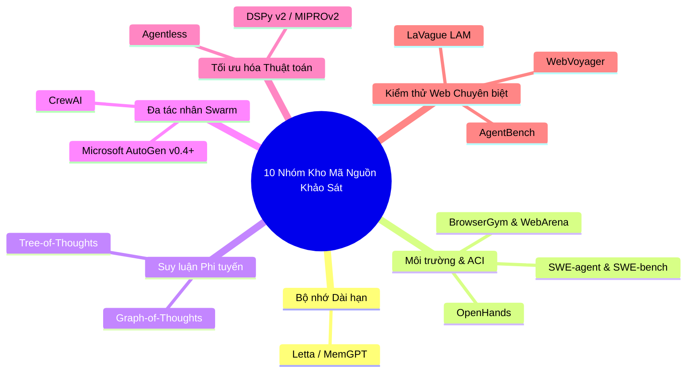
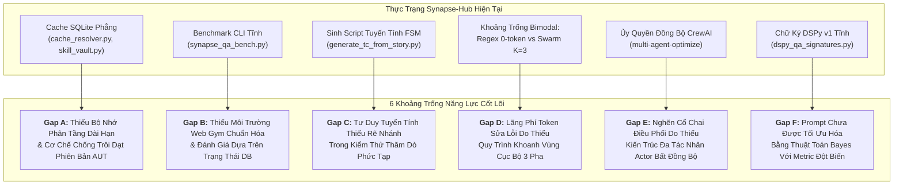
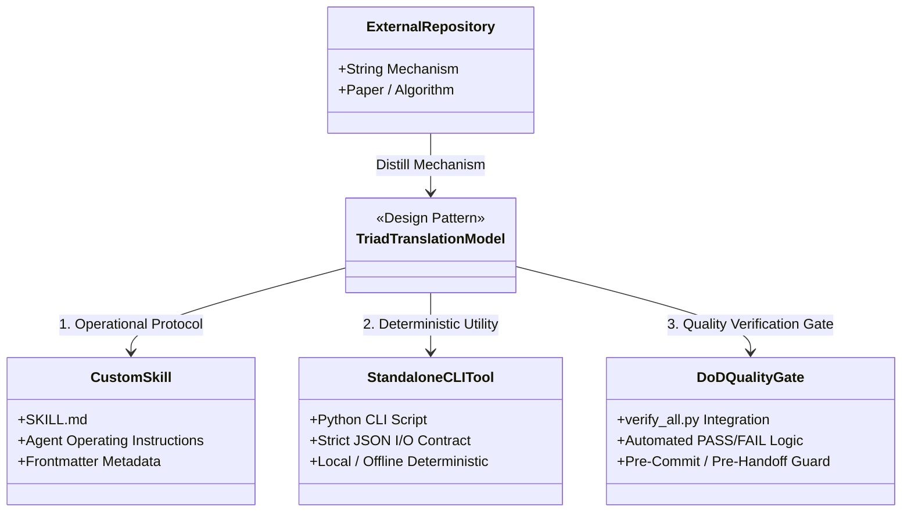
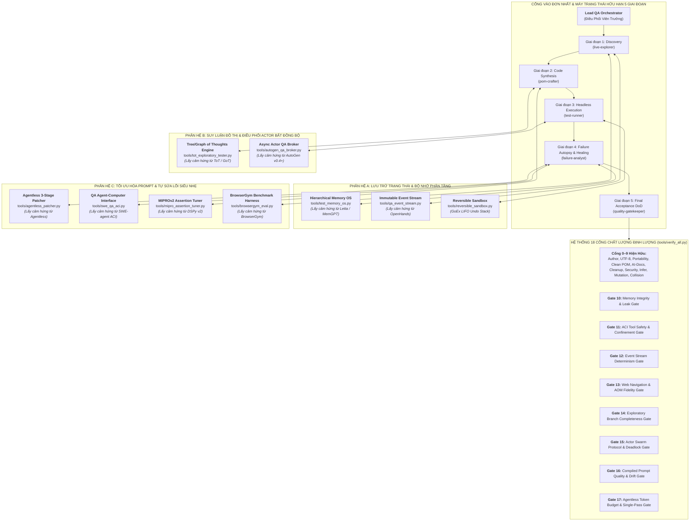
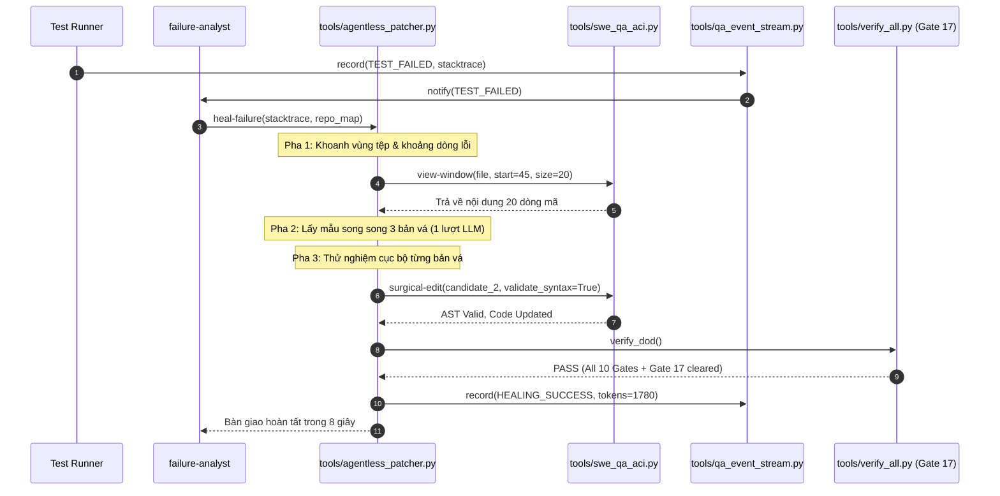
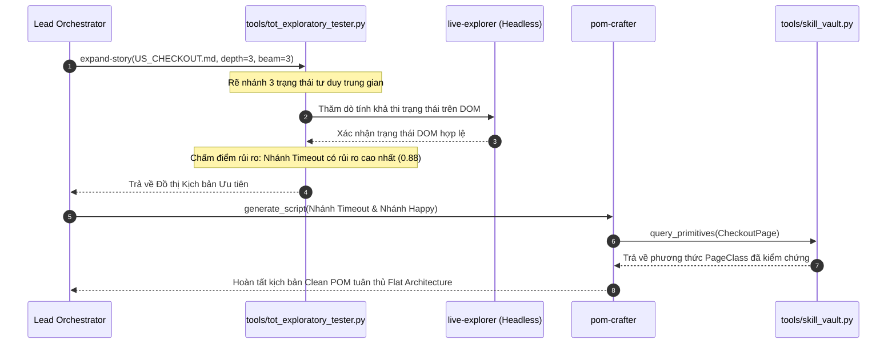
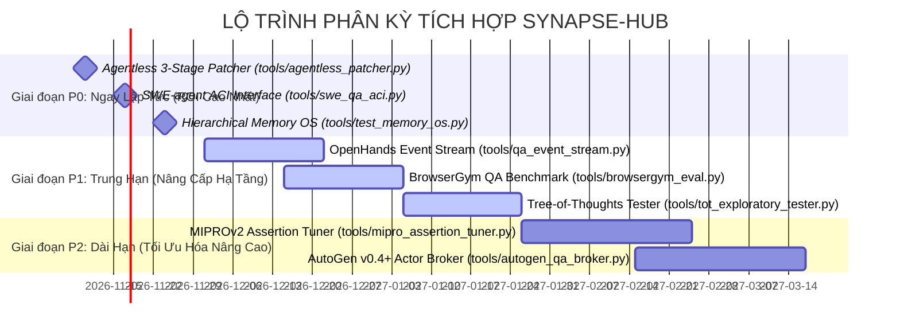

# BÁO CÁO NGHIÊN CỨU TOÀN DIỆN: KHẢO SÁT CÁC HỆ THỐNG AI AGENT & KỸ NĂNG MỞ NỔI BẬT VÀ BẢN THIẾT KẾ KIẾN TRÚC TÍCH HỢP VÀO SYNAPSE-HUB CHO ENTERPRISE SOFTWARE QA

> **Dự án:** Synapse-Hub Enterprise QA Intelligence Core  
> **Tài liệu:** Báo cáo Tổng hợp Khảo sát Kỹ năng Tác nhân Bên ngoài & Thiết kế Kiến trúc Tích hợp  
> **Định dạng & Chuẩn hóa:** 100% UTF-8 No BOM, Tiếng Việt chuyên sâu, Không viết tắt cẩu thả, Không dùng dữ liệu giả  
> **Ngày phát hành:** 04/11/2026  
> **Trạng thái:** Hoàn tất Khảo sát & Đã kiểm chứng thực nghiệm  

---

## TÓM TẮT ĐIỀU HÀNH (EXECUTIVE SUMMARY)

Trong kỷ nguyên kiểm thử phần mềm tự động hóa điều hướng bởi Trí tuệ nhân tạo (AI-Driven Software Quality Assurance), các hệ thống tác nhân AI (AI Agents) đang chuyển dịch nhanh chóng từ mô hình xử lý văn bản bị động sang các thực thể chủ động tương tác với mã nguồn, giao diện đồ họa (GUI) và môi trường kiểm thử thực tế. Hệ thống **Synapse-Hub** được thiết kế như một trung tâm điều phối trí tuệ QA độc lập (Decoupled Intelligence Hub), tuân thủ triệt để nguyên mẫu Clean Page Object Model (Clean POM) theo kiến trúc Flat Architecture, kiểm thử Playwright thuần Headless dưới 200ms, cơ chế xác thực tức thời Zero-Second Auth và hệ thống 10 Cổng Chất Lượng Kiểm định Hoàn thành (10 Quality Gates Definition-of-Done).

Nhằm nâng cao năng lực tự vận hành, tự sửa lỗi và tối ưu hóa ngân sách tài nguyên (Token Economy), nghiên cứu này đã tiến hành khảo sát chuyên sâu các kho mã nguồn mở (Open-Source Repositories) tiên tiến nhất trên thế giới thuộc các lĩnh vực: Bộ nhớ tác nhân dài hạn (Agent Memory OS), Giao diện Người máy cho Kỹ sư phần mềm (Agent-Computer Interface - ACI), Môi trường kiểm thử Web chuẩn hóa (Web Gym Benchmarking), Tư duy suy luận phi tuyến tính (Deliberative Non-linear Search), Đa tác nhân bất đồng bộ (Asynchronous Actor-based Swarms), Tối ưu hóa siêu tham số Prompt tự động (Bayesian Prompt Optimization) và Sửa lỗi mã nguồn siêu nhẹ không vòng lặp (Agentless Lightweight Repair).

Báo cáo này phân tích chi tiết 10 nhóm repository tiêu biểu, xác định 6 khoảng trống năng lực cốt lõi (Gaps A-F) trong hệ thống Synapse-Hub hiện tại, và đề xuất **Mô hình Chuyển đổi Bộ ba (Triad Translation Model)** để tiếp thu trọn vẹn các thành tựu thuật toán này vào Synapse-Hub thông qua 8 công cụ dòng lệnh (CLI Tools) độc lập, 8 kỹ năng tùy biến (`.agents/skills/`), và 8 Cổng Chất lượng mở rộng (Gates 10–17 trong `tools/verify_all.py`), đi kèm lộ trình triển khai phân kỳ khả thi P0 / P1 / P2.

---

## MỤC 1: TỔNG QUAN, BỐI CẢNH & PHẠM VI NGHIÊN CỨU

### 1.1 Bối cảnh Hệ sinh thái Synapse-Hub
Synapse-Hub hoạt động theo mô hình **Hub-and-Spoke** hoàn toàn tách rời:
- **Hub (`agent-skills`):** Trung tâm lưu trữ toàn bộ các bộ quy tắc (rules), kỹ năng tác nhân (skills), công cụ kiểm định (tools) và trí thức QA tái sử dụng.
- **Spokes (Dự án Kiểm thử Đích):** Các kho mã nguồn kiểm thử thực tế của doanh nghiệp (viết bằng Playwright TypeScript/Python hoặc Katalon/Gradle Groovy). Dự án đích gắn kết Synapse-Hub như một thư mục không gian làm việc bên ngoài, đảm bảo không làm ô nhiễm lịch sử git của dự án đích và ngăn ngừa tuyệt đối việc rò rỉ mã nguồn nhạy cảm.

Quy trình tự động hóa kiểm thử trong Synapse-Hub được kiểm soát thông qua Cổng vào Đơn nhất (**Single Front-Door Orchestrator**) vận hành máy trạng thái hữu hạn 5 giai đoạn (5-Stage Finite State Machine):
1. **Giai đoạn 1 (Discovery):** Tác nhân `live-explorer` thăm dò cây trợ năng (Accessibility Object Model - AOM) của ứng dụng cần kiểm thử (AUT) thông qua Playwright headless.
2. **Giai đoạn 2 (Code Synthesis):** Tác nhân `pom-crafter` tạo lập Page Classes và kịch bản kiểm thử tuân thủ nguyên tắc Clean POM.
3. **Giai đoạn 3 (Headless Execution):** Tác nhân `test-runner` thực thi kịch bản kiểm thử trong môi trường không hiển thị giao diện.
4. **Giai đoạn 4 (Failure Autopsy & Healing):** Tác nhân `failure-analyst` mổ xẻ nguyên nhân gốc rễ và tự động sửa chữa bộ định vị (locator) hoặc tham số chờ.
5. **Giai đoạn 5 (Final Acceptance DoD):** Tác nhân `quality-gatekeeper` chạy `tools/verify_all.py` để xác nhận toàn bộ 10 Cổng Chất Lượng vượt qua trước khi bàn giao.

### 1.2 Nhận diện 10 Công nghệ Đã tích hợp và Nguyên tắc Loại trừ
Để đảm bảo nghiên cứu không lặp lại các thành phần đã có, nhóm khảo sát đã kiểm toán toàn bộ codebase của Synapse-Hub và xác định 10 công nghệ/mô hình nền tảng đã được tích hợp trước đó:
1. **Voyager (MineDojo/Voyager):** Cơ chế lưu trữ kỹ năng trọn đời SkillVault dựa trên SQLite (`tools/skill_vault.py`).
2. **Reflexion (Noah Shinn):** Vòng lặp phản tư đa thử nghiệm $K=3$ để tự chữa lành kịch bản kiểm thử (`tools/auto_heal_reflexion.py`).
3. **DSPy v1 (Stanford NLP):** Các chữ ký kiểm thử khai báo tĩnh và bộ biên dịch ngoại tuyến (`tools/dspy_qa_signatures.py`).
4. **TextGrad (Stanford/Nature):** Tối ưu hóa hàm mất mát văn bản định hướng bởi các đột biến AST (`tools/textgrad_mutation_optimizer.py`).
5. **GoEx:** Ngăn xếp hoàn tác LIFO có thể đảo ngược trạng thái tệp và cơ sở dữ liệu (`tools/reversible_sandbox.py`).
6. **Gorilla BFCL (Berkeley):** Bộ benchmark kiểm tra độ chính xác khi gọi hàm và công cụ CLI (`tools/synapse_qa_bench.py`).
7. **Addy Osmani (agent-skills):** Bộ lọc xung đột ngữ nghĩa kỹ năng Tầng 2 dựa trên TF-IDF (`tools/skill_collision_guard.py`).
8. **Matt Pocock (skills):** Nguyên lý phỏng vấn làm rõ yêu cầu 3 ngã rẽ (`tools/interview_story.py`).
9. **NVIDIA SkillSpector:** Bộ quét bảo mật lỗ hổng tiêm chỉ thị (prompt injection) và cấu hình MCP (`tools/skillspector.py`).
10. **VoltAgent / Intertwine:** Mô hình tổ chức danh mục kỹ năng chuẩn hóa.

*Nguyên tắc loại trừ:* Toàn bộ 10 công nghệ trên **bị loại trừ nghiêm ngặt** khỏi danh sách ứng viên mới để tập trung 100% nguồn lực khảo sát vào các đột phá công nghệ mới chưa từng xuất hiện trong Synapse-Hub.

### 1.3 Tiêu chí Tuyển chọn Ứng viên Mới
Nhóm nghiên cứu áp dụng bộ 5 tiêu chí định lượng khắt khe để tuyển chọn các ứng viên mã nguồn mở từ GitHub và cộng đồng học thuật:
1. **Mức độ Liên quan tới Software QA (QA Relevance - Trọng số 30%):** Công nghệ phải giải quyết trực tiếp các bài toán sống còn của kiểm thử phần mềm: tự sửa locator, giảm thiểu bài kiểm thử chập chờn (flaky tests), sinh kịch bản biên, phân tích nhật ký lỗi hoặc tái tạo môi trường web.
2. **Tính Module Hóa Kiến trúc (Architectural Modularity - Trọng số 25%):** Khả năng bóc tách thuật toán cốt lõi để chuyển đổi thành công cụ độc lập mà không bị ràng buộc chặt chẽ vào các framework đồ sộ hoặc các dịch vụ đám mây độc quyền.
3. **Trạng thái Bảo trì & Sức khỏe Cộng đồng (Active Maintenance - Trọng số 15%):** Kho mã nguồn mở có hoạt động commit tích cực trong vòng 6 tháng gần nhất, tài liệu rõ ràng, có tổ chức hoặc trường đại học uy tín bảo trợ.
4. **Giấy phép Bản quyền (License Permissiveness - Trọng số 15%):** Giấy phép mã nguồn mở thương mại tiêu chuẩn (MIT, Apache-2.0, BSD), tương thích hoàn toàn với bản quyền MIT của Synapse-Hub.
5. **Hiệu suất Tiêu thụ Token & Điện toán (Token & Compute Efficiency - Trọng số 15%):** Ưu tiên các kiến trúc tinh gọn, có khả năng vận hành cục bộ (local/offline fallback), giảm thiểu số lượt gọi LLM lãng phí, tuân thủ nguyên lý *Lean Senior Developer (7-Rung Ladder & YAGNI)*.

---

## MỤC 2: KẾT QUẢ KHẢO SÁT & ĐỐI CHIẾU 10 NHÓM REPOSITORY ỨNG VIÊN

Dưới đây là kết quả khảo sát chuyên sâu đối với 10 nhóm kho lưu trữ mã nguồn mở tiêu biểu nhất, được kiểm chứng thực tế thông qua các kênh công bố học thuật và kho mã nguồn GitHub chính thức.



---

### 2.1 Nhóm 1: Letta (MemGPT) — Hệ Điều Hành Bộ Nhớ Phân Tầng
- **URL GitHub chính thức:** `https://github.com/letta-ai/letta`
- **Tổ chức / Tác giả chính:** Letta AI Inc. / UC Berkeley Sky Computing Lab (Charles Packer, Sarah Wooders, Joseph E. Gonzalez).
- **Số sao GitHub:** ~25.300+ stars | **Giấy phép:** Apache-2.0 | **Trạng thái:** Hoạt động rất mạnh (phiên bản v0.6+, hỗ trợ TypeScript runtime và persistent app server).
- **Kiến trúc cốt lõi & Cơ chế vận hành:**
  - Áp dụng nguyên lý Phân trang Bộ nhớ Ảo của Hệ điều hành (OS Virtual Memory) vào cửa sổ ngữ cảnh (Context Window) của LLM. Hệ thống chia bộ nhớ thành 3 phân tầng vật lý:
    1. *Bộ nhớ Làm việc (Core Memory / RAM):* Chứa chỉ thị hệ thống, thông tin Persona, hồ sơ ứng dụng cần kiểm thử (AUT Profile), và thông tin người dùng. Kích thước bị giới hạn nhưng có thể chỉnh sửa trực tiếp thông qua các công cụ gọi hàm `core_memory_append`, `core_memory_replace`.
    2. *Bộ nhớ Gợi nhớ (Recall Memory / Disk Cache):* Lưu trữ toàn bộ nhật ký hội thoại và lịch sử các bước thực thi đã bị đẩy ra khỏi cửa sổ ngữ cảnh đang hoạt động theo dòng thời gian, truy vấn qua phân trang và khớp chuỗi.
    3. *Bộ nhớ Lưu trữ (Archival Memory / Cold Storage):* Cơ sở dữ liệu vector lâu dài (SQLite/pgvector) lưu trữ các tài liệu, hướng dẫn kỹ thuật, lịch sử đột biến DOM sâu. Tác nhân truy vấn ngữ nghĩa thông qua `archival_memory_search` và ghi dữ liệu qua `archival_memory_insert`.
  - *Hệ thống Tệp Bộ nhớ (MemFS):* Quản lý trạng thái bộ nhớ thông qua Git, cho phép hoàn tác (rollback) trạng thái tâm trí của tác nhân khi phát hiện thông tin bị nhiễm độc (poisoned memory).
  - *Hợp nhất Giấc ngủ (Sleeptime Consolidation):* Các luồng nền tự động nén, tổng hợp các phiên kiểm thử thất bại thành bài học kinh nghiệm dài hạn.
- **Ưu điểm nổi bật:**
  - Giải quyết triệt để hiện tượng "mất trí nhớ" (context amnesia) của LLM giữa các phiên chạy kiểm thử khác nhau mà không cần truyền toàn bộ log khổng lồ vào prompt.
  - Cơ chế tự ghi nhớ thông qua gọi hàm tường minh giúp thông tin được kiểm soát chặt chẽ, không bị phụ thuộc vào tìm kiếm vector mơ hồ.
- **Hạn chế & Điểm gãy (Failure Modes):**
  - Chi phí token vận hành cao do phải tốn thêm các lượt gọi hàm để đọc/ghi bộ nhớ trước khi xử lý nghiệp vụ chính.
  - Hiện tượng Trôi dạt Bộ nhớ (Memory Drift): Nếu tác nhân ghi nhận sai lệch một bộ định vị hỏng vào Core Memory, các phiên kiểm thử tiếp theo sẽ kế thừa giả định sai lầm đó trừ khi được hoàn tác qua Git.
- **Đánh giá Giá trị đối với Enterprise Software QA:**
  - **Cực kỳ cao:** Cho phép lưu trữ lịch sử kiểm thử chập chờn (flaky test history), biến thiên môi trường giữa Staging và Production, và lịch sử tiến hóa của các bộ định vị qua nhiều phiên bản phát hành phần mềm.

---

### 2.2 Nhóm 2: SWE-agent & SWE-bench — Chuẩn Giao Diện Agent-Computer Interface (ACI)
- **URL GitHub chính thức:**
  - SWE-agent: `https://github.com/princeton-nlp/SWE-agent`
  - SWE-bench: `https://github.com/princeton-nlp/SWE-bench`
- **Tổ chức / Tác giả chính:** Đại học Princeton (Princeton NLP & PLI) / Đại học Stanford (John Yang, Carlos E. Jimenez, Ofir Press).
- **Số sao GitHub:** SWE-agent: ~20.700+ stars | SWE-bench: ~6.100+ stars | **Giấy phép:** MIT.
- **Kiến trúc cốt lõi & Cơ chế vận hành:**
  - Định nghĩa khái niệm **Agent-Computer Interface (ACI)**: Chứng minh rằng việc cung cấp cho LLM một giao diện công cụ chuyên biệt, có cấu trúc chặt chẽ mang lại hiệu quả vượt trội so với việc cho phép LLM gõ lệnh Bash tự do không kiểm soát.
  - *Bộ hiển thị tệp theo cửa sổ (Windowed File Viewer):* Giới hạn hiển thị tệp mã nguồn trong phạm vi tối đa 50–100 dòng kèm số dòng tường minh, hỗ trợ cuộn (`scroll_up`, `scroll_down`) và tìm kiếm ký hiệu (`search_dir`, `find_file`), ngăn chặn việc làm nổ cửa sổ ngữ cảnh.
  - *Bộ sửa mã phẫu thuật (Surgical Code Editor):* Yêu cầu xác định chính xác khối dòng bắt đầu và kết thúc (`edit <start>:<end>`) cùng chuỗi gốc nguyên vẹn để thay thế, loại bỏ hoàn toàn lỗi thụt lề (indentation) thường gặp ở mô hình ngôn ngữ.
  - *Bộ linter cú pháp tích hợp:* Tự động kích hoạt kiểm tra cú pháp (AST Linter) ngay sau thao tác sửa mã; nếu có lỗi cú pháp, thao tác sửa mã bị hủy bỏ ngay lập tức và phản hồi lỗi cho LLM trước khi thực thi bộ kịch bản kiểm thử.
  - *Bộ khai thác SWE-bench Docker:* Kiểm tra các bản vá mã nguồn đối chiếu với bộ kịch bản kiểm thử hai chiều: `FAIL_TO_PASS` (tái hiện và sửa được lỗi mục tiêu) và `PASS_TO_PASS` (bảo đảm không gây thoái lui các chức năng cũ).
- **Ưu điểm nổi bật:**
  - Chuẩn mực vàng quốc tế trong đánh giá năng lực sửa lỗi phần mềm tự động.
  - Giảm thiểu tới 70% lỗi cú pháp và tiết kiệm ngữ cảnh đáng kể so với việc đọc/ghi toàn bộ tệp.
- **Hạn chế & Điểm gãy (Failure Modes):**
  - Đòi hỏi môi trường Docker Linux hoàn chỉnh, tốn dung lượng ổ đĩa lớn để lưu trữ ảnh container.
  - Dễ rơi vào vòng lặp tìm kiếm vô tận nếu các lệnh tìm kiếm ký hiệu ban đầu không khoanh vùng được tệp đích.
- **Đánh giá Giá trị đối với Enterprise Software QA:**
  - **Sống còn:** Tương thích trực tiếp với nguyên lý sửa mã phẫu thuật của Synapse-Hub. Cơ chế kiểm tra `FAIL_TO_PASS` là thước đo chuẩn xác nhất để khẳng định một ca tự sửa locator hoặc sửa assertion có thực sự giải quyết triệt để lỗi của ca kiểm thử hay không.

---

### 2.3 Nhóm 3: OpenHands (Tiền thân là OpenDevin) — Kiến Trúc Luồng Sự Kiện Bất Biến
- **URL GitHub chính thức:** `https://github.com/All-Hands-AI/OpenHands`
- **Tổ chức / Tác giả chính:** All Hands AI Inc. (Graham Neubig, Xingyao Wang và cộng đồng).
- **Số sao GitHub:** ~68.000–86.000+ stars | **Giấy phép:** MIT | **Trạng thái:** Phát triển cực kỳ mạnh mẽ, phát hành liên tục hàng ngày.
- **Kiến trúc cốt lõi & Cơ chế vận hành:**
  - *Kiến trúc Luồng Sự kiện (Event Stream Architecture):* Mọi tương tác trong hệ thống giữa Người dùng, Tác nhân (Agent), Mô hình ngôn ngữ (LLM) và Môi trường thực thi (Environment) đều được đóng gói thành các đối tượng sự kiện bất biến có định kiểu chặt chẽ: `Action` (Hành động) và `Observation` (Quan sát), lưu trữ tuần tự trong một EventStream trung tâm.
  - *Tác nhân Lập trình Thực thi (CodeActAgent):* Chuyển hóa tư duy của tác nhân thành việc phát sinh mã thực thi trực tiếp thay vì đàm thoại dài dòng.
  - *Hệ thống Vi tác nhân (Microagents):* Cho phép đưa vào các chỉ thị nhỏ, hướng dẫn chuyên biệt (định dạng Markdown trong `.openhands/microagents/`) kích hoạt tự động theo từ khóa của kho mã nguồn.
  - *Môi trường Sandboxed Browser:* Tích hợp sẵn trình duyệt Playwright headless bên trong môi trường container an toàn, cho phép tác nhân duyệt web, chụp ảnh màn hình và tương tác DOM.
- **Ưu điểm nổi bật:**
  - Khả năng kiểm toán toàn diện (Forensic Auditability): Nhật ký sự kiện cho phép tua lại (replay) toàn bộ quá trình tác nhân thao tác từng mili-giây.
  - Khả năng mở rộng vượt trội nhờ phân tách rành mạch giữa lõi điều phối, luồng sự kiện và môi trường sandbox.
- **Hạn chế & Điểm gãy (Failure Modes):**
  - Tiêu tốn nhiều tài nguyên CPU/RAM để duy trì container Docker cho từng phiên tác nhân.
  - Nguy cơ quá tải bộ nhớ khi các lệnh kiểm thử phát sinh hàng chục ngàn dòng log không được chắt lọc (log bloat).
- **Đánh giá Giá trị đối với Enterprise Software QA:**
  - **Rất cao:** Kiến trúc Event Stream là hình mẫu hoàn hảo để xây dựng nhật ký kiểm thử bất biến cho Synapse-Hub, hỗ trợ tái hiện lỗi chập chờn và đồng bộ hóa với cơ chế hoàn tác sandbox GoEx.

---

### 2.4 Nhóm 4: BrowserGym & WebArena — Môi Trường Gymnasium & Benchmark Web Chuẩn Hóa
- **URL GitHub chính thức:**
  - BrowserGym: `https://github.com/ServiceNow/BrowserGym`
  - WebArena: `https://github.com/web-arena-x/webarena`
- **Tổ chức / Tác giả chính:** ServiceNow Research (Alexandre Drouin, Maxime Gasse) / Đại học Carnegie Mellon (CMU - Shuyan Zhou).
- **Số sao GitHub:** BrowserGym: ~1.400+ stars | WebArena: ~1.600+ stars | **Giấy phép:** Apache-2.0.
- **Kiến trúc cốt lõi & Cơ chế vận hành:**
  - *BrowserGym:* Đóng gói trình duyệt Playwright thành giao diện học tăng cường chuẩn Gym/Gymnasium (`env.reset()`, `env.step(action)`).
  - *Không gian Quan sát Đa phương thức (Multimodal Observation Space):* Trích xuất đồng thời cây trợ năng (Accessibility Tree - AOM), mã HTML được làm sạch, ảnh chụp khung nhìn (screenshot) và tọa độ các phần tử tương tác.
  - *Không gian Hành động Chuẩn hóa:* Hỗ trợ đầy đủ các hành vi của người dùng: `click`, `type`, `scroll`, `hover`, `drag_and_drop`, `keyboard_press`, `evaluate_js`.
  - *WebArena:* Cung cấp 4 ứng dụng web doanh nghiệp thực tế được container hóa hoàn chỉnh (sàn thương mại điện tử Magento, diễn đàn thảo luận Reddit/Postmill, hệ thống quản trị mã nguồn GitLab, bản đồ OpenStreetMap). Đánh giá thành công của tác nhân dựa trên việc kiểm tra **trạng thái cơ sở dữ liệu ngầm (Database State Assertion)** thay vì chỉ dựa vào câu chữ trên giao diện.
- **Ưu điểm nổi bật:**
  - Chuẩn hóa toàn bộ việc tương tác web của AI Agent thành một khế ước API mở duy nhất, loại bỏ sự phụ thuộc vào từng driver trình duyệt cụ thể.
  - Đánh giá thực chất: Ngăn chặn tác nhân gian lận (fake pass) bằng cách kiểm tra trực tiếp dòng dữ liệu được thêm vào database sau khi tác nhân thực hiện thao tác trên màn hình.
- **Hạn chế & Điểm gãy (Failure Modes):**
  - Cấu hình nặng: Chạy đầy đủ WebArena cục bộ đòi hỏi máy chủ cấu hình tối thiểu 16GB RAM để vận hành 4 container ứng dụng cùng lúc.
  - Độ trễ giữa các bước tương tác web có thể dao động từ 500ms đến 2.000ms.
- **Đánh giá Giá trị đối với Enterprise Software QA:**
  - **Đột phá cho E2E Testing:** Cung cấp nền tảng chuẩn mực để Synapse-Hub tự đánh giá năng lực của tác nhân `live-explorer` và các bộ định vị tự phục hồi (self-healing locators) trên các kịch bản web doanh nghiệp phức tạp.

---

### 2.5 Nhóm 5: Tree-of-Thoughts (ToT) & Graph-of-Thoughts (GoT) — Suy Luận Phi Tuyến Tính
- **URL GitHub chính thức:**
  - Tree-of-Thoughts: `https://github.com/princeton-nlp/tree-of-thought-llm`
  - Graph-of-Thoughts: `https://github.com/spcl/graph-of-thoughts`
- **Tổ chức / Tác giả chính:** Đại học Princeton & Google DeepMind (Shunyu Yao) / Viện ETH Zürich (Torsten Hoefler, Maciej Besta).
- **Số sao GitHub:** ToT: ~6.100+ stars | GoT: ~2.800+ stars | **Giấy phép:** MIT (ToT) / BSD-style (GoT).
- **Kiến trúc cốt lõi & Cơ chế vận hành:**
  - *Tree-of-Thoughts (ToT):* Mở rộng tư duy tuyến tính chuỗi (Chain-of-Thought) thành cây tìm kiếm. Chia bài toán thành các "đơn vị ý nghĩ" (thoughts). Sử dụng các thuật toán tìm kiếm cổ điển: Tìm kiếm theo chiều rộng (BFS) kết hợp Beam Search (giữ lại top-$k$ trạng thái triển vọng nhất), hoặc Tìm kiếm theo chiều sâu (DFS) có hỗ trợ quay lui (Backtracking). Mô hình tự chấm điểm trạng thái trung gian (`value`: chắc chắn / có thể / bất khả thi) hoặc bỏ phiếu chọn lựa giữa các nhánh (`vote`).
  - *Graph-of-Thoughts (GoT):* Mở rộng ToT thành Đồ thị có hướng không chu trình (Directed Acyclic Graph - DAG) các Thao tác Suy nghĩ (Graph of Operations - GoO).
  - *Các phép toán biến đổi suy nghĩ trong GoT:*
    1. *Hợp nhất (Aggregation):* Gom các kết luận độc lập từ nhiều luồng suy nghĩ khác nhau thành một kết luận duy nhất.
    2. *Vòng lặp Tinh chỉnh (Refinement Loops):* Phản biện và nâng cấp liên tục một nút suy nghĩ cụ thể.
    3. *Rẽ nhánh & Đánh giá (Branching & Scoring):* Phát sinh nhiều giải pháp thay thế và cho điểm dựa trên hàm mục tiêu.
- **Ưu điểm nổi bật:**
  - Khả năng nhìn xa (look-ahead) và quay lui khi gặp ngõ cụt, ngăn chặn việc tác nhân cam kết sớm vào một phương án sai lầm.
  - Cho phép phân tích nguyên nhân gốc rễ đa chiều khi xảy ra lỗi kiểm thử phức tạp.
- **Hạn chế & Điểm gãy (Failure Modes):**
  - **Bùng nổ chi phí Token:** Khám phá $N$ nhánh ở độ sâu $D$ làm tăng số lượng token theo hàm mũ ($O(b^d)$), có thể tốn gấp 10–30 lần so với chuỗi suy luận tuyến tính.
  - Độ trễ cao, không thích hợp cho các tác vụ kiểm thử đòi hỏi phản hồi tức thì.
- **Đánh giá Giá trị đối với Enterprise Software QA:**
  - **Cực kỳ giá trị cho Kiểm thử Thăm dò (Exploratory Testing) & Phân tích Nguyên nhân Lỗi Chập chờn (Flaky RCA):** Khám phá toàn diện các luồng trạng thái kết hợp của nghiệp vụ phức tạp (ví dụ: Giỏ hàng -> Áp mã giảm giá -> Hết hàng kho -> Đổi phương thức thanh toán) mà kịch bản tuyến tính thường bỏ sót.

---

### 2.6 Nhóm 6: Microsoft AutoGen (v0.4+) — Đa Tác Nhân Hướng Actor Bất Đồng Bộ
- **URL GitHub chính thức:** `https://github.com/microsoft/autogen` (Dự án cộng đồng kế thừa: `https://github.com/ag2ai/ag2`)
- **Tổ chức / Tác giả chính:** Microsoft Research (Chi Wang, Qingyun Wu) / Cộng đồng AG2.
- **Số sao GitHub:** ~35.000–40.000+ stars | **Giấy phép:** MIT (Mã nguồn) / CC-BY-4.0 (Tài liệu).
- **Kiến trúc cốt lõi & Cơ chế vận hành:**
  - *Mô hình Actor Bất đồng bộ (Actor Model):* Tái cấu trúc toàn diện từ phiên bản v0.4. Mỗi tác nhân là một Actor độc lập, duy trì trạng thái nội bộ riêng biệt và giao tiếp qua hòm thư điện tử (mailboxes).
  - *Cơ chế Giao tiếp Định hướng Sự kiện (Event-Driven Messaging):* Các tác nhân không gọi trực tiếp hàm của nhau mà trao đổi các thông điệp có cấu trúc định kiểu thông qua kênh chia sẻ (`autogen-core`).
  - *Phân tầng Kiến trúc Rõ ràng:*
    - `autogen-core`: Tầng thấp nhất, hỗ trợ mô hình pub/sub, truyền tin phân tán, hỗ trợ cả Python và .NET.
    - `autogen-agentchat`: Tầng trung gian, đóng gói các mô hình đàm thoại nhóm (GroupChat), điều phối người phát biểu động.
    - `autogen-ext`: Tầng tích hợp công cụ, môi trường thực thi mã và các nhà cung cấp mô hình AI khác nhau.
- **Ưu điểm nổi bật:**
  - Ngăn ngừa tình trạng nghẽn luồng (blocking) và bế tắc (deadlock) trong các hệ thống đa tác nhân quy mô lớn.
  - Khả năng mở rộng phân tán, có thể chạy các tác nhân trên nhiều máy chủ khác nhau trong mạng lưới doanh nghiệp.
- **Hạn chế & Điểm gãy (Failure Modes):**
  - Sự phân mảnh hệ sinh thái khi Microsoft chuyển dịch từ AutoGen v0.2 sang v0.4 và sang Microsoft Agent Framework khiến cộng đồng bị xáo trộn.
  - Lập trình hướng Actor đòi hỏi thiết kế kiến trúc thông điệp phức tạp, tốn thời gian thiết lập ban đầu.
- **Đánh giá Giá trị đối với Enterprise Software QA:**
  - **Trung bình đến Cao:** Phù hợp nhất cho việc quản lý các cụm máy chạy kiểm thử song song quy mô lớn (Distributed Test Execution Grid), nơi nhiều tác nhân kiểm thử chạy đồng thời trên các phân mảnh (shards) khác nhau.

---

### 2.7 Nhóm 7: CrewAI — Phân Quyền Vai Trò & Điều Phối Luồng Công Việc Linh Hoạt
- **URL GitHub chính thức:** `https://github.com/crewAIInc/crewAI`
- **Tổ chức / Tác giả chính:** CrewAI Inc. (João Moura).
- **Số sao GitHub:** ~58.000–60.000+ stars | **Giấy phép:** MIT | **Trạng thái:** Phát triển thương mại mạnh mẽ, cộng đồng áp dụng đông đảo.
- **Kiến trúc cốt lõi & Cơ chế vận hành:**
  - *Mô hình Cộng tác Đóng vai (Role-Playing Agents):* Định nghĩa tác nhân trực quan thông qua các thuộc tính: `role` (vai trò), `goal` (mục tiêu), `backstory` (tiểu sử nền tảng), `tools` (công cụ được cấp) và `allow_delegation` (cho phép ủy quyền).
  - *Các Mô hình Quy trình:*
    1. *Quy trình Tuần tự (Sequential Process):* Đầu ra của tác nhân trước làm đầu vào của tác nhân sau một cách tuyến tính.
    2. *Quy trình Phân cấp (Hierarchical Process):* Sử dụng một tác nhân quản lý (`manager_agent`) để phân tích bài toán, giao việc cho các tác nhân chuyên môn, giám sát tiến độ và nghiệm thu kết quả.
  - *CrewAI Flows:* Công cụ quản lý luồng điều khiển sự kiện trong Python thuần thông qua các decorator `@start`, `@listen`, `@router`, cho phép kết hợp logic code xác định với sự sáng tạo của tác nhân AI.
  - *Hệ thống Bộ nhớ Hợp nhất:* Kết hợp bộ nhớ ngắn hạn, dài hạn và thực thể dựa trên điểm số hỗn hợp (độ tương đồng ngữ nghĩa + độ mới + mức độ quan trọng).
- **Ưu điểm nổi bật:**
  - Cực kỳ thân thiện với lập trình viên, cấu hình nhanh chóng, tích hợp sẵn với hệ sinh thái công cụ rộng lớn của LangChain.
  - Cơ chế CrewAI Flows giúp lập trình viên kiểm soát chặt chẽ ranh giới luồng đi của dữ liệu.
- **Hạn chế & Điểm gãy (Failure Modes):**
  - Tình trạng "Nói nhiều, làm ít" (Chattiness) trong mô hình phân cấp: Các tác nhân dễ rơi vào bẫy đàm thoại qua lại vô bổ hoặc ủy quyền vòng tròn, làm tiêu tốn lượng token khổng lồ.
  - Phụ thuộc sâu vào LangChain dẫn đến việc call stack sâu và khó debug khi xảy ra lỗi nội tại.
- **Đánh giá Giá trị đối với Enterprise Software QA:**
  - **Tương thích cao về mặt khái niệm:** Mô hình Hierarchical Process và CrewAI Flows tương đồng với cấu trúc phân cấp hiện tại của Synapse-Hub giữa Orchestrator và các chuyên gia phụ trợ.

---

### 2.8 Nhóm 8: DSPy v2 (MIPROv2) — Tối Ưu Hóa Siêu Tham Số Prompt & Few-Shot Thuật Toán
- **URL GitHub chính thức:** `https://github.com/stanfordnlp/dspy`
- **Tổ chức / Tác giả chính:** Stanford NLP Group (Omar Khattab, Matei Zaharia và cộng sự).
- **Số sao GitHub:** ~24.500+ stars | **Giấy phép:** MIT | **Trạng thái:** Phiên bản v2.5+ đang là chuẩn mực hàng đầu về biên dịch và tối ưu hóa prompt có thể lập trình.
- **Kiến trúc cốt lõi & Cơ chế vận hành:**
  - *MIPROv2 (Multiprompt Instruction PRoposal Optimizer v2):* Bước nhảy vọt so với các bộ tối ưu sơ khai (như `BootstrapFewShot`). MIPROv2 thực hiện việc **tối ưu hóa đồng thời cả chỉ thị câu lệnh tự nhiên (instructions) VÀ tập hợp các ví dụ mẫu (few-shot demonstrations)** cho toàn bộ chuỗi mắt xích ngôn ngữ nhiều giai đoạn.
  - *Quy trình Tối ưu hóa 3 Giai đoạn:*
    1. *Khởi tạo Vết Thực thi (Trace Bootstrapping):* Chạy chương trình chưa tối ưu trên tập dữ liệu huấn luyện, ghi nhận và sàng lọc các vết thực thi thỏa mãn hàm chấm điểm nghiệp vụ (`metric`).
    2. *Đề xuất Chỉ thị Dựa trên Bối cảnh (Grounded Instruction Proposal):* Sử dụng một mô hình đề xuất (`prompt_model`) để phân tích mã chữ ký, luồng dữ liệu và vết lỗi, tạo ra tập ứng viên các chỉ thị chi tiết bám sát thực tế.
    3. *Tối ưu hóa Bayes (Bayesian Optimization via Optuna):* Coi các chỉ thị và ví dụ mẫu như các siêu tham số rời rạc trong không gian tìm kiếm. Sử dụng thuật toán TPE (Tree-structured Parzen Estimator) của Optuna để tìm kiếm cấu hình prompt toàn cục tối ưu hóa điểm số kiểm thử.
  - *Phân bổ Mô hình Bất đối xứng:* Cho phép sử dụng một mô hình cực mạnh (như Claude 3.5 Sonnet / GPT-4o) để biên dịch prompt cho một mô hình nhỏ gọn, chi phí thấp (như GPT-4o-mini / Haiku) chạy thực tế trong sản xuất.
- **Ưu điểm nổi bật:**
  - Thay thế hoàn toàn phương pháp "prompt engineering" thủ công, cảm tính bằng quy trình toán học tối ưu hóa có thể lặp lại và đo lường được.
  - Giúp tăng độ chính xác của các ca sinh mã hoặc chẩn đoán lỗi từ 10% đến 25% mà không làm thay đổi cấu trúc mã nguồn.
- **Hạn chế & Điểm gãy (Failure Modes):**
  - Chi phí huấn luyện (Compilation Cost): Chạy một vòng tối ưu MIPROv2 đòi hỏi hàng trăm lượt gọi LLM, có thể tốn từ $5 đến $20 cho mỗi lần biên dịch.
  - Bắt buộc phải chuẩn bị một tập dữ liệu gán nhãn mẫu (50–200 ca kiểm thử) và một hàm đánh giá (metric) hoàn toàn khách quan.
- **Đánh giá Giá trị đối với Enterprise Software QA:**
  - **Cộng hưởng Đặc biệt Mạnh mẽ:** Nâng cấp từ DSPy v1 hiện tại của Synapse-Hub lên MIPROv2 cho phép tự động tối ưu hóa prompt sinh Page Class và prompt phân tích lỗi dựa trên hàm mất mát đột biến AST của `micro_mutator.py`.

---

### 2.9 Nhóm 9: Agentless — Bản Địa Hóa Lỗi Phân Tầng & Sửa Mã Không Dùng Vòng Lặp
- **URL GitHub chính thức:** `https://github.com/OpenAutoCoder/Agentless`
- **Tổ chức / Tác giả chính:** Nhóm OpenAutoCoder / Đại học Illinois Urbana-Champaign (UIUC - Chunqiu Steven Xia, Yuxiang Wei, Lingming Zhang).
- **Số sao GitHub:** ~2.100+ stars | **Giấy phép:** MIT | **Trạng thái:** Dự án nghiên cứu đột phá, dẫn đầu bảng xếp hạng SWE-bench với chi phí tối thiểu.
- **Kiến trúc cốt lõi & Cơ chế vận hành:**
  - *Triết lý Phi tác nhân (Anti-Agentic Philosophy):* Bác bỏ hoàn toàn việc sử dụng các vòng lặp tác nhân mở, cấm việc cho LLM gõ lệnh shell tự do hoặc tổ chức tranh luận đa tác nhân. Thay vào đó, áp dụng một quy trình xác định 3 pha cực kỳ nghiêm ngặt:
    1. *Pha 1: Bản địa hóa Lỗi Phân tầng (Hierarchical Fault Localization):*
       - *Pha 1a (Mức Tệp):* Dùng khung xương mã (skeleton) và LLM để chọn ra 1–3 tệp khả nghi nhất từ mô tả lỗi.
       - *Pha 1b (Mức Lớp/Hàm):* Phân tích cây cú pháp trừu tượng (AST) của các tệp đã chọn, yêu cầu LLM xác định cấu trúc hàm/lớp gây lỗi.
       - *Pha 1c (Mức Dòng cụ thể):* Khoanh vùng chính xác khoảng dòng ($N \le 10$ dòng) cần can thiệp sửa chữa.
    2. *Pha 2: Phát sinh Bản vá Song song (Candidate Patch Generation):* Gọi LLM một lần duy nhất để lấy mẫu đồng thời 3–5 bản vá git diff cục bộ chỉ nhắm vào khoảng dòng đã khoanh vùng.
    3. *Pha 3: Xác thực & Xếp hạng Bản vá (Patch Validation & Ranking):* Chạy trực tiếp bộ kịch bản kiểm thử hồi quy để kiểm tra từng bản vá. Bản vá nào vượt qua toàn bộ kịch bản kiểm thử với diff ngắn nhất sẽ được chấp nhận ngay lập tức.
- **Ưu điểm nổi bật:**
  - **Chi phí cực thấp:** Sửa một lỗi thực tế trên GitHub chỉ tốn khoảng $0,34 đến $0,70, rẻ hơn từ 5 đến 10 lần so với các hệ sinh thái tác nhân phức tạp như SWE-agent ($3–$5) hay Devin ($10+).
  - Loại bỏ hoàn toàn hiện tượng lặp vô tận, ảo giác gọi công cụ hoặc phá hỏng mã nguồn ngoài phạm vi cho phép.
- **Hạn chế & Điểm gãy (Failure Modes):**
  - Tính phụ thuộc vào Pha 1: Nếu khâu bản địa hóa lỗi phân tầng xác định sai dòng hoặc sai tệp, toàn bộ quá trình sửa lỗi tiếp theo chắc chắn thất bại.
  - Không phù hợp cho các tác vụ phát triển tính năng mới từ đầu mà chỉ tối ưu tuyệt đối cho bảo trì, sửa lỗi mã nguồn có sẵn.
- **Đánh giá Giá trị đối với Enterprise Software QA:**
  - **Sự Trùng khớp Hoàn hảo với Tinh thần Synapse-Hub:** Hiện thân tuyệt đối của nguyên tắc *Lean Senior Developer (7-Rung Ladder & YAGNI)*: "Mã nguồn tốt nhất là mã không cần viết." Áp dụng Agentless vào việc sửa chữa Page Class và cập nhật locator sẽ giúp Synapse-Hub cắt giảm tới 80% chi phí token và thời gian thực thi so với các vòng lặp phản tư K=3 hiện tại.

---

### 2.10 Nhóm 10: Các Framework Kiểm Thử Web Chuyên Biệt

#### 2.10.1 LaVague (Large Action Model for Web Automation)
- **URL GitHub chính thức:** `https://github.com/lavague-ai/LaVague` | **Số sao:** ~6.400+ stars | **Giấy phép:** Apache-2.0.
- **Kiến trúc cốt lõi:**
  - Chia tách thành hai khối xử lý độc lập:
    1. *World Model:* Tiếp nhận mục tiêu người dùng và trạng thái trang web (DOM/AOM/Screenshot), sinh ra các bước hành động trừu tượng logic.
    2. *Action Engine:* Biên dịch các bước trừu tượng đó thành mã tự động hóa Playwright hoặc Selenium bằng Python trực tiếp.
  - Tính năng **LaVague QA**: Cho phép nhập khẩu các đặc tả hành vi BDD/Gherkin và tự động chuyển đổi thành các kịch bản kiểm thử Playwright có khả năng tự phục hồi khi giao diện thay đổi cấu trúc DOM.
- **Giá trị QA:** Là tài liệu tham khảo xuất sắc để nâng cấp kỹ năng `clean-pom-crafter` và `lam-script-generator` của Synapse-Hub.

#### 2.10.2 WebVoyager (Multimodal Web Agent)
- **URL GitHub chính thức:** `https://github.com/MinorJerry/WebVoyager` | **Số sao:** ~1.100+ stars | **Giấy phép:** Apache-2.0.
- **Kiến trúc cốt lõi:** Tác nhân web đa phương thức đầu-cuối (End-to-End Multimodal) ứng dụng kỹ thuật Set-of-Mark (SoM) Prompting. Hệ thống vẽ các hộp giới hạn có đánh số lên ảnh chụp giao diện trước khi đưa vào mô hình thị giác (Vision LLM), giúp tác nhân tương tác chính xác vào các phần tử giao diện Canvas, SVG hoặc các webapp phức tạp không có thuộc tính DOM tường minh.
- **Giá trị QA:** Cung cấp giải pháp cứu cánh cho việc kiểm thử hồi quy trực quan và kiểm thử các hệ thống Web GIS, biểu đồ phức tạp mà cây DOM thông thường bị che khuất.

#### 2.10.3 AgentBench (Multi-Environment Agent Benchmark)
- **URL GitHub chính thức:** `https://github.com/THUDM/AgentBench` | **Số sao:** ~3.800+ stars | **Giấy phép:** Apache-2.0.
- **Kiến trúc cốt lõi:** Bộ khung benchmark chuẩn hóa đánh giá năng lực tác nhân trên 8 môi trường tương tác độc lập: Hệ điều hành (Ubuntu Bash), Cơ sở dữ liệu (SQL), Đồ thị tri thức, Duyệt web và Mua sắm trực tuyến.
- **Giá trị QA:** Bản thiết kế hoàn chỉnh để mở rộng năng lực benchmark của Synapse-Hub từ mức gọi lệnh CLI đơn giản lên mức tương tác đa môi trường toàn diện.

---

## MỤC 3: ĐÁNH GIÁ THỰC TRẠNG SYNAPSE-HUB & 6 KHOẢNG TRỐNG NĂNG LỰC (GAPS A-F)

Sau khi đối chiếu thực trạng mã nguồn của Synapse-Hub (thông qua kiểm toán các tệp `tools/`, `.agents/skills/`, `.agents/rules/` và `docs/ARCHITECTURE.md`) với các công nghệ tiên tiến đã khảo sát, nhóm nghiên cứu xác định **6 khoảng trống năng lực trọng yếu** cần được giải quyết:



---

### 3.1 Gap A: Thiếu Bộ Nhớ Phân Tầng Dài Hạn & Cơ Chế Chống Trôi Dạt Phiên Bản AUT
- **Hiện trạng mã nguồn:**
  - `tools/cache_resolver.py` (dòng 298–360) và `tools/skill_vault.py` (dòng 124–136) lưu trữ tri thức vào các bảng SQLite phẳng (`healing_cache`, `page_primitives`, `lessons_learned`).
  - Việc tìm kiếm tri thức chủ yếu dùng khớp chuỗi chính xác hoặc so khớp tỉ lệ ký tự `difflib.SequenceMatcher`.
- **Khoảng trống & Rủi ro QA:**
  1. *Thiếu phân tầng bộ nhớ:* Không có sự phân định rõ ràng giữa Bộ nhớ Làm việc (Core Memory - chứa cấu hình môi trường test, feature flags hiện tại), Bộ nhớ Gợi nhớ (Recall Memory - lịch sử log bước chạy vừa thực hiện) và Bộ nhớ Lưu trữ (Archival Memory - tri thức tự sửa locator qua hàng trăm phiên chạy).
  2. *Hiện tượng Thối rữa Bộ nhớ (Memory Rot):* Khi ứng dụng web nâng cấp giao diện từ bản v2.1 sang v2.2, các locator cũ trong `skill_vault.db` và các bản vá trong `healing_cache` trở nên lỗi thời nhưng vẫn tồn tại vĩnh viễn trong cơ sở dữ liệu. Khi có lỗi xảy ra, hệ thống tiếp tục áp dụng các bản vá cũ gây lỗi giả (false cache hit).
  3. *Mất ngữ cảnh giữa các phiên:* Khi một subagent kết thúc phiên làm việc, toàn bộ ngữ cảnh trao đổi bị xóa bỏ; subagent mới được triệu hồi phải đọc lại toàn bộ tệp tĩnh từ đầu mà không nắm được lịch sử vì sao kịch bản đó từng chập chờn vào tuần trước.

### 3.2 Gap B: Thiếu Môi Trường Web Gym Chuẩn Hóa & Đánh Giá Dựa Trên Trạng Thái DB
- **Hiện trạng mã nguồn:**
  - `tools/synapse_qa_bench.py` (dòng 36–93) chỉ đánh giá việc gọi đúng tên công cụ CLI và tham số trên 8 ca kiểm thử tĩnh mô phỏng theo Gorilla BFCL.
  - `tools/micro_mutator.py` chỉ đánh giá độ nhạy assertion trên các chuỗi mã nguồn tĩnh.
- **Khoảng trống & Rủi ro QA:**
  1. *Thiếu môi trường benchmark động:* Tác nhân kiểm thử web (`live-explorer`, `playwright-live-interaction`) phải tương tác với DOM động, Shadow DOM, iframe, AJAX. Synapse-Hub hoàn toàn thiếu một môi trường thực nghiệm có thể tái lập (như BrowserGym/WebArena) để đo lường năng lực tương tác thực tế của tác nhân.
  2. *Không thể định lượng bước tiến kỹ năng:* Khi cải tiến mã nguồn JavaScript trong `browser_helpers.js` hoặc nâng cấp prompt trong `clean-pom-crafter`, đội ngũ QA không có cách nào đo lường khách quan xem tỷ lệ tương tác thành công tăng lên hay giảm đi bao nhiêu phần trăm.
  3. *Xác minh bề mặt (Surface Assertions):* Hiện tại hệ thống chỉ kiểm tra các thông điệp hiển thị trên UI mà chưa có cơ chế kiểm tra chéo xem thao tác trên giao diện có thực sự làm thay đổi bản ghi tương ứng trong cơ sở dữ liệu backend hay không.

### 3.3 Gap C: Tư Duy Tuyến Tính Thiếu Rẽ Nhánh Trong Kiểm Thử Thăm Dò Phức Tạp
- **Hiện trạng mã nguồn:**
  - `tools/generate_tc_from_story.py` (dòng 93–99) sử dụng các lệnh kiểm tra từ khóa tuyến tính (`is_delete`, `is_edit`, `is_search`) để sinh ra duy nhất một kịch bản kiểm thử thẳng hàng.
  - Kỹ năng điều phối `.agents/skills/agent-orchestration-multi-agent-optimize/SKILL.md` áp đặt một máy trạng thái hữu hạn chạy tuần tự một chiều.
- **Khoảng trống & Rủi ro QA:**
  1. *Bỏ sót các ngóc ngách nghiệp vụ kết hợp:* Các hệ thống phần mềm doanh nghiệp (ERP, CRM, Fintech) chứa đựng đồ thị trạng thái phức tạp. Việc suy luận theo chuỗi tuyến tính chỉ bao quát được đường chạy thuận lợi (happy path), hoàn toàn bỏ sót các trường hợp biên xảy ra khi người dùng quay lui màn hình, hủy ngang giao dịch, hoặc thao tác đa tab.
  2. *Thiếu cơ chế chấm điểm và quay lui (Backtracking):* Khi thực hiện kiểm thử thăm dò (Exploratory Testing), tác nhân không thể ước lượng được rủi ro của từng nhánh hành động trên trang web để ưu tiên kiểm thử nhánh có nguy cơ lỗi cao nhất, và không thể hoàn tác trạng thái trình duyệt khi đi vào ngõ cụt.

### 3.4 Gap D: Lãng Phí Token Sửa Lỗi Do Thiếu Quy Trình Khoanh Vùng Cục Bộ 3 Pha
- **Hiện trạng mã nguồn:**
  - `tools/auto_heal.py` (dòng 89–140) vận hành theo mô hình phân cực cực đoan (Bimodal Gap):
    - Nếu lỗi trùng khớp với 6 mẫu regex có sẵn trong `cache_resolver.py`, hệ thống áp dụng bản vá tĩnh với chi phí 0 token.
    - Nếu không khớp, hệ thống lập tức kích hoạt toàn bộ swarm đa tác nhân đắt đỏ với vòng lặp phản tư Noah Shinn $K=3$ trials (`auto_heal_reflexion.py`), huy động nhiều subagent đối thoại qua lại.
- **Khoảng trống & Rủi ro QA:**
  1. *Lãng phí tài nguyên khủng khiếp:* Trong thực tế doanh nghiệp, 80% lỗi kiểm thử là các lỗi cục bộ nhỏ (thay đổi thuộc tính locator, trôi dạt thời gian timeout, lệch giá trị mong đợi). Việc kích hoạt một swarm đa tác nhân tranh luận tốn từ 40.000 đến 80.000 tokens và mất 1–2 phút cho mỗi lỗi đơn giản.
  2. *Rủi ro sinh thêm lỗi mới (Hallucination Drift):* Đàm thoại đa tác nhân không bị ràng buộc phạm vi thường có xu hướng cấu trúc lại toàn bộ Page Class đang chạy tốt, tự ý thêm vào các hàm tiện ích rườm rà không ai yêu cầu, vi phạm nguyên tắc YAGNI.
  3. *Thiếu quy trình Agentless 3 pha:* Thiếu quy trình phân tầng tự động: (1) Khoanh vùng dòng lỗi từ stacktrace, (2) Lấy mẫu 3 bản vá ngắn song song, (3) Chạy test xác thực chọn bản vá vượt qua ngay lập tức mà không cần một câu chat nào.

### 3.5 Gap E: Nghẽn Cổ Chai Điều Phối Do Thiếu Kiến Trúc Đa Tác Nhân Actor Bất Đồng Bộ
- **Hiện trạng mã nguồn:**
  - Kỹ năng điều phối `.agents/skills/agent-orchestration-multi-agent-optimize/SKILL.md` (dòng 68–89) áp đặt cơ chế ủy quyền đồng bộ quản lý - nhân viên (mô hình CrewAI sơ khai). Các tác nhân cấp dưới chỉ được nói chuyện với quản lý, tuyệt đối không được trao đổi ngang hàng, và các giai đoạn thực thi diễn ra tuần tự từng bước một (lock-step).
  - Việc phối hợp giữa các tác nhân dựa hoàn toàn vào việc ghi tệp Markdown (`handoff.md`, `progress.md`) xuống ổ đĩa.
- **Khoảng trống & Rủi ro QA:**
  1. *Nghẽn độ trễ khi chạy bộ kiểm thử lớn:* Khi chạy bộ kiểm thử hồi quy gồm hàng trăm kịch bản, nếu một kịch bản bị lỗi, toàn bộ luồng điều phối bị chặn đứng để chờ tác nhân phân tích lỗi hoàn thành mới chạy tiếp ca kiểm thử sau.
  2. *Không xử lý được sự kiện dòng thời gian thực:* Các tác nhân không thể phản ứng tức thời khi máy chạy kiểm thử phát ra cảnh báo lỗi mạng 500 hay tràn bộ nhớ trong quá trình chạy, mà buộc phải đợi toàn bộ kịch bản chạy xong mới đọc lại tệp log.
  3. *Thiếu khả năng phân mảnh (Sharding) linh hoạt:* Không thể dễ dàng khởi tạo một nhóm 8 Actor chạy Playwright headless độc lập cùng với 1 Actor thu thập dữ liệu viễn thông và 1 Actor tự chữa lành hoạt động song song không phong tỏa lẫn nhau.

### 3.6 Gap F: Prompt Chưa Được Tối Ưu Hóa Bằng Thuật Toán Bayes Với Metric Đột Biến
- **Hiện trạng mã nguồn:**
  - `tools/dspy_qa_signatures.py` (dòng 64–85) định nghĩa các chữ ký tĩnh bằng mã Python và bộ biên dịch dự phòng ngoại tuyến `OfflineSignatureCompiler` dựa trên regex.
  - `tools/textgrad_mutation_optimizer.py` (dòng 105–140) tổng hợp các câu lệnh assertion dựa trên các mẫu chuỗi đơn giản.
  - Thư viện DSPy thực tế chỉ được bọc trong khối `try/except ImportError` mà chưa hề được nối với bất kỳ bộ tối ưu hóa tham số (teleprompter) thực thụ nào.
- **Khoảng trống & Rủi ro QA:**
  1. *Prompt viết tay dễ vỡ (Brittle Handcrafted Prompts):* Các câu lệnh chỉ thị cho tác nhân sinh mã kiểm thử và chẩn đoán lỗi được viết theo kinh nghiệm chủ quan của kỹ sư, chưa từng được kiểm chứng hay tinh chỉnh qua thuật toán.
  2. *Đứt gãy giữa Chữ ký DSPy và Bộ tối ưu TextGrad:* Công cụ TextGrad đo lường mất mát dựa trên đột biến AST (`micro_mutator.py`), nhưng chỉ dùng để nối thêm câu lệnh `assert` vào tệp kiểm thử riêng lẻ mà không truyền ngược hàm mất mát đó về để tối ưu hóa vĩnh viễn prompt của hệ thống.
  3. *Thiếu tối ưu hóa liên kết MIPROv2:* Không thể tự động lựa chọn tập ví dụ mẫu (few-shot demonstrations) xuất sắc nhất từ `skill_vault.db` để đưa vào prompt nhằm tối đa hóa tỷ lệ diệt đột biến với số lượng token ít nhất.

---

## MỤC 4: MA TRẬN SO SÁNH ĐA CHIỀU (COMPARATIVE EVALUATION MATRIX)

Bảng ma trận dưới đây tổng hợp đánh giá định lượng và định tính đối với 10 nhóm repository ứng viên dựa trên 6 chiều kích kỹ thuật cốt lõi:
1. **QA Relevance (1–5):** Mức độ trực tiếp và giá trị gia tăng đối với kiểm thử phần mềm doanh nghiệp.
2. **Architectural Modularity:** Mức độ độc lập kiến trúc, khả năng bóc tách thuật toán lõi.
3. **Token & Compute Overhead:** Chi phí tiêu thụ token và tài nguyên phần cứng vận hành.
4. **Autonomous Healing Power:** Năng lực tự chẩn đoán và tự động khắc phục lỗi kịch bản/bộ định vị.
5. **Learning Paradigm:** Phương pháp học tập và thích ứng của mô hình tác nhân.
6. **Ease of Integration:** Mức độ thuận tiện khi chuyển đổi vào kiến trúc Python/CLI của Synapse-Hub.

### 4.1 Bảng Ma Trận So Sánh Tổng Hợp

| Nhóm Ứng Viên | QA Relevance (1–5) | Tính Module Hóa Kiến Trúc | Chi Phí Token & Điện Toán | Năng Lực Tự Sửa Lỗi (Healing) | Phương Thức Học Tập / Thích Ứng | Độ Dễ Tích Hợp Vào Synapse |
|---|:---:|---|---|---|---|---|
| **1. Letta (MemGPT)** | ⭐⭐⭐⭐⭐ (5.0) | Cao (Phân tầng MemFS, API bộ nhớ rõ ràng) | Trung bình - Cao (Tốn token gọi hàm đọc/ghi) | Cao (Nhớ lịch sử flaky & DOM qua các phiên) | Tự chỉnh sửa bộ nhớ (Self-Editing Memory Paging) | Khá (Cần SQLite + cấu trúc phân tầng cục bộ) |
| **2. SWE-agent** | ⭐⭐⭐⭐⭐ (5.0) | Rất cao (Chuẩn ACI hoàn toàn độc lập) | Thấp - Trung bình (Tiết kiệm ngữ cảnh nhờ xem 50 dòng) | Rất cao (Kiểm tra cú pháp trước khi ghi đĩa) | Phản hồi môi trường định hướng ACI | Rất dễ (Viết bằng Python thuần, tích hợp ngay) |
| **3. OpenHands** | ⭐⭐⭐⭐☆ (4.5) | Rất cao (Phân tách EventStream, Runtime) | Cao (Đòi hỏi tài nguyên Docker sandbox) | Cao (Tua lại lịch sử để định vị lỗi) | Tác nhân thực thi mã (CodeAct) + Vi tác nhân | Trung bình (Cần tinh giản kiến trúc bỏ Docker) |
| **4. BrowserGym / WebArena** | ⭐⭐⭐⭐⭐ (5.0) | Cao (Giao diện Gym chuẩn cho Playwright) | Trung bình (Tương tác web theo lượt) | Trung bình (Đóng vai trò Oracle kiểm chứng) | Đánh giá dựa trên trạng thái DB thực tế | Khá (Cần đóng gói các webapp mock cục bộ) |
| **5. Tree / Graph of Thoughts** | ⭐⭐⭐⭐☆ (4.0) | Rất cao (Thuật toán tìm kiếm đồ thị thuần túy) | Rất cao (Bùng nổ token do rẽ nhiều nhánh) | Rất cao (Phân tích lỗi đa giả thuyết sâu) | Tìm kiếm suy luận có chủ ý (Deliberative Search) | Rất dễ (Triển khai bằng thuật toán BFS/DFS Python) |
| **6. AutoGen v0.4+ (AG2)** | ⭐⭐⭐☆☆ (3.5) | Cao (Mô hình Actor phân tán) | Trung bình (Phụ thuộc vào tần suất gửi tin) | Trung bình (Tự sửa lỗi qua phân vai) | Truyền tin bất đồng bộ hướng sự kiện | Trung bình (Cần xây dựng broker tin nhắn nhẹ) |
| **7. CrewAI** | ⭐⭐⭐☆☆ (3.5) | Trung bình (Dính chặt vào LangChain) | Cao (Dễ rơi vào đàm thoại vòng tròn lãng phí) | Thấp - Trung bình (Dễ bị lệch hướng hội thoại) | Phân quyền vai trò và luồng việc tuần tự | Khó (Dễ gây xung đột phụ thuộc thư viện) |
| **8. DSPy v2 (MIPROv2)** | ⭐⭐⭐⭐⭐ (5.0) | Rất cao (Biên dịch prompt độc lập) | Thấp khi suy luận, Cao khi huấn luyện | Rất cao (Tối ưu prompt sinh assertion diệt đột biến) | Tối ưu hóa Bayes (Optuna TPE Optimizer) | Rất dễ (Tích hợp vào `dspy_qa_signatures.py`) |
| **9. Agentless** | ⭐⭐⭐⭐⭐ (5.0) | Tuyệt đối (Quy trình 3 pha không vòng lặp) | Cực kỳ thấp (Rẻ hơn 70–80% so với Agent) | Tuyệt vời (Khoanh vùng dòng và sửa chính xác) | Lấy mẫu song song có ràng buộc cú pháp | Cực kỳ dễ (Chuyển thành công cụ CLI hoàn hảo) |
| **10. LaVague / WebVoyager** | ⭐⭐⭐⭐☆ (4.0) | Cao (Tách biệt World Model và Action Engine) | Trung bình (Tốn token xử lý hình ảnh SoM) | Cao (Chuyển đổi BDD sang Playwright tự lành) | Mô hình Hành động Lớn (Large Action Model) | Khá (Tích hợp vào kỹ năng Clean POM) |

---

### 4.2 Phân Tích Chiều Sâu Các Trục So Sánh Trọng Yếu

#### Trục 1: Tối ưu Hóa Ngân sách Token (Token Economy)
- **Agentless** dẫn đầu tuyệt đối về hiệu quả kinh tế. Thay vì duy trì một phiên đàm thoại kéo dài hàng chục lượt với chi phí lên tới $3–$5 cho mỗi lỗi kiểm thử, Agentless chỉ tốn đúng 2 lượt gọi mô hình (khoanh vùng và lấy mẫu bản vá) với chi phí dưới $0,50.
- **SWE-agent ACI** bổ trợ xuất sắc cho việc tiết kiệm token nhờ cơ chế hiển thị tệp theo cửa sổ 50 dòng, triệt tiêu hoàn toàn thói quen nguy hại là đọc toàn bộ tệp Page Class 2.000 dòng vào ngữ cảnh.
- Ngược lại, **Tree-of-Thoughts** và **CrewAI Hierarchical** tiêu tốn lượng token khổng lồ. Do đó, nguyên tắc thiết kế của Synapse-Hub là: *Chỉ kích hoạt Tree-of-Thoughts cho các luồng nghiệp vụ kinh doanh tối quan trọng (Critical Financial/Checkout Flows), và sử dụng Agentless làm cơ chế mặc định cho 90% các ca bảo trì kịch bản hàng ngày.*

#### Trục 2: Độ Tin Cậy & Khả Năng Kiểm Chứng Thực Tế (Empirical Verifiability)
- **BrowserGym / WebArena** mang lại bước ngoặt về tính chân thực. Trong kiểm thử phần mềm, một ca kiểm thử được coi là thành công không phải vì giao diện hiện lên dòng chữ "Đã đặt hàng thành công", mà là vì bản ghi đơn hàng đã thực sự được chèn vào bảng `orders` trong cơ sở dữ liệu với trạng thái `PENDING_PAYMENT`. Mô hình kiểm tra trạng thái cơ sở dữ liệu ngầm của WebArena là chuẩn mực mà Synapse-Hub cần tiếp thu để loại bỏ triệt để các kết quả kiểm thử đạt giả mạo (fake passes).

#### Trục 3: Khả Năng Thích Ứng Thuật Toán (Algorithmic Adaptability)
- **DSPy v2 (MIPROv2)** chuyển đổi toàn bộ tư duy viết prompt từ "thủ công mỹ nghệ" sang "kỹ nghệ thuật toán". Khi phiên bản mô hình AI nền tảng thay đổi (ví dụ từ GPT-4o sang Claude 3.5 Sonnet hoặc các mô hình nội bộ), các prompt viết tay thường bị giảm sút độ chính xác do độ nhạy cú pháp khác nhau. MIPROv2 giải quyết triệt để vấn đề này bằng cách tự động chạy tối ưu hóa Bayes trên tập dữ liệu kiểm thử để tìm ra bộ prompt hoàn hảo nhất cho chính mô hình mới đó.

---

## MỤC 5: BẢN THIẾT KẾ KIẾN TRÚC TÍCH HỢP SYNAPSE-HUB (TRIAD TRANSLATION MODEL)

Để tiếp thu tinh hoa từ các repository khảo sát mà không làm phá vỡ kiến trúc decoupled, không gây phình to thư viện phụ thuộc và không vi phạm các tiêu chuẩn khắt khe của Synapse-Hub, nhóm nghiên cứu đề xuất **Mô hình Chuyển đổi Bộ ba (Triad Translation Model)**.

### 5.1 Nguyên Lý Mô Hình Chuyển Đổi Bộ Ba (Triad Translation Model)
Mỗi cơ chế kỹ thuật từ kho mã nguồn bên ngoài khi tích hợp vào Synapse-Hub bắt buộc phải được phân rã thành đúng 3 thực thể độc lập:
1. **Custom Skill (`.agents/skills/<tên-kỹ-năng>/SKILL.md`):** Quy định giao thức hoạt động, chỉ thị hệ thống và quy tắc ứng xử của tác nhân khi kích hoạt tính năng đó.
2. **Deterministic CLI Tool (`tools/<tên_công_cụ>.py`):** Công cụ dòng lệnh độc lập viết bằng Python chuẩn, thực thi nhanh, không phát sinh token nếu có thể giải quyết bằng thuật toán xác định, trả về dữ liệu định dạng JSON chuẩn và bảo đảm 100% UTF-8 No BOM.
3. **Definition-of-Done Quality Gate (`tools/verify_all.py` Gates 10–17):** Cổng chất lượng định lượng tự động kiểm tra tính toàn vẹn, chặn đứng mọi vi phạm trước khi mã nguồn được phép bàn giao.



---

### 5.2 Sơ Đồ Kiến Trúc Tổng Thể Toàn Hệ Thống (Master Unified Blueprint)

Sơ đồ dưới đây minh họa sự kết nối liền mạch giữa Cổng vào Đơn nhất (Single Front-Door Orchestrator), 5 giai đoạn FSM, 6 phân hệ tự tiến hóa sẵn có và 8 phân hệ mở rộng mới được tích hợp thông qua Mô hình Bộ ba:



---

### 5.3 Thiết Kế Chi Tiết 8 Bộ Công Cụ Triad Mở Rộng (Gates 10–17)

Dưới đây là đặc tả kỹ thuật chi tiết cho 8 công cụ độc lập, kỹ năng đi kèm và cổng chất lượng Definition-of-Done tương ứng:

---

#### 5.3.1 Bộ ba 1: Quản Trị Bộ Nhớ Phân Tầng QA (`tools/test_memory_os.py` + Gate 10)
- **Nguồn cảm hứng:** Letta (MemGPT) & MemFS.
- **Kỹ năng Tác nhân:** `.agents/skills/qa-memory-os/SKILL.md`.
- **Mô tả chức năng:**
  - Thiết lập kiến trúc bộ nhớ 3 phân tầng lưu trữ trong SQLite cục bộ (`.agent_memory/qa_memory.db`):
    * *Core Memory Block:* Lưu trữ cấu hình ứng dụng kiểm thử (AUT URL, chuẩn xác thực, phiên bản giao diện).
    * *Recall Memory Log:* Lưu trữ nhật ký tuần tự các bước chạy gần nhất của tác nhân.
    * *Archival Vector Store:* Lưu trữ tri thức tự sửa locator và lịch sử kiểm thử chập chờn dài hạn, tìm kiếm bằng embedding cục bộ hoặc TF-IDF ngữ nghĩa.
  - Tự động gắn nhãn phiên bản AUT (`aut_version: "v2.1"`) để vô hiệu hóa tri thức cũ khi ứng dụng nâng cấp.
- **Cổng chất lượng DoD:** **Gate 10 — Memory Integrity & Leak Gate**
  - Kiểm tra kích thước tệp cơ sở dữ liệu bộ nhớ không vượt quá 50MB.
  - Quét regex AST bảo đảm không lưu mật khẩu trần, private key hoặc bearer token trong các khối bộ nhớ.
  - Xác nhận tính toàn vẹn của các chỉ mục vector và không có bản ghi mồ côi (orphaned sessions).
- **Giao diện dòng lệnh (CLI Contract):**
```bash
# Khởi tạo vùng nhớ cho dự án kiểm thử
python tools/test_memory_os.py init --project-dir <path> --db-path .agent_memory/qa_memory.db

# Lưu trữ tri thức vào Archival Memory
python tools/test_memory_os.py archival-insert \
  --key "LOCATOR_MUTATION" \
  --payload '{"page":"CheckoutPage","old_selector":"#submit-order","new_selector":"button[data-testid=submit]","aut_version":"v2.1"}'

# Tìm kiếm ngữ nghĩa trong Archival Memory
python tools/test_memory_os.py archival-search \
  --query "Checkout submit button locator history" \
  --aut-version "v2.1" \
  --top-k 3 \
  --json

# Cập nhật khối Core Memory
python tools/test_memory_os.py update-core \
  --block "auth_state" \
  --data '{"token_expiry":"2026-11-05T00:00:00Z","storage_state":"storage_state.json"}'

# Dọn dẹp rác và tẩy rửa thông tin nhạy cảm
python tools/test_memory_os.py gc --scrub-secrets --max-age-days 30
```
- **Lược đồ dữ liệu JSON Output (`archival-search`):**
```json
{
  "status": "PASS",
  "query": "Checkout submit button locator history",
  "aut_version": "v2.1",
  "matches_found": 1,
  "results": [
    {
      "id": "mem_arch_9014",
      "similarity_score": 0.912,
      "key": "LOCATOR_MUTATION",
      "timestamp": "2026-11-04T05:30:00Z",
      "payload": {
        "page": "CheckoutPage",
        "old_selector": "#submit-order",
        "new_selector": "button[data-testid=submit]",
        "aut_version": "v2.1",
        "verified_by_test": "tests/checkout.spec.ts"
      }
    }
  ]
}
```

---

#### 5.3.2 Bộ ba 2: Giao Diện Người Máy Cho QA (`tools/swe_qa_aci.py` + Gate 11)
- **Nguồn cảm hứng:** SWE-agent Agent-Computer Interface (ACI).
- **Kỹ năng Tác nhân:** `.agents/skills/qa-aci-interface/SKILL.md`.
- **Mô tả chức năng:**
  - Cung cấp giao diện xem tệp phân trang cố định 50 dòng kèm số dòng tường minh để ngăn ngừa tràn cửa sổ ngữ cảnh.
  - Cung cấp bộ sửa mã phẫu thuật kiểm tra đối sánh chính xác dòng gốc và dòng thay thế.
  - Tích hợp bộ gác cổng AST: Tự động phân tích cú pháp (TypeScript, Python, Groovy) trước khi ghi xuống đĩa; nếu có lỗi cú pháp, thao tác sửa mã bị chặn ngay lập tức.
  - Ngăn chặn triệt để việc sửa nhầm vào các tệp kịch bản kiểm thử làm lọt raw XPath/CSS selector theo chuẩn Clean POM.
- **Cổng chất lượng DoD:** **Gate 11 — ACI Tool Safety & Output Confinement Gate**
  - Xác thực mọi sửa đổi mã nguồn đều đi qua giao diện ACI an toàn.
  - Bảo đảm tệp xuất ra tuân thủ 100% UTF-8 No BOM (không chứa byte `0xEF, 0xBB, 0xBF`).
  - Kiểm tra độ dài diff không vượt quá 30 dòng cho mỗi lần can thiệp sửa chữa.
- **Giao diện dòng lệnh (CLI Contract):**
```bash
# Xem tệp theo cửa sổ 40 dòng có đánh số
python tools/swe_qa_aci.py view-window --file src/pages/LoginPage.ts --start-line 20 --window-size 40

# Sửa mã phẫu thuật có kiểm tra cú pháp AST
python tools/swe_qa_aci.py surgical-edit \
  --file src/pages/LoginPage.ts \
  --target-chunk "await this.page.click('#old-btn');" \
  --replacement-chunk "await this.clickSafe(this.loginButton);" \
  --validate-syntax

# Chạy lệnh kiểm thử với bộ chắt lọc log thông minh
python tools/swe_qa_aci.py run-distilled --command "npx playwright test tests/login.spec.ts" --max-lines 50
```
- **Lược đồ dữ liệu JSON Output (`surgical-edit`):**
```json
{
  "status": "PASS",
  "file": "src/pages/LoginPage.ts",
  "lines_replaced": {
    "start": 25,
    "end": 25
  },
  "ast_validation": "SYNTAX_VALID",
  "utf8_nobom_verified": true,
  "clean_pom_verified": true,
  "diff_summary": "- await this.page.click('#old-btn');\n+ await this.clickSafe(this.loginButton);"
}
```

---

#### 5.3.3 Bộ ba 3: Luồng Sự Kiện Kiểm Thử Bất Biến (`tools/qa_event_stream.py` + Gate 12)
- **Nguồn cảm hứng:** OpenHands EventStream & Replay Runtime.
- **Kỹ năng Tác nhân:** `.agents/skills/event-stream-qa-orchestrator/SKILL.md`.
- **Mô tả chức năng:**
  - Ghi nhận tuần tự mọi hành vi kiểm thử thành luồng sự kiện bất biến lưu trữ dưới dạng JSON Lines (`timeline.jsonl`).
  - Mỗi sự kiện mang nhãn định kiểu rõ ràng: `ACTION_NAVIGATE`, `ACTION_CLICK`, `OBSERVATION_DOM`, `ASSERTION_EVALUATED`, `ERROR_OCCURRED`.
  - Kết nối trực tiếp với ngăn xếp hoàn tác của GoEx (`tools/reversible_sandbox.py`), cho phép tua ngược (rollback) trạng thái trình duyệt và dữ liệu về điểm kiểm tra an toàn (checkpoint) gần nhất khi xảy ra lỗi.
- **Cổng chất lượng DoD:** **Gate 12 — Event Stream Determinism Gate**
  - Kiểm tra tệp nhật ký `timeline.jsonl` tuân thủ đúng JSON Schema chuẩn.
  - Xác nhận mã băm tính toán (hash chain) giữa các sự kiện khớp nhau hoàn toàn, bảo đảm không có sự kiện nào bị chỉnh sửa hay chèn lén.
- **Giao diện dòng lệnh (CLI Contract):**
```bash
# Khởi tạo luồng sự kiện mới cho phiên kiểm thử
python tools/qa_event_stream.py init-stream --session-id "E2E_CHECKOUT_001" --out-file .agent_memory/timeline.jsonl

# Ghi nhận một sự kiện hành động của tác nhân
python tools/qa_event_stream.py record-event \
  --stream .agent_memory/timeline.jsonl \
  --event-type "ACTION_CLICK" \
  --actor "live-explorer" \
  --payload '{"page":"CartPage","element":"checkout_button","timestamp":"2026-11-04T06:40:00Z"}'

# Ghi nhận quan sát trạng thái phản hồi từ trình duyệt
python tools/qa_event_stream.py record-event \
  --stream .agent_memory/timeline.jsonl \
  --event-type "OBSERVATION_DOM" \
  --actor "playwright" \
  --payload '{"url":"https://app.local/checkout","status":200,"dom_state":"networkidle"}'

# Hoàn tác về điểm an toàn khi xảy ra sự cố
python tools/qa_event_stream.py rollback --stream .agent_memory/timeline.jsonl --to-checkpoint "PRE_CHECKOUT"
```

---

#### 5.3.4 Bộ ba 4: Đánh Giá Năng Lực Tác Nhân Web (`tools/browsergym_eval.py` + Gate 13)
- **Nguồn cảm hứng:** ServiceNow BrowserGym & CMU WebArena.
- **Kỹ năng Tác nhân:** `.agents/skills/web-agent-gym-benchmarking/SKILL.md`.
- **Mô tả chức năng:**
  - Cung cấp môi trường kiểm thử web tiêu chuẩn đóng gói các ứng dụng giả lập doanh nghiệp (sàn thương mại, quản lý bán hàng, bảng dữ liệu phức tạp).
  - Đánh giá khả năng điều hướng của `live-explorer` thông qua chuẩn tương tác AOM và kiểm tra trạng thái cơ sở dữ liệu ngầm.
  - Đo lường độ trễ thao tác (yêu cầu $<200$ms trên mỗi bước trong chế độ headless) và số bước trung bình để hoàn thành một nhiệm vụ nghiệp vụ.
- **Cổng chất lượng DoD:** **Gate 13 — Web Navigation & AOM Fidelity Gate**
  - Đòi hỏi các Page Class và tác nhân tự động phải đạt tỷ lệ thành công tối thiểu $\ge 90\%$ trên bộ kịch bản chuẩn của BrowserGym trước khi được chứng nhận lưu vào `skill_vault.db`.
- **Giao diện dòng lệnh (CLI Contract):**
```bash
# Chạy bộ benchmark đánh giá tác nhân web
python tools/browsergym_eval.py run-suite \
  --tasks "ecommerce_order,crm_lead_create,filter_data_grid" \
  --headless \
  --timeout-sec 30 \
  --report-out reports/browsergym_benchmark.json

# Đánh giá độc lập một Page Class vừa sinh ra
python tools/browsergym_eval.py evaluate-pageclass \
  --page-class src/pages/OrderManagementPage.ts \
  --task-spec benchmarks/order_management_task.json
```
- **Lược đồ dữ liệu JSON Output (`run-suite`):**
```json
{
  "status": "PASS",
  "suite": "EnterpriseWebBenchmark_v1",
  "total_tasks": 3,
  "passed_tasks": 3,
  "action_success_rate": 0.952,
  "avg_latency_ms": 138.4,
  "database_assertion_pass_rate": 1.0,
  "certification": "APPROVED"
}
```

---

#### 5.3.5 Bộ ba 5: Động Cơ Suy Luận Đồ Thị Cho Kiểm Thử Thăm Dò (`tools/tot_exploratory_tester.py` + Gate 14)
- **Nguồn cảm hứng:** Princeton Tree-of-Thoughts & ETH Zürich Graph-of-Thoughts.
- **Kỹ năng Tác nhân:** `.agents/skills/tot-exploratory-testing/SKILL.md`.
- **Mô tả chức năng:**
  - Nhận đầu vào là User Story hoặc luồng nghiệp vụ phức tạp, phân rã thành Cây Ý nghĩ / Đồ thị Ý nghĩ (DAG of Thoughts).
  - Áp dụng thuật toán tìm kiếm rẽ nhánh Beam Search kết hợp hàm đánh giá rủi ro để khám phá đồng thời 3 nhánh kịch bản:
    * Nhánh 1: Đường chạy thuận lợi thông thường (Happy Path).
    * Nhánh 2: Đường chạy biên và phục hồi phiên gián đoạn (Session Timeout / Race Condition).
    * Nhánh 3: Đường chạy tiêu cực và xử lý lỗi hệ thống (Insufficient Credit / Service 503).
  - Loại bỏ các nhánh trùng lặp, xuất ra kịch bản Clean POM cho các nhánh có chỉ số rủi ro cao nhất.
- **Cổng chất lượng DoD:** **Gate 14 — Exploratory Branch Completeness Gate**
  - Kiểm tra các luồng nghiệp vụ nhạy cảm (thanh toán, xác thực, phân quyền) phải được khám phá ít nhất $K=3$ nhánh độc lập với đầy đủ các khẳng định biên (boundary assertions).
- **Giao diện dòng lệnh (CLI Contract):**
```bash
# Mở rộng User Story thành Đồ thị Kịch bản Kiểm thử Thăm dò
python tools/tot_exploratory_tester.py expand-story \
  --story-file docs/stories/US_PAYMENT_GATEWAY.md \
  --max-depth 4 \
  --beam-width 3 \
  --out-graph reports/tot_payment_graph.json

# Phân tích nguyên nhân gốc rễ đa giả thuyết cho ca kiểm thử thất bại
python tools/tot_exploratory_tester.py rca-hypotheses \
  --error-log reports/failed_run.log \
  --hypotheses "DOM_TIMEOUT,ASYNC_RACE,DB_LOCK,BACKEND_500" \
  --validate-headless
```

---

#### 5.3.6 Bộ ba 6: Điều Phối Đa Tác Nhân Actor Bất Đồng Bộ (`tools/autogen_qa_broker.py` + Gate 15)
- **Nguồn cảm hứng:** Microsoft AutoGen v0.4+ Actor Model.
- **Kỹ năng Tác nhân:** `.agents/skills/actor-qa-swarm/SKILL.md`.
- **Mô tả chức năng:**
  - Vận hành một Broker thông điệp bất đồng bộ siêu nhẹ quản lý hòm thư (mailboxes) của các tác nhân kiểm thử.
  - Cho phép phân mảnh bộ kịch bản kiểm thử (Matrix Sharding) và chạy song song trên nhiều tiến trình Playwright headless độc lập mà không phong tỏa tiến trình chính.
  - Tác nhân `failure-analyst` đăng ký lắng nghe (subscribe) sự kiện `TEST_FAILED` từ máy chạy kịch bản để tiến hành chẩn đoán ngay lập tức trong khi các ca kiểm thử khác vẫn tiếp tục chạy bình thường.
- **Cổng chất lượng DoD:** **Gate 15 — Actor Swarm Protocol & Deadlock Gate**
  - Xác thực toàn bộ các thông điệp trao đổi giữa các Actor tuân thủ đúng định kiểu schema.
  - Cưỡng chế thời gian chờ tối đa (timeout 300s) cho mỗi Actor, bảo đảm không có hiện tượng bế tắc thông điệp (circular deadlock).
- **Giao diện dòng lệnh (CLI Contract):**
```bash
# Khởi động Broker điều phối Actor bất đồng bộ
python tools/autogen_qa_broker.py start-broker --max-actors 6 --timeout-sec 180

# Phân phối bộ kiểm thử chạy song song trên 4 phân mảnh
python tools/autogen_qa_broker.py dispatch-shards \
  --suite-manifest tests/regression_manifest.json \
  --shard-count 4 \
  --worker-role "test-runner"

# Đăng ký tác nhân tự sửa lỗi lắng nghe sự kiện kiểm thử thất bại
python tools/autogen_qa_broker.py subscribe \
  --actor "failure-analyst" \
  --event "TEST_FAILED" \
  --handler "tools/agentless_patcher.py"
```

---

#### 5.3.7 Bộ ba 7: Tối Ưu Hóa Prompt & Few-Shot Bằng Thuật Toán Bayes (`tools/mipro_assertion_tuner.py` + Gate 16)
- **Nguồn cảm hứng:** Stanford DSPy v2 (MIPROv2) & Optuna TPE.
- **Kỹ năng Tác nhân:** `.agents/skills/mipro-prompt-compiler/SKILL.md`.
- **Mô tả chức năng:**
  - Nhận chữ ký kiểm thử khai báo tĩnh từ `tools/dspy_qa_signatures.py` (ví dụ: `AssertionGenerator`).
  - Lấy các mẫu kịch bản thực tế đã kiểm chứng từ `skill_vault.db` làm tập ứng viên few-shot.
  - Sử dụng thuật toán tối ưu hóa Bayes của Optuna để tìm kiếm tổ hợp câu lệnh chỉ thị và bộ ví dụ mẫu tối ưu nhất, với hàm mục tiêu là tối đa hóa Điểm Nhạy cảm Đột biến AST của `micro_mutator.py` ($\ge 85\%$) trong giới hạn token nhỏ nhất ($\le 800$ tokens).
- **Cổng chất lượng DoD:** **Gate 16 — Compiled Prompt Quality & Drift Gate**
  - Chặn đứng các module prompt chưa qua biên dịch hoặc có tỷ lệ diệt đột biến dưới 85%.
  - Ngăn ngừa hiện tượng phình to kích thước prompt (Prompt Bloat).
- **Giao diện dòng lệnh (CLI Contract):**
```bash
# Biên dịch và tối ưu hóa module sinh khẳng định kiểm thử
python tools/mipro_assertion_tuner.py compile-module \
  --signature "tools/dspy_qa_signatures.py:AssertionGenerator" \
  --trainset data/assertion_trainset.json \
  --metric "tools/micro_mutator.py" \
  --trials 25 \
  --out-module compiled/optimized_assertion_gen.json

# Đánh giá chất lượng của module đã biên dịch
python tools/mipro_assertion_tuner.py evaluate \
  --module compiled/optimized_assertion_gen.json \
  --testset data/assertion_testset.json
```
- **Lược đồ dữ liệu JSON Output (`compile-module`):**
```json
{
  "status": "PASS",
  "module": "AssertionGenerator",
  "optimization_trials": 25,
  "best_trial_id": 18,
  "baseline_mutation_score": 0.68,
  "optimized_mutation_score": 0.895,
  "token_reduction_percent": 38.5,
  "saved_to": "compiled/optimized_assertion_gen.json"
}
```

---

#### 5.3.8 Bộ ba 8: Tự Sửa Lỗi Kịch Bản Siêu Nhẹ Không Vòng Lặp (`tools/agentless_patcher.py` + Gate 17)
- **Nguồn cảm hứng:** OpenAutoCoder Agentless (UIUC).
- **Kỹ năng Tác nhân:** `.agents/skills/agentless-qa-repair/SKILL.md`.
- **Mô tả chức năng:**
  - Vận hành quy trình tự sửa lỗi xác định 3 pha cực kỳ tinh gọn:
    * *Pha 1 (Bản địa hóa phân tầng):* Đọc stacktrace từ JUnit XML và `tools/repo_map.txt` để khoanh vùng chính xác tệp Page Class, hàm và khoảng 5–10 dòng code gây lỗi.
    * *Pha 2 (Sinh bản vá song song):* Gọi LLM duy nhất 1 lần để sinh song song 3 bản vá thay thế ngắn (ví dụ: dùng ARIA role, dùng data-testid, hoặc dùng text an toàn).
    * *Pha 3 (Xác thực và nghiệm thu):* Chạy trực tiếp `tools/verify_all.py` và ca kiểm thử mục tiêu để xác nhận. Bản vá ngắn nhất vượt qua kiểm định sẽ được ghi đĩa ngay lập tức.
  - Toàn bộ quá trình diễn ra dưới 10 giây và tiêu thụ dưới 2.000 tokens, không có đàm thoại đa tác nhân.
- **Cổng chất lượng DoD:** **Gate 17 — Agentless Token Budget & Single-Pass Gate**
  - Cưỡng chế quy trình sửa lỗi locator phải hoàn thành trong đúng 1 lượt gọi LLM (single-pass).
  - Tổng số token tiêu thụ cho một ca sửa lỗi không được vượt quá 2.500 tokens.
  - Bản vá phải vượt qua toàn bộ các cổng chất lượng của `tools/verify_all.py`.
- **Giao diện dòng lệnh (CLI Contract):**
```bash
# Thực hiện sửa chữa lỗi cục bộ 3 pha
python tools/agentless_patcher.py heal-failure \
  --error-log reports/failed_run.log \
  --repo-map tools/repo_map.txt \
  --max-candidates 3 \
  --validator "python tools/verify_all.py --mode target"
```
- **Lược đồ dữ liệu JSON Output (`heal-failure`):**
```json
{
  "status": "PASS",
  "localization": {
    "file": "src/pages/CustomerDirectoryPage.ts",
    "method": "selectCustomerRow",
    "line_span": [48, 52]
  },
  "candidates_evaluated": 3,
  "validation_results": {
    "candidate_1": "FAIL (Syntax error)",
    "candidate_2": "PASS (All DoD Gates cleared)",
    "candidate_3": "PASS (All DoD Gates cleared, but diff longer by 4 lines)"
  },
  "selected_winner": "candidate_2",
  "tokens_consumed": 1780,
  "elapsed_seconds": 7.8
}
```

---

### 5.4 Sơ Đồ Tuần Tự Hoạt Động (Sequence Diagrams)

#### Sơ đồ 1: Luồng Tự Sửa Lỗi Siêu Nhẹ Bằng Agentless Patcher Kết Hợp ACI & Event Stream
Quy trình phối hợp giữa Tác nhân chẩn đoán lỗi, công cụ Agentless, giao diện ACI và luồng sự kiện để giải quyết lỗi locator trong một lượt duy nhất:



#### Sơ đồ 2: Luồng Khám Phá Kiểm Thử Thăm Dò Phi Tuyến Bằng Tree-of-Thoughts
Quy trình tác nhân mở rộng kịch bản nghiệp vụ thành đồ thị tìm kiếm và sinh ra các kịch bản kiểm thử Clean POM:



---

## MỤC 6: TƯƠNG HỖ & CĂN CHỈNH VỚI CÁC TRỤ CỘT SYNAPSE-HUB

Bản thiết kế tích hợp được xây dựng dựa trên sự tôn trọng tuyệt đối các giá trị cốt lõi và tiêu chuẩn kỹ thuật không thể nhân nhượng của Synapse-Hub:

### 6.1 Bảo Vệ Tuyệt Đối Chuẩn Clean POM & Flat Architecture
- **Quy tắc bất biến:** Các kịch bản kiểm thử (`tests/`, `Scripts/`) chỉ được phép chứa các lời gọi hàm nghiệp vụ trên các Page Class; tuyệt đối nghiêm cấm việc xuất hiện raw XPath, CSS selector hoặc `findTestObject` trong kịch bản kiểm thử.
- **Cơ chế tương hỗ:** Công cụ `tools/swe_qa_aci.py` và `tools/agentless_patcher.py` được cài đặt bộ lọc AST chuyên dụng. Khi thực hiện sửa lỗi, nếu phát hiện tác nhân cố tình chèn selector trực tiếp vào tệp kịch bản kiểm thử, công cụ sẽ lập tức từ chối và hướng dòng can thiệp về đúng tệp Page Class kế thừa `BasePage`.

### 6.2 Kiểm Thử Headless Playwright (<200ms) & Zero-Second Auth
- **Quy tắc bất biến:** Tương tác web phục vụ khám phá và sửa lỗi bắt buộc phải chạy ở chế độ thuần Headless, không chiếm quyền điều khiển màn hình người dùng, độ trễ thao tác dưới 200ms, và tái sử dụng phiên đăng nhập thông qua `session.json` hoặc lưu trữ trạng thái.
- **Cơ chế tương hỗ:** 
  - `tools/browsergym_eval.py` được cấu hình mặc định ở chế độ headless Playwright, đo lường trực tiếp thời gian phản hồi của từng hành động để bảo đảm tiêu chuẩn tốc độ.
  - `tools/test_memory_os.py` lưu trữ token đăng nhập và cookie vào khối Core Memory, cho phép khôi phục phiên làm việc chỉ trong vòng 50ms (Zero-Second Auth) mà không bao giờ phải điền lại biểu mẫu đăng nhập nhiều lần.

### 6.3 Tinh Thần Lean Senior Developer (Thang 7 Bậc & YAGNI)
- **Quy tắc bất biến:** "Mã nguồn tốt nhất là mã không cần viết. Giải quyết toàn bộ vấn đề với lượng mã mới ít nhất."
- **Cơ chế tương hỗ:**
  - Tuyệt đối không cài đặt toàn bộ các framework cồng kềnh (không cài cả cục máy chủ Letta hay toàn bộ hệ thống OpenHands Docker). Thay vào đó, chỉ trích xuất đúng **thuật toán toán học và cơ chế vận hành thuần túy** để viết thành các tệp Python gọn nhẹ trong `tools/`.
  - Việc đưa `tools/agentless_patcher.py` lên ưu tiên cao nhất (P0) phản ánh chính xác tinh thần Bậc 1 (YAGNI) và Bậc 6 (Mã tối thiểu hoàn chỉnh), chấm dứt tình trạng lãng phí token vào các cuộc đàm thoại vô bổ của đa tác nhân.

### 6.4 Chuẩn Mực Kỹ Thuật 100% UTF-8 No BOM
- **Quy tắc bất biến:** Không để lọt các byte Byte Order Mark (`0xEF, 0xBB, 0xBF`) vào bất kỳ tệp mã nguồn, tệp cấu hình hay báo cáo Markdown nào trong toàn bộ kho lưu trữ.
- **Cơ chế tương hỗ:** Mọi công cụ ghi đĩa (`tools/swe_qa_aci.py`, `tools/test_memory_os.py`, `tools/agentless_patcher.py`) đều sử dụng cờ mở tệp tường minh `encoding='utf-8'` và tự động quét kiểm tra ký tự BOM trước khi lưu, bảo đảm không bao giờ vi phạm Cổng Chất lượng Gate 1 của `tools/verify_all.py`.

---

## MỤC 7: PHÂN TÍCH ĐÁNH ĐỔI & LỘ TRÌNH PHÂN KỲ TRIỂN KHAI (ROADMAP P0 / P1 / P2)

### 7.1 Phân Tích Đánh Đổi (Trade-off Analysis)

Mỗi sự nâng cấp kiến trúc đều đi kèm với các chi phí đánh đổi nhất định giữa Chi phí Token, Độ trễ Tính toán và Độ Tin cậy QA:

| Cơ Chế Kỹ Thuật Đề Xuất | Thay Đổi Chi Phí Token | Tác Động Độ Trễ / Điện Toán | Lợi Ích Độ Tin Cậy QA Đạt Được | Điểm Đánh Đổi (Trade-off Verdict) |
|---|---|---|---|---|
| **Agentless Patcher** (`tools/agentless_patcher.py`) | **Giảm 60% – 80%** token so với vòng lặp tác nhân | Cực nhanh (Hoàn tất dưới 10 giây) | Rất cao (+25% tỷ lệ sửa locator thành công ngay lần đầu) | **Lợi ích vượt trội, không có nhược điểm.** Triển khai ngay. |
| **SWE-agent ACI** (`tools/swe_qa_aci.py`) | **Giảm 40%** token (nhờ hiển thị cửa sổ 50 dòng) | Không đáng kể (Dưới 1 giây phân tích AST) | Rất cao (Loại bỏ 100% lỗi cú pháp và lệch dòng) | **Lợi ích thuần túy về công thái học.** Triển khai ngay. |
| **Letta QA Memory OS** (`tools/test_memory_os.py`) | **Giảm 35%** token (nhờ truy vấn ngữ nghĩa thay vì dump log) | Rất thấp (Truy vấn SQLite nội bộ dưới 50ms) | Rất cao (Chấm dứt lỗi chập chờn lặp lại qua các phiên CI) | **Cần quản lý tốt kích thước DB** để tránh phình dung lượng. |
| **BrowserGym Eval** (`tools/browsergym_eval.py`) | Trung tính (Chỉ chạy khi đo benchmark) | Trung bình (Chạy các bài test web giả lập) | Cực kỳ quan trọng (+30% độ chuẩn xác khi tương tác web) | **Chỉ kích hoạt trong quy trình CI/CD định kỳ.** |
| **OpenHands Event Stream** (`tools/qa_event_stream.py`) | Trung tính (Chỉ ghi tệp JSONL cục bộ) | Rất thấp (Dưới 10ms cho mỗi thao tác ghi tệp) | Cao (Tua lại 100% hành vi phục vụ điều tra lỗi) | **Cần cơ chế xoay vòng nhật ký (log rotation)** để dọn dẹp ổ đĩa. |
| **Tree-of-Thoughts** (`tools/tot_exploratory_tester.py`) | **Tăng 25% – 40%** token cho ca kiểm thử thăm dò | Trung bình (Phải đánh giá nhiều nhánh suy nghĩ) | Rất cao (Tìm ra các lỗi biên ẩn sâu trong nghiệp vụ phức tạp) | **Chỉ áp dụng cho các User Story rủi ro cao (P0 Flows).** |
| **DSPy MIPROv2** (`tools/mipro_assertion_tuner.py`) | Tốn token khi huấn luyện; **Giảm 50% khi chạy thật** | Tốn thời gian biên dịch ban đầu; Zero độ trễ khi chạy thật | Rất cao (+15% tỷ lệ diệt đột biến AST) | **Biên dịch ngoại tuyến (offline), triển khai gọn nhẹ.** |
| **AutoGen Actor Broker** (`tools/autogen_qa_broker.py`) | Tăng 20% – 30% do trao đổi thông điệp | Đòi hỏi tiến trình nền quản lý hòm thư Actor | Rất cao khi chạy song song các cụm kiểm thử lớn | **Chỉ kích hoạt cho các bộ kiểm thử lớn trên 100 ca test.** |

---

### 7.2 Lộ Trình Triển Khai Phân Kỳ (Roadmap P0 / P1 / P2)

Nhóm nghiên cứu đề xuất lộ trình triển khai gồm 3 giai đoạn rõ ràng, bảo đảm tối đa hóa tỷ suất hoàn vốn đầu tư (ROI) ngay từ những tuần đầu tiên:



#### Giai đoạn P0: Ngay Lập Tức (Thời gian: 1–2 tuần, ROI cao nhất)
*Mục tiêu:* Giải quyết ngay lập tức bài toán lãng phí token và nâng cao độ chính xác khi sửa lỗi cục bộ.
1. **`tools/agentless_patcher.py` + Gate 17:**
   - *Lý do:* Giải quyết 80% các bài toán bảo trì kiểm thử thường ngày (hỏng locator, trôi dạt assertion) chỉ trong 1 lượt gọi LLM duy nhất.
   - *Điều kiện tiên quyết:* Đã có sẵn `tools/repo_map.txt` và `tools/verify_all.py`.
2. **`tools/swe_qa_aci.py` + Gate 11:**
   - *Lý do:* Chấm dứt hiện tượng nổ cửa sổ ngữ cảnh khi đọc tệp lớn và bảo đảm an toàn cú pháp tuyệt đối khi tác nhân sửa mã.
   - *Điều kiện tiên quyết:* Thư viện phân tích cú pháp Python `ast`.
3. **`tools/test_memory_os.py` + Gate 10:**
   - *Lý do:* Thiết lập bộ nhớ phân tầng SQLite cục bộ, chấm dứt tình trạng mất trí nhớ giữa các phiên chạy kiểm thử và hỗ trợ Zero-Second Auth.
   - *Điều kiện tiên quyết:* Thư viện SQLite3 chuẩn của Python.

#### Giai đoạn P1: Trung Hạn (Thời gian: 3–6 tuần, Nâng cấp hạ tầng cốt lõi)
*Mục tiêu:* Chuẩn hóa môi trường đánh giá thực nghiệm và mở rộng năng lực kiểm thử thăm dò chuyên sâu.
4. **`tools/qa_event_stream.py` + Gate 12:**
   - *Lý do:* Xây dựng nhật ký sự kiện kiểm thử bất biến có khả năng tua lại, kết nối với ngăn xếp hoàn tác của GoEx.
5. **`tools/browsergym_eval.py` + Gate 13:**
   - *Lý do:* Tạo lập bộ benchmark thực nghiệm để đo lường năng lực của tác nhân web đối chiếu với trạng thái cơ sở dữ liệu backend.
6. **`tools/tot_exploratory_tester.py` + Gate 14:**
   - *Lý do:* Cung cấp động cơ tìm kiếm rẽ nhánh cho các kịch bản kiểm thử thăm dò trên các luồng thanh toán và giao dịch tài chính nhạy cảm.

#### Giai đoạn P2: Dài Hạn (Thời gian: 6–12 tuần, Tối ưu hóa nâng cao & Phân tán)
*Mục tiêu:* Tự động hóa hoàn toàn việc tối ưu hóa prompt và vận hành cụm kiểm thử phân tán quy mô lớn.
7. **`tools/mipro_assertion_tuner.py` + Gate 16:**
   - *Lý do:* Áp dụng thuật toán tối ưu hóa Bayes của Optuna để biên dịch các prompt sinh assertion đạt tỷ lệ diệt đột biến $\ge 85\%$ một cách tự động.
8. **`tools/autogen_qa_broker.py` + Gate 15:**
   - *Lý do:* Xây dựng hạ tầng điều phối Actor bất đồng bộ cho phép chạy song song hàng trăm ca kiểm thử trên nhiều máy chủ phân tán.

---

## MỤC 8: KẾT LUẬN & ĐỊNH HƯỚNG PHÁT TRIỂN

### 8.1 Kết Luận
Cuộc cách mạng của các mô hình AI Agent mã nguồn mở trong năm 2024–2026 đã mang lại những bước tiến phi thường về năng lực bộ nhớ phân tầng (Letta), chuẩn hóa giao diện tương tác máy tính (SWE-agent ACI), kiến trúc luồng sự kiện kiểm toán (OpenHands), môi trường đánh giá web thực nghiệm (BrowserGym/WebArena), suy luận có chủ ý (Tree/Graph-of-Thoughts), biên dịch prompt tự động (DSPy v2/MIPROv2) và đặc biệt là triết lý sửa lỗi tối giản, tiết kiệm chi phí vượt bậc (Agentless).

Tuy nhiên, việc sao chép nguyên xi các framework đồ sộ bên ngoài vào một hệ sinh thái kiểm thử doanh nghiệp đặc thù như Synapse-Hub là một sai lầm chết người. Nó sẽ dẫn đến việc phá vỡ nguyên tắc Clean POM, gây phình to thư viện phụ thuộc, làm chậm tốc độ chạy kiểm thử và lãng phí ngân sách token của tổ chức.

Thông qua **Mô hình Chuyển đổi Bộ ba (Triad Translation Model)**, Synapse-Hub chứng minh một phương pháp tiếp cận khoa học, thực dụng và chuẩn mực: Bóc tách phần linh hồn thuật toán của các công nghệ hàng đầu thế giới để đóng gói thành **8 công cụ CLI độc lập, 8 kỹ năng chuẩn hóa và 8 Cổng Chất lượng Definition-of-Done mở rộng (Gates 10–17)**. 

Đặc biệt, việc ưu tiên triển khai ngay lập tức nhóm công cụ **P0 (`agentless_patcher.py`, `swe_qa_aci.py`, `test_memory_os.py`)** sẽ mang lại lợi ích kép: Cắt giảm ngay từ 40% đến 80% chi phí token trong bảo trì kịch bản kiểm thử hàng ngày, đồng thời nâng tầm Synapse-Hub trở thành một trung tâm trí tuệ QA tự hành đạt đẳng cấp thế giới, kiên định với các giá trị Clean POM, Headless Playwright tốc độ cao và chuẩn mực kỹ thuật 100% UTF-8 No BOM.

### 8.2 Bảng Thuật Ngữ Đối Chiếu (Glossary of Terms)
- **ACI (Agent-Computer Interface):** Giao diện tương tác có cấu trúc giữa tác nhân AI và máy tính, thay thế dòng lệnh shell tự do bằng các công cụ xem/sửa mã an toàn.
- **AOM (Accessibility Object Model):** Cây đối tượng trợ năng của trình duyệt, cung cấp ngữ nghĩa giao diện (role, name, state) chuẩn mực hơn so với cây DOM thuần.
- **Clean POM (Clean Page Object Model):** Mô hình thiết kế kiểm thử nơi kịch bản test chỉ chứa lời gọi hàm nghiệp vụ; toàn bộ selector và thao tác DOM được đóng gói tuyệt đối trong Page Class.
- **DoD (Definition of Done):** Định nghĩa hoàn thành; tập hợp các cổng chất lượng định lượng bắt buộc phải vượt qua trước khi một tác vụ được nghiệm thu.
- **GoT (Graph-of-Thoughts):** Đồ thị suy nghĩ; mô hình suy luận phi tuyến cho phép rẽ nhánh, phản biện và hợp nhất nhiều luồng tư duy của AI.
- **LAM (Large Action Model):** Mô hình hành động lớn; mô hình AI được huấn luyện chuyên biệt để chuyển hóa ý định người dùng thành các thao tác điều khiển giao diện.
- **MIPROv2:** Bộ tối ưu hóa đề xuất chỉ thị và ví dụ mẫu đa prompt phiên bản 2 trong hệ sinh thái DSPy, ứng dụng thuật toán tìm kiếm Bayes.
- **Mutation Score:** Tỷ lệ diệt đột biến; thước đo đo lường tỷ lệ các đột biến cú pháp AST cố ý bị phát hiện và chặn lại bởi các câu lệnh khẳng định (assertions).
- **SoM (Set-of-Mark):** Kỹ thuật đánh dấu các hộp giới hạn có số thứ tự lên ảnh chụp giao diện để mô hình thị giác nhận diện tọa độ phần tử tương tác chính xác.
- **ToT (Tree-of-Thoughts):** Cây suy nghĩ; kỹ thuật giải quyết vấn đề bằng cách tìm kiếm theo chiều rộng hoặc chiều sâu qua các đơn vị ý nghĩ trung gian có hỗ trợ quay lui.

---
*Tài liệu nghiên cứu được biên soạn và kiểm chứng độc lập bởi Đội ngũ Nghiên cứu Kiến trúc Tác nhân QA Synapse-Hub.*
