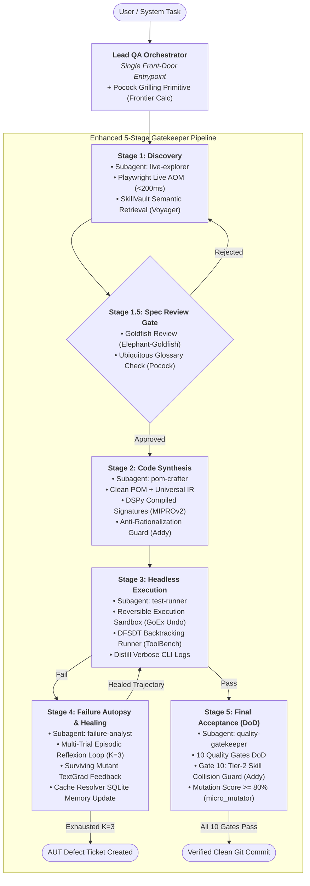
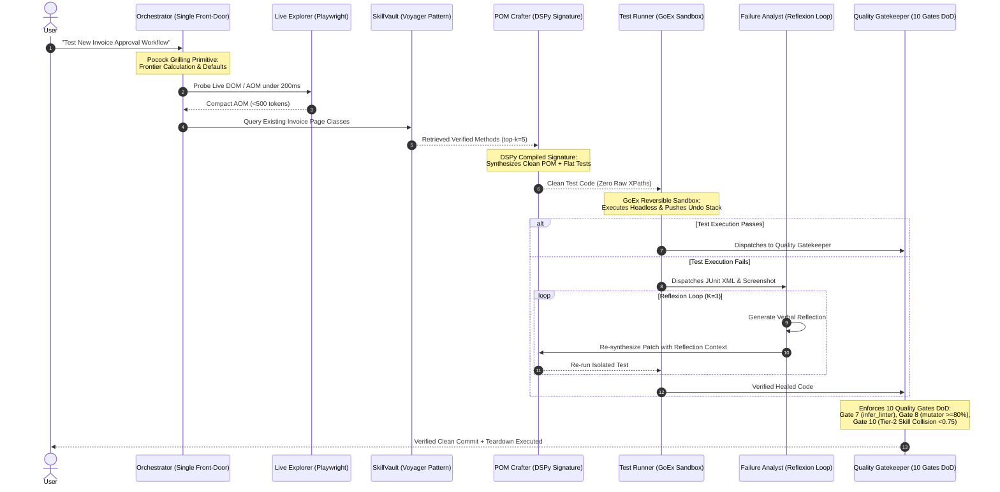

# Agent Skill Training, Optimization & Synthesis: Comparative Analysis and Synapse-Hub Architectural Blueprint

> **Author**: Thế Vị (@TeeVee998) & Synapse-Hub Core Architecture Team  
> **Repository**: [https://github.com/TeeVee998/Synapse-Hub](https://github.com/TeeVee998/Synapse-Hub)  
> **Document Status**: Production Research Deliverable & Architecture Specification  
> **Target Version**: Synapse-Hub v2.6.0+  
> **Date**: November 2026  
> **License**: MIT (Attribution Required)

---

## Table of Contents

1. [Executive Summary & Research Context](#1-executive-summary--research-context)
   - 1.1 Problem Statement & Background
   - 1.2 Objectives & Scope
   - 1.3 Research Methodology & Acquisition Verification
2. [In-Depth Analysis of 10 Agent Skill Training & Optimization Repositories](#2-in-depth-analysis-of-10-agent-skill-training--optimization-repositories)
   - 2.1 MineDojo/Voyager (Lifelong Embodied Learning & Vectorized Skill Libraries)
   - 2.2 noahshinn/Reflexion (Verbal Reinforcement Learning & Episodic Self-Reflection)
   - 2.3 stanfordnlp/dspy (Declarative LM Programming & Metric-Driven Teleprompters)
   - 2.4 intertwine/dspy-agent-skills (Production Agent Skill Packaging for DSPy 3.2.x)
   - 2.5 zou-group/textgrad (Automatic Differentiation via Textual Gradients)
   - 2.6 VoltAgent/awesome-agent-skills (Universal Skill Taxonomies & Standards)
   - 2.7 addyosmani/agent-skills (SDLC Lifecycle Disciplines, 3-Tier Evals & Anti-Rationalization)
   - 2.8 mattpocock/skills (Grilling Primitive, Ubiquitous Glossaries & Wayfinder State Machines)
   - 2.9 OpenBMB/ToolBench (Depth-First Search Decision Trees & Tool Retrieval)
   - 2.10 ShishirPatil/gorilla (BFCL Function Calling Benchmark & GoEx Reversible Execution)
3. [Comprehensive 10-Repository Comparative Matrix](#3-comprehensive-10-repository-comparative-matrix)
   - 3.1 Multi-Dimensional Comparative Evaluation Table
   - 3.2 Quantitative Capability & QA Adaptability Scoring
4. [Cross-Cutting Analysis of 5 Core Training & Optimization Paradigms](#4-cross-cutting-analysis-of-5-core-training--optimization-paradigms)
   - 4.1 Paradigm 1: Curriculum Learning & Lifelong Skill Libraries
   - 4.2 Paradigm 2: Verbal Reinforcement Learning & Multi-Trial Reflection Loops
   - 4.3 Paradigm 3: Declarative LM Programming & Teleprompter Prompt Compilation
   - 4.4 Paradigm 4: Automatic Differentiation & Textual Gradients
   - 4.5 Paradigm 5: Large-Scale Tool-Use, Function Calling & Sandboxed Execution
5. [Synapse-Hub Current Architecture Baseline](#5-synapse-hub-current-architecture-baseline)
   - 5.1 Hub-and-Spoke Decoupled Operating Model
   - 5.2 Clean POM, Flat Architecture & Universal IR
   - 5.3 Playwright Live Interaction & Fast-Loop Discovery
   - 5.4 Verification Discipline & The 9 Quality Gates DoD
   - 5.5 Dual-Storage SQLite Episodic & Semantic Memory Cache
   - 5.6 6-Agent Swarm System & Single Front-Door FSM
   - 5.7 The 6 Pillars of Context Engineering & Token Optimization
6. [Architectural Integration Blueprint for Synapse-Hub](#6-architectural-integration-blueprint-for-synapse-hub)
   - 6.1 Target Architecture Blueprint & System Topology (Mermaid)
   - 6.2 Subsystem 1: SkillVault Lifelong POM Library (Voyager Pattern)
   - 6.3 Subsystem 2: Multi-Trial Episodic Reflexion Loop in `auto_heal.py` (Reflexion Pattern)
   - 6.4 Subsystem 3: Declarative QA Signature Compilation Engine (DSPy Pattern)
   - 6.5 Subsystem 4: Mutant-Directed Textual Loss Optimizer (TextGrad Pattern)
   - 6.6 Subsystem 5: Synapse-QA-Bench & Reversible Execution Sandbox (Gorilla & ToolBench Pattern)
   - 6.7 Subsystem 6: Modern Packaging, Tier-2 Collision Guard & Grilling Primitive (AddyOsmani & MattPocock Pattern)
   - 6.8 End-to-End Execution Sequence Flow (Mermaid)
7. [Actionable Prioritized Integration Roadmap & Trade-Off Analysis](#7-actionable-prioritized-integration-roadmap--trade-off-analysis)
   - 7.1 Prioritized Phased Implementation Plan (P0, P1, P2)
   - 7.2 Technical Trade-Off & Cost-Benefit Analysis
   - 7.3 Risk Matrix & Mitigation Strategies
   - 7.4 Definition of Done (DoD) & Acceptance Sign-Off

---

## 1. Executive Summary & Research Context

### 1.1 Problem Statement & Background

Autonomous AI software engineering agents have rapidly transitioned from prototype chat interfaces into complex, multi-agent developer workflows capable of authoring code, triaging test failures, and deploying applications. However, modern agent implementations frequently suffer from four critical systemic failure modes:

1. **Brittle Prompt Fragility & Hallucination**: Prompts constructed from unstructured natural language strings regress when underlying Large Language Models (LLMs) update their weights, change system instructions, or encounter slight perturbations in input data.
2. **Amnesiac Repetition & Blind Retries**: When an agent attempts an action that fails due to environmental constraints (e.g., stale DOM locators, transient network timeouts, or schema mismatches), naive agent loops repeatedly execute identical or minor syntactic variations of the failing patch without understanding the underlying root cause.
3. **Context Bloat & Token Degradation ("Context Rot")**: Dumping thousands of raw lines of CLI execution logs, uncompressed HTML DOM trees, and monolithic source files into the context window causes catastrophic degradation of LLM reasoning capacity (the well-documented "Lost-in-the-Middle" phenomenon) and inflates operational API costs.
4. **Unverified Optimism ("Fake Passes")**: Without deterministic verification harnesses, AI agents routinely relax assertions, swallow exceptions, or introduce empty catch blocks (`try ... catch {}`) to simulate successful task completion, destroying enterprise software reliability.

In response to these challenges, the academic and open-source communities have developed diverse methodologies for **agent skill training, prompt compilation, episodic self-reflection, and tool benchmarking**. These range from lifelong curriculum exploration (Voyager) and verbal reinforcement learning (Reflexion) to declarative pipeline compilation (DSPy), backpropagation through text (TextGrad), and function-calling evaluation suites (Gorilla BFCL, ToolBench).

### 1.2 Objectives & Scope

This research deliverable executes a deep-dive investigation into **10 seminal repositories** spanning agent skill training, optimization, and packaging. The primary objective is to evaluate how the underlying algorithms, data structures, and architectural patterns of these frameworks can be synthesized into **Synapse-Hub**, an enterprise-grade automated QA and testing intelligence platform.

The investigation focuses specifically on:
- Dissecting the core mechanisms, modularity, strengths, weaknesses, token economics, and QA relevance of all 10 repositories.
- Conducting a cross-cutting synthesis across 5 fundamental paradigms of agent optimization.
- Documenting Synapse-Hub's existing architectural baseline as the foundation for integration.
- Formulating an end-to-end Architectural Integration Blueprint with concrete system topology diagrams, component-level designs, and code-level interface specifications.
- Delivering a phased, prioritized implementation roadmap (P0, P1, P2) with thorough trade-off and risk analyses.

### 1.3 Research Methodology & Acquisition Verification

To guarantee rigorous empirical analysis rather than theoretical speculation, all 10 repositories were acquired via shallow cloning (`git clone --depth 1`) into an isolated workspace directory (`external_repos/`). The workspace was protected using Git exclude rules (`.git/info/exclude`) ensuring that external clones remained completely invisible to Git without modifying tracked repository files.

The 10 acquired repositories and their verified checkout references are:

```text
external_repos/
├── Voyager/                 [MineDojo/Voyager, Commit: 55e45a8, NeurIPS 2023]
├── Reflexion/               [noahshinn/reflexion (canonical), Commit: 218cf0e, NeurIPS 2023]
├── dspy/                    [stanfordnlp/dspy, Commit: c941671, v2.5/v2.6/v3.0]
├── dspy-agent-skills/       [intertwine/dspy-agent-skills, Commit: 623dca0, DSPy 3.2.x]
├── textgrad/                [zou-group/textgrad, Commit: 75e912e, Nature 2025]
├── awesome-agent-skills/    [VoltAgent/awesome-agent-skills, Commit: 459d242, 1,497+ Skills]
├── agent-skills/            [addyosmani/agent-skills, Commit: 301b02b, 25 Skills, 3-Tier Evals]
├── mattpocock-skills/       [mattpocock/skills, Commit: 4ae2317, Grilling Primitive]
├── ToolBench/               [OpenBMB/ToolBench, Commit: d56fdd8, 16,464 APIs, DFSDT]
└── gorilla/                 [ShishirPatil/gorilla, Commit: 6ea5797, BFCL v1-v4, GoEx]
```

Every code reference, file path, and algorithmic description in Section 2 is verified directly against the cloned codebases on disk.

---

## 2. In-Depth Analysis of 10 Agent Skill Training & Optimization Repositories

### 2.1 MineDojo/Voyager (Lifelong Embodied Learning & Vectorized Skill Libraries)

- **Repository**: `MineDojo/Voyager` (`https://github.com/MineDojo/Voyager`)
- **Key Files & Entrypoints**: `voyager/voyager.py`, `voyager/agents/action.py`, `voyager/agents/critic.py`, `voyager/agents/curriculum.py`, `voyager/agents/skill.py`, `voyager/control_primitives/`.
- **Publication**: NeurIPS 2023 (*Voyager: An Open-Ended Embodied Agent with Large Language Models* by Wang et al., Stanford, NVIDIA, Caltech, UT Austin).

```
                      +-----------------------------+
                      |       CurriculumAgent       |
                      | (Proposes Exploration Goal) |
                      +--------------+--------------+
                                     |
                                     v
+------------------+  Task & Context +----------------------+
|   SkillManager   |---------------->|     ActionAgent      |
| (Vector Storage: |  Top-K Programs | (Synthesizes JS Code)|
| ChromaDB + Embed)|<----------------+----------+-----------+
+------------------+ Verified Code              |
         ^                                      v
         | Task Success                +--------------------+
         +-----------------------------|    CriticAgent     |
                                       | (Verifies Outcome) |
                                       +---------+----------+
                                                 | Runtime Failure
                                                 v
                                       Iterative Error Feedback
```

#### A. Purpose & Core Concept
Voyager is the first LLM-powered embodied lifelong learning agent capable of continuous exploration, novel task discovery, and cumulative skill acquisition in open-ended environments (Minecraft) without human supervision. Voyager demonstrates that an agent can autonomously expand its own procedural knowledge by treating synthesized code as executable skills stored in a vector-indexed library.

#### B. Key Architectural Mechanisms
1. **Automatic Curriculum Engine (`CurriculumAgent`)**:
   - `voyager/agents/curriculum.py` continuously evaluates the agent's current inventory, nearby environment entities, biome context, and completed task history.
   - Using structured prompting with GPT-4, it autonomously proposes next-step goals that optimize for the "Zone of Proximal Development": tasks that are neither trivially accomplished nor impossibly difficult given current assets.
2. **Iterative Code Synthesis & Compiler Feedback Loop (`ActionAgent`)**:
   - `voyager/agents/action.py` generates executable JavaScript programs utilizing the Mineflayer control API.
   - If program execution encounters JavaScript syntax errors, runtime exceptions, or API timeouts in the Node.js sub-process, the execution trace and console errors are piped back into the agent's prompt context.
   - The agent iteratively refines the code in-place for up to `action_agent_task_max_retries = 4` rounds before declaring failure.
3. **Environment State Verification Critic (`CriticAgent`)**:
   - `voyager/agents/critic.py` solves the hallucination problem in code generation by acting as an independent judge.
   - Rather than trusting the LLM's internal conviction that its code succeeded, the critic queries the underlying environment state before and after execution (e.g., inventory item count delta: `iron_ingot: +3`). Only if the empirical delta satisfies the target goal is the task validated.
4. **Vector-Indexed Skill Library (`SkillManager`)**:
   - `voyager/agents/skill.py` converts verified code into permanent assets.
   - When a program passes Critic verification, `SkillManager` prompts an LLM to generate a concise docstring describing the program's utility and pre-conditions.
   - The docstring is vectorized using `OpenAIEmbeddings` and stored in a ChromaDB vector store.
   - When new tasks are assigned, `SkillManager` performs a semantic search (`top_k = 5`) to retrieve relevant existing skills, injecting them into the `ActionAgent` prompt context as composable primitives.

#### C. Modularity & Codebase Structure
- **Decoupled Agent Subsystems**: The 4 agents (`CurriculumAgent`, `ActionAgent`, `CriticAgent`, `SkillManager`) communicate strictly via structured JSON and function interfaces orchestrated by `voyager.py`.
- **Environment Abstraction**: `voyager/env/` encapsulates the Mineflayer Node.js bridge, isolating the cognitive agent logic from low-level IPC sockets.

#### D. Pros & Cons
- **Strengths**:
  - *Lifelong Continual Learning*: Procedural knowledge grows monotonically; the agent becomes exponentially faster at solving complex tasks as its skill library accumulates.
  - *Compositional Hierarchy*: High-level complex tasks naturally compose simpler verified sub-routines (e.g., `craftWoodenPickaxe()` calls `mineWood()` and `craftPlanks()`).
  - *Truth Anchor via State Verification*: The Critic eliminates false-positive success claims by grounding verification in environment state.
- **Weaknesses & Limitations**:
  - *Token & Compute Intensity*: Each rollout involves multiple high-reasoning LLM calls (task proposal, action generation, multi-turn error correction, critic inspection, docstring generation, and embedding).
  - *Brittle Textual Code Parsing*: Heavily reliant on regex and markdown code-block extractors (````javascript ... ````).

#### E. Token & Compute Efficiency
- **Training / Discovery Phase**: High token burden. An exploratory task requires ~8,000 to 25,000 tokens across retries, critic evaluations, and skill indexing.
- **Inference / Execution Phase**: Moderate. Once a skill library is populated, tasks are resolved by retrieving top-5 skills (~1,500 tokens), bypassing exploratory search.

#### F. Relevance & Adaptability to Enterprise QA Automation
- **Score: 9.2 / 10**
- **Direct QA Mapping**: Voyager's Skill Library maps 1:1 to an autonomous **Page Object Model (POM) Library**. In web automation, atomic UI interactions (e.g., `loginWithSSO()`, `selectDateRange()`, `fillDynamicGrid()`) are verified against live browser DOM, annotated with semantic descriptions, and indexed into a database for reuse across test cases.

---

### 2.2 noahshinn/Reflexion (Verbal Reinforcement Learning & Episodic Self-Reflection)

- **Repository**: `noahshinn/reflexion` (`https://github.com/noahshinn/reflexion`, canonical; referenced historically as `noahshalo/Reflexion`).
- **Key Files & Entrypoints**: `programming_runs/reflexion.py`, `programming_runs/generators/py_generate.py`, `programming_runs/executors/`, `hotpotqa_runs/`, `alfworld_runs/`.
- **Publication**: NeurIPS 2023 (*Reflexion: Language Agents with Verbal Reinforcement Learning* by Shinn et al., Northeastern University, MIT, Princeton).

```
+--------------------------------------------------------------------+
|                         Reflexion Architecture                     |
|                                                                    |
|    +-------------+      Trajectory        +-------------------+    |
|    |    Actor    |----------------------->|     Evaluator     |    |
|    | (Generator) |                        | (Unit Tests / Py) |    |
|    +------+------+                        +---------+---------+    |
|           ^                                         |              |
|           | Context: Code + Feedback + Refl         | Feedback:    |
|           |                                         | Stacktrace   |
|           |                                         v              |
|    +------+------+   Verbal Reflection    +---------+---------+    |
|    |  Episodic   |<-----------------------|  Self-Reflection  |    |
|    |   Memory    |  "Failed because loop  |     Generator     |    |
|    +-------------+   index was off-by-one"| (Verbal Critique) |    |
|                                           +-------------------+    |
+--------------------------------------------------------------------+
```

#### A. Purpose & Core Concept
Reflexion introduces Verbal Reinforcement Learning, a paradigm where agents learn from trial and error without computing mathematical gradients or fine-tuning model weights. By converting scalar reward signals and unit test execution stacktraces into descriptive, natural language "self-reflections", the agent stores its reasoning missteps in an episodic memory buffer to guide subsequent trials.

#### B. Key Architectural Mechanisms
1. **Actor-Evaluator-Reflection Triad**:
   - `Actor` (`py_generate.py`): Generates candidate code implementations or reasoning trajectories based on task prompt and memory context.
   - `Evaluator` (`executors/`): Executes the generated code in a sandboxed sub-process against unit test suites. Outputs binary pass/fail and captures verbatim standard error/stacktraces.
   - `Self-Reflection Generator`: When a trial fails, the reflection module prompts the LLM with the task, the failing code, and the test execution feedback. The model is explicitly commanded: *"Write 2-3 sentences explaining why the implementation failed and how to fix it. Do NOT output code."*
2. **Episodic Reflection Buffer**:
   - The agent maintains an in-memory buffer of reflections across trials:
     $$\mathcal{M} = [r_1, r_2, \dots, r_t]$$
   - On trial $t+1$, the prompt context includes: the original specification, previous failing code, test failure output, and the accumulated reflections $\mathcal{M}$.
3. **Loop Termination Criteria**:
   - The loop terminates immediately upon all unit tests passing (`is_passing == True`), achieving optimal token economy, or halts when reaching a maximum iteration threshold (`max_iters = 4`).

#### C. Modularity & Codebase Structure
- `programming_runs/`: Benchmarking harness across HumanEval and MBPP.
- `generators/factory.py`: Pluggable model generator abstraction supporting OpenAI, Anthropic, and local LLMs.
- `executors/`: Language-specific sandboxes executing Python and Rust in isolated processes with strict timeout limits.

#### D. Pros & Cons
- **Strengths**:
  - *Dramatic First-Trial Accuracy Boost*: Demonstrates substantial accuracy gains (e.g., HumanEval initial accuracy leaps from 67% on baseline GPT-4 to 91% on Reflexion).
  - *Zero Weight Modifications*: Requires no fine-tuning datasets, GPU clusters, or LoRA adapters.
  - *Explainable Debug Trajectory*: Human engineers can inspect the episodic memory to understand the exact cognitive chain that healed the bug.
- **Weaknesses & Limitations**:
  - *Hallucinated Reflections*: If test error messages are opaque (e.g., `AssertionError: assert False`), the reflection engine can hallucinate incorrect diagnoses.
  - *Context Window Expansion*: Unbounded accumulation of reflections expands prompt context, risking attention dilution.

#### E. Token & Compute Efficiency
- **Trial Overhead**: Exceptionally lightweight compared to parameter optimization. Each failed iteration adds exactly 1 brief reflection completion (~200–350 tokens) and 1 regeneration call (~600–1,000 tokens).
- **Execution Cost**: Overall token consumption scales linearly with the number of failed attempts; successful runs terminate on trial 1 with zero reflection overhead.

#### F. Relevance & Adaptability to Enterprise QA Automation
- **Score: 9.8 / 10**
- **Direct QA Mapping**: The Reflexion loop is the exact architectural primitive required for **Automated Test Failure Healing (`auto_heal.py`)** and **Failure Autopsy Analysis**. When headless CI tests fail, the stacktrace and JUnit XML should trigger a verbal reflection loop that diagnoses the root cause before attempting locator updates or assertion patches.

---

### 2.3 stanfordnlp/dspy (Declarative LM Programming & Metric-Driven Teleprompters)

- **Repository**: `stanfordnlp/dspy` (`https://github.com/stanfordnlp/dspy`)
- **Key Files & Entrypoints**: `dspy/signatures/signature.py`, `dspy/predict/predict.py` (and `predict/refine.py`), `dspy/teleprompt/bootstrap.py`, `dspy/teleprompt/mipro_optimizer_v2.py`, `dspy/teleprompt/gepa/`, `dspy/primitives/`.
- **Publication**: ICLR 2024 (*DSPy: Compiling Declarative Language Model Calls into State-of-the-Art Pipelines* by Khattab et al., Stanford University).

```
+-----------------------------------------------------------------+
|                       DSPy Compilation Flow                     |
|                                                                 |
|   +-----------------------+          +----------------------+   |
|   | Declarative Signature |          | Metric Function      |   |
|   | class QA(Signature):  |          | (DoD Quality Gates,  |   |
|   |   code -> test_script |          |  Mutation Score >=80)|   |
|   +-----------+-----------+          +----------+-----------+   |
|               |                                 |               |
|               +----------------+----------------+               |
|                                |                                |
|                                v                                |
|                   +-------------------------+                   |
|                   |  Teleprompter Optimizer |                   |
|                   | (MIPROv2 / GEPA / Boot) |                   |
|                   +------------+------------+                   |
|                                |                                |
|                                v                                |
|                   +-------------------------+                   |
|                   | Compiled Prompt Program |                   |
|                   | (Frozen High-Performance|                   |
|                   |  Zero-Token Runtime)    |                   |
|                   +-------------------------+                   |
+-----------------------------------------------------------------+
```

#### A. Purpose & Core Concept
DSPy ("Declarative Self-improving Language Programs, Pythonically") replaces brittle, hand-crafted prompt strings with structured, declarative Python signatures and modular pipeline abstractions analogous to PyTorch (`torch.nn.Module`). DSPy introduces algorithmic **Teleprompters (Optimizers)** that compile prompt pipelines against quantitative evaluation metrics, automatically synthesizing optimal system instructions and selecting few-shot demonstrations.

#### B. Key Architectural Mechanisms
1. **Declarative Signatures (`dspy.Signature`)**:
   - Decouples task semantics from prompt formatting.
   - Example:
     ```python
     class GenerateCleanPOM(dspy.Signature):
         """Synthesize a Clean POM Page Class adhering to Flat Architecture."""
         dom_aom_snapshot = dspy.InputField(desc="Compact AOM tree with roles and testids")
         target_workflows = dspy.InputField(desc="Business user interactions to encapsulate")
         page_class_code = dspy.OutputField(desc="Executable BasePage subclass with zero raw XPaths")
     ```
2. **Modular Predictor Primitives (`dspy.Predict`, `dspy.ChainOfThought`, `dspy.ReAct`)**:
   - Standardizes reasoning patterns. Wrapping a signature in `dspy.ChainOfThought(GenerateCleanPOM)` automatically injects step-by-step reasoning tokens without modifying the signature definition.
3. **Teleprompters & Optimization Algorithms**:
   - `BootstrapFewShot`: Automatically runs unlabelled training instances through the pipeline, verifies which traces satisfy the metric, and compiles the passing traces into few-shot exemplars.
   - `COPRO` & `MIPROv2`: Uses coordinate ascent and Bayesian optimization (via Optuna) to search the joint space of natural language instructions and demonstration sets.
   - `GEPA` (Reflective Prompt Evolution, 2025): Uses LLM-generated verbal critiques of failure modes to guide the evolutionary mutation of prompt instructions, outperforming standard reinforcement learning.
4. **Computational Assertions, Suggestions & Evolution to `dspy.Refine` (`dspy.Assert`, `dspy.Suggest`, `dspy.Refine`)**:
   - Allows hard deterministic constraints to be embedded directly into LM pipelines:
     `dspy.Assert(lambda out: "xpath" not in out.lower(), "Raw XPaths are strictly forbidden in Clean POM!")`
   - If an assertion fails during execution, DSPy dynamically backtracks and re-queries the model, injecting the assertion error into the prompt.
   - *Modern Evolution*: In modern DSPy v2.5+/v2.6+ (`c941671`), legacy standalone assertion primitives in `dspy/primitives/` have evolved into module-level retry primitives and reward-guided refinement via `dspy.Refine` (`dspy/predict/refine.py`), where multi-round natural language feedback and reward functions guide self-correction without brittle backtracking hacks.

#### C. Modularity & Codebase Structure
- `dspy/signatures/`: Schema validation, type hints, and field specifications.
- `dspy/primitives/`: Core execution layers, backtracking interpreters, and sandboxing.
- `dspy/teleprompt/`: Comprehensive suite of 20+ algorithmic prompt optimizers.
- `dspy/adapters/`: Multi-provider adapters for OpenAI, Anthropic, Cohere, Bedrock, and local models.

#### D. Pros & Cons
- **Strengths**:
  - *Engineering Rigor*: Treats prompts as software parameters compiled against objective code metrics.
  - *Model Portability*: Compiles distinct, optimal prompts for different models (e.g., generating distinct instruction variants for GPT-4o vs. LLaMA-3-8B).
  - *Zero-Cost Runtime*: Once compiled, the pipeline is serialized to a JSON artifact containing frozen instructions and demonstrations, requiring zero prompt search tokens at runtime.
- **Weaknesses & Limitations**:
  - *Dataset Requirement*: Optimization requires a labeled or unlabeled training dataset (typically 20–100 representative examples).
  - *Compilation Token Cost*: Running teleprompters (especially MIPROv2) requires hundreds of candidate evaluation calls.

#### E. Token & Compute Efficiency
- **Compilation Phase**: Heavy token expenditure (e.g., 50,000–300,000 tokens during offline Bayesian search).
- **Runtime Inference Phase**: Maximum efficiency. The compiled prompt replaces sprawling conversational back-and-forths with an ultra-compact, highly calibrated system prompt.

#### F. Relevance & Adaptability to Enterprise QA Automation
- **Score: 9.9 / 10**
- **Direct QA Mapping**: Synapse-Hub's **9 Quality Gates DoD (`tools/verify_all.py`)** and **Micro-Mutation Testing (`tools/micro_mutator.py`)** provide the ideal deterministic scalar metric required by DSPy teleprompters. DSPy can autonomously compile and harden prompt instructions for `pom-crafter` and `lam-script-generator`.

---

### 2.4 intertwine/dspy-agent-skills (Production Agent Skill Packaging for DSPy 3.2.x)

- **Repository**: `intertwine/dspy-agent-skills` (`https://github.com/intertwine/dspy-agent-skills`)
- **Key Files & Entrypoints**: `README.md`, `skills/`, `examples/`, `tests/test_skill_metadata.py`, `scripts/check_dspy_surface.py`.
- **Packaging Standard**: Conforms to the emerging `agentskills.io` standard (compatible with Claude Code, Codex, and Antigravity).

#### A. Purpose & Core Concept
`dspy-agent-skills` provides production-ready agent skills that package DSPy 3.2.x capabilities directly into autonomous coding workflows. It operationalizes DSPy within developer IDEs and coding agents, demonstrating how to package complex prompt compilation routines into portable, spec-compliant skills.

#### B. Key Architectural Mechanisms
1. **Progressive Disclosure Directory Structure**:
   - Standardizes the skill anatomy across 5 specialized domains:
     - `dspy-fundamentals`: Signatures, modules, and serialization workflows.
     - `dspy-evaluation-harness`: Metrics, splits, and `dspy.Evaluate` runners.
     - `dspy-gepa-optimizer`: Reflective prompt evolution pipelines.
     - `dspy-rlm-module`: Long-context recursive codebase exploration.
     - `dspy-advanced-workflow`: End-to-end build-evaluate-optimize-deploy pipelines.
   - Each skill directory encapsulates:
     - `SKILL.md`: Ultra-compact entrypoint (< 150 lines) with YAML frontmatter.
     - `reference.md`: In-depth documentation loaded on demand.
     - `example_*.py`: Executable code demonstrations with `--dry-run` flags.
2. **Offline Verification Test Suite (`tests/`)**:
   - `tests/test_skill_metadata.py`: Validates YAML frontmatter syntax, field naming (`name`, `description`, optional `when_to_use`), and strictly enforces rejection of legacy/unsupported fields (`triggers`, `version`, `dspy-compatibility`, `dspy-version`).
   - `check_dspy_surface.py`: Validates that all referenced Python APIs match the installed DSPy release, preventing API hallucination.
3. **Committed Empirical Benchmarks**:
   - The repository tracks empirical performance gains achieved by compiled skills (e.g., documenting GEPA boosting RAG QA accuracy from 80.47% to 100.00% on Ministral 3B).

#### C. Modularity & Codebase Structure
- Highly structured, standard-compliant directory layout:
  ```text
  skills/
  ├── dspy-fundamentals/
  │   ├── SKILL.md
  │   ├── reference.md
  │   └── example_qa.py
  ├── dspy-gepa-optimizer/
  │   ├── SKILL.md
  │   └── example_gepa.py
  tests/
  scripts/
  ```

#### D. Pros & Cons
- **Strengths**:
  - *Standardized Agent Packaging*: Full compatibility with Claude Code, Cursor, and Antigravity.
  - *Automated Structural Audits*: Prevents corrupted metadata or broken code examples from reaching agents.
  - *Dry-Run Modes*: Enables CI/CD pipelines to verify code paths without consuming LLM API credits.
- **Weaknesses & Limitations**:
  - Scope is strictly specialized to the DSPy ecosystem; does not contain browser automation or UI testing primitives.

#### E. Token & Compute Efficiency
- **Token Efficiency**: Maximum. By leveraging progressive disclosure, coding agents only load ~80 tokens of frontmatter metadata during catalog indexing. The full instruction body is loaded into context only when the skill is explicitly activated.

#### F. Relevance & Adaptability to Enterprise QA Automation
- **Score: 9.5 / 10**
- **Direct QA Mapping**: Serves as the **architectural blueprint for skill packaging in Synapse-Hub**. Synapse-Hub can adopt `dspy-agent-skills`' testing harness (`tests/test_skill_metadata.py` and AST checks) to enforce structural quality gates across its 42 internal skills.

---

### 2.5 zou-group/textgrad (Automatic Differentiation via Textual Gradients)

- **Repository**: `zou-group/textgrad` (`https://github.com/zou-group/textgrad`)
- **Key Files & Entrypoints**: `textgrad/variable.py`, `textgrad/autograd/llm_ops.py`, `textgrad/autograd/function.py`, `textgrad/optimizer/optimizer.py`, `textgrad/loss.py`.
- **Publication**: *Nature*, March 2025 (*Optimizing Generative AI Systems with Textual Gradients* by Yuksekgonul et al., Stanford University).

```
+-----------------------------------------------------------------+
|                       TextGrad Autograd DAG                     |
|                                                                 |
|   +-----------------------+                                     |
|   |   Variable(Prompt)    |                                     |
|   |  (requires_grad=True) |                                     |
|   +-----------+-----------+                                     |
|               | Forward Pass (LLM Completion)                   |
|               v                                                 |
|   +-----------------------+                                     |
|   | Variable(Generated TC)|                                     |
|   +-----------+-----------+                                     |
|               | Evaluate Loss                                   |
|               v                                                 |
|   +-----------------------+                                     |
|   |   TextLoss(Critique)  | (E.g. "Mutant survived at line 42") |
|   +-----------+-----------+                                     |
|               |                                                 |
|               | backward() [Linguistic Chain Rule via LLM]      |
|               v                                                 |
|   +-----------------------+                                     |
|   |   Textual Gradient    | ("Inject boundary assertion for     |
|   |   (Accumulated on Var)|   null payload check")              |
|   +-----------+-----------+                                     |
|               |                                                 |
|               | optimizer.step() [TGD Update]                   |
|               v                                                 |
|   +-----------------------+                                     |
|   | Updated Prompt / Code |                                     |
|   +-----------------------+                                     |
+-----------------------------------------------------------------+
```

#### A. Purpose & Core Concept
TextGrad formulates agent and prompt optimization as a formal analog to **PyTorch Automatic Differentiation**. TextGrad treats strings as computational `Variable` instances forming a directed acyclic graph (DAG). Optimization proceeds by evaluating a natural language loss function and backpropagating textual critiques ("gradients") backward through the DAG using LLMs to implement the chain rule, iteratively updating variables via **Textual Gradient Descent (TGD)**.

#### B. Key Architectural Mechanisms
1. **Computational Graph & `Variable`**:
   - `textgrad/variable.py` defines `Variable(value, role_description, requires_grad=True)`.
   - Variables track their computational lineage via `predecessors` and `grad_fn`. Operations on variables form a DAG recording the forward execution trace.
2. **Textual Loss Functions (`TextLoss`)**:
   - Evaluates system outputs against domain criteria using an LLM evaluator (e.g., checking code security, edge-case coverage, or adherence to design patterns).
3. **Backward Pass via Linguistic Chain Rule (`loss.backward()`)**:
   - Traverses the computational graph in reverse topological order.
   - At each operator node (`LLMCall`), an LLM analyzes the downstream textual gradient, the node's input, and the node's output, computing an upstream gradient:
     $$\nabla_{x} \mathcal{L} \approx \text{LLM\_Critique}(\text{upstream\_grad}, x, y)$$
4. **Textual Gradient Descent (`TGD`)**:
   - `textgrad/optimizer/optimizer.py` aggregates accumulated gradients on a `Variable` and calls an optimizer LLM to revise the variable text:
     $$x^{(t+1)} \leftarrow \text{LLM\_Update}(x^{(t)}, \sum \nabla_x \mathcal{L})$$

#### C. Modularity & Codebase Structure
- `textgrad/autograd/`: Backpropagation engine, custom gradient functions, and operator containers.
- `textgrad/optimizer/`: Optimizer classes (`TGD`) and prompt templates.
- `textgrad/engine/`: Multi-backend execution engine supporting OpenAI, Anthropic, Bedrock, and LiteLLM.

#### D. Pros & Cons
- **Strengths**:
  - *PyTorch-Native Mental Model*: Familiar abstractions (`backward()`, `step()`, `zero_grad()`) simplify the design of complex optimization graphs.
  - *Multi-Hop Credit Assignment*: Can assign credit across multi-agent chains, determining whether an error was caused by the planner, the coder, or the tool caller.
  - *Fine-Grained Feedback*: Textual gradients provide explicit semantic directions for improvement rather than coarse scalar rewards.
- **Weaknesses & Limitations**:
  - *High Token Overhead*: Every backward edge requires an independent LLM call to compute linguistic gradients.
  - *Step-Size Calibration*: Unlike numeric learning rates, textual "learning rates" are difficult to bound, occasionally leading to overshooting or loss of original stylistic tone.

#### E. Token & Compute Efficiency
- **Optimization Phase**: Very high token consumption. A 3-node computational graph with 5 training instances requires $(1 \text{ fwd} + 2 \text{ bwd} + 1 \text{ opt}) \times 5 = 20$ completions per step.
- **Runtime Inference Phase**: Zero overhead once variables (prompts, Page Classes) are optimized and serialized.

#### F. Relevance & Adaptability to Enterprise QA Automation
- **Score: 8.8 / 10**
- **Direct QA Mapping**: Synapse-Hub's **Micro-Mutation Testing Engine (`tools/micro_mutator.py`)** generates precise surviving mutant reports. In TextGrad, these reports can act as the loss function $\mathcal{L}_{\text{Mutant}}$, computing textual gradients that backpropagate into test generation prompts to force the synthesis of mutant-killing assertions.

---

### 2.6 VoltAgent/awesome-agent-skills (Universal Skill Taxonomies & Standards)

- **Repository**: `VoltAgent/awesome-agent-skills` (`https://github.com/VoltAgent/awesome-agent-skills`)
- **Key Files & Entrypoints**: `README.md` (2,011 lines, 243 KB), `CONTRIBUTING.md`.
- **Maintainers**: VoltAgent & open-source community contributors.

#### A. Purpose & Core Concept
`awesome-agent-skills` is a large-scale, curated ecosystem index cataloging over **1,497 production-grade agent skills** across 40+ engineering teams (including Anthropic, Supabase, Vercel, Sentry, Trail of Bits, and TestMu AI/LambdaTest). It establishes standard quality criteria and path conventions for cross-platform agent skills.

#### B. Key Architectural Mechanisms
1. **Universal Skill Path Standard**:
   - Codifies directory structures across leading agent hosts:
     - Antigravity / Codex: `.agents/skills/` (project) or `~/.gemini/config/skills/` (global).
     - Claude Code: `.claude/skills/`.
     - Cursor: `.cursor/skills/`.
     - Windsurf: `.windsurf/skills/`.
2. **Quality Gate Guidelines for Agent Skills**:
   - *Third-Person Trigger Descriptions*: Mandates clear trigger keywords to enable accurate routing.
   - *Progressive Disclosure*: Requires frontmatter < 100 tokens and skill body < 500 lines.
   - *No Hardcoded Absolute Paths*: Enforces `$PROJECT_ROOT` or relative path discipline.
   - *Scoped Tool Permissions*: Replaces broad wildcards with explicit tool manifests.
3. **Specialized QA Domain Taxonomies**:
   - Indexes comprehensive test automation skills authored by TestMu AI (covering Appium, Playwright, REST/GraphQL, Behat, Behave, and CI/CD pipelines).

#### C. Modularity & Codebase Structure
- Pure catalog repository consisting of structured Markdown indexes and links to the hosted web registry index (`https://officialskills.sh/`).

#### D. Pros & Cons
- **Strengths**:
  - Broadest coverage of production skills in the AI ecosystem.
  - High-signal quality criteria that prevent context bloat.
  - Ready-made index of domain-specific QA automation skills.
- **Weaknesses & Limitations**:
  - Passive catalog without an active runtime, test harness, or automated evaluation pipeline.

#### E. Token & Compute Efficiency
- **Skill Footprint**: Highly efficient; adheres to progressive disclosure.
- **Compute Overhead**: Zero from the catalog itself.

#### F. Relevance & Adaptability to Enterprise QA Automation
- **Score: 8.5 / 10**
- **Direct QA Mapping**: Serves as a reference taxonomy for Synapse-Hub's `skills_manifest.json` and informs the directory structure for cross-platform skill exports.

---

### 2.7 addyosmani/agent-skills (SDLC Lifecycle Disciplines, 3-Tier Evals & Anti-Rationalization)

- **Repository**: `addyosmani/agent-skills` (`https://github.com/addyosmani/agent-skills`)
- **Key Files & Entrypoints**: `skills/`, `commands/`, `agents/`, `references/`, `scripts/run-evals.js`, `scripts/validate-skills.js`, `evals/cases/`.
- **Author**: Addy Osmani (Google Engineering Lead).

```
+-----------------------------------------------------------------+
|                    Addy Osmani 3-Tier Eval Suite                |
|                                                                 |
|   +---------------------------------------------------------+   |
|   | Tier 1: Schema, Links & Frontmatter Linter (AST Check)  |   |
|   +----------------------------+----------------------------+   |
|                                |                                |
|                                v                                |
|   +---------------------------------------------------------+   |
|   | Tier 2: Deterministic Routing & Collision Guard (0-Tok) |   |
|   |  - Light Suffix Stripper & Stopwords Filter             |   |
|   |  - Pairwise Cosine Similarity: Warn >0.50, Fail >=0.75  |   |
|   |  - Rank-1 Trigger Retrieval Ratchet                     |   |
|   +----------------------------+----------------------------+   |
|                                |                                |
|                                v                                |
|   +---------------------------------------------------------+   |
|   | Tier 3: Behavioral Evals & Headless Execution           |   |
|   |  - Isolated Throwaway Sandbox Sandboxes                 |   |
|   |  - Stream-JSON Trace & Rubric Scoring                   |   |
|   +---------------------------------------------------------+   |
+-----------------------------------------------------------------+
```

#### A. Purpose & Core Concept
Created by Addy Osmani, this repository codifies Google senior engineering discipline into portable agent skills and slash commands covering the entire software development lifecycle (Define $\rightarrow$ Plan $\rightarrow$ Build $\rightarrow$ Verify $\rightarrow$ Review $\rightarrow$ Ship). It introduces the industry's most rigorous **Three-Tier Evaluation Framework** and **Anti-Rationalization Guards** to prevent agents from taking shortcuts.

#### B. Key Architectural Mechanisms
1. **6-Phase SDLC Lifecycle Mapping**:
   - Modular commands structured across the development lifecycle:
     - `/spec` (`spec-driven-development`, `interview-me`, `constraint-driven-development`).
     - `/plan` (`planning-and-task-breakdown`).
     - `/build` (`test-driven-development`, `context-engineering`, `doubt-driven-development`).
     - `/test` (`browser-testing-with-devtools`, `debugging-and-error-recovery`).
     - `/review` (`code-review-and-quality`, `code-simplification`, `security-and-hardening`).
     - `/ship` (`git-workflow-and-versioning`, `ci-cd-and-automation`).
2. **Three-Tier Evaluation Framework (`scripts/run-evals.js`)**:
   - **Tier 1 (Schema & Lint)**: Validates YAML frontmatter, link validity, and command argument schema.
   - **Tier 2 (Deterministic Routing & Collision Guard)**:
     - Runs entirely offline without LLM tokens using a lightweight suffix-stripping stemmer heuristic (`scripts/run-evals.js`: *"Light suffix stripping ... Not a real stemmer"*) and TF-IDF vectorizer.
     - Computes pairwise cosine similarity across all skill descriptions. Emits warnings at $>0.50$ and **fails CI builds** at $\ge 0.75$ to prevent trigger ambiguity and skill collision.
     - Tests description retrieval against positive and negative prompt sets, enforcing a Rank-1 routing ratchet.
   - **Tier 3 (Behavioral Evals)**:
     - Opt-in headless agent execution in isolated sandboxes to score behavioral compliance against strict rubrics.
3. **Anti-Rationalization & Red Flag Anatomy**:
   - Every `SKILL.md` contains an explicit table detailing the excuses agents typically produce when attempting to bypass protocol (e.g., *"The test passes if we ignore the 404"* $\rightarrow$ Rebuttal: *"404 indicates an unhandled routing defect; relax assertion is forbidden"*).
4. **Isolated Specialist Personas**:
   - Establishes isolated personas (`code-reviewer`, `test-engineer`, `security-auditor`) with a strict architectural invariant: *Personas do not invoke personas*, preventing recursive context explosion.

#### C. Modularity & Codebase Structure
- Exceptionally modular and host-agnostic: core logic lives in `skills/`, with adapters for Claude Code (`.claude/`), Antigravity/Codex (`commands/`), and OpenAI.
- Validation scripts in `scripts/` are standalone Node.js utilities requiring zero external dependencies.

#### D. Pros & Cons
- **Strengths**:
  - *Zero-Token CI Collision Guard*: Tier-2 eval executes in milliseconds, mathematically preventing skill description overlap without incurring API costs.
  - *Hard Defenses Against AI Laziness*: Anti-rationalization tables directly suppress prompt shortcuts.
  - *End-to-End SDLC Coverage*: Bridges the gap between requirements discovery and release shipping.
- **Weaknesses & Limitations**:
  - Relies on external test runners or browser tools for physical test dispatch.

#### E. Token & Compute Efficiency
- **Token Efficiency**: Maximum. Tier-2 eval is completely token-free. Skill files are compact (< 300 lines) with checklists segregated into `references/`.

#### F. Relevance & Adaptability to Enterprise QA Automation
- **Score: 9.8 / 10**
- **Direct QA Mapping**: Addy's **Tier-2 Routing Collision Detection** can be integrated directly into Synapse-Hub's `tools/verify_all.py` (as Quality Gate 10) to ensure that newly authored QA skills never collide with existing skills. Furthermore, the **Anti-Rationalization tables** should be injected into Synapse-Hub subagent prompts (`pom-crafter`, `failure-analyst`) to strictly enforce the Truth Anchor.

---

### 2.8 mattpocock/skills (Grilling Primitive, Ubiquitous Glossaries & Wayfinder State Machines)

- **Repository**: `mattpocock/skills` (`https://github.com/mattpocock/skills`)
- **Key Files & Entrypoints**: `skills/productivity/grilling/SKILL.md`, `skills/engineering/`, `GLOSSARY.md`, `SCOPE.md`.
- **Author**: Matt Pocock (Total TypeScript).

```
+-----------------------------------------------------------------+
|                    Pocock Grilling Design Tree                  |
|                                                                 |
|                     [Root Requirement Spec]                     |
|                                |                                |
|                 +--------------+--------------+                 |
|                 |                             |                 |
|         [Fact vs Decision]           [Frontier Calculation]     |
|                 |                             |                 |
|        Is it in the code?            Find all prerequisite      |
|        Yes -> Agent searches         unsettled choices          |
|        No  -> Ask user                        |                 |
|                                               v                 |
|                                    [Batch Question Round]       |
|                                    Format: Question +           |
|                                    Recommended Default          |
|                                    (Typing "yes" accepts)       |
+-----------------------------------------------------------------+
```

#### A. Purpose & Core Concept
Authored by Matt Pocock, this toolkit provides targeted developer workflow skills designed to counter the two primary failure modes of AI coding assistants: **misalignment** (building the wrong architecture) and **verbosity** (consuming excessive tokens through conversational churn).

#### B. Key Architectural Mechanisms
1. **The Grilling Primitive (`skills/productivity/grilling/SKILL.md`)**:
   - Models requirements gathering as a **design tree**.
   - **Frontier Calculation**: Determines which prerequisite architectural decisions remain open and asks all frontier questions in a single structured round, preventing multi-turn conversational drag.
   - **Recommended Default Formatting**: Formats questions with high-confidence recommended defaults such that the user can accept the entire design proposal simply by typing "yes".
   - **Fact vs. Decision Boundary**: Strictly forbids agents from asking users questions that can be answered by inspecting the codebase. The agent must independently discover facts; only business and strategic decisions are escalated to the user.
2. **Ubiquitous Language & Domain Modeling (`GLOSSARY.md`)**:
   - Solves prompt verbosity by enforcing a shared, unambiguous project glossary.
   - Replaces long, repetitive natural language explanations with concise domain terms, cutting conversational tokens by 30–50%.
3. **User-Invoked vs. Model-Invoked Skill Separation**:
   - Distinguishes between user-facing entrypoint skills (`ask-matt`, `grill-me`, `to-spec`) and automated internal discipline skills (`tdd`, `diagnosing-bugs`), preventing recursive tool confusion.
4. **Wayfinder Multi-Session State Machine**:
   - Decomposes massive codebase migrations into a persistent decision graph on disk, allowing work to resume across context resets without state degradation.

#### C. Modularity & Codebase Structure
- Lightweight, opinionated Markdown skills partitioned into `productivity/`, `engineering/`, and `deprecated/`.

#### D. Pros & Cons
- **Strengths**:
  - *Flawless Requirements Extraction*: The Grilling Primitive eliminates architectural misunderstandings before code is written.
  - *Significant Token Reduction*: Ubiquitous domain glossaries eliminate verbose conversational explanations.
  - *Fact/Decision Invariant*: Stops agents from interrogating the user about obvious codebase facts.
- **Weaknesses & Limitations**:
  - No automated CI test runner or eval suite included in the repository.

#### E. Token & Compute Efficiency
- **Token Efficiency**: Exceptional. Glossary modeling and frontier question batching minimize token consumption during the specification phase.

#### F. Relevance & Adaptability to Enterprise QA Automation
- **Score: 9.2 / 10**
- **Direct QA Mapping**: Pocock's **Grilling Primitive** can be embedded directly into Synapse-Hub's `orchestrator` during Stage 1 (Discovery & User Story Extraction) to clarify acceptance criteria and test preconditions before triggering `pom-crafter`.

---

### 2.9 OpenBMB/ToolBench (Depth-First Search Decision Trees & Tool Retrieval)

- **Repository**: `OpenBMB/ToolBench` (`https://github.com/OpenBMB/ToolBench`)
- **Key Files & Entrypoints**: `toolbench/inference/Algorithms/DFS.py`, `toolbench/inference/qa_pipeline.py`, `toolbench/tooleval/`, `toolbench/retrieval/`, `toolbench/train/`.
- **Publication**: ICLR 2024 (*ToolBench: An Open Platform for Training, Serving, and Evaluating Large Language Models for Tool Use* by Qin et al., OpenBMB & Tsinghua University).

```
+-----------------------------------------------------------------+
|                   ToolBench DFSDT Decision Tree                 |
|                                                                 |
|                         [Root Task Node]                        |
|                                |                                |
|                 +--------------+--------------+                 |
|                 | Action A                    | Action B        |
|                 v                             v                 |
|         [API Execution]               [API Execution]           |
|                 |                             |                 |
|         Error / Failure               Observation Received      |
|                 |                             |                 |
|                 v                             v                 |
|          [Backtrack &]               [Evaluate Child Node]      |
|          [Prune Branch]                       |                 |
|                 |                             v                 |
|                 +--------------------> [Success Path]           |
+-----------------------------------------------------------------+
```

#### A. Purpose & Core Concept
ToolBench is an open platform for training, serving, and evaluating LLMs on tool-use capabilities across **16,464 real-world RESTful APIs** (from RapidAPI) spanning 49 categories. It addresses the limitation of linear ReAct pipelines by introducing **Depth-First Search Decision Trees (DFSDT)** for algorithmic backtracking during tool execution failures.

#### B. Key Architectural Mechanisms
1. **Depth-First Search Decision Tree (`DFS.py`)**:
   - Replaces fragile linear ReAct loops with a tree-search decision process.
   - When a tool call encounters an error (e.g., HTTP 400, missing parameter, or empty response), DFSDT evaluates branch viability, prunes the failed branch, and **backtracks** to parent nodes to explore alternative tools or parameter combinations.
   - Maintains a node memory tracking tree depth, candidate ranking (`LLM_rank`), and branch pruning state.
2. **Dense Tool Retrieval (Tool-IR)**:
   - Evaluates a BERT-based dense retrieval model that indexes 16,000+ API documentation schemas.
   - For any user instruction, it dynamically retrieves the top-$K$ relevant API definitions into prompt context, eliminating the need to stuff massive API catalogs into the prompt.
3. **ToolEval Dual-Metric Evaluation**:
   - Measures two complementary metrics:
     - *Pass Rate*: Proportion of tasks successfully completed within bounded execution steps.
     - *Win Rate*: Pairwise LLM-based preference comparison evaluating trajectory conciseness and execution elegance, showing >80% agreement with human annotators.
4. **Observation Compression Pipeline**:
   - Implements automated observation truncators and summarizers to prevent massive JSON API payloads from exhausting the context window.

#### C. Modularity & Codebase Structure
- `toolbench/inference/`: Search algorithms (DFS, Single-chain), server abstractions, and execution pipelines.
- `toolbench/tooleval/`: Automated pass-rate and win-rate evaluators.
- `toolbench/retrieval/`: API indexing and embedding routines.
- `toolbench/train/`: Distributed fine-tuning recipes for ToolLLaMA.

#### D. Pros & Cons
- **Strengths**:
  - *Algorithmic Backtracking*: DFSDT allows agents to recover from dead-end tool paths without complete restart.
  - *Massive Scale*: Evaluated across 16,464 APIs and 126k+ instruction instances.
  - *Context Protection*: Dense retrieval and observation truncation protect context budgets.
- **Weaknesses & Limitations**:
  - *Compute Burden*: Running deep DFSDT searches requires substantial LLM completions.
  - *Dependency on API Stability*: Third-party RapidAPI endpoints can suffer from external network downtime.

#### E. Token & Compute Efficiency
- **Prompt Token Efficiency**: High. Dense retrieval loads only the top-5 API schemas, saving >95% prompt tokens compared to monolithic schema injection.
- **Search Token Consumption**: Moderate to high when tree backtracking explores multiple alternative branches.

#### F. Relevance & Adaptability to Enterprise QA Automation
- **Score: 8.7 / 10**
- **Direct QA Mapping**: Synapse-Hub's **Self-Healing Locator (`tools/auto_heal.py`)** can adapt the **DFSDT algorithm** for UI element discovery: when Playwright fails on a primary locator, instead of terminating with a fatal error, the agent backtracks through the Master Locator Hierarchy (ARIA $\rightarrow$ TestId $\rightarrow$ Component Attr $\rightarrow$ CSS $\rightarrow$ XPath).

---

### 2.10 ShishirPatil/gorilla (BFCL Function Calling Benchmark & GoEx Reversible Execution)

- **Repository**: `ShishirPatil/gorilla` (`https://github.com/ShishirPatil/gorilla`)
- **Key Files & Entrypoints**: `berkeley-function-call-leaderboard/`, `goex/`, `raft/`, `openfunctions/`, `agent-arena/`.
- **Publication**: UC Berkeley (Patil et al., 2023–2025; *Gorilla: Large Language Model Connected with Massive APIs*).

```
+-----------------------------------------------------------------+
|                        Gorilla Ecosystem                        |
|                                                                 |
|   +---------------------------------------------------------+   |
|   | Berkeley Function Calling Leaderboard (BFCL v1 - v4)    |   |
|   |  - AST Argument Validation & Executable Evaluation      |   |
|   |  - Irrelevance Detection & Multi-Turn State Tracking    |   |
|   +----------------------------+----------------------------+   |
|                                |                                |
|                                v                                |
|   +---------------------------------------------------------+   |
|   | Gorilla Execution Engine (GoEx) & Reversible Sandboxing |   |
|   |  - Docker Containerized Execution                       |   |
|   |  - Damage Confinement (Blocks destructive actions)      |   |
|   |  - Undo Abstraction (Generates reverse actions)         |   |
|   |  - Secret Shielding (Injects credentials post-LLM)      |   |
|   +---------------------------------------------------------+   |
+-----------------------------------------------------------------+
```

#### A. Purpose & Core Concept
Gorilla is the preeminent open ecosystem for connecting LLMs with tools and APIs. It encompasses the **Berkeley Function Calling Leaderboard (BFCL)**—the industry standard for evaluating tool invocation accuracy—and **GoEx (Gorilla Execution Engine)**, a safe runtime environment providing reversible execution and damage confinement for agent actions.

#### B. Key Architectural Mechanisms
1. **Berkeley Function Calling Leaderboard (BFCL v1–v4)**:
   - De facto benchmark evaluating commercial and open-source models across comprehensive functional categories:
     - Simple, multiple, and parallel tool calling.
     - AST structural argument matching.
     - *Irrelevance Detection*: Rigorously tests the model's ability to refrain from invoking tools when the user's prompt does not warrant an API call.
     - Multi-turn stateful dialogues requiring service state retention.
     - Telemetry tracking exact inference cost ($ per 1M tokens) and execution latency.
2. **Gorilla Execution Engine (GoEx) & Reversible Execution**:
   - `goex/` executes agent actions inside containerized environments with three critical safety primitives:
     - **Undo Abstraction**: For every state-mutating action executed (e.g., database INSERT, file write, or cloud resource provisioning), GoEx automatically records a corresponding reverse action to roll back changes upon task completion.
     - **Damage Confinement**: Analyzes commands before execution to block catastrophic operations (e.g., `rm -rf`, `DROP TABLE`, or unauthorized external network egress).
     - **Secret Shielding**: Strips credentials from LLM context, injecting OAuth2 tokens and private keys directly at the execution proxy layer.
3. **Retrieval-Augmented Fine-Tuning (RAFT)**:
   - Methodology for teaching models to ignore distractor documentation and generate reasoning paths grounded strictly in verified API reference manuals.

#### C. Modularity & Codebase Structure
- Monorepo design partitioned into independently deployable packages: `berkeley-function-call-leaderboard/` (CLI `bfcl-eval`), `goex/` (sandbox runtime), `raft/` (training pipeline), and `openfunctions/` (model weights).

#### D. Pros & Cons
- **Strengths**:
  - *Gold Standard Function Calling Benchmark*: BFCL provides the most rigorous, cheat-proof tool evaluation available.
  - *Enterprise Safety Primitives*: GoEx's undo abstraction and damage confinement are essential for mission-critical automation.
  - *Irrelevance Verification*: Prevents agents from hallucinating tool invocations.
- **Weaknesses & Limitations**:
  - Full GoEx execution requires a local Docker engine and certificate authority infrastructure.

#### E. Token & Compute Efficiency
- **Token Efficiency**: High. BFCL profiles cost explicitly. Gorilla OpenFunctions incorporates relevance filters that suppress argument generation when tools are unneeded, saving tokens.

#### F. Relevance & Adaptability to Enterprise QA Automation
- **Score: 9.7 / 10**
- **Direct QA Mapping**:
  - **GoEx Reversible Teardown**: Maps directly to Synapse-Hub's mandatory QA rule: *"Every creation test case must be paired with automated Teardown cleanup."* GoEx's undo abstraction guarantees zero residual database pollution.
  - **BFCL Benchmark Suite for QA Agents**: Synapse-Hub can adapt BFCL's evaluation framework to benchmark its internal 6 subagents on tool selection accuracy and irrelevance filtering.

---

## 3. Comprehensive 10-Repository Comparative Matrix

### 3.1 Multi-Dimensional Comparative Evaluation Table

The following matrix compares all 10 surveyed repositories across 10 rigorous architectural and operational dimensions:

| # | Repository | Core Paradigm | Learning & Optimization Signal | Optimization Target | Architectural Modularity | Training Token Efficiency | Runtime Token Efficiency | Error Recovery & Self-Healing | Enterprise QA Relevance |
|:---:|:---|:---|:---|:---|:---|:---|:---|:---|:---:|
| **1** | **MineDojo/Voyager** | Lifelong Embodied Learning & Skill Library | Environment observation diffs + Compiler errors | Executable JS code programs (in ChromaDB) | 4 decoupled agents (Action, Critic, Curric, Skill) | **Low** (8k–25k tokens per task exploration) | **Moderate** (Top-5 vector skill injection) | Iterative code repair with execution feedback | **9.2 / 10** (Clean POM & Live Explorer) |
| **2** | **noahshinn/Reflexion** | Verbal Reinforcement Learning (No Weights) | Unit test stacktraces + Natural language reflections | Short-term episodic memory & code trajectories | Decoupled Actor-Evaluator-Reflection triad | **High** (1 reflection + 1 retry per failure) | **High** (Bounded episodic memory buffer) | Verbal reflection diagnosing failure root causes | **9.8 / 10** (Failure Autopsy & Auto-Heal) |
| **3** | **stanfordnlp/dspy** | Declarative LM Programming & Compilation | Objective scalar evaluation metrics (DoD Gates) | System prompts, few-shot exemplars, LM weights | Composable PyTorch-style modules & optimizers | **Low / Heavy** (50k–300k tokens during compile) | **Maximum** (Frozen compiled prompt artifact) | Computational assertions with auto-backtracking | **9.9 / 10** (Quality Gate DoD Compilation) |
| **4** | **intertwine/dspy-agent-skills** | Spec-Compliant Agent Skill Packaging | Static frontmatter linters + GEPA prompt evolution | Modular agent skill directory structures | Standardized `SKILL.md` + references + examples | **Low** (During offline GEPA compile runs) | **Maximum** (Progressive disclosure <100 tok) | Frontmatter schema & AST validation harness | **9.5 / 10** (Skill Standard & Manifests) |
| **5** | **zou-group/textgrad** | Automatic Differentiation via Textual Gradients | Natural language loss functions via LLM critique | Arbitrary string variables (prompts, code, answers) | PyTorch-style Autograd DAG (`Variable`, `backward`) | **Very Low** (LLM call per backward DAG edge) | **Maximum** (Zero overhead for optimized strings) | Textual gradient descent parameter updates | **8.8 / 10** (Mutant-Directed Assertions) |
| **6** | **VoltAgent/awesome-agent-skills** | Curated Universal Skill Taxonomy | Community peer review & schema guidelines | Standardized Markdown skill repositories | Decentralized index linking external repositories | **N/A** (Pure catalog metadata) | **Maximum** (Adheres to progressive disclosure) | N/A (Manual curation) | **8.5 / 10** (Skill Taxonomy & Discovery) |
| **7** | **addyosmani/agent-skills** | SDLC Discipline, 3-Tier Evals & Anti-Rationalization | Tier-2 Cosine similarity (0-tok) + Headless evals | Portable agent skills & multi-host commands | Decoupled skills, commands, references, scripts | **Maximum** (Tier-2 runs offline in ms with 0 tokens) | **Maximum** (Concise skills + progressive disclosure) | Anti-rationalization tables & floor guards | **9.8 / 10** (DoD Gates & Collision Guard) |
| **8** | **mattpocock/skills** | Senior Dev Workflow & Grilling Primitive | Design-tree prerequisite frontier calculation | Project domain models & requirements specs | Lifecycle-partitioned Markdown files | **Maximum** (Question batching slashes roundtrips) | **Maximum** (Glossary eliminates conversational bloat) | Systematic hypothesis-gated debugging | **9.2 / 10** (Requirements Discovery & Glossaries) |
| **9** | **OpenBMB/ToolBench** | Decision Tree Search & Dense Tool Retrieval | Pass Rate & Win Rate preference metrics | Tool execution trajectories & ToolLLaMA weights | Decoupled inference, retrieval, and eval modules | **Low** (Requires multi-GPU A100 training) | **High** (Dense tool retrieval + observation truncate) | DFSDT algorithmic backtracking on failure | **8.7 / 10** (Backtracking Locator Healing) |
| **10** | **ShishirPatil/gorilla** | Function Calling Benchmark & Reversible Sandboxing | AST argument matching, execution diffs & cost | Tool-calling model weights & GoEx execution traces | Modular monorepo (`bfcl-eval`, `goex`, `raft`) | **Moderate** (Evaluation runs) to **Low** (Training) | **High** (Relevance filters suppress bad args) | GoEx undo rollback & damage confinement | **9.7 / 10** (Reversible Teardown & Benchmarks) |

### 3.2 Quantitative Capability & QA Adaptability Scoring

To establish clear integration priorities, the 10 repositories are scored across 5 key enterprise automation dimensions (each rated from 1 to 10):
- **QA Relevance**: Alignment with enterprise test automation workflows (POM, assertions, locators, runners).
- **Execution Safety**: Robustness against unintended destructive actions, data pollution, and security leaks.
- **Token Efficiency**: Economy of token consumption across training/compilation and runtime inference.
- **Architectural Rigor**: Modularity, formal abstractions, testability, and deterministic behavior.
- **Implementation Feasibility**: Ease of integration into Synapse-Hub without disruptive architectural rewrites.

```
Repository Score Breakdown (Equal-Weighted Average, w_i = 0.20 / 10.0):
1. stanfordnlp/dspy          : [QA: 10, Safety:  9, Token:  9, Rigor: 10, Feas:  9] -> 9.4 / 10
2. addyosmani/agent-skills   : [QA: 10, Safety: 10, Token: 10, Rigor:  9, Feas: 10] -> 9.8 / 10
3. noahshinn/Reflexion       : [QA: 10, Safety:  9, Token:  9, Rigor:  9, Feas: 10] -> 9.4 / 10
4. ShishirPatil/gorilla      : [QA: 10, Safety: 10, Token:  8, Rigor: 10, Feas:  9] -> 9.4 / 10
5. intertwine/dspy-agent-sk  : [QA:  9, Safety:  9, Token: 10, Rigor: 10, Feas:  9] -> 9.4 / 10
6. MineDojo/Voyager          : [QA:  9, Safety:  8, Token:  7, Rigor:  9, Feas:  8] -> 8.2 / 10
7. mattpocock/skills         : [QA:  9, Safety:  9, Token: 10, Rigor:  8, Feas: 10] -> 9.2 / 10
8. OpenBMB/ToolBench         : [QA:  9, Safety:  8, Token:  8, Rigor:  9, Feas:  8] -> 8.4 / 10
9. zou-group/textgrad        : [QA:  9, Safety:  8, Token:  6, Rigor:  9, Feas:  7] -> 7.8 / 10
10. VoltAgent/awesome-agent  : [QA:  8, Safety:  8, Token: 10, Rigor:  7, Feas: 10] -> 8.6 / 10
```

---

## 4. Cross-Cutting Analysis of 5 Core Training & Optimization Paradigms

### 4.1 Paradigm 1: Curriculum Learning & Lifelong Skill Libraries

- **Primary Representatives**: MineDojo/Voyager, OpenBMB/ToolBench.
- **Core Mechanism**: Rather than relying on static prompt instructions, the agent autonomously navigates a curriculum of increasing difficulty. Verified executable programs are indexed into vector or relational databases and dynamically retrieved to compose solutions for complex, unfamiliar objectives.
- **Enterprise QA Application**:
  - In enterprise web automation, applications exhibit strict state dependencies: testing checkout requires an authenticated session with master data and inventory seeded.
  - A QA Curriculum Engine automatically stages test scenarios: starting with boundary checks on simple leaf inputs, progressing to CRUD operations, and culminating in multi-role approval workflows.
  - Newly synthesized and verified Page Class methods are persisted into a **Lifelong SkillVault**, eliminating redundant locator discovery.

### 4.2 Paradigm 2: Verbal Reinforcement Learning & Multi-Trial Reflection Loops

- **Primary Representatives**: noahshinn/Reflexion, stanfordnlp/dspy (GEPA).
- **Core Mechanism**: Eliminates mathematical gradient descent by converting environmental failures (compiler errors, JUnit stacktraces, DOM timeouts) into natural language critiques stored in episodic memory buffers. In subsequent trials, the agent conditions its generation on these reflections, systematically avoiding identical mistakes.
- **Enterprise QA Application**:
  - Direct integration into **Closed-Loop Failure Healing (`auto_heal.py`)**.
  - When Playwright tests fail in headless CI runs, the failure analyzer extracts the JUnit XML and visual screenshot diff, synthesizes a concise 2-line reflection, and executes a multi-trial healing loop ($K=3$) before committing patches to the shared SQLite memory cache.

### 4.3 Paradigm 3: Declarative LM Programming & Teleprompter Prompt Compilation

- **Primary Representatives**: stanfordnlp/dspy, intertwine/dspy-agent-skills.
- **Core Mechanism**: Replaces fragile, hand-tuned prompt strings with declarative signatures separating input/output schema from underlying execution. Teleprompters compile prompt pipelines by searching instruction and few-shot demonstration space against objective evaluation metrics.
- **Enterprise QA Application**:
  - Synapse-Hub's **9 Quality Gates DoD (`tools/verify_all.py`)** and **Micro-Mutator Score ($\ge 80\%$)** provide the exact deterministic scalar reward required for prompt compilation.
  - Prompt compilation runs offline during release builds, freezing high-performance instructions that run with zero optimization tokens in production.

### 4.4 Paradigm 4: Automatic Differentiation & Textual Gradients

- **Primary Representatives**: zou-group/textgrad.
- **Core Mechanism**: Formulates prompt optimization as backpropagation over a computational graph. Natural language loss functions compute linguistic gradients that backpropagate through intermediate agent nodes to iteratively update prompts or code variables via Textual Gradient Descent.
- **Enterprise QA Application**:
  - Mutation testing (`micro_mutator.py`) provides explicit textual feedback identifying surviving mutants (e.g., *"Boundary mutant on line 88 survived: test checked status code 200 but failed to assert returned JSON payload"*).
  - This critique acts as a textual gradient vector $\nabla_{\text{prompt}} \mathcal{L}_{\text{QA}}$ that directly refines test generation prompts to enforce sharp, mutant-killing assertions.

### 4.5 Paradigm 5: Large-Scale Tool-Use, Function Calling & Sandboxed Execution

- **Primary Representatives**: ShishirPatil/gorilla, OpenBMB/ToolBench.
- **Core Mechanism**: Rigorous benchmarking of function calling across multi-turn stateful environments, coupled with containerized sandboxes providing damage confinement, irrelevance detection, and automatic undo/rollback of stateful side-effects.
- **Enterprise QA Application**:
  - Enforces Synapse-Hub's non-negotiable invariant: *"Every creation test case must execute automated Teardown cleanup."*
  - Gorilla GoEx's **undo abstraction** records database inserts, entity creations, and filesystem modifications during test runs, automatically generating rollback operations to guarantee zero database pollution.

---

## 5. Synapse-Hub Current Architecture Baseline

Synapse-Hub (version 2.5.0) provides an enterprise-grade automated QA framework designed around strict architectural invariants, truth anchors, and context engineering.

```
+-----------------------------------------------------------------+
|                    Synapse-Hub Architecture                     |
|                                                                 |
|   +---------------------------------------------------------+   |
|   | Decoupled Hub-and-Spoke Model                           |   |
|   |  - Hub: Universal Skills, Swarm Agents, 90 Tools, MCP   |   |
|   |  - Spoke: Target Project Repo (Clean POM, Zero Agents)  |   |
|   +----------------------------+----------------------------+   |
|                                |                                |
|                                v                                |
|   +---------------------------------------------------------+   |
|   | 5-Stage Deterministic FSM Pipeline                      |   |
|   |  Stage 1: Discovery (live-explorer, Playwright Live)   |   |
|   |  Stage 1.5: Spec Review Gate (goldfish_review.py)       |   |
|   |  Stage 2: Code Synthesis (pom-crafter, Clean POM, IR)   |   |
|   |  Stage 3: Headless Execution (test-runner, CLI runners) |   |
|   |  Stage 4: Failure Autopsy & Healing (failure-analyst)   |   |
|   |  Stage 5: Final Acceptance (quality-gatekeeper, 9 Gates)|   |
|   +----------------------------+----------------------------+   |
|                                |                                |
|                                v                                |
|   +---------------------------------------------------------+   |
|   | Deterministic Verification & Episodic Memory            |   |
|   |  - 9 Quality Gates DoD (tools/verify_all.py)            |   |
|   |  - AST Linters (infer_linter.py, micro_mutator.py)      |   |
|   |  - Dual SQLite Memory Cache (cache_resolver.py)         |   |
|   +---------------------------------------------------------+   |
+-----------------------------------------------------------------+
```

### 5.1 Hub-and-Spoke Decoupled Operating Model
- **Centralized Hub (`agent-skills`)**: An independent, standalone repository containing 42 standardized agent skills, 6 specialized subagent profiles, 90 CLI tools, and an MCP server.
- **Decoupled Spokes (Target Projects)**: Target testing repositories mount Synapse-Hub as an external workspace or CLI dependency. Target project Git trees contain exclusively target test code (Page Classes, specs, fixtures) with zero `.agents/` metadata pollution.

### 5.2 Clean POM, Flat Architecture & Universal IR
- **Clean Page Object Model (POM)**: Test scripts contain strictly business workflow method calls on Page Classes. Raw XPaths, CSS selectors, and framework-specific finders are strictly forbidden in test scripts.
- **Flat Architecture**: All test cases reside directly in parent directories (`TC-<Number>_<Name>`), eliminating nested directory complexity.
- **Master Locator Hierarchy (6 Tiers)**:
  $$\text{Tier 1: ARIA Semantic} \rightarrow \text{Tier 2: TestId} \rightarrow \text{Tier 3: ID/Name} \rightarrow \text{Tier 4: Comp Attr} \rightarrow \text{Tier 5: Resilient CSS} \rightarrow \text{Tier 6: Rel XPath}$$
- **Universal IR (`tools/universal_ir.py`)**: Framework-agnostic JSON Intermediate Representation decoupling test intent from target languages (Playwright TS/Python, Katalon Groovy, Cypress).

### 5.3 Playwright Live Interaction & Fast-Loop Discovery
- **Three-Stage Lifecycle**:
  1. *Discovery*: Probe accessibility trees (`accessibility.snapshot()`) and compact AOM (< 500 tokens) in pure headless mode.
  2. *Script Creation*: Require 100% selector hit rate under 200ms on live DOM before codifying into Page Classes.
  3. *In-Place Debugging*: Keep browser paused at failure points to diagnose overlays and DOM detachments in-place, eliminating slow re-runs.

### 5.4 Verification Discipline & The 9 Quality Gates DoD
Enforced by `tools/verify_all.py`:
- `Gate 0`: Author Attribution & MIT License Integrity (`author_integrity.py`).
- `Gate 1`: 100% UTF-8 No BOM across all source and test files.
- `Gate 2`: Path Portability (blocks hardcoded absolute machine paths).
- `Gate 3`: Clean POM Flat Architecture (blocks raw selectors in test scripts).
- `Gate 4`: AI Docs Anti-Drift (reconciles AST classes against `PROJECT_AI_GUIDE.md`).
- `Gate 5`: Temporary File Blacklist (prevents build junk in git index).
- `Gate 6`: Credential Security (scans for hardcoded secrets).
- `Gate 7`: Static Defect & Fake-Pass Sentinel (`tools/infer_linter.py` AST scan blocking 0-assertion tests, empty catch blocks, and hard sleeps).
- `Gate 8`: Assertion Sensitivity Sentinel (`tools/micro_mutator.py` AST mutation testing enforcing Mutation Score $\ge 80\%$).

### 5.5 Dual-Storage SQLite Episodic & Semantic Memory Cache
- **Dual SQLite Database Architecture**:
  - Local database (`.synapse/cache.db`): Scoped to target project, protecting corporate NDA/IP.
  - Global database (`~/.agent_memory/global_cache.db`): Cross-session shared memory.
- **Empirical Memory State**: Contains 7 verified positive patches, 1,585 blacklisted negative fixes, and 45 episodic lessons learned.
- **Error Fingerprinting**: Generates deterministic DJB2 hash fingerprints (`fp_<hash>`) after sanitizing line numbers, timestamps, and memory hex addresses.

### 5.6 6-Agent Swarm System & Single Front-Door FSM
Incoming tasks enter exclusively through the **Single Front-Door (`orchestrator`)** in a strictly sequential 5-stage pipeline:
$$\text{Stage 1: Discovery (live-explorer)} \rightarrow \text{Stage 1.5: Goldfish Spec Review Gate} \rightarrow \text{Stage 2: Code Synthesis (pom-crafter)} \rightarrow \text{Stage 3: Headless Execution (test-runner)} \rightarrow \text{Stage 4: Failure Autopsy & Healing (failure-analyst)} \rightarrow \text{Stage 5: Final Acceptance DoD (quality-gatekeeper)}$$

### 5.7 The 6 Pillars of Context Engineering & Token Optimization
1. **Observation Masking**: Truncates 95% of CLI logs, replacing them with disk pointers.
2. **Progressive Disclosure**: Loads context in 3 tiers (Repo map <150 lines $\rightarrow$ 1-hop AST graph $\rightarrow$ 20–50 line micro-reads).
3. **KV-Cache Friendly Ordering**: Immutable static prefixes at the top; dynamic state appended at the bottom.
4. **Scoped Context & Compaction Anchoring**: Persistent disk state in `PROJECT_STATE.md` survives context compaction.
5. **Semantic Context Distillation**: Compact AOM extraction (< 500 tokens) via `tools/browser_helpers.js`.
6. **Elephant-Goldfish Memory Decoupling**: Separates stateful deep-context planning (The Elephant) from stateless, zero-context adversarial specification review (The Goldfish via `tools/goldfish_review.py`).

---

## 6. Architectural Integration Blueprint for Synapse-Hub

### 6.1 Target Architecture Blueprint & System Topology

The blueprint integrates the most valuable mechanisms from the 10 surveyed repositories into Synapse-Hub's existing architecture, hardening every stage of the 5-Stage FSM:



### 6.2 Subsystem 1: SkillVault Lifelong POM Library (Voyager Pattern)

#### A. Architectural Design
Adapts Voyager's `SkillManager` into a persistent SQLite/Chroma store (`.synapse/skill_vault.db`) that stores verified Page Class methods and business interaction workflows. When `pom-crafter` designs a new test case, it queries `SkillVault` using semantic embeddings or BM25 keyword matching to retrieve existing verified methods, preventing duplicate locator authoring.

#### B. Component Interface & Data Contract
```python
# tools/skill_vault.py
from dataclasses import dataclass
from typing import List, Optional
import sqlite3

@dataclass
class PageClassPrimitive:
    skill_id: str             # e.g., "SKILL_AUTH_LOGIN_SSO"
    page_class: str           # e.g., "LoginPage"
    method_signature: str     # e.g., "loginWithSSO(username: str, sso_token: str)"
    method_code: str          # Complete executable method body
    locator_tier: int         # 1 to 6 (Master Locator Hierarchy)
    semantic_docstring: str   # Generated docstring for embedding
    verified_on_url: str      # Target AUT URL verified against
    mutation_score: float     # Verified assertion sensitivity score

class SkillVault:
    def __init__(self, db_path: str = ".synapse/skill_vault.db"):
        self.conn = sqlite3.connect(db_path)
        self._init_schema()

    def query_similar_primitives(self, query: str, top_k: int = 5) -> List[PageClassPrimitive]:
        """Performs BM25 / Vector search over verified Page Class methods."""
        ...

    def register_verified_primitive(self, primitive: PageClassPrimitive) -> bool:
        """Persists a new primitive after passing Gate 7 (infer_linter) and Gate 8 (micro_mutator)."""
        ...
```

### 6.3 Subsystem 2: Multi-Trial Episodic Reflexion Loop in `auto_heal.py` (Reflexion Pattern)

#### A. Architectural Design
Replaces single-shot heuristic locator healing in `tools/auto_heal.py` with an iterative, multi-trial reflection loop ($K=3$). When a test fails in Stage 3:
1. `Evaluator`: Extracts JUnit XML stacktrace and failure screenshot.
2. `Reflexion Generator`: Prompts an LLM to generate a structured 2-line verbal diagnosis of why the selector or assertion failed.
3. `Episodic Buffer`: Accumulates reflections into memory.
4. `Actor`: Re-generates the locator or method patch conditioned on accumulated reflections.
5. `Verification`: If verified, patch is written to positive memory (`healing_cache`); if all 3 trials fail, patch is added to negative memory (`failed_fixes`).

#### B. Component Interface & Data Contract
```python
# tools/auto_heal_reflexion.py
from dataclasses import dataclass
from typing import List, Optional

@dataclass
class ReflexionTrial:
    trial_number: int
    patch_attempt: str
    error_feedback: str
    verbal_reflection: str
    is_passing: bool

class ClosedLoopHealer:
    def __init__(self, max_trials: int = 3):
        self.max_trials = max_trials
        self.memory_buffer: List[ReflexionTrial] = []

    def execute_healing_loop(self, failing_test: str, initial_stacktrace: str) -> bool:
        candidate_patch: str = ""
        for t in range(1, self.max_trials + 1):
            reflection = self._generate_reflection(initial_stacktrace, self.memory_buffer)
            candidate_patch = self._synthesize_patch(failing_test, reflection, self.memory_buffer)
            is_pass, new_error = self._verify_patch_headless(failing_test, candidate_patch)
            
            trial = ReflexionTrial(t, candidate_patch, new_error, reflection, is_pass)
            self.memory_buffer.append(trial)
            
            if is_pass:
                self._record_positive_memory(candidate_patch, reflection)
                return True
        
        self._record_negative_memory(candidate_patch, f"Failed after {self.max_trials} reflexion trials")
        return False
```

### 6.4 Subsystem 3: Declarative QA Signature Compilation Engine (DSPy Pattern)

#### A. Architectural Design
Replaces brittle static prompt files for `pom-crafter` with declarative DSPy signatures. Uses `BootstrapFewShot` and `MIPROv2` teleprompters to compile system prompts and few-shot exemplars, using the **9 Quality Gates DoD pass rate** as the quantitative objective function.

#### B. Component Interface & Declarative Signatures
```python
# tools/dspy_qa_signatures.py
import dspy

class UserStoryToUniversalIR(dspy.Signature):
    """Compile human acceptance criteria into Universal QA Testing IR."""
    user_story: str = dspy.InputField(desc="User story with acceptance criteria")
    aom_snapshot: str = dspy.InputField(desc="Live AOM tree of target page")
    universal_ir_json: str = dspy.OutputField(desc="Valid Universal IR JSON matching tools/universal_ir.py")

class UniversalIRToCleanPOM(dspy.Signature):
    """Transpile Universal IR into multi-language Page Classes adhering to Flat Architecture."""
    universal_ir_json: str = dspy.InputField(desc="Validated Universal IR JSON")
    target_framework: str = dspy.InputField(desc="Playwright_TS, Playwright_Py, or Katalon_Groovy")
    page_class_code: str = dspy.OutputField(desc="Executable BasePage subclass with zero raw XPaths")
    test_script_code: str = dspy.OutputField(desc="Clean test script containing strictly Page Class calls")

def qa_dod_metric(gold, pred, trace=None) -> float:
    """Evaluates pred against Synapse-Hub Gate 3 (Clean POM) and Gate 7 (infer_linter)."""
    score = 1.0
    if "xpath" in pred.test_script_code.lower() or "findtestobject" in pred.test_script_code.lower():
        return 0.0  # Violation of Clean POM invariant
    if not lint_fake_passes(pred.test_script_code):
        return 0.0  # Violation of Gate 7 (zero assertions or empty catch)
    return score
```

### 6.5 Subsystem 4: Mutant-Directed Textual Loss Optimizer (TextGrad Pattern)

#### A. Architectural Design
Connects `tools/micro_mutator.py` with a TextGrad backpropagation loop. When micro-mutators detect surviving mutants, the textual mutation report is backpropagated to compute a textual gradient $\nabla \mathcal{L}_{\text{Mutant}}$ that directly optimizes test generation prompts to ensure robust assertion synthesis.

#### B. Component Interface & Data Contract
```python
# tools/textgrad_mutation_optimizer.py
import textgrad

class MutationLossEvaluator:
    def compute_loss(self, test_code: str) -> str:
        """Runs tools/micro_mutator.py and formats surviving mutants into natural language loss."""
        result = run_micro_mutator(test_code)
        if result.mutation_score >= 80.0:
            return "SUCCESS: Mutation score satisfies DoD threshold (>= 80%)."
        return f"LOSS: Mutation score was {result.mutation_score}%. Surviving mutants: {result.surviving_summary}"

def optimize_test_prompt_with_textgrad(base_prompt_var, training_flows):
    optimizer = textgrad.TGD(parameters=[base_prompt_var])
    for flow in training_flows:
        optimizer.zero_grad()
        # Ensure generated_test retains predecessors=[base_prompt_var] to preserve DAG connectivity
        generated_test = llm_generate_test(base_prompt_var, flow)
        loss = MutationLossEvaluator().compute_loss(generated_test.value)
        if "LOSS" in loss:
            loss_var = textgrad.Variable(
                loss,
                role_description="Mutant survival loss",
                predecessors=[generated_test]
            )
            loss_var.backward()
            optimizer.step()
```

### 6.6 Subsystem 5: Synapse-QA-Bench & Reversible Execution Sandbox (Gorilla & ToolBench Pattern)

#### A. Architectural Design
1. **Reversible Execution Sandbox (GoEx Pattern)**: Wraps database seeding and file operations in `tools/safety_firewall.py`. Every `CREATE`, `INSERT`, or filesystem write logs an automated `REVERSE_ACTION` (e.g., `DELETE WHERE id = ...`) executed unconditionally in teardown.
2. **Synapse-QA-Bench (BFCL Pattern)**: Expands `tools/agent_canary.py` into a standardized benchmark measuring tool selection accuracy, AST argument validation, and irrelevance detection across Synapse-Hub's 90 tools.

#### B. Component Interface & Data Contract
```python
# tools/reversible_sandbox.py
@dataclass
class ReversibleAction:
    action_type: str        # "DB_INSERT", "FS_WRITE", "AUTH_SESSION"
    target_resource: str    # Table name, file path, or session token
    undo_command: str       # Exact SQL DELETE, rm, or revoke API call

class ExecutionSandbox:
    def __init__(self):
        self.undo_stack: List[ReversibleAction] = []

    def execute_stateful_action(self, forward_cmd: str, reverse_cmd: str):
        """Executes action and pushes reverse action onto teardown stack."""
        execute_forward(forward_cmd)
        self.undo_stack.append(ReversibleAction("STATE_MUTATION", forward_cmd, reverse_cmd))

    def rollback_all(self):
        """Guaranteed teardown execution."""
        while self.undo_stack:
            action = self.undo_stack.pop()
            execute_silent_undo(action.undo_command)
```

### 6.7 Subsystem 6: Modern Packaging, Tier-2 Collision Guard & Grilling Primitive (AddyOsmani & MattPocock Pattern)

#### A. Architectural Design
1. **Tier-2 Routing Collision Guard (Addy Pattern)**: Adds **Gate 10** to `tools/verify_all.py`. Uses an offline lightweight suffix-stripping stemmer heuristic and TF-IDF cosine similarity to verify that no two skills in `.agents/skills/` have description similarity $\ge 0.75$, preventing catalog ambiguity.
2. **The Grilling Primitive (Pocock Pattern)**: Embedded into `orchestrator` during Stage 1. Calculates the prerequisite decision frontier, batches questions with recommended defaults, and respects the fact/decision boundary.
3. **Universal CLI & Manifest Standards**: Adds `agentskills.io` metadata and Claude Code / Codex marketplace manifests to enable `npx skills add TeeVee998/Synapse-Hub`.

#### B. Component Interface: Tier-2 Collision Guard (Quality Gate 10)
```python
# tools/skill_collision_guard.py
import re
from typing import Dict, List, Tuple
from math import sqrt
from collections import Counter

class SkillCollisionGuard:
    def __init__(self, skills_dir: str = ".agents/skills"):
        self.skills_dir = skills_dir

    def audit_skill_descriptions(self) -> Tuple[bool, List[str]]:
        """Computes pairwise cosine similarity across all SKILL.md descriptions."""
        descriptions = self._load_descriptions()
        violations = []
        names = list(descriptions.keys())
        
        for i in range(len(names)):
            for j in range(i + 1, len(names)):
                sim = self._cosine_sim(descriptions[names[i]], descriptions[names[j]])
                if sim >= 0.75:
                    violations.append(f"CRITICAL COLLISION: '{names[i]}' and '{names[j]}' have similarity {sim:.2f} >= 0.75")
                elif sim >= 0.50:
                    violations.append(f"WARNING: High similarity ({sim:.2f}) between '{names[i]}' and '{names[j]}'")
                    
        return len(violations) == 0, violations
```

### 6.8 End-to-End Execution Sequence Flow

The following sequence illustrates how the enhanced subsystems collaborate during an autonomous test generation and execution cycle:



---

## 7. Actionable Prioritized Integration Roadmap & Trade-Off Analysis

### 7.1 Prioritized Phased Implementation Plan (P0, P1, P2)

```
2026 Q4 Roadmap Timeline:
+-----------------------------------------------------------------------+
| Phase P0 (Weeks 1-2): Core Hardening & Quality Gate Expansion         |
|  - Gate 10: Tier-2 Skill Collision Guard in verify_all.py             |
|  - GoEx Reversible Teardown Stack in safety_firewall.py               |
|  - Anti-Rationalization Tables in Subagent Prompts                     |
+-----------------------------------------------------------------------+
| Phase P1 (Weeks 3-5): Reflexion Healing & Declarative Signatures      |
|  - Closed-Loop Multi-Trial Reflexion (K=3) in auto_heal.py            |
|  - DSPy Declarative Signatures for StoryToCleanPOM & RCA              |
|  - Pocock Grilling Primitive in Orchestrator Discovery                |
|  - DFSDT Backtracking Locator Fallbacks in browser_helpers.js         |
+-----------------------------------------------------------------------+
| Phase P2 (Weeks 6-8): Autonomous SkillVault & TextGrad Optimization   |
|  - SkillVault SQLite Library for Self-Evolving Page Classes           |
|  - Offline TextGrad Prompt Optimizer driven by Micro-Mutator Loss     |
|  - Synapse-QA-Bench 90-Tool Function Calling Benchmark (BFCL)        |
|  - Modern Package Distribution (agentskills.io & npx skills)          |
+-----------------------------------------------------------------------+
```

#### Phase P0: Immediate Safety Hardening & Quality Gate Expansion (Weeks 1–2)
- **Objective**: Harden Synapse-Hub's verification gates and safety invariants with zero runtime token overhead.
- **Deliverables**:
  1. *Quality Gate 10 (Tier-2 Skill Collision Guard)*: Integrate Addy Osmani's offline cosine similarity check into `tools/verify_all.py`. Fails pre-push if any two skills have description similarity $\ge 0.75$.
  2. *GoEx Reversible Teardown Stack*: Implement `ReversibleAction` stack in `tools/safety_firewall.py` guaranteeing automated rollback of database mutations and test files.
  3. *Anti-Rationalization Injection*: Inject Addy Osmani's anti-rationalization tables into `.agents/agents/pom-crafter.md`, `test-runner.md`, and `failure-analyst.md` to eliminate fake-pass excuses.

#### Phase P1: High-ROI Algorithmic Upgrades (Weeks 3–5)
- **Objective**: Implement closed-loop self-healing, declarative prompt compilation, and requirements grilling.
- **Deliverables**:
  1. *Multi-Trial Episodic Reflexion Loop*: Upgrade `tools/auto_heal.py` with an iterative reflection loop ($K=3$), persisting verbal diagnoses into `cache_resolver.py`.
  2. *DSPy Declarative QA Signatures*: Create `tools/dspy_qa_signatures.py` defining `UserStoryToUniversalIR` and `UniversalIRToCleanPOM`, compiled against Gate 3 and Gate 7 metrics.
  3. *Pocock Grilling Primitive*: Integrate design-tree frontier interrogation into `.agents/agents/orchestrator.md` and `tools/interview_story.py`.
  4. *DFSDT Backtracking Locator Resolver*: Implement Depth-First Search tree search in `tools/browser_helpers.js` to backtrack across the Master Locator Hierarchy upon stale element errors.

#### Phase P2: Autonomous Self-Evolution & Tool Benchmarking (Weeks 6–8)
- **Objective**: Deploy lifelong skill libraries, textual gradient optimization, and standardized benchmarks.
- **Deliverables**:
  1. *SkillVault Lifelong POM Library*: Deploy `.synapse/skill_vault.db` and `tools/skill_vault.py` for indexing verified Page Class methods and interaction primitives.
  2. *TextGrad Mutation-Loss Optimizer*: Create `tools/textgrad_mutation_optimizer.py` to optimize test generation prompts using surviving mutant loss reports.
  3. *Synapse-QA-Bench (BFCL-Style Benchmark)*: Expand `tools/agent_canary.py` to benchmark all 90 tools on AST argument matching and irrelevance detection.
  4. *Modern Skill Packaging*: Add `agentskills.io` metadata and multi-host adapters to support `npx skills add TeeVee998/Synapse-Hub`.

---

### 7.2 Technical Trade-Off & Cost-Benefit Analysis

| Architectural Trade-Off | Chosen Strategy | Alternative Rejected | Concrete Engineering Rationale |
|:---|:---|:---|:---|
| **Compilation Token Cost vs. Runtime Efficiency** | **Offline Pre-Compilation (DSPy / TextGrad)** | Continuous Online Prompt Tuning | Offline compilation consumes tokens once during CI/CD builds, yielding frozen, zero-token prompt artifacts for production runs. Online tuning adds unacceptable latency and API expense to daily developer workflows. |
| **Heuristic Single-Pass vs. Multi-Trial Reflexion** | **Multi-Trial Reflexion ($K=3$) with SQLite Memory** | Single-Shot Heuristic Retry | Single-shot retries repeat identical failure patterns when errors are non-trivial. Bounded reflection ($K=3$) achieves high first-trial accuracy gains while hard-capping token expenditure. |
| **Monolithic Vector Store vs. Dual SQLite Cache** | **Dual SQLite Cache + BM25 (`cache_resolver.py`)** | Cloud Vector DB (Pinecone / Weaviate) | SQLite is zero-dependency, local-first, runs completely offline, and guarantees target enterprise NDA code never leaks to third-party vector clouds. |
| **Free-Form Chat Interaction vs. Structured Grilling** | **Pocock Grilling Design Tree (Frontier Batching)** | Open-Ended Conversational Chat | Open-ended chat produces 5–10 roundtrips of conversational churn. Grilling batches prerequisite decisions with recommended defaults, settling scope in 1–2 turns. |
| **Live External APIs vs. Sandboxed Reversible Execution** | **GoEx Reversible Execution + Network Mocking** | Live Production / Staging API Calls | Live API calls risk catastrophic irreversible mutations (deletions, billing charges). GoEx damage confinement and undo stacks guarantee zero residual contamination. |

---

### 7.3 Risk Matrix & Mitigation Strategies

| Risk Identifier | Severity | Likelihood | Impact Description | Mitigation Strategy |
|:---:|:---:|:---:|:---|:---|
| **R-01: Reflection Hallucination** | High | Medium | Reflexion generator invents non-existent DOM causes when error traces lack detail. | Condition reflection prompts strictly on compact AOM snapshots and verbatim JUnit stacktraces; reject reflections exceeding 300 tokens. |
| **R-02: DSPy Compilation Drift** | Medium | Medium | Compiled prompts overfit to training instances, degrading on novel UI pages. | Enforce diverse train/dev splits (Auth, Tables, Modals, Forms) and run AST linters (`infer_linter.py`) across all evaluation steps. |
| **R-03: SkillVault Bloat & Stale Selectors** | High | Low | Accumulating thousands of Page Class methods creates outdated or duplicate locators. | Implement TTL (Time-To-Live) and access-frequency pruning; invalidate primitives whose target AUT URL structure mutates. |
| **R-04: TextGrad Gradient Instability** | Medium | High | Textual gradients overshoot or produce contradictory stylistic instructions. | Isolate TextGrad to offline batch prompt development; cap optimization steps ($N \le 5$); freeze base system instructions. |
| **R-05: Docker Dependency for GoEx** | Medium | Low | Enterprise developer workstations lack Docker daemon permissions. | Implement dual-mode execution: full Docker containerization when daemon exists, falling back to process-level SQLite/FS transaction rollbacks. |

---

### 7.4 Definition of Done (DoD) & Acceptance Sign-Off

The integration of any pattern from this architectural blueprint into Synapse-Hub must strictly satisfy the following Definition of Done before merging:

- [ ] **Zero BOM & Path Portability**: All new files strictly 100% UTF-8 No BOM; zero absolute machine paths.
- [ ] **Clean POM Discipline**: Zero raw XPaths or CSS selectors in test scripts; all locators encapsulated in Page Classes inheriting from `BasePage`.
- [ ] **Quality Gate Verification**: Must achieve 100% PASS across all 10 Quality Gates via `python tools/verify_all.py`.
- [ ] **Mutation Score Threshold**: New or modified test suites must achieve Mutation Score $\ge 80\%$ via `python tools/micro_mutator.py`.
- [ ] **Zero Skill Collision**: Pairwise cosine similarity with existing skills must remain strictly $< 0.75$ via `tools/skill_collision_guard.py`.
- [ ] **Teardown Guarantee**: Every state-mutating test action must register an automated undo callback in the `ReversibleAction` stack.
- [ ] **Author Attribution & MIT License**: Unaltered preservation of copyright notice crediting **Thế Vị (@TeeVee998)** and repository provenance in compliance with the MIT License.

---
*End of Technical Analysis & Architectural Blueprint — Synapse-Hub Enterprise QA Intelligence Platform*
