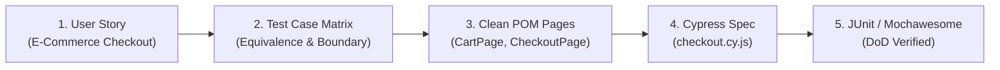

# 🌲 Cypress JavaScript Reference Suite (Clean POM & Synapse Guardrails)

This directory provides a production-grade **Cypress (JavaScript)** reference suite demonstrating the Clean Page Object Model (POM) and Flat Architecture standards enforced by **Synapse Hub**.

---

## 🌟 End-to-End Testing Lifecycle (Story ➔ Test Cases ➔ Script ➔ Report)



### 1. User Story & Acceptance Criteria
- **Story:** *As a customer, I want to review my shopping cart and apply a valid discount coupon so that my total price updates before placing an order.*
- **Acceptance Criteria (AC):**
  - AC1: Cart must show items, quantities, and price breakdown.
  - AC2: Valid coupon code (e.g. `SAVE20`) deducts 20% from subtotal.
  - AC3: Invalid coupon code displays red error toast: *"Mã giảm giá không hợp lệ"*.
  - AC4: Empty cart checkout button must remain disabled.

### 2. Key Architectural Patterns Enforced
- **Zero Raw Selectors in Specs:** `cypress/e2e/checkout.cy.js` calls only semantic methods on `CartPage` and `CheckoutPage`.
- **Resilient ARIA Locators:** Page objects use `cy.findByRole`, `cy.findByLabel`, or scoped semantic CSS.
- **Dynamic Idempotency:** Uses `BasePage.uniqueCode('ORDER_')` for order identifiers.
- **Smart Synchronization:** Replaces static `cy.wait(5000)` with network route assertions and spinner detachment.

---

## 🚀 How to Run & Verify

```bash
# 1. Run Synapse AST Test Linter (Zero-token verification)
npx synapse-hub lint ./cypress/e2e

# 2. Verify 11 Quality Gates DoD
npx synapse-hub verify

# 3. Run Headless Cypress
npm install
npx cypress run --spec "cypress/e2e/checkout.cy.js"
```
