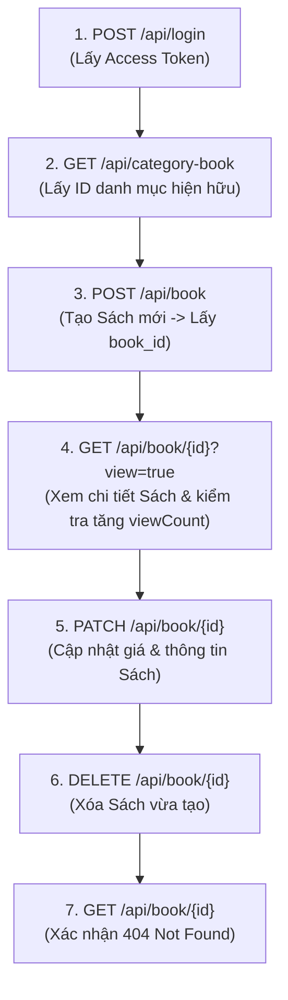

# API Test Cases: Book Management Module

> **Target API:** AnhTester Book Management API (v1.0.0)  
> **Base URL:** `https://book.anhtester.com`  
> **Auth Scheme:** Bearer Token (JWT via `Authorization: Bearer <accessToken>`)  
> **Source Spec:** `https://book.anhtester.com/swagger/json`  
> **Tag / Module:** `Book Management`  
> **Tiêu chuẩn:** ISO/IEC/IEEE 29119-3 (Bảng chuẩn 12 cột)  
> **Quy chuẩn áp dụng:** ISO/IEC/IEEE 29119, OWASP API Security Top 10, Equivalence Partitioning (EP), Boundary Value Analysis (BVA), `api_rules.md`.

---

## 📋 Endpoint Catalog (Module Book Management)

| # | HTTP Method | Path | Description | Security | Total Test Cases |
|---|---|---|---|---|---|
| 1 | `GET` | `/api/book` | Danh sách sách (Phân trang, Search, Sort, Filter) | Public / Optional | 12 |
| 2 | `POST` | `/api/book` | Tạo sách mới | Bearer Auth | 20 |
| 3 | `GET` | `/api/book/{id}` | Chi tiết sách theo ID (Hỗ trợ tăng `viewCount`) | Public / Optional | 7 |
| 4 | `PATCH` | `/api/book/{id}` | Cập nhật thông tin sách theo ID | Bearer Auth | 13 |
| 5 | `DELETE` | `/api/book/{id}` | Xóa sách theo ID | Bearer Auth | 6 |
| **Tổng** | | | | | **58 Test Cases** |

---

## 🔍 Test Cases Chi Tiết Theo Endpoint

### 1. `GET /api/book` — Danh Sách Sách (Pagination, Search, Sorting)

| Case ID | REQ_ID | Module / Screen | Test Title & Objective | Pre-Condition | Test Steps (1-1) | Test Data | Expected Result | Priority / Severity | Risk Score (RPN) | Automatable / Type | Automation Tags |
|:---|:---|:---|:---|:---|:---|:---|:---|:---|:---|:---|:---|
| TC_BOOK_GET_001 | REQ-BOOK-GET-01 | Book API - GET List | Lấy danh sách sách mặc định (Default Pagination) | Dịch vụ Book API hoạt động; CSDL có sẵn ít nhất 10 bản ghi sách | 1. Gửi HTTP GET request tới `/api/book` không kèm query params 2. Kiểm tra status code và response body schema | Header: `Accept: application/json` | HTTP 200 OK Body chứa: `list` (mảng <= 10 items), `pagination` (`total` >= 10, `totalPage` >= 1, `currentPage`: 1, `lengthData` <= 10) | High | 16 | Yes / API | @API, @Smoke, @Regression, @P0 |
| TC_BOOK_GET_002 | REQ-BOOK-GET-02 | Book API - GET List | Phân trang danh sách với tham số page=2&limit=5 | CSDL có sẵn ít nhất 10 bản ghi sách | 1. Gửi HTTP GET request tới `/api/book?page=2&limit=5` 2. Kiểm tra status code và phân trang trả về | Query: `page=2&limit=5` | HTTP 200 OK Body trả về đúng: `currentPage` = 2, `lengthData` <= 5 items | High | 16 | Yes / API | @API, @Regression, @Pagination |
| TC_BOOK_GET_003 | REQ-BOOK-GET-03 | Book API - GET List | Tìm kiếm sách theo từ khóa tên hay mô tả (Search keyword) | CSDL có ít nhất 1 cuốn sách chứa chuỗi 'Clean Code' | 1. Gửi HTTP GET request tới `/api/book?search=Clean+Code` 2. Kiểm tra danh sách sách trả về | Query: `search=Clean Code` | HTTP 200 OK Tất cả sách trong `list` có thuộc tính `name` hay `description` chứa chuỗi 'Clean Code' | High | 16 | Yes / API | @API, @Regression, @Search |
| TC_BOOK_GET_004 | REQ-BOOK-GET-04 | Book API - GET List | Tìm kiếm với từ khóa không tồn tại trong hệ thống | Dịch vụ Book API sẵn sàng; từ khóa search không trùng sách nào | 1. Gửi HTTP GET request tới `/api/book?search=non_existent_book_999` 2. Kiểm tra danh sách trả về | Query: `search=non_existent_book_999` | HTTP 200 OK Body trả về `list` rỗng: `[]`, `pagination.total`: 0, `lengthData`: 0 | Medium | 8 | Yes / API | @API, @Regression, @Negative |
| TC_BOOK_GET_005 | REQ-BOOK-GET-05 | Book API - GET List | Sắp xếp danh sách sách theo giá (price) tăng dần | CSDL có nhiều sách với các mức giá khác nhau | 1. Gửi HTTP GET request tới `/api/book?sort=price&sortBy=asc` 2. Kiểm tra thứ tự giá các item trong mảng list | Query: `sort=price&sortBy=asc` | HTTP 200 OK Mảng `list` có giá trị `price` tăng dần đơn điệu từ nhỏ tới lớn | Medium | 8 | Yes / API | @API, @Regression, @Sorting |
| TC_BOOK_GET_006 | REQ-BOOK-GET-06 | Book API - GET List | Sắp xếp danh sách sách theo lượt xem (viewCount) giảm dần | CSDL có các cuốn sách với viewCount khác nhau | 1. Gửi HTTP GET request tới `/api/book?sort=viewCount&sortBy=desc` 2. Kiểm tra thứ tự viewCount | Query: `sort=viewCount&sortBy=desc` | HTTP 200 OK Mảng `list` có thuộc tính `viewCount` giảm dần đơn điệu | Medium | 8 | Yes / API | @API, @Regression, @Sorting |
| TC_BOOK_GET_007 | REQ-BOOK-GET-07 | Book API - GET List | Sắp xếp mặc định theo thời gian cập nhật (updatedAt) mới nhất | CSDL có các cuốn sách cập nhật ở các thời điểm khác nhau | 1. Gửi HTTP GET request tới `/api/book?sort=updatedAt&sortBy=desc` 2. Kiểm tra thứ tự updatedAt | Query: `sort=updatedAt&sortBy=desc` | HTTP 200 OK Mảng `list` có sách được cập nhật mới nhất nằm ở đầu danh sách | Medium | 8 | Yes / API | @API, @Regression, @Sorting |
| TC_BOOK_GET_008 | REQ-BOOK-GET-08 | Book API - GET List | Boundary - Số trang page=99999 vượt quá tổng số trang hiện có | Tổng số trang hiện tại trong CSDL nhỏ hơn 99999 | 1. Gửi HTTP GET request tới `/api/book?page=99999` 2. Kiểm tra phân trang và danh sách phản hồi | Query: `page=99999` | HTTP 200 OK Body trả về `list` rỗng: `[]`, `currentPage`: 99999, không xảy ra lỗi crash 500 | Medium | 8 | Yes / API | @API, @Regression, @Boundary |
| TC_BOOK_GET_009 | REQ-BOOK-GET-09 | Book API - GET List | Negative - Tham số sort truyền trường không hỗ trợ | Hệ thống Book API sẵn sàng | 1. Gửi HTTP GET request tới `/api/book?sort=invalid_column` 2. Kiểm tra mã lỗi trả về | Query: `sort=invalid_column` | HTTP 400 Bad Request Body chứa thông báo lỗi trường sắp xếp không được hỗ trợ | Low | 4 | Yes / API | @API, @Regression, @Negative |
| TC_BOOK_GET_010 | REQ-BOOK-GET-10 | Book API - GET List | Security - XSS Payload trong query param search | Hệ thống Book API sẵn sàng | 1. Gửi HTTP GET request tới `/api/book?search=%3Cscript%3Ealert(1)%3C/script%3E` 2. Kiểm tra response body và header Content-Type | Query: `search=` | HTTP 200 OK Body được sanitized an toàn chống xss injection, kết quả list rỗng, không có lỗi 500 | High | 24 | Yes / API | @API, @Security, @XSS, @Injection |
| TC_BOOK_GET_011 | REQ-BOOK-GET-11 | Book API - GET List | Rate Limiting & Concurrency - Gửi liên tiếp 100 requests trong 1 giây | Client có kết nối mạng tới Book API server | 1. Khởi tạo vòng lặp gửi 100 HTTP GET requests tới `/api/book` trong 1 giây 2. Ghi nhận mã HTTP phản hồi và header X-RateLimit | 100 GET requests lặp liên tục trong < 1000ms | HTTP 429 Too Many Requests khi vượt ngưỡng quota, header X-RateLimit-Remaining giảm dần, đảm bảo resilience, không bị 504 timeout | High | 24 | Yes / API | @API, @Security, @RateLimit, @Resilience |
| TC_BOOK_GET_012 | REQ-BOOK-GET-12 | Book API - GET List | Protocol - Content Negotiation với Header Accept: application/xml | Hệ thống Book API sẵn sàng | 1. Gửi HTTP GET request tới `/api/book` kèm Header `Accept: application/xml` 2. Kiểm tra status code và định dạng response | Header: `Accept: application/xml` | HTTP 406 Not Acceptable (hệ thống từ chối định dạng XML, chỉ chấp nhận application/json) | Low | 4 | Yes / API | @API, @Regression, @Protocol |

---

### 2. `POST /api/book` — Tạo Sách Mới

| Case ID | REQ_ID | Module / Screen | Test Title & Objective | Pre-Condition | Test Steps (1-1) | Test Data | Expected Result | Priority / Severity | Risk Score (RPN) | Automatable / Type | Automation Tags |
|:---|:---|:---|:---|:---|:---|:---|:---|:---|:---|:---|:---|
| TC_BOOK_POST_001 | REQ-BOOK-POST-01 | Book API - POST Create | Happy Path — Tạo sách đầy đủ tất cả thuộc tính schema | Bearer Token Admin hợp chuẩn đã sinh; Danh mục 'Category_ID_1' tồn tại trong CSDL | 1. Chuẩn bị request body đầy đủ các trường 2. Gửi HTTP POST tới `/api/book` kèm Header Authorization 3. Kiểm tra status và body tạo thành công | Header: `Authorization: Bearer <valid_token>` Body: `{"name": "Clean Code Java", "slug": "clean-code-java", "description": "Sách hướng dẫn", "status": "AVAILABLE", "categories": ["Category_ID_1"], "price": 150000, "pictures": ["https://img.com/book.jpg"]}` | HTTP 201 Created Body trả về: `{"msg": "Book created successfully"}` kèm ID sách mới | Critical | 24 | Yes / API | @API, @Smoke, @Regression, @P0 |
| TC_BOOK_POST_002 | REQ-BOOK-POST-02 | Book API - POST Create | Happy Path — Tạo sách chỉ có các trường bắt buộc (name, status, categories, price) | Bearer Token Admin hợp chuẩn đã sinh; Danh mục 'Category_ID_1' tồn tại | 1. Chuẩn bị body chỉ gồm 4 trường bắt buộc 2. Gửi HTTP POST tới `/api/book` kèm Bearer Token 3. Kiểm tra status code 201 | Header: `Authorization: Bearer <valid_token>` Body: `{"name": "Refactoring", "status": "AVAILABLE", "categories": ["Category_ID_1"], "price": 120000}` | HTTP 201 Created Bản ghi sách được tạo với các trường tùy chọn mang giá trị mặc định | High | 16 | Yes / API | @API, @Smoke, @Regression |
| TC_BOOK_POST_003 | REQ-BOOK-POST-03 | Book API - POST Create | Negative — Auth: Không gửi Bearer Token xác thực | Không truyền Header Authorization | 1. Chuẩn bị body hợp thức 2. Gửi HTTP POST tới `/api/book` không có Header Authorization 3. Kiểm tra mã lỗi xác thực | Header: Không có `Authorization` Body: `{"name": "No Auth Book", "status": "AVAILABLE", "categories": ["Cat1"], "price": 50000}` | HTTP 401 Unauthorized Bảo mật xác thực broken auth, từ chối tạo sách khi thiếu token, không rò rỉ mã lỗi 500 | Critical | 24 | Yes / API | @API, @Security, @BrokenAuth |
| TC_BOOK_POST_004 | REQ-BOOK-POST-04 | Book API - POST Create | Negative — Auth: Token sai cấu trúc hay hết hạn sử dụng | Header Authorization chứa token sai | 1. Gửi HTTP POST tới `/api/book` với token giả mạo `invalid_token` 2. Kiểm tra phản hồi xác thực | Header: `Authorization: Bearer invalid_token_xyz` Body: `{"name": "Fake Token Book", "status": "AVAILABLE", "categories": ["Cat1"], "price": 50000}` | HTTP 401 Unauthorized Từ chối token giả mạo, phòng chống tấn công brute và giả mạo token | Critical | 24 | Yes / API | @API, @Security, @BrokenAuth |
| TC_BOOK_POST_005 | REQ-BOOK-POST-05 | Book API - POST Create | Field Validation — Thiếu trường bắt buộc name | Bearer Token Admin hợp chuẩn đã sinh | 1. Chuẩn bị body thiếu trường `name` 2. Gửi HTTP POST tới `/api/book` 3. Kiểm tra lỗi schema | Header: `Authorization: Bearer <valid_token>` Body: `{"status": "AVAILABLE", "categories": ["Cat1"], "price": 50000}` | HTTP 400 Bad Request Thông báo lỗi trường name là bắt buộc | High | 16 | Yes / API | @API, @Regression, @Negative |
| TC_BOOK_POST_006 | REQ-BOOK-POST-06 | Book API - POST Create | Field Validation — Trường name là chuỗi rỗng hay chỉ có khoảng trắng | Bearer Token Admin hợp chuẩn đã sinh | 1. Chuẩn bị body với `name` là `"   "` 2. Gửi HTTP POST tới `/api/book` 3. Kiểm tra phản hồi | Header: `Authorization: Bearer <valid_token>` Body: `{"name": "   ", "status": "AVAILABLE", "categories": ["Cat1"], "price": 50000}` | HTTP 400 Bad Request Chặn chuỗi tên rỗng | Medium | 8 | Yes / API | @API, @Regression, @Boundary |
| TC_BOOK_POST_007 | REQ-BOOK-POST-07 | Book API - POST Create | Field Validation — Thiếu trường bắt buộc categories | Bearer Token Admin hợp chuẩn đã sinh | 1. Chuẩn bị body không có trường `categories` 2. Gửi HTTP POST tới `/api/book` 3. Kiểm tra phản hồi lỗi | Header: `Authorization: Bearer <valid_token>` Body: `{"name": "Book No Cat", "status": "AVAILABLE", "price": 50000}` | HTTP 400 Bad Request Báo lỗi thiếu trường danh mục | High | 16 | Yes / API | @API, @Regression, @Negative |
| TC_BOOK_POST_008 | REQ-BOOK-POST-08 | Book API - POST Create | Field Validation — Mảng categories rỗng vi phạm minItems: 1 | Bearer Token Admin hợp chuẩn đã sinh | 1. Chuẩn bị body với `categories: []` 2. Gửi HTTP POST tới `/api/book` 3. Kiểm tra phản hồi ràng buộc minItems | Header: `Authorization: Bearer <valid_token>` Body: `{"name": "Book Empty Cat", "status": "AVAILABLE", "categories": [], "price": 50000}` | HTTP 400 Bad Request Lỗi danh mục phải chứa tối thiểu 1 phần tử | High | 16 | Yes / API | @API, @Regression, @Boundary |
| TC_BOOK_POST_009 | REQ-BOOK-POST-09 | Book API - POST Create | Field Validation — Thiếu trường bắt buộc price | Bearer Token Admin hợp chuẩn đã sinh | 1. Chuẩn bị body không truyền trường `price` 2. Gửi HTTP POST tới `/api/book` 3. Kiểm tra mã lỗi | Header: `Authorization: Bearer <valid_token>` Body: `{"name": "Book No Price", "status": "AVAILABLE", "categories": ["Cat1"]}` | HTTP 400 Bad Request Báo lỗi giá tiền là bắt buộc | High | 16 | Yes / API | @API, @Regression, @Negative |
| TC_BOOK_POST_010 | REQ-BOOK-POST-10 | Book API - POST Create | Field Validation — Giá tiền là số âm (price: -100) | Bearer Token Admin hợp chuẩn đã sinh | 1. Chuẩn bị body với `price: -100` 2. Gửi HTTP POST tới `/api/book` 3. Kiểm tra chặn giá trị âm | Header: `Authorization: Bearer <valid_token>` Body: `{"name": "Book Negative Price", "status": "AVAILABLE", "categories": ["Cat1"], "price": -100}` | HTTP 400 Bad Request Chặn giá trị tiền âm | High | 16 | Yes / API | @API, @Regression, @Boundary |
| TC_BOOK_POST_011 | REQ-BOOK-POST-11 | Book API - POST Create | Field Validation — Giá tiền vượt ngưỡng cực đại (price: 999999999999999) | Bearer Token Admin hợp chuẩn đã sinh | 1. Chuẩn bị body với `price: 999999999999999` 2. Gửi HTTP POST tới `/api/book` 3. Kiểm tra phản hồi | Header: `Authorization: Bearer <valid_token>` Body: `{"name": "Over Price", "status": "AVAILABLE", "categories": ["Cat1"], "price": 999999999999999}` | HTTP 400 Bad Request (vượt ngưỡng tối đa 9000000000000) | Medium | 8 | Yes / API | @API, @Regression, @Boundary |
| TC_BOOK_POST_012 | REQ-BOOK-POST-12 | Book API - POST Create | Enum Validation — Giá trị status nằm ngoài danh mục enum cho phép | Bearer Token Admin hợp chuẩn đã sinh | 1. Chuẩn bị body với `status: "PENDING"` (ngoài enum AVAILABLE/UNAVAILABLE) 2. Gửi HTTP POST tới `/api/book` 3. Kiểm tra xác thực enum | Header: `Authorization: Bearer <valid_token>` Body: `{"name": "Invalid Status", "status": "PENDING", "categories": ["Cat1"], "price": 50000}` | HTTP 400 Bad Request Báo lỗi giá trị status không thuộc enum cho phép | High | 16 | Yes / API | @API, @Regression, @Negative |
| TC_BOOK_POST_013 | REQ-BOOK-POST-13 | Book API - POST Create | Security — SQL Injection trong thuộc tính name khi tạo sách | Bearer Token Admin hợp chuẩn đã sinh | 1. Chuẩn bị body có tên chứa SQL payload 2. Gửi HTTP POST tới `/api/book` 3. Kiểm tra tính toàn vẹn CSDL | Header: `Authorization: Bearer <valid_token>` Body: `{"name": "' OR 1=1; DROP TABLE books;--", "status": "AVAILABLE", "categories": ["Cat1"], "price": 50000}` | HTTP 201 Created (chuỗi được tham số hóa an toàn chống sqli injection, CSDL không bị drop bảng, không phát sinh lỗi 500) | Critical | 24 | Yes / API | @API, @Security, @SQLi, @Injection |
| TC_BOOK_POST_014 | REQ-BOOK-POST-14 | Book API - POST Create | Security — XSS Payload trong trường description | Bearer Token Admin hợp chuẩn đã sinh | 1. Chuẩn bị body chứa mã script XSS trong `description` 2. Gửi HTTP POST tới `/api/book` 3. Kiểm tra lưu trữ an toàn | Header: `Authorization: Bearer <valid_token>` Body: `{"name": "XSS Book", "description": "<svg onload=alert(1)>", "status": "AVAILABLE", "categories": ["Cat1"], "price": 50000}` | HTTP 201 Created (nội dung được sanitized an toàn chống xss injection, không lưu mã độc nguy hại) | Critical | 24 | Yes / API | @API, @Security, @XSS, @Injection |
| TC_BOOK_POST_015 | REQ-BOOK-POST-15 | Book API - POST Create | Security — Mass Assignment (Cố tình gán id, viewCount, createdAt) | Bearer Token Admin hợp chuẩn đã sinh | 1. Chuẩn bị body chứa các thuộc tính nội bộ hệ thống 2. Gửi HTTP POST tới `/api/book` 3. Kiểm tra bản ghi sinh ra | Header: `Authorization: Bearer <valid_token>` Body: `{"name": "Hack Book", "status": "AVAILABLE", "categories": ["Cat1"], "price": 50000, "viewCount": 999999, "id": "custom_id"}` | HTTP 201 Created (hệ thống tự sinh ID mới, lọc bỏ thuộc tính mass assignment không phép) | Critical | 24 | Yes / API | @API, @Security, @MassAssignment |
| TC_BOOK_POST_016 | REQ-BOOK-POST-16 | Book API - POST Create | Protocol — Sai Header Content-Type (text/plain thay vì application/json) | Bearer Token Admin hợp chuẩn đã sinh | 1. Gửi HTTP POST tới `/api/book` với Header `Content-Type: text/plain` 2. Kiểm tra phản hồi mã giao thức | Header: `Content-Type: text/plain` Body: `{"name": "Plain Text Book", "status": "AVAILABLE", "categories": ["Cat1"], "price": 50000}` | HTTP 415 Unsupported Media Type (yêu cầu Content-Type application/json) | Low | 4 | Yes / API | @API, @Regression, @Protocol |
| TC_BOOK_POST_017 | REQ-BOOK-POST-17 | Book API - POST Create | Syntax Validation — Malformed JSON cú pháp bị lỗi | Bearer Token Admin hợp chuẩn đã sinh | 1. Gửi HTTP POST tới `/api/book` với payload JSON lỗi cú pháp 2. Kiểm tra bắt lỗi JSON Parser | Header: `Authorization: Bearer <valid_token>` Body: `{"name": "Test Book", "price": }` | HTTP 400 Bad Request Body chứa thông báo lỗi phân tích cú pháp JSON Parse Error | Medium | 8 | Yes / API | @API, @Regression, @Negative |
| TC_BOOK_POST_018 | REQ-BOOK-POST-18 | Book API - POST Create | System Limits — Oversized Payload dung lượng request body > 10MB | Bearer Token Admin hợp chuẩn đã sinh | 1. Tạo chuỗi ký tự dung lượng 15MB trong trường description 2. Gửi HTTP POST tới `/api/book` 3. Kiểm tra kiểm soát dung lượng | Header: `Authorization: Bearer <valid_token>` Body: JSON chứa chuỗi 15MB | HTTP 413 Payload Too Large Hệ thống từ chối nhận payload vượt ngưỡng, ngăn ngừa cạn kiệt bộ nhớ timeout và lỗi 502 | Medium | 8 | Yes / API | @API, @Security, @StressTest |
| TC_BOOK_POST_019 | REQ-BOOK-POST-19 | Book API - POST Create | Concurrency & Race Condition — 2 Request POST tạo trùng tên sách cùng thời điểm | Bearer Token Admin hợp chuẩn đã sinh | 1. Khởi tạo 2 luồng song song gửi cùng 1 tên sách tới `/api/book` cùng thời điểm <50ms 2. Kiểm tra tính đơn nhất | 2 Parallel threads gửi cùng tên sách: `"Unique Concurrency Book"` | 1 Request trả về HTTP 201 Created và 1 Request trả về HTTP 409 Conflict, xử lý concurrency an toàn không race condition | Critical | 24 | Yes / API | @API, @Concurrency, @RaceCondition |
| TC_BOOK_POST_020 | REQ-BOOK-POST-20 | Book API - POST Create | Foreign Key Integrity — Truyền ID danh mục không tồn tại trong hệ thống | Bearer Token Admin hợp chuẩn đã sinh; ID danh mục không có trong CSDL | 1. Chuẩn bị body với `categories: ["non_existent_cat_999"]` 2. Gửi HTTP POST tới `/api/book` 3. Kiểm tra ràng buộc khóa ngoại | Header: `Authorization: Bearer <valid_token>` Body: `{"name": "Invalid Cat", "status": "AVAILABLE", "categories": ["non_existent_cat_999"], "price": 50000}` | HTTP 404 Not Found Thông báo lỗi danh mục liên kết không tồn tại | High | 16 | Yes / API | @API, @Regression, @DataIntegrity |

---

### 3. `GET /api/book/{id}` — Chi Tiết Sách Theo ID

| Case ID | REQ_ID | Module / Screen | Test Title & Objective | Pre-Condition | Test Steps (1-1) | Test Data | Expected Result | Priority / Severity | Risk Score (RPN) | Automatable / Type | Automation Tags |
|:---|:---|:---|:---|:---|:---|:---|:---|:---|:---|:---|:---|
| TC_BOOK_GET_ID_001 | REQ-BOOK-GET-ID-01 | Book API - GET Detail | Lấy chi tiết sách tồn tại không tăng viewCount (view=false) | Cuốn sách có ID hiện hữu trong CSDL (ví dụ ID: 101) | 1. Gửi HTTP GET request tới `/api/book/101?view=false` 2. So sánh thông tin chi tiết và kiểm tra viewCount giữ nguyên | Path: `id=101` Query: `view=false` | HTTP 200 OK Body chứa đầy đủ các thuộc tính của sách; `viewCount` giữ nguyên không thay đổi | High | 16 | Yes / API | @API, @Smoke, @Regression, @P0 |
| TC_BOOK_GET_ID_002 | REQ-BOOK-GET-ID-02 | Book API - GET Detail | Lấy chi tiết sách kèm tăng lượt xem (view=true) | Cuốn sách có ID hiện hữu trong CSDL với viewCount = N | 1. Ghi nhận viewCount ban đầu 2. Gửi HTTP GET request tới `/api/book/101?view=true` 3. Kiểm tra viewCount mới | Path: `id=101` Query: `view=true` | HTTP 200 OK Giá trị `viewCount` mới = `viewCount` cũ + 1 | High | 16 | Yes / API | @API, @Regression, @StateChange |
| TC_BOOK_GET_ID_003 | REQ-BOOK-GET-ID-03 | Book API - GET Detail | Schema Validation — Response khớp cấu trúc đặc tả OpenAPI | Cuốn sách có ID hiện hữu trong CSDL | 1. Gửi HTTP GET tới `/api/book/{id}` 2. Đối soát JSON Schema với định nghĩa Swagger | Path: `id`: ID sách hiện hữu | HTTP 200 OK Tất cả các trường bắt buộc (`id`, `name`, `price`, `status`, `categories`) hiện diện đầy đủ và đúng kiểu dữ liệu | High | 16 | Yes / API | @API, @Regression, @Contract |
| TC_BOOK_GET_ID_004 | REQ-BOOK-GET-ID-04 | Book API - GET Detail | Negative — Truy vấn chi tiết sách với ID không tồn tại | CSDL không chứa bản ghi sách với ID `non_existent_book_id_999` | 1. Gửi HTTP GET request tới `/api/book/non_existent_book_id_999` 2. Kiểm tra status code lỗi | Path: `id=non_existent_book_id_999` | HTTP 404 Not Found Body chứa thông báo lỗi không tìm thấy sách: `{"msg": "Book not found"}` | High | 16 | Yes / API | @API, @Regression, @Negative |
| TC_BOOK_GET_ID_005 | REQ-BOOK-GET-ID-05 | Book API - GET Detail | Boundary — Path param id chứa ký tự đặc biệt nguy hiểm | Hệ thống Book API sẵn sàng | 1. Gửi HTTP GET request tới `/api/book/!@#$%^&*()` 2. Kiểm tra xử lý chuỗi đặc biệt | Path: `id=!@#$%^&*()` | HTTP 400 Bad Request Chặn ký tự đặc biệt nguy hại trong path id, đảm bảo resilience không crash 500 | Medium | 8 | Yes / API | @API, @Regression, @Boundary |
| TC_BOOK_GET_ID_006 | REQ-BOOK-GET-ID-06 | Book API - GET Detail | Security — SQL Injection trong Path parameter id | Hệ thống Book API sẵn sàng | 1. Gửi HTTP GET request tới `/api/book/1'%20OR%20'1'='1` 2. Kiểm tra phản hồi bảo mật | Path: `id=1' OR '1'='1` | HTTP 400 Bad Request Tham số hóa an toàn chống sqli injection, không rò rỉ CSDL, không lỗi 500 | Critical | 24 | Yes / API | @API, @Security, @SQLi, @Injection |
| TC_BOOK_GET_ID_007 | REQ-BOOK-GET-ID-07 | Book API - GET Detail | Security — Sensitive Data Exposure Check trên thông tin sách | Cuốn sách có ID hiện hữu trong CSDL | 1. Gửi HTTP GET request tới `/api/book/{id}` 2. Kiểm tra toàn bộ các trường JSON trả về | Path: `id`: ID sách hiện hữu | HTTP 200 OK Response không làm lộ thông tin nhạy cảm của tác giả, mật khẩu, chống rò rỉ idor và data exposure | Critical | 24 | Yes / API | @API, @Security, @DataExposure |

---

### 4. `PATCH /api/book/{id}` — Cập Nhật Sách Theo ID

| Case ID | REQ_ID | Module / Screen | Test Title & Objective | Pre-Condition | Test Steps (1-1) | Test Data | Expected Result | Priority / Severity | Risk Score (RPN) | Automatable / Type | Automation Tags |
|:---|:---|:---|:---|:---|:---|:---|:---|:---|:---|:---|:---|
| TC_BOOK_PATCH_001 | REQ-BOOK-PATCH-01 | Book API - PATCH Update | Happy Path — Cập nhật tên và giá sách thành công | Bản ghi sách ID hiện hữu trong CSDL; Bearer Token Admin hợp chuẩn đã sinh | 1. Gửi HTTP PATCH request tới `/api/book/{id}` kèm Bearer Token 2. Kiểm tra phản hồi cập nhật thành công | Path: `id` sách hiện hữu Header: `Authorization: Bearer <valid_token>` Body: `{"name": "Clean Code 2nd Edition", "price": 180000}` | HTTP 200 OK Body: `{"msg": "Book updated successfully"}` | Critical | 24 | Yes / API | @API, @Smoke, @Regression, @P0 |
| TC_BOOK_PATCH_002 | REQ-BOOK-PATCH-02 | Book API - PATCH Update | Partial Update Check — Các trường không gửi được giữ nguyên vẹn | Bản ghi sách có sẵn `name`, `price`, `categories` | 1. Gửi HTTP PATCH chỉ cập nhật trường `description` 2. Gửi HTTP GET `/api/book/{id}` để kiểm tra | Path: `id` sách hiện hữu Body: `{"description": "Mô tả mới được cập nhật"}` | HTTP 200 OK Trường `description` cập nhật giá trị mới; các trường `name`, `price`, `categories` giữ nguyên không bị null | High | 16 | Yes / API | @API, @Regression, @PartialUpdate |
| TC_BOOK_PATCH_003 | REQ-BOOK-PATCH-03 | Book API - PATCH Update | State Transition — Đổi trạng thái từ AVAILABLE sang UNAVAILABLE | Bản ghi sách đang ở trạng thái AVAILABLE | 1. Gửi HTTP PATCH cập nhật `status: "UNAVAILABLE"` 2. Kiểm tra trạng thái mới của sách | Body: `{"status": "UNAVAILABLE"}` | HTTP 200 OK Trạng thái chuyển thành UNAVAILABLE thành công | High | 16 | Yes / API | @API, @Regression, @StateTransition |
| TC_BOOK_PATCH_004 | REQ-BOOK-PATCH-04 | Book API - PATCH Update | Negative — Auth: Không gửi Bearer Token khi cập nhật | Không truyền Header Authorization | 1. Gửi HTTP PATCH tới `/api/book/{id}` không có token 2. Kiểm tra từ chối truy cập | Header: Không có `Authorization` Body: `{"price": 99000}` | HTTP 401 Unauthorized Bảo mật auth, từ chối thao tác sửa khi thiếu token xác thực, không lỗi 500 | Critical | 24 | Yes / API | @API, @Security, @BrokenAuth |
| TC_BOOK_PATCH_005 | REQ-BOOK-PATCH-05 | Book API - PATCH Update | Security — BOLA / IDOR: Sửa sách thuộc quyền quản lý của tác giả khác | Token của User A; ID cuốn sách thuộc quyền quản lý của User B | 1. Sử dụng Bearer Token của User A 2. Gửi HTTP PATCH cập nhật sách của User B 3. Kiểm tra phân quyền truy cập | Header: Token của User A Path: ID sách của User B Body: `{"name": "Hacked Title"}` | HTTP 403 Forbidden Hệ thống phòng chống lỗ hổng idor, từ chối sửa tài nguyên của user khác | Critical | 24 | Yes / API | @API, @Security, @IDOR, @BOLA |
| TC_BOOK_PATCH_006 | REQ-BOOK-PATCH-06 | Book API - PATCH Update | Negative — Cập nhật sách với ID không tồn tại | CSDL không chứa sách với ID `invalid_book_id_999` | 1. Gửi HTTP PATCH tới `/api/book/invalid_book_id_999` 2. Kiểm tra mã lỗi | Path: `id=invalid_book_id_999` Body: `{"name": "New Name"}` | HTTP 404 Not Found Thông báo không tìm thấy cuốn sách cần cập nhật | High | 16 | Yes / API | @API, @Regression, @Negative |
| TC_BOOK_PATCH_007 | REQ-BOOK-PATCH-07 | Book API - PATCH Update | Field Validation — Cập nhật giá price thành số âm (-5000) | Bản ghi sách hiện hữu; Bearer Token Admin sẵn sàng | 1. Gửi HTTP PATCH với `price: -5000` 2. Kiểm tra chặn giá tiền âm | Body: `{"price": -5000}` | HTTP 400 Bad Request Chặn cập nhật giá trị tiền âm | High | 16 | Yes / API | @API, @Regression, @Boundary |
| TC_BOOK_PATCH_008 | REQ-BOOK-PATCH-08 | Book API - PATCH Update | Field Validation — Cập nhật status thành giá trị ngoài Enum | Bản ghi sách hiện hữu | 1. Gửi HTTP PATCH với `status: "DISCONTINUED"` 2. Kiểm tra kiểm tra enum | Body: `{"status": "DISCONTINUED"}` | HTTP 400 Bad Request Báo lỗi giá trị enum status không thuộc danh mục cho phép | High | 16 | Yes / API | @API, @Regression, @Negative |
| TC_BOOK_PATCH_009 | REQ-BOOK-PATCH-09 | Book API - PATCH Update | Field Validation — Cập nhật categories thành mảng rỗng vi phạm minItems | Bản ghi sách hiện hữu | 1. Gửi HTTP PATCH với `categories: []` 2. Kiểm tra phản hồi | Body: `{"categories": []}` | HTTP 400 Bad Request (vi phạm ràng buộc minItems: 1) | High | 16 | Yes / API | @API, @Regression, @Boundary |
| TC_BOOK_PATCH_010 | REQ-BOOK-PATCH-10 | Book API - PATCH Update | Boundary — Request body rỗng {} không chứa trường nào | Bản ghi sách hiện hữu; Bearer Token Admin sẵn sàng | 1. Gửi HTTP PATCH với body `{}` 2. Kiểm tra xử lý payload rỗng | Body: `{}` | HTTP 200 OK (hệ thống giữ nguyên dữ liệu gốc khi payload rỗng) | Low | 4 | Yes / API | @API, @Regression, @EdgeCase |
| TC_BOOK_PATCH_011 | REQ-BOOK-PATCH-11 | Book API - PATCH Update | Security — Mass Assignment: Cố tình cập nhật viewCount và createdAt | Bản ghi sách hiện hữu | 1. Gửi HTTP PATCH chứa `viewCount` và `createdAt` 2. Kiểm tra tính toàn vẹn dữ liệu | Body: `{"viewCount": 99999, "createdAt": "2000-01-01T00:00:00Z"}` | HTTP 200 OK (hệ thống bỏ qua không cập nhật viewCount/createdAt, ngăn chặn mass assignment) | Critical | 24 | Yes / API | @API, @Security, @MassAssignment |
| TC_BOOK_PATCH_012 | REQ-BOOK-PATCH-12 | Book API - PATCH Update | Protocol — Header Content-Type Mismatch (text/plain) | Bản ghi sách hiện hữu | 1. Gửi HTTP PATCH với Header `Content-Type: text/plain` 2. Kiểm tra từ chối định dạng | Header: `Content-Type: text/plain` Body: `{"name": "New Name"}` | HTTP 415 Unsupported Media Type (yêu cầu Content-Type application/json) | Low | 4 | Yes / API | @API, @Regression, @Protocol |
| TC_BOOK_PATCH_013 | REQ-BOOK-PATCH-13 | Book API - PATCH Update | Data Integrity — Cập nhật categories chứa ID danh mục không tồn tại | Bản ghi sách hiện hữu; ID danh mục không có trong CSDL | 1. Gửi HTTP PATCH với danh mục giả mạo 2. Kiểm tra toàn vẹn khóa ngoại | Body: `{"categories": ["fake_cat_id_999"]}` | HTTP 404 Not Found Báo lỗi danh mục liên kết không tồn tại | High | 16 | Yes / API | @API, @Regression, @DataIntegrity |

---

### 5. `DELETE /api/book/{id}` — Xóa Sách Theo ID

| Case ID | REQ_ID | Module / Screen | Test Title & Objective | Pre-Condition | Test Steps (1-1) | Test Data | Expected Result | Priority / Severity | Risk Score (RPN) | Automatable / Type | Automation Tags |
|:---|:---|:---|:---|:---|:---|:---|:---|:---|:---|:---|:---|
| TC_BOOK_DELETE_001 | REQ-BOOK-DEL-01 | Book API - DELETE | Happy Path — Xóa cuốn sách đang tồn tại thành công | Cuốn sách vừa tạo tồn tại trong CSDL; Bearer Token Admin hợp chuẩn đã sinh | 1. Gửi HTTP DELETE request tới `/api/book/{id}` kèm Bearer Token 2. Kiểm tra status code xóa thành công | Path: `id` cuốn sách vừa tạo Header: `Authorization: Bearer <valid_token>` | HTTP 200 OK Body: `{"msg": "Book deleted successfully"}` | Critical | 24 | Yes / API | @API, @Smoke, @Regression, @P0 |
| TC_BOOK_DELETE_002 | REQ-BOOK-DEL-02 | Book API - DELETE | State Verification — Gọi GET lại cuốn sách sau khi đã DELETE | Cuốn sách vừa bị xóa thành công ở bước trước | 1. Gửi HTTP GET request tới `/api/book/{id}` với ID cuốn sách vừa bị xóa 2. Kiểm tra phản hồi 404 | Path: `id` cuốn sách đã bị xóa | HTTP 404 Not Found Xác nhận bản ghi sách đã biến mất khỏi hệ thống | High | 16 | Yes / API | @API, @Regression, @StateVerification |
| TC_BOOK_DELETE_003 | REQ-BOOK-DEL-03 | Book API - DELETE | Security — BOLA / IDOR: Xóa sách thuộc sở hữu của người dùng khác | Token của User A; ID cuốn sách thuộc quyền quản lý của User B | 1. Dùng Bearer Token User A gửi HTTP DELETE tới sách của User B 2. Kiểm tra phân quyền truy cập | Header: Token User A Path: ID sách của User B | HTTP 403 Forbidden Phòng chống lỗ hổng idor, từ chối xóa tài nguyên của người dùng khác | Critical | 24 | Yes / API | @API, @Security, @IDOR, @BOLA |
| TC_BOOK_DELETE_004 | REQ-BOOK-DEL-04 | Book API - DELETE | Negative — Auth: Không gửi Bearer Token khi thực hiện DELETE | Không truyền Header Authorization | 1. Gửi HTTP DELETE tới `/api/book/{id}` không có token 2. Kiểm tra mã lỗi xác thực | Header: Không có `Authorization` Path: ID sách | HTTP 401 Unauthorized Từ chối thao tác xóa khi chưa có token xác thực, bảo mật broken auth | Critical | 24 | Yes / API | @API, @Security, @BrokenAuth |
| TC_BOOK_DELETE_005 | REQ-BOOK-DEL-05 | Book API - DELETE | Negative — Xóa sách với ID không tồn tại trong hệ thống | CSDL không chứa cuốn sách với ID `deleted_or_fake_book_id_999` | 1. Gửi HTTP DELETE request tới `/api/book/deleted_or_fake_book_id_999` 2. Kiểm tra mã lỗi | Path: `id=deleted_or_fake_book_id_999` | HTTP 404 Not Found Thông báo cuốn sách cần xóa không tồn tại | High | 16 | Yes / API | @API, @Regression, @Negative |
| TC_BOOK_DELETE_006 | REQ-BOOK-DEL-06 | Book API - DELETE | Idempotency Check — Thực hiện DELETE lặp lại cùng 1 Book ID 2 lần liên tiếp | Cuốn sách tồn tại; Bearer Token Admin sẵn sàng | 1. Gửi HTTP DELETE lần 1 → nhận 200 OK 2. Gửi ngay HTTP DELETE lần 2 với cùng ID đó | Path: `id` cuốn sách | Lần 1: HTTP 200 OK Lần 2: HTTP 404 Not Found Đảm bảo tính idempotency và atomicity, không gây lỗi 500 | High | 16 | Yes / API | @API, @Regression, @Idempotency |

---

## 🔄 Dependencies & Execution Order (Chuỗi Phụ Thuộc)

---

## 📊 Test Data Matrix cho Module Book Management

| Field | Dữ liệu chuẩn | Dữ liệu sai định dạng | Dữ liệu biên (Boundary) | Security & Protocol Payload |
|---|---|---|---|---|
| `name` | `"Clean Code Java"` | `""` (rỗng), `"   "` (khoảng trắng) | 1 ký tự, 255 ký tự | `""`, `' OR 1=1--` |
| `description` | `"Sách hướng dẫn lập trình chuyên nghiệp"` | — | Văn bản dài (10,000 ký tự) | `"<svg onload=alert(1)>"` |
| `categories` | `["cat_id_123"]` | `[]` (mảng rỗng), `"not_an_array"` | `["non_existent_id"]` | — |
| `price` | `150000` | `-100` (số âm), `"abc"` (chuỗi) | `0`, `9000000000000` (cực đại) | `999999999999999` (vượt ngưỡng max) |
| `status` | `"AVAILABLE"`, `"UNAVAILABLE"` | `"PENDING"`, `"INVALID"` | Phân biệt chữ hoa thường: `"available"` | — |
| `pictures` | `["https://img.com/b.jpg"]` | `["not_a_valid_url"]` | `[]` | `"javascript:alert(1)"` |
| `Headers` | `Content-Type: application/json` | `Content-Type: text/plain` | `Accept: application/xml` | Thiếu Auth Token / Token giả mạo |

---

## Ambiguity & Assumptions Log

| ID | Requirement Reference / Statement | Ambiguity / Gap Detected | Working Assumption / Resolution | Impact / Risk |
|:---|:---|:---|:---|:---|
| AMB-BOOK-01 | GET /api/book default sort order | OpenAPI spec không ghi rõ trường sắp xếp mặc định | Giả định sắp xếp theo `updatedAt` giảm dần (TC_BOOK_GET_007) | Medium |
| AMB-BOOK-02 | POST /api/book price max length | Không có rule về giới hạn giá tối đa trong schema | Giả định max price là 9000000000000 (BigInt) (TC_BOOK_POST_011) | Low |
| AMB-BOOK-03 | PATCH /api/book partial fields | Chưa định nghĩa rõ PUT hay PATCH cho cập nhật sách | Giả định hỗ trợ PATCH partial update, các trường vắng mặt giữ nguyên (TC_BOOK_PATCH_002) | High |
| AMB-BOOK-04 | DELETE /api/book cascade behavior | Chưa ghi rõ có soft delete hay hard delete | Giả định xóa bản ghi khỏi DB; truy vấn GET sau đó trả về 404 (TC_BOOK_DELETE_002) | High |
| AMB-BOOK-05 | Rate Limit threshold | Spec không công bố ngưỡng rate limiting cụ thể | Giả định ngưỡng 100 requests/giây sẽ kích hoạt 429 Too Many Requests (TC_BOOK_GET_011) | Medium |
| AMB-BOOK-06 | Concurrency duplicate book creation | Hành vi khi tạo 2 cuốn sách cùng tên cùng lúc | Giả định hệ thống chấp nhận 1 request (201) và từ chối request trùng thứ hai với 409 Conflict (TC_BOOK_POST_019) | High |
| AMB-BOOK-07 | IDOR authorization for book modification | Chưa rõ quyền hạn của User thường đối với tài nguyên sách | Giả định chỉ admin hay chính tác giả tạo sách mới có quyền PATCH/DELETE (TC_BOOK_PATCH_005, TC_BOOK_DELETE_003) | High |
