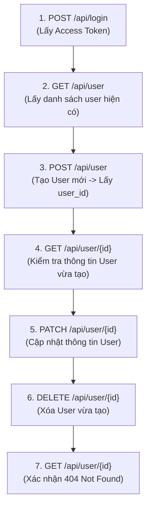

# API Test Cases: User Management Module (Comprehensive Suite)

> **Target API:** AnhTester Book Management API (v1.0.0)  
> **Base URL:** `http://localhost:8080` (or `https://book.anhtester.com`)  
> **Auth Scheme:** Bearer Token (JWT via `Authorization: Bearer <accessToken>`)  
> **Source Spec:** `https://book.anhtester.com/swagger/json`  
> **Tiêu chuẩn:** ISO/IEC/IEEE 29119-3 (Bảng chuẩn 12 cột)  
> **Quy chuẩn áp dụng:** ISO/IEC/IEEE 29119, OWASP API Security Top 10, Equivalence Partitioning (EP), Boundary Value Analysis (BVA), Error Guessing, `api_rules.md`.

---

## 📋 Endpoint Catalog (Module User Management)

| # | HTTP Method | Path | Description | Security | Total Test Cases |
|---|---|---|---|---|---|
| 1 | `GET` | `/api/user` | Danh sách users (Phân trang, Search, Sort) | Public / Optional | 12 |
| 2 | `POST` | `/api/user` | Tạo người dùng mới | Bearer Auth | 19 |
| 3 | `GET` | `/api/user/{id}` | Xem thông tin chi tiết user theo ID | Public / Optional | 6 |
| 4 | `PATCH` | `/api/user/{id}` | Cập nhật thông tin user theo ID | Bearer Auth | 12 |
| 5 | `DELETE` | `/api/user/{id}` | Xóa user theo ID | Bearer Auth | 5 |
| **Tổng** | | | | | **54 Test Cases** |

---

## 🔍 Test Cases Chi Tiết Theo Endpoint

### 1. `GET /api/user` — Danh sách Users

| Case ID | REQ_ID | Module / Screen | Test Title & Objective | Pre-Condition | Test Steps (1-1) | Test Data | Expected Result | Priority / Severity | Risk Score (RPN) | Automatable / Type | Automation Tags |
|:---|:---|:---|:---|:---|:---|:---|:---|:---|:---|:---|:---|
| TC_USER_GET_001 | REQ-USER-GET-01 | User API - GET List | Lấy danh sách users mặc định (Default Pagination) | Hệ thống User API hoạt động; CSDL có sẵn >= 10 bản ghi user | 1. Gửi HTTP GET request tới `/api/user` không kèm query params 2. Kiểm tra status code và response body schema | Header: `Accept: application/json` | HTTP 200 OK Body chứa: `list` (mảng <= 10 items), `pagination` (`total` >= 10, `totalPage` >= 1, `currentPage`: 1, `lengthData` <= 10) | High | 16 | Yes / API | @API, @Smoke, @Regression, @P0 |
| TC_USER_GET_002 | REQ-USER-GET-02 | User API - GET List | Phân trang danh sách với tham số page=2&limit=5 | CSDL có sẵn ít nhất 10 bản ghi người dùng | 1. Gửi HTTP GET request tới `/api/user?page=2&limit=5` 2. Kiểm tra status code và phân trang trả về | Query: `page=2&limit=5` | HTTP 200 OK Body trả về đúng: `currentPage` = 2, `lengthData` <= 5 items | High | 16 | Yes / API | @API, @Regression, @Pagination |
| TC_USER_GET_003 | REQ-USER-GET-03 | User API - GET List | Tìm kiếm user theo từ khóa tên hay email | CSDL có ít nhất 1 user chứa chuỗi 'AnhTester' trong tên hay email | 1. Gửi HTTP GET request tới `/api/user?search=AnhTester` 2. Kiểm tra danh sách người dùng trả về | Query: `search=AnhTester` | HTTP 200 OK Tất cả users trong `list` có chứa từ khóa 'AnhTester' trong thuộc tính `name` hay `email` | High | 16 | Yes / API | @API, @Regression, @Search |
| TC_USER_GET_004 | REQ-USER-GET-04 | User API - GET List | Tìm kiếm với từ khóa không tồn tại trong hệ thống | Dịch vụ User API sẵn sàng; từ khóa search không trùng user nào | 1. Gửi HTTP GET request tới `/api/user?search=xyz_not_exist_999` 2. Kiểm tra danh sách trả về | Query: `search=xyz_not_exist_999` | HTTP 200 OK Body trả về `list` rỗng: `[]`, `pagination.total`: 0, `lengthData`: 0 | Medium | 8 | Yes / API | @API, @Regression, @Negative |
| TC_USER_GET_005 | REQ-USER-GET-05 | User API - GET List | Sắp xếp danh sách users theo tên tăng dần (A-Z) | CSDL có nhiều users với tên khác nhau | 1. Gửi HTTP GET request tới `/api/user?sort=name&sortBy=asc` 2. Kiểm tra thứ tự sắp xếp thuộc tính name | Query: `sort=name&sortBy=asc` | HTTP 200 OK Mảng `list` có giá trị `name` tăng dần từ A đến Z | Medium | 8 | Yes / API | @API, @Regression, @Sorting |
| TC_USER_GET_006 | REQ-USER-GET-06 | User API - GET List | Sắp xếp danh sách users theo ngày tạo createdAt giảm dần | CSDL có các users tạo ở thời điểm khác nhau | 1. Gửi HTTP GET request tới `/api/user?sort=createdAt&sortBy=desc` 2. Kiểm tra thứ tự createdAt | Query: `sort=createdAt&sortBy=desc` | HTTP 200 OK Mảng `list` sắp xếp theo ngày tạo mới nhất lên đầu danh sách | Medium | 8 | Yes / API | @API, @Regression, @Sorting |
| TC_USER_GET_007 | REQ-USER-GET-07 | User API - GET List | Boundary - Số trang page=99999 vượt quá tổng số trang hiện có | Tổng số trang hiện tại trong CSDL nhỏ hơn 99999 | 1. Gửi HTTP GET request tới `/api/user?page=99999` 2. Kiểm tra phân trang và danh sách phản hồi | Query: `page=99999` | HTTP 200 OK Body trả về `list` rỗng: `[]`, `currentPage`: 99999, không xảy ra lỗi crash 500 | Medium | 8 | Yes / API | @API, @Regression, @Boundary |
| TC_USER_GET_008 | REQ-USER-GET-08 | User API - GET List | Negative - Tham số limit=0 hay số âm | Hệ thống User API sẵn sàng | 1. Gửi HTTP GET request tới `/api/user?limit=-1` 2. Kiểm tra mã lỗi trả về | Query: `limit=-1` | HTTP 400 Bad Request Body thông báo lỗi limit không được nhỏ hơn 1 | Low | 4 | Yes / API | @API, @Regression, @Negative |
| TC_USER_GET_009 | REQ-USER-GET-09 | User API - GET List | Negative - Tham số sort truyền trường không tồn tại trong schema | Hệ thống User API sẵn sàng | 1. Gửi HTTP GET request tới `/api/user?sort=invalid_field` 2. Kiểm tra phản hồi lỗi | Query: `sort=invalid_field` | HTTP 400 Bad Request Body chứa thông báo lỗi trường sắp xếp không được hỗ trợ | Low | 4 | Yes / API | @API, @Regression, @Negative |
| TC_USER_GET_010 | REQ-USER-GET-10 | User API - GET List | Security - XSS Payload trong query param search | Hệ thống User API sẵn sàng | 1. Gửi HTTP GET request tới `/api/user?search=%3Cscript%3Ealert(1)%3C/script%3E` 2. Kiểm tra response body và header Content-Type | Query: `search=` | HTTP 200 OK Body được sanitized an toàn chống xss injection, kết quả list rỗng, không có lỗi 500 | High | 24 | Yes / API | @API, @Security, @XSS, @Injection |
| TC_USER_GET_011 | REQ-USER-GET-11 | User API - GET List | Rate Limiting & Concurrency - Gửi liên tiếp 100 requests trong 1 giây | Client có kết nối mạng tới User API server | 1. Khởi tạo vòng lặp gửi 100 HTTP GET requests tới `/api/user` trong 1 giây 2. Ghi nhận mã HTTP phản hồi và header X-RateLimit | 100 GET requests lặp liên tục trong < 1000ms | HTTP 429 Too Many Requests khi vượt ngưỡng quota, header X-RateLimit-Remaining giảm dần, đảm bảo resilience, không bị 504 timeout | High | 24 | Yes / API | @API, @Security, @RateLimit, @Resilience |
| TC_USER_GET_012 | REQ-USER-GET-12 | User API - GET List | Protocol - Content Negotiation với Header Accept: application/xml | Hệ thống User API sẵn sàng | 1. Gửi HTTP GET request tới `/api/user` kèm Header `Accept: application/xml` 2. Kiểm tra status code và định dạng response | Header: `Accept: application/xml` | HTTP 406 Not Acceptable (hệ thống từ chối định dạng XML, chỉ chấp nhận application/json) | Low | 4 | Yes / API | @API, @Regression, @Protocol |

---

### 2. `POST /api/user` — Tạo User Mới

| Case ID | REQ_ID | Module / Screen | Test Title & Objective | Pre-Condition | Test Steps (1-1) | Test Data | Expected Result | Priority / Severity | Risk Score (RPN) | Automatable / Type | Automation Tags |
|:---|:---|:---|:---|:---|:---|:---|:---|:---|:---|:---|:---|
| TC_USER_POST_001 | REQ-USER-POST-01 | User API - POST Create | Happy Path — Tạo user với đầy đủ các trường thông tin | Bearer Token Admin hợp chuẩn đã sinh | 1. Chuẩn bị request body đầy đủ các trường 2. Gửi HTTP POST tới `/api/user` kèm Header Authorization 3. Kiểm tra status và body tạo thành công | Header: `Authorization: Bearer <valid_token>` Body: `{"name": "Auto User", "email": "auto_user_1712049200@test.com", "password": "<TEST_PASSWORD>", "phone": "0987654321", "address": "Hà Nội", "isActive": true}` | HTTP 201 Created Body: `{"msg": "User created successfully"}` kèm object user mới tạo | Critical | 24 | Yes / API | @API, @Smoke, @Regression, @P0 |
| TC_USER_POST_002 | REQ-USER-POST-02 | User API - POST Create | Happy Path — Tạo user chỉ có required fields (name, email) | Bearer Token Admin hợp chuẩn đã sinh | 1. Chuẩn bị body chỉ gồm name và email 2. Gửi HTTP POST tới `/api/user` kèm Bearer Token 3. Kiểm tra status code 201 | Header: `Authorization: Bearer <valid_token>` Body: `{"name": "Minimal User", "email": "auto_min_1712049200@test.com"}` | HTTP 201 Created Mật khẩu tự động gán giá trị mặc định `<DEFAULT_TEST_PWD>`, các trường tùy chọn mang giá trị null | High | 16 | Yes / API | @API, @Smoke, @Regression |
| TC_USER_POST_003 | REQ-USER-POST-03 | User API - POST Create | Negative — Auth: Không gửi Bearer Token xác thực | Không truyền Header Authorization | 1. Chuẩn bị body hợp thức 2. Gửi HTTP POST tới `/api/user` không có Header Authorization 3. Kiểm tra mã lỗi xác thực | Header: Không có `Authorization` Body: `{"name": "No Auth User", "email": "noauth@test.com"}` | HTTP 401 Unauthorized Bảo mật xác thực broken auth, từ chối tạo user khi thiếu token, không lỗi 500 | Critical | 24 | Yes / API | @API, @Security, @BrokenAuth |
| TC_USER_POST_004 | REQ-USER-POST-04 | User API - POST Create | Negative — Auth: Token sai cấu trúc hay hết hạn sử dụng | Header Authorization chứa token sai | 1. Gửi HTTP POST tới `/api/user` với token giả mạo `invalid_token_123` 2. Kiểm tra phản hồi xác thực | Header: `Authorization: Bearer invalid_token_123` Body: `{"name": "Fake Token User", "email": "faketoken@test.com"}` | HTTP 401 Unauthorized Từ chối token giả mạo, phòng chống tấn công brute và giả mạo token | Critical | 24 | Yes / API | @API, @Security, @BrokenAuth |
| TC_USER_POST_005 | REQ-USER-POST-05 | User API - POST Create | Field Validation — Thiếu trường bắt buộc name | Bearer Token Admin hợp chuẩn đã sinh | 1. Chuẩn bị body thiếu trường `name` 2. Gửi HTTP POST tới `/api/user` 3. Kiểm tra lỗi schema | Header: `Authorization: Bearer <valid_token>` Body: `{"email": "noname@test.com"}` | HTTP 400 Bad Request Thông báo lỗi trường name là bắt buộc | High | 16 | Yes / API | @API, @Regression, @Negative |
| TC_USER_POST_006 | REQ-USER-POST-06 | User API - POST Create | Field Validation — Trường name là chuỗi rỗng hay chỉ có khoảng trắng | Bearer Token Admin hợp chuẩn đã sinh | 1. Chuẩn bị body với `name` là `"   "` 2. Gửi HTTP POST tới `/api/user` 3. Kiểm tra phản hồi | Header: `Authorization: Bearer <valid_token>` Body: `{"name": "   ", "email": "test@test.com"}` | HTTP 400 Bad Request Chặn chuỗi tên rỗng | Medium | 8 | Yes / API | @API, @Regression, @Boundary |
| TC_USER_POST_007 | REQ-USER-POST-07 | User API - POST Create | Field Validation — Thiếu trường bắt buộc email | Bearer Token Admin hợp chuẩn đã sinh | 1. Chuẩn bị body không có trường `email` 2. Gửi HTTP POST tới `/api/user` 3. Kiểm tra phản hồi lỗi | Header: `Authorization: Bearer <valid_token>` Body: `{"name": "No Email"}` | HTTP 400 Bad Request Báo lỗi thiếu trường email | High | 16 | Yes / API | @API, @Regression, @Negative |
| TC_USER_POST_008 | REQ-USER-POST-08 | User API - POST Create | Field Validation — Sai định dạng email (thiếu @ hay tên miền) | Bearer Token Admin hợp chuẩn đã sinh | 1. Chuẩn bị body với email sai định dạng `invalid_email_format` 2. Gửi HTTP POST tới `/api/user` 3. Kiểm tra phản hồi cú pháp email | Header: `Authorization: Bearer <valid_token>` Body: `{"name": "Test", "email": "invalid_email_format"}` | HTTP 400 Bad Request Lỗi định dạng email không đúng chuẩn RFC | High | 16 | Yes / API | @API, @Regression, @Boundary |
| TC_USER_POST_009 | REQ-USER-POST-09 | User API - POST Create | Field Validation — Email trùng lặp với người dùng đã tồn tại | Email đã có sẵn trong CSDL người dùng | 1. Chuẩn bị body với email đã tồn tại trong DB 2. Gửi HTTP POST tới `/api/user` 3. Kiểm tra kiểm tra trùng lặp | Header: `Authorization: Bearer <valid_token>` Body: `{"name": "Duplicate User", "email": "existing_user@test.com"}` | HTTP 409 Conflict Báo lỗi email đã được đăng ký trong hệ thống | High | 16 | Yes / API | @API, @Regression, @DataIntegrity |
| TC_USER_POST_010 | REQ-USER-POST-10 | User API - POST Create | Type Mismatch — Trường isActive gửi sai kiểu dữ liệu (string thay vì boolean) | Bearer Token Admin hợp chuẩn đã sinh | 1. Chuẩn bị body với `isActive: "yes"` (kiểu string) 2. Gửi HTTP POST tới `/api/user` 3. Kiểm tra lỗi type mismatch | Header: `Authorization: Bearer <valid_token>` Body: `{"name": "Test", "email": "valid_email@test.com", "isActive": "yes"}` | HTTP 400 Bad Request Báo lỗi kiểu dữ liệu trường isActive không phải boolean | Medium | 8 | Yes / API | @API, @Regression, @Negative |
| TC_USER_POST_011 | REQ-USER-POST-11 | User API - POST Create | Format Validation — URL ảnh đại diện avatarUrl sai định dạng | Bearer Token Admin hợp chuẩn đã sinh | 1. Chuẩn bị body với `avatarUrl: "not_a_valid_url"` 2. Gửi HTTP POST tới `/api/user` 3. Kiểm tra ràng buộc định dạng URL | Header: `Authorization: Bearer <valid_token>` Body: `{"name": "Test", "email": "valid_avatar@test.com", "avatarUrl": "not_a_valid_url"}` | HTTP 400 Bad Request Báo lỗi định dạng URL ảnh đại diện sai quy chuẩn | Medium | 8 | Yes / API | @API, @Regression, @Boundary |
| TC_USER_POST_012 | REQ-USER-POST-12 | User API - POST Create | Stress & ReDoS Check — Trường password siêu dài (10,000 ký tự) | Bearer Token Admin hợp chuẩn đã sinh | 1. Chuẩn bị body với password lặp 10,000 ký tự 2. Gửi HTTP POST tới `/api/user` 3. Kiểm tra khả năng chịu tải và ReDoS | Header: `Authorization: Bearer <valid_token>` Body: `{"name": "Test", "email": "longpass@test.com", "password": "A...10000_chars"}` | HTTP 400 Bad Request Ngăn ngừa tấn công ReDoS và cạn kiệt bộ nhớ memory exhaustion timeout và lỗi 502 | High | 16 | Yes / API | @API, @Security, @StressTest |
| TC_USER_POST_013 | REQ-USER-POST-013 | User API - POST Create | Security — SQL Injection trong thuộc tính name khi tạo user | Bearer Token Admin hợp chuẩn đã sinh | 1. Chuẩn bị body có tên chứa SQL payload 2. Gửi HTTP POST tới `/api/user` 3. Kiểm tra tính toàn vẹn CSDL | Header: `Authorization: Bearer <valid_token>` Body: `{"name": "' OR 1=1--", "email": "sqli_1712049200@test.com"}` | HTTP 201 Created (chuỗi được tham số hóa an toàn chống sqli injection, CSDL an toàn không lỗi 500) | Critical | 24 | Yes / API | @API, @Security, @SQLi, @Injection |
| TC_USER_POST_014 | REQ-USER-POST-14 | User API - POST Create | Security — XSS Payload trong trường address | Bearer Token Admin hợp chuẩn đã sinh | 1. Chuẩn bị body chứa mã script XSS trong `address` 2. Gửi HTTP POST tới `/api/user` 3. Kiểm tra lưu trữ an toàn | Header: `Authorization: Bearer <valid_token>` Body: `{"name": "XSS Test", "email": "xss_1712049200@test.com", "address": ""}` | HTTP 201 Created (nội dung được sanitized an toàn chống xss injection, không lưu mã độc nguy hại) | Critical | 24 | Yes / API | @API, @Security, @XSS, @Injection |
| TC_USER_POST_015 | REQ-USER-POST-15 | User API - POST Create | Security — Mass Assignment: Cố tình gán quyền quản trị role/isAdmin/id | Bearer Token Admin hợp chuẩn đã sinh | 1. Chuẩn bị body chứa các trường phân quyền nội bộ 2. Gửi HTTP POST tới `/api/user` 3. Kiểm tra quyền hạn của user được tạo | Header: `Authorization: Bearer <valid_token>` Body: `{"name": "Hacker", "email": "hacker@test.com", "role": "ADMIN", "isAdmin": true, "id": "custom_id_123"}` | HTTP 201 Created (hệ thống tự sinh ID mới, lọc bỏ thuộc tính mass assignment role, isAdmin, id) | Critical | 24 | Yes / API | @API, @Security, @MassAssignment |
| TC_USER_POST_016 | REQ-USER-POST-16 | User API - POST Create | Protocol — Sai Header Content-Type (text/plain thay vì application/json) | Bearer Token Admin hợp chuẩn đã sinh | 1. Gửi HTTP POST tới `/api/user` với Header `Content-Type: text/plain` 2. Kiểm tra phản hồi mã giao thức | Header: `Content-Type: text/plain` Body: `{"name": "Plain Text User", "email": "plain@test.com"}` | HTTP 415 Unsupported Media Type (yêu cầu Content-Type application/json) | Low | 4 | Yes / API | @API, @Regression, @Protocol |
| TC_USER_POST_017 | REQ-USER-POST-17 | User API - POST Create | Syntax Validation — Malformed JSON cú pháp bị lỗi | Bearer Token Admin hợp chuẩn đã sinh | 1. Gửi HTTP POST tới `/api/user` với payload JSON lỗi cú pháp 2. Kiểm tra bắt lỗi JSON Parser | Header: `Authorization: Bearer <valid_token>` Body: `{"name": "Test", "email": }` | HTTP 400 Bad Request Body chứa thông báo lỗi phân tích cú pháp JSON Parse Error | Medium | 8 | Yes / API | @API, @Regression, @Negative |
| TC_USER_POST_018 | REQ-USER-POST-18 | User API - POST Create | System Limits — Oversized Payload dung lượng request body > 10MB | Bearer Token Admin hợp chuẩn đã sinh | 1. Tạo chuỗi ký tự dung lượng 15MB trong trường address 2. Gửi HTTP POST tới `/api/user` 3. Kiểm tra kiểm soát dung lượng | Header: `Authorization: Bearer <valid_token>` Body: JSON chứa chuỗi 15MB | HTTP 413 Payload Too Large Hệ thống từ chối nhận payload vượt ngưỡng, ngăn ngừa cạn kiệt bộ nhớ timeout và lỗi 502 | Medium | 8 | Yes / API | @API, @Security, @StressTest |
| TC_USER_POST_019 | REQ-USER-POST-19 | User API - POST Create | Concurrency & Race Condition — 2 Request POST tạo cùng email gửi đồng thời | Bearer Token Admin hợp chuẩn đã sinh | 1. Khởi tạo 2 luồng song song gửi cùng 1 email tới `/api/user` cùng thời điểm <50ms 2. Kiểm tra tính đơn nhất | 2 Parallel threads gửi cùng email: `"concurrent_user@test.com"` | 1 Request trả về HTTP 201 Created và 1 Request trả về HTTP 409 Conflict, xử lý concurrency an toàn không race condition | Critical | 24 | Yes / API | @API, @Concurrency, @RaceCondition |

---

### 3. `GET /api/user/{id}` — Chi Tiết User Theo ID

| Case ID | REQ_ID | Module / Screen | Test Title & Objective | Pre-Condition | Test Steps (1-1) | Test Data | Expected Result | Priority / Severity | Risk Score (RPN) | Automatable / Type | Automation Tags |
|:---|:---|:---|:---|:---|:---|:---|:---|:---|:---|:---|:---|
| TC_USER_GET_ID_001 | REQ-USER-GET-ID-01 | User API - GET Detail | Happy Path — Lấy thông tin user hiện hữu trong CSDL | User có ID hiện hữu trong CSDL (ví dụ ID: 501) | 1. Gửi HTTP GET request tới `/api/user/501` 2. Kiểm tra response body và các trường thông tin | Path: `id=501` | HTTP 200 OK Body chứa: `{"id", "name", "email", "avatarUrl", "phone", "address", "isActive", "createdAt", "updatedAt"}` | High | 16 | Yes / API | @API, @Smoke, @Regression, @P0 |
| TC_USER_GET_ID_002 | REQ-USER-GET-ID-02 | User API - GET Detail | Schema Validation — Response khớp cấu trúc không chứa trường null bắt buộc | User có ID hiện hữu trong CSDL | 1. Gửi HTTP GET tới `/api/user/{id}` 2. Đối soát schema với đặc tả Swagger | Path: `id`: ID người dùng hiện hữu | HTTP 200 OK Các trường `id`, `name`, `email`, `isActive`, `createdAt`, `updatedAt` hiện diện và không bị null | High | 16 | Yes / API | @API, @Regression, @Contract |
| TC_USER_GET_ID_003 | REQ-USER-GET-ID-03 | User API - GET Detail | Negative — Truy vấn chi tiết user với ID không tồn tại | CSDL không chứa user với ID `non_exist_user_id_99999` | 1. Gửi HTTP GET request tới `/api/user/non_exist_user_id_99999` 2. Kiểm tra status code lỗi | Path: `id=non_exist_user_id_99999` | HTTP 404 Not Found Body: `{"msg": "User not found"}` | High | 16 | Yes / API | @API, @Regression, @Negative |
| TC_USER_GET_ID_004 | REQ-USER-GET-ID-04 | User API - GET Detail | Boundary — Path param id chứa ký tự đặc biệt nguy hiểm | Hệ thống User API sẵn sàng | 1. Gửi HTTP GET request tới `/api/user/!@#$%^&*()` 2. Kiểm tra xử lý chuỗi đặc biệt | Path: `id=!@#$%^&*()` | HTTP 400 Bad Request Chặn ký tự đặc biệt nguy hại trong path id, đảm bảo resilience không crash 500 | Medium | 8 | Yes / API | @API, @Regression, @Boundary |
| TC_USER_GET_ID_005 | REQ-USER-GET-ID-05 | User API - GET Detail | Security — SQL Injection trong Path parameter id | Hệ thống User API sẵn sàng | 1. Gửi HTTP GET request tới `/api/user/1'%20OR%20'1'='1` 2. Kiểm tra phản hồi bảo mật | Path: `id=1' OR '1'='1` | HTTP 400 Bad Request Tham số hóa an toàn chống sqli injection, không rò rỉ CSDL, không lỗi 500 | Critical | 24 | Yes / API | @API, @Security, @SQLi, @Injection |
| TC_USER_GET_ID_006 | REQ-USER-GET-ID-06 | User API - GET Detail | Security — Sensitive Data Exposure Check trên thông tin profile | User có ID hiện hữu trong CSDL | 1. Gửi HTTP GET request tới `/api/user/{id}` 2. Kiểm tra toàn bộ các trường JSON trả về | Path: `id`: ID người dùng hiện hữu | HTTP 200 OK Xác nhận Response KHÔNG chứa `password`, `hash`, `token`, chống rò rỉ idor và bảo vệ thông tin cá nhân | Critical | 24 | Yes / API | @API, @Security, @IDOR, @DataExposure |

---

### 4. `PATCH /api/user/{id}` — Cập Nhật User Theo ID

| Case ID | REQ_ID | Module / Screen | Test Title & Objective | Pre-Condition | Test Steps (1-1) | Test Data | Expected Result | Priority / Severity | Risk Score (RPN) | Automatable / Type | Automation Tags |
|:---|:---|:---|:---|:---|:---|:---|:---|:---|:---|:---|:---|
| TC_USER_PATCH_001 | REQ-USER-PATCH-01 | User API - PATCH Update | Happy Path — Cập nhật tên và số điện thoại người dùng | User có ID hiện hữu trong CSDL; Bearer Token Admin hợp chuẩn đã sinh | 1. Gửi HTTP PATCH tới `/api/user/{id}` kèm Bearer Token 2. Kiểm tra phản hồi cập nhật | Path: `id` user hiện hữu Header: `Authorization: Bearer <valid_token>` Body: `{"name": "Updated Name", "phone": "0912345678"}` | HTTP 200 OK Body: `{"msg": "User updated successfully"}` | Critical | 24 | Yes / API | @API, @Smoke, @Regression, @P0 |
| TC_USER_PATCH_002 | REQ-USER-PATCH-02 | User API - PATCH Update | Partial Update Check — Các trường không gửi được giữ nguyên vẹn | Bản ghi user có sẵn `name`, `email`, `address` | 1. Gửi HTTP PATCH chỉ cập nhật trường `address` 2. Gửi HTTP GET `/api/user/{id}` để kiểm tra | Path: `id` user hiện hữu Body: `{"address": "Đà Nẵng"}` | HTTP 200 OK Trường `address` đổi mới, `name` và `email` giữ nguyên không bị xóa | High | 16 | Yes / API | @API, @Regression, @PartialUpdate |
| TC_USER_PATCH_003 | REQ-USER-PATCH-03 | User API - PATCH Update | State Transition — Đổi trạng thái isActive thành false (Vô hiệu hóa user) | User đang ở trạng thái `isActive: true` | 1. Gửi HTTP PATCH cập nhật `isActive: false` 2. Kiểm tra trạng thái mới của user | Body: `{"isActive": false}` | HTTP 200 OK Trạng thái tài khoản chuyển sang vô hiệu hóa thành công | High | 16 | Yes / API | @API, @Regression, @StateTransition |
| TC_USER_PATCH_004 | REQ-USER-PATCH-04 | User API - PATCH Update | Negative — Auth: Không gửi Bearer Token khi cập nhật | Không truyền Header Authorization | 1. Gửi HTTP PATCH tới `/api/user/{id}` không có token 2. Kiểm tra từ chối truy cập | Header: Không có `Authorization` Body: `{"name": "No Auth"}` | HTTP 401 Unauthorized Bảo mật auth, từ chối thao tác sửa khi thiếu token xác thực, không lỗi 500 | Critical | 24 | Yes / API | @API, @Security, @BrokenAuth |
| TC_USER_PATCH_005 | REQ-USER-PATCH-05 | User API - PATCH Update | Security — BOLA / IDOR: Sửa profile của User khác trong hệ thống | Token của User A; ID người dùng của User B | 1. Sử dụng Bearer Token của User A 2. Gửi HTTP PATCH cập nhật tài khoản của User B 3. Kiểm tra phân quyền truy cập | Header: Token của User A Path: ID người dùng User B Body: `{"name": "Hacked Profile"}` | HTTP 403 Forbidden Hệ thống phòng chống lỗ hổng idor, từ chối sửa tài nguyên của user khác | Critical | 24 | Yes / API | @API, @Security, @IDOR, @BOLA |
| TC_USER_PATCH_006 | REQ-USER-PATCH-06 | User API - PATCH Update | Negative — Cập nhật user với ID không tồn tại | CSDL không chứa user với ID `invalid_id_999` | 1. Gửi HTTP PATCH tới `/api/user/invalid_id_999` 2. Kiểm tra mã lỗi | Path: `id=invalid_id_999` Body: `{"name": "New Name"}` | HTTP 404 Not Found Thông báo không tìm thấy người dùng cần cập nhật | High | 16 | Yes / API | @API, @Regression, @Negative |
| TC_USER_PATCH_007 | REQ-USER-PATCH-07 | User API - PATCH Update | Field Validation — Cập nhật email trùng với email của user khác | Email `existing_other_user@test.com` đã thuộc về user khác | 1. Gửi HTTP PATCH cập nhật email trùng người dùng khác 2. Kiểm tra bắt lỗi xung đột | Body: `{"email": "existing_other_user@test.com"}` | HTTP 409 Conflict Báo lỗi email đã được người dùng khác đăng ký | High | 16 | Yes / API | @API, @Regression, @DataIntegrity |
| TC_USER_PATCH_008 | REQ-USER-PATCH-08 | User API - PATCH Update | Field Validation — Cập nhật email sai định dạng cú pháp | User có ID hiện hữu trong CSDL | 1. Gửi HTTP PATCH với `email: "not_an_email"` 2. Kiểm tra xác thực email | Body: `{"email": "not_an_email"}` | HTTP 400 Bad Request Báo lỗi định dạng email không đúng chuẩn | High | 16 | Yes / API | @API, @Regression, @Boundary |
| TC_USER_PATCH_009 | REQ-USER-PATCH-09 | User API - PATCH Update | Boundary — Request body rỗng {} không chứa trường nào | User hiện hữu; Bearer Token Admin sẵn sàng | 1. Gửi HTTP PATCH với body `{}` 2. Kiểm tra xử lý payload rỗng | Body: `{}` | HTTP 200 OK (hệ thống giữ nguyên dữ liệu gốc khi payload rỗng) | Low | 4 | Yes / API | @API, @Regression, @EdgeCase |
| TC_USER_PATCH_010 | REQ-USER-PATCH-10 | User API - PATCH Update | Security — Mass Assignment: Cố tình cập nhật role và createdAt | User hiện hữu trong CSDL | 1. Gửi HTTP PATCH chứa `role` và `createdAt` 2. Kiểm tra tính toàn vẹn dữ liệu | Body: `{"role": "SUPER_ADMIN", "createdAt": "2000-01-01T00:00:00Z"}` | HTTP 200 OK (hệ thống bỏ qua không cập nhật role/createdAt, ngăn chặn mass assignment) | Critical | 24 | Yes / API | @API, @Security, @MassAssignment |
| TC_USER_PATCH_011 | REQ-USER-PATCH-11 | User API - PATCH Update | Security — Revoke Tokens khi thay đổi password (Token Lifecycle) | User đổi mật khẩu mới thành công | 1. Gửi PATCH thay đổi mật khẩu 2. Sử dụng refresh token cũ để yêu cầu cấp access token mới 3. Kiểm tra hủy token cũ | PATCH: `{"password": "<NEW_PASSWORD>"}` Sau đó dùng token cũ gửi request | HTTP 401 Unauthorized Token cũ bị thu hồi hiệu lực ngay lập tức, ngăn chặn brute và chiếm quyền tài khoản | Critical | 24 | Yes / API | @API, @Security, @TokenLifecycle |
| TC_USER_PATCH_012 | REQ-USER-PATCH-12 | User API - PATCH Update | Protocol — Header Content-Type Mismatch (text/plain) | User hiện hữu trong CSDL | 1. Gửi HTTP PATCH với Header `Content-Type: text/plain` 2. Kiểm tra từ chối định dạng | Header: `Content-Type: text/plain` Body: `{"name": "New Name"}` | HTTP 415 Unsupported Media Type (yêu cầu Content-Type application/json) | Low | 4 | Yes / API | @API, @Regression, @Protocol |

---

### 5. `DELETE /api/user/{id}` — Xóa User Theo ID

| Case ID | REQ_ID | Module / Screen | Test Title & Objective | Pre-Condition | Test Steps (1-1) | Test Data | Expected Result | Priority / Severity | Risk Score (RPN) | Automatable / Type | Automation Tags |
|:---|:---|:---|:---|:---|:---|:---|:---|:---|:---|:---|:---|
| TC_USER_DELETE_001 | REQ-USER-DEL-01 | User API - DELETE | Happy Path — Xóa user đang tồn tại thành công | User vừa tạo tồn tại trong CSDL; Bearer Token Admin hợp chuẩn đã sinh | 1. Gửi HTTP DELETE request tới `/api/user/{id}` kèm Bearer Token 2. Kiểm tra status code xóa thành công | Path: `id` user vừa tạo Header: `Authorization: Bearer <valid_token>` | HTTP 200 OK Body: `{"msg": "User deleted successfully"}` | Critical | 24 | Yes / API | @API, @Smoke, @Regression, @P0 |
| TC_USER_DELETE_002 | REQ-USER-DEL-02 | User API - DELETE | State Verification — Gọi GET lại user sau khi đã DELETE | User vừa bị xóa thành công ở bước trước | 1. Gửi HTTP GET request tới `/api/user/{id}` với ID user vừa bị xóa 2. Kiểm tra phản hồi 404 | Path: `id` user đã bị xóa | HTTP 404 Not Found Xác nhận bản ghi người dùng đã biến mất khỏi hệ thống | High | 16 | Yes / API | @API, @Regression, @StateVerification |
| TC_USER_DELETE_003 | REQ-USER-DEL-03 | User API - DELETE | Security — BOLA / IDOR: Xóa tài khoản của người dùng khác | Token của User A; ID tài khoản của User B | 1. Dùng Bearer Token User A gửi HTTP DELETE tới tài khoản User B 2. Kiểm tra phân quyền truy cập | Header: Token User A Path: ID người dùng User B | HTTP 403 Forbidden Phòng chống lỗ hổng idor, từ chối xóa tài nguyên của người dùng khác | Critical | 24 | Yes / API | @API, @Security, @IDOR, @BOLA |
| TC_USER_DELETE_004 | REQ-USER-DEL-04 | User API - DELETE | Negative — Xóa user với ID không tồn tại trong hệ thống | CSDL không chứa người dùng với ID `deleted_or_fake_id_999` | 1. Gửi HTTP DELETE request tới `/api/user/deleted_or_fake_id_999` 2. Kiểm tra mã lỗi | Path: `id=deleted_or_fake_id_999` | HTTP 404 Not Found Thông báo người dùng cần xóa không tồn tại | High | 16 | Yes / API | @API, @Regression, @Negative |
| TC_USER_DELETE_005 | REQ-USER-DEL-05 | User API - DELETE | Idempotency Check — Thực hiện DELETE lặp lại cùng 1 ID 2 lần liên tiếp | User tồn tại; Bearer Token Admin sẵn sàng | 1. Gửi HTTP DELETE lần 1 → nhận 200 OK 2. Gửi ngay HTTP DELETE lần 2 với cùng ID đó | Path: `id` user | Lần 1: HTTP 200 OK Lần 2: HTTP 404 Not Found Đảm bảo tính idempotency và atomicity, không gây lỗi 500 | High | 16 | Yes / API | @API, @Regression, @Idempotency |

---

## 🔄 Dependencies & Execution Order (Chuỗi Phụ Thuộc)

---

## 📊 Test Data Matrix Nâng Cao

| Field | Dữ liệu chuẩn | Dữ liệu sai định dạng | Dữ liệu biên (Boundary) | Security & Protocol Payload |
|---|---|---|---|---|
| `name` | `"Nguyen Van A"` | `""` (rỗng), `"   "` (khoảng trắng) | `"A"` (1 ký tự), 255 ký tự | `""`, `' OR 1=1--` |
| `email` | `"auto_user_1712049200@test.com"` | `"user@domain"`, `"no_at_sign.com"` | Ngắn nhất: `"a@b.co"` | `' OR 1=1--` |
| `password` | `"<TEST_PASSWORD>"` | `""` | Mặc định: `"<DEFAULT_TEST_PWD>"` | `"A".repeat(10000)` (ReDoS Check) |
| `phone` | `"0912345678"` | `"abc_not_number"` | `"0"` | `"+84912345678"` |
| `avatarUrl` | `"https://example.com/avatar.jpg"` | `"not_a_valid_url"` | `"ftp://server/file"` | `"javascript:alert(1)"` |
| `isActive` | `true` / `false` | `"yes"` (chuỗi) | `null` | — |
| `Headers` | `Content-Type: application/json` | `Content-Type: text/plain` | `Accept: application/xml` | Thiếu Auth Token / Token giả mạo |

---

## Ambiguity & Assumptions Log

| ID | Requirement Reference / Statement | Ambiguity / Gap Detected | Working Assumption / Resolution | Impact / Risk |
|:---|:---|:---|:---|:---|
| AMB-USER-01 | GET /api/user default sorting | Spec không chỉ rõ thuộc tính sắp xếp mặc định | Giả định sắp xếp theo `createdAt` giảm dần (TC_USER_GET_006) | Medium |
| AMB-USER-02 | POST /api/user minimal payload password | Hành vi khi không truyền password lúc tạo user | Giả định hệ thống sinh mật khẩu mặc định `<DEFAULT_TEST_PWD>` (TC_USER_POST_002) | Medium |
| AMB-USER-03 | PATCH /api/user email collision | Không rõ mã lỗi khi sửa trùng email với người dùng khác | Giả định trả về 409 Conflict hay 400 Bad Request kèm message rõ ràng (TC_USER_PATCH_007) | High |
| AMB-USER-04 | User token revocation policy | Khi đổi password thì các phiên đăng nhập cũ có bị hủy không | Giả định toàn bộ access token và refresh token cũ bị hủy ngay lập tức (TC_USER_PATCH_011) | High |
| AMB-USER-05 | BOLA / IDOR protection rule | Quyền hạn của user thông thường đối với user khác | Giả định người dùng chỉ có quyền đọc/sửa profile của chính mình; cố tình can thiệp user khác trả về 403 Forbidden (TC_USER_PATCH_005, TC_USER_DELETE_003) | High |
| AMB-USER-06 | DELETE cascade behavior | Xóa người dùng có xóa đơn hàng cùng giỏ hàng liên kết không | Giả định áp dụng soft-delete hay xóa cascade sạch sẽ dữ liệu cá nhân (TC_USER_DELETE_002) | High |
