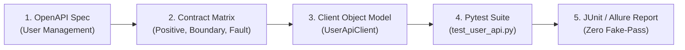

# 🐍 Pytest API & Contract Reference Suite (Clean POM & Synapse Guardrails)

This directory provides a production-grade **Pytest (Python)** API testing reference suite demonstrating API Client Object encapsulation, contract validation, and idempotency standards enforced by **Synapse Hub**.

---

## 🌟 End-to-End Testing Lifecycle (Spec ➔ Matrix ➔ Script ➔ Report)



### 1. Contract & Requirements
- **Endpoint:** `POST /api/v1/users`
- **Rules:**
  - `email` must be valid RFC-5322 format and unique.
  - `role` must be one of `["ADMIN", "MEMBER", "GUEST"]`.
  - Duplicated email returns HTTP 409 Conflict with localization message.
  - Invalid payload returns HTTP 422 Unprocessable Entity.

### 2. Key Architectural Patterns Enforced
- **Clean Client Encapsulation:** Test cases (`tests/test_user_api.py`) call business methods on `UserApiClient`, without dealing with raw HTTP headers or URL concatenation.
- **Idempotent Data Isolation:** Uses `unique_email()` with timestamp prefixes to guarantee collision-free parallel test execution.
- **Automated Teardown Fixture:** Every created user is registered in a teardown registry for guaranteed deletion.
- **Zero-Tolerance for Fake Pass:** All tests assert HTTP status codes, payload contract schemas, and error messages.

---

## 🚀 How to Run & Verify

```bash
# 1. Run Synapse AST Test Linter (Zero-token verification)
agent-qa lint ./tests

# 2. Verify 11 Quality Gates DoD
agent-qa verify

# 3. Run Pytest Suite
pip install -r requirements.txt
pytest -v --junitxml=reports/junit_report.xml
```
