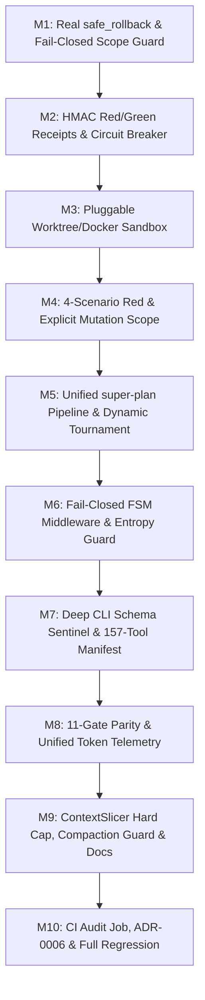

<!--
# SPDX-FileCopyrightText: Copyright (c) 2026 Thế Vị (@TeeVee98). All rights reserved.
# SPDX-License-Identifier: MIT
# Project: Synapse-Hub (https://github.com/TeeVee98/Synapse-Hub)
# Author: Thế Vị (@TeeVee98) | MIT License
-->

# Spec-Driven Super-Plan: Synapse Hub Audit Remediation & Monotonic Ratchet Hardening (P0 + P1 + P2)

> **Reference Protocol:** [AGENTS.md §5](AGENTS.md), [.agent/skills/super-plan/SKILL.md](.agent/skills/super-plan/SKILL.md)
> **Audit Baseline:** Commit `8060843beafc41c74a51699d99222f93384f24e8` (Arithmetic Mean `67.6/100` — All 5 Pillars `WARN`: Pillar 1 `63`, Pillar 2 `56`, Pillar 3 `82`, Pillar 4 `67`, Pillar 5 `70`)
> **Super-Plan Routing (`tools/design/super_plan_engine.py`):** `tier = DEEP_SUPER_PLAN` | `risk_score = 0.70` | `fan_in = 143` | `cross_boundary = True` | `history_drift = 0.10`
> **Ambiguity Gate Status:** Resolved — User approved: (1) Full sequential P0 + P1 + P2 roadmap, (2) Pluggable Sandbox (`WorktreeSandbox` stdlib default + opt-in `DockerSandbox` backend), and (3) Realistic Hybrid P2 (configurable hard cap in `ContextSlicer`, optional `tiktoken` via unified `token_estimator` with transparent heuristic fallback, and honest telemetry/docs labeling).
> **Execution Mode:** Single-Agent `/solo` (Sequential `M1 -> M2 -> M3 -> M4 -> M5 -> M6 -> M7 -> M8 -> M9 -> M10`; zero `swarm` workers).
> **Plan Changelog:** `v1.0.0 (2026-11-24)` — Initial Tier 2 grounded blueprint closing all P0, P1, and P2 mechanical discrepancies from the Synapse Hub Audit Report.

---

## Cognitive Grounding & Budget

- **Step-Back Principles:** Fail-Closed Verification Invariant (any unverifiable git state, tampered receipt, failed analysis, or unrecognized workflow action MUST fail closed rather than pass silently); Cryptographic Binding & Isolation Invariant (verification receipts bind to exact commit, command, and test snapshot; tests/mutants execute in ephemeral sandboxes before artifact promotion); Scientific Honesty Invariant (distinguish measured provider/disk telemetry from heuristic estimates and research simulations).
- **Self-Discover Primitives:** `MOD_FIRST_PRINCIPLES`, `MOD_FAILURE_MODE_ANALYSIS`, `MOD_CONTRACT_VERIFICATION`
- **DynamicBudget Allocation:** category=`rca` | thinking_budget=`2048` | max_tokens=`4096`

---

## 0. Orthogonal Architectural Tournament (Trade-off Matrix)

| Evaluation Criteria | Branch A: Minimalist Docs & Patch | Branch B: Pluggable Fail-Closed Enforcement + Honest Hybrid *(Selected)* | Branch C: Full External Container & Tokenizer Rewrite |
| :--- | :--- | :--- | :--- |
| **Core Philosophy** | Patch rollback flag, lower doc claims, skip sandbox & pipeline orchestration. | Implement real rollback, HMAC receipts, stdlib `WorktreeSandbox` + opt-in `DockerSandbox`, fail-closed FSM/entropy, deep CLI schema checks, and unified estimator with honest labels. | Mandate Docker for all local runs, add mandatory `tiktoken` + provider SDK dependencies to `pyproject.toml`, rewrite `super_plan_engine` as external service. |
| **Blast Radius** | Small (~6 files) — leaves P0.3 isolation and P1 pipeline/FSM gaps unresolved. | Controlled (~19 files across 10 atomic milestones, strictly `<= 3` files/milestone). | Disruptive (30+ files + hard external runtime dependencies). |
| **Regression & Security Risk** | High residual security risk (no sandbox, unsigned receipts, permissive unknown actions). | Low regression risk (stdlib-first defaults, opt-in container hardening, explicit backward-compatible flags). | High operational friction (breaks offline/zero-dep local dev & non-Docker CI runners). |
| **Alignment with Audit & AGENTS.md** | Fails P0.3 and P1 reliability targets. | Satisfies 100% of P0, P1, P2 roadmap items while honoring AGENTS.md §0.3 Stdlib-First & Invariant 11 Ratchet. | Violates zero-dependency Python stdlib baseline (`AGENTS.md §0.3`). |

> **Ruling:** Selected **Branch B (Pluggable Fail-Closed Enforcement + Honest Hybrid)** — eliminates every P0 safety gap and P1 enforcement drift using Python stdlib primitives first, preserves zero-dependency local ergonomics, and offers opt-in Docker isolation and native `tiktoken` precision where available.

---

## 1. Affected Files & Blast Radius

### Target Files & Structural Anchors

| Action | File Path & AST Structural Anchor | Scope & Responsibility |
| :--- | :--- | :--- |
| `[MODIFY]` | `tools/design/dag_self_healer.py::SelfHealingDAGExecutor` (L115-L265) | Execute real compensating hooks (with timeout & captured status) and physical path-scoped file restoration in `safe_rollback()`; make `check_scope_guard_violation()` fail-closed on git/IO errors. |
| `[MODIFY]` | `tools/lint/plan_schema_sentinel.py::rollback_path_scoped` (L148-L189) | Harden `rollback_path_scoped()` to verify pre/post file hashes, handle untracked created files cleanly, and return structured restoration evidence without touching out-of-scope files. |
| `[MODIFY]` | `tests/test_super_plan_10_blueprint.py` (L1-L120) | Add physical file-mutation before/after SHA-256 + `git diff` rollback tests and fail-closed scope-guard exception tests. |
| `[MODIFY]` | `tools/orchestration/solo_runner.py::certify_red_phase` (L1464-L1612), `certify_green_phase` (L1615-L1816), `certify_mutation_phase` (L1819-L1915), `run_debate` (L938-L1030) | Sign Red receipts with HMAC-SHA256 bound to HEAD commit, normalized command, executed tests, and snapshot; enforce strict Green verification & mandatory TTL/timestamp; wire `LocatorRetryCircuitBreaker`; enforce 4-scenario Red binding & target diff relevance; integrate pluggable sandbox; fail-closed semantic entropy on exception (`ERROR_REVIEW_REQUIRED`, `code_write_permission=False`). |
| `[MODIFY]` | `tools/core/circuit_breaker.py::LocatorRetryCircuitBreaker` (L404-L508) | Expose deterministic trip/state summary helper consumed by `solo_runner.py` retry guardrails. |
| `[CREATE]` | `tools/orchestration/sandbox_runner.py::SandboxBackend` (New) | Implement pluggable `SandboxBackend` (`WorktreeSandbox` ephemeral workspace/worktree with scrubbed env & artifact promotion + optional `DockerSandbox` container backend). |
| `[MODIFY]` | `tests/test_solo_runner.py` (L1-L120) | Add tests for tampered/expired/wrong-commit Red receipts, strict command matching, circuit breaker tripping, `WorktreeSandbox` side-effect isolation, 4-scenario Red validation, and fail-closed entropy errors. |
| `[MODIFY]` | `tools/lint/micro_mutator.py::evaluate_target` (L1248-L1375) | Eliminate silent fallback from `diff_only=True` to full-file mutation; require explicit `--mutation-scope full` (or `allow_full_fallback=True`); emit complete per-mutant ledger & denominator in report/receipt. |
| `[MODIFY]` | `tests/test_micro_mutator.py` (L1-L120) | Verify `NO_DIFF_MUTANTS` status on empty/non-mutable diff without silent full-file fallback, explicit full-scope opt-in, and full mutant ledger serialization. |
| `[MODIFY]` | `tools/design/super_plan_engine.py::scaffold_super_plan` (L483-L660), `calibrate_and_refine_plan` (L805-L862), `main` (L864-L920) | Add unified `run-pipeline` stage orchestrator persisting per-stage artifacts and separating `PLAN_GENERATED`, `PLAN_VALIDATED`, `PLAN_EXECUTED`; compute dynamic task-driven Tournament verdicts; hook post-DoD debt harvesting. |
| `[MODIFY]` | `tools/core/debt_harvester.py::run_debt_harvest` (L218-L245) | Support programmatic JSON return payload for post-DoD `super_plan_engine` pipeline harvesting. |
| `[MODIFY]` | `tests/test_super_plan_and_harvester.py` (L360-L410) | Add end-to-end `run-pipeline` stage-state tests, dynamic Tournament scoring tests, and align `test_scaffold_super_plan_embeds_cognitive_grounding_and_passes_gates` `TIER_2_DEEP` budget expectation (`max_tokens=4096`, `thinking_budget=2048`). |
| `[MODIFY]` | `tools/core/fsm_middleware.py::FsmMiddleware` (L106-L310) | Enforce fail-closed rejection (`UNKNOWN_ACTION_BLOCKED`) for unrecognized actions whenever a controlled FSM workflow is active, while keeping uncontrolled mode backward-compatible. |
| `[MODIFY]` | `tests/test_fsm_middleware.py` (L1-L120) | Verify unknown actions are blocked in active workflows and mutation/test/heal/done transitions enforce strict stage gates. |
| `[MODIFY]` | `tools/lint/cli_schema_sentinel.py::extract_ast_arguments` (L40-L146), `validate_schema_drift` (L176-L270) | Add deep schema diffing (`type`, `required`, `default`, `choices`) and enforce `--fail-unregistered` against classified public CLI tools while honoring explicit `excluded_internal_tools` manifest. |
| `[MODIFY]` | `tools/tools_schema.json` (L1-L30) | Synchronize any deep schema metadata drift (`verify_all` summary "11 Quality Gates", arg metadata) and record deterministic `excluded_internal_tools` classification for the 157 discovered helper scripts. |
| `[MODIFY]` | `tests/test_cli_schema_sentinel.py` (L1-L120) | Add tests for `type`/`required`/`default`/`choices` drift detection and public vs excluded-internal `--fail-unregistered` enforcement. |
| `[MODIFY]` | `tools/core/verify_all.py::run_all_gates` (L146-L215), `main` (L344-L366) | Align all "10 gates" docstrings/help strings to "11 gates" across `verify_all.py`. |
| `[MODIFY]` | `tools/core/cache_prefix_enforcer.py::CachePrefixEnforcer` (L51-L135) | Route token counting through unified `tools/core/token_estimator.py::count_tokens` and attach `estimator_info` (`is_exact`, `provider_observed=False`) to partition output. |
| `[MODIFY]` | `tools/core/gates/gate_11_token_reduction.py::gate_11_token_reduction` (L60-L140) | Replace hardcoded `/ 3.8` with unified `token_estimator`, compute real compression ratio directly from `tools_schema.json` vs `tools_schema.min.json`, and report `production_active` separately from `research_simulation` tiers. |
| `[MODIFY]` | `tools/context/context_slicer.py::ContextSlicer` (L177-L237) | Support hard `max_tokens` ceiling across combined rule header + AST skeleton in `slice_context()` using `token_estimator.count_tokens`. |
| `[MODIFY]` | `tools/core/task_memory_manager.py::TaskMemoryManager` (L215-L255) | Add `check_compaction_trigger()` and pre-prune integrity verification guard (`verify_integrity()` required before pruning). |
| `[MODIFY]` | `docs/TOKEN_QUOTA_PLAYBOOK.md` (L40-L80) | Distinguish measured disk/heuristic estimates from `provider_observed` telemetry, align `<100 tokens` claim with configurable hard cap, and clarify `/compact` advisory + pre-prune disk verification semantics. |
| `[MODIFY]` | `.github/workflows/ci_quality_gates.yml` (L26-L67) | Update "10 Quality Gates" label to "11 Quality Gates" and add `audit-ratchet-verification` CI job executing the enforcement test suites and uploading JSON gate artifacts. |
| `[CREATE]` | `docs/adr/ADR-0006-audit-monotonic-ratchet-hardening.md` (New) | Record Tier 2 architectural rulings (Pluggable Worktree+Docker Sandbox, HMAC Red Receipt, Fail-Closed FSM & Entropy, Honest Hybrid Token Telemetry). |
| `[MODIFY]` | `tests/test_gate_11_all_15_tiers.py` (L1-L100) | Verify direct disk schema compression calculation, unified estimator metadata, and separate `production_active` vs `research_simulation` reporting. |

### Blast Radius & Downstream Dependencies
- **Direct Callers:** `tools/core/verify_all.py` (Gate 8 & Gate 11), `tools/core/cli.py`, `tools/core/agent_runner.py`, `.github/workflows/ci_quality_gates.yml`, and `/solo` + `/super-plan` agent workflows.
- **Downstream Tests:** `tests/test_super_plan_10_blueprint.py`, `tests/test_solo_runner.py`, `tests/test_micro_mutator.py`, `tests/test_super_plan_and_harvester.py`, `tests/test_fsm_middleware.py`, `tests/test_cli_schema_sentinel.py`, `tests/test_gate_11_all_15_tiers.py`, `tests/test_verify_all.py`, `tests/test_task_memory_manager.py`.
- **Regression Risk:** Medium-High on core orchestration (`solo_runner.py`, `fsm_middleware.py`, `dag_self_healer.py`), mitigated by strict `<= 3`-file atomic milestones, sequential execution, path-scoped rollback hooks, and backward-compatible CLI defaults.

---

## 2. Data Flow & Interface Signatures



### Typed Interface Manifests (Anti-Full-Code)

```python
from dataclasses import dataclass, field
from typing import Any, Dict, List, Optional, Protocol, Tuple


@dataclass(frozen=True)
class AuditBaselineSpec:
    commit_hash: str
    pillar_scores: Dict[str, int]
    roadmap_tiers: List[str]


@dataclass(frozen=True)
class RollbackExecutionReceipt:
    node_id: str
    compensating_hook_run: bool
    compensating_hook_exit_code: Optional[int]
    git_revert_run: bool
    reverted_files: List[str]
    removed_created_files: List[str]
    pre_hashes: Dict[str, str]
    post_hashes: Dict[str, str]
    verified_clean: bool
    errors: List[str] = field(default_factory=list)


@dataclass(frozen=True)
class SignedRedReceipt:
    status: str
    certified_at: str
    commit_hash: str
    normalized_cmd: str
    executed_tests: List[str]
    scenario_coverage: Dict[str, bool]
    test_tree_hash: str
    failure_sha256: str
    ttl_seconds: int
    receipt_hmac: str


class SandboxBackend(Protocol):
    name: str
    def prepare(self, repo_root: str, target_files: List[str]) -> str: ...
    def execute(self, cmd: str, sandbox_dir: str, timeout: float = 60.0) -> Tuple[int, str]: ...
    def promote_artifacts(self, sandbox_dir: str, artifact_paths: List[str], dest_root: str) -> List[str]: ...
    def cleanup(self, sandbox_dir: str) -> None: ...


@dataclass(frozen=True)
class SandboxExecutionResult:
    backend: str
    exit_code: int
    output: str
    promoted_artifacts: List[str]
    isolated_root: str


@dataclass(frozen=True)
class ScopedMutationReceipt:
    target: str
    scope_requested: str
    scope_used: str
    total_generated: int
    killed: int
    survived: int
    timed_out: int
    invalid: int
    score_denominator: int
    score: float
    passed: bool
    mutants: List[Dict[str, Any]]


@dataclass(frozen=True)
class PipelineStageArtifact:
    stage: str
    lifecycle_state: str
    artifact_path: str
    passed: bool
    metrics: Dict[str, Any]


@dataclass(frozen=True)
class FailClosedGuardVerdict:
    allowed: bool
    reason: Optional[str]
    workflow_active: bool
    entropy_status: str
    code_write_permission: bool


@dataclass(frozen=True)
class DeepSchemaDriftReport:
    status: str
    tools_checked: int
    field_drifts: List[Dict[str, Any]]
    unregistered_public: List[str]
    excluded_internal_count: int


@dataclass(frozen=True)
class MeasuredGateTelemetry:
    gate_count: int
    estimator_engine: str
    is_exact: bool
    provider_observed: bool
    schema_compression_pct: float
    production_active_passed: int
    research_simulation_inventoried: int


@dataclass(frozen=True)
class HardCappedContextContract:
    content: str
    estimated_tokens: int
    max_tokens: Optional[int]
    truncated: bool
    compaction_recommended: bool
    integrity_verified: bool


@dataclass(frozen=True)
class AuditRatchetReleaseReceipt:
    ci_workflow_updated: bool
    adr_path: str
    suites_passed: List[str]
```

---

## 3. Atomic Milestones (Execution DAG)

### Milestone 1: Real Transactional `safe_rollback()` & Fail-Closed Scope Guard (P0.1)
- **Node ID:** `M1` | **depends_on:** `[]`
- **Compute Tier:** `[Model: Pro / Reasoning | Thinking: High | Temp: 0.1]`
- **Files Modified (Max 3):** `tools/design/dag_self_healer.py`, `tools/lint/plan_schema_sentinel.py`, `tests/test_super_plan_10_blueprint.py`
- **Write Set:** `['tools/design/dag_self_healer.py', 'tools/lint/plan_schema_sentinel.py', 'tests/test_super_plan_10_blueprint.py']`
- **Contracts:** `consumes: [{'contract': 'AuditBaselineSpec'}]` | `produces: [{'contract': 'RollbackExecutionReceipt'}]`
- **Scope:** Replace boolean flag stubs in `SelfHealingDAGExecutor.safe_rollback()` (L188-L208) with actual compensating hook subprocess execution (validated via `validate_rollback_hook_safety`, bounded timeout) plus physical path-scoped file restoration via `rollback_path_scoped()` (recording pre/post SHA-256). Make `check_scope_guard_violation()` (L210-L258) fail-closed (`return False, ["SCOPE_GUARD_UNVERIFIABLE: ..."]`) on non-zero git exit codes, exceptions, or unreadable write-sets. Add end-to-end file-mutation rollback tests proving out-of-scope files remain untouched.
- **Circuit Breaker:** Max Fix Attempts: 2 | Scope Guard: Halt if out-of-scope files touched
- **Rollback Hook:** `git restore -- tools/design/dag_self_healer.py tools/lint/plan_schema_sentinel.py tests/test_super_plan_10_blueprint.py`
- **Pass Gate:** `python3 -m pytest tests/test_super_plan_10_blueprint.py -v`

### Milestone 2: Cryptographically Signed Red/Green Receipt & Circuit Breaker Wiring (P0.2)
- **Node ID:** `M2` | **depends_on:** `['M1']`
- **Compute Tier:** `[Model: Pro / Reasoning | Thinking: High | Temp: 0.1]`
- **Files Modified (Max 3):** `tools/orchestration/solo_runner.py`, `tools/core/circuit_breaker.py`, `tests/test_solo_runner.py`
- **Write Set:** `['tools/orchestration/solo_runner.py', 'tools/core/circuit_breaker.py', 'tests/test_solo_runner.py']`
- **Contracts:** `consumes: [{'contract': 'RollbackExecutionReceipt'}]` | `produces: [{'contract': 'SignedRedReceipt'}]`
- **Scope:** Sign Red receipts in `certify_red_phase()` with HMAC-SHA256 covering canonical `{status, certified_at, commit_hash, normalized_cmd, executed_tests, test_tree_hash, failure_sha256, ttl_seconds}`. In `certify_green_phase()`, enforce HMAC verification, mandatory valid ISO-8601 `certified_at`, TTL enforcement, exact `commit_hash == HEAD` check, and strict normalized command matching (remove blanket `is_inline_mock` exemption). Wire `LocatorRetryCircuitBreaker` into `solo_runner.py` retry loops to halt repeated failures after 2 consecutive strikes.
- **Circuit Breaker:** Max Fix Attempts: 2 | Scope Guard: Halt if out-of-scope files touched
- **Rollback Hook:** `git restore -- tools/orchestration/solo_runner.py tools/core/circuit_breaker.py tests/test_solo_runner.py`
- **Pass Gate:** `python3 -m pytest tests/test_solo_runner.py -k "receipt or breaker or red or green" -v`

### Milestone 3: Pluggable Ephemeral Test/Mutation Sandbox (P0.3)
- **Node ID:** `M3` | **depends_on:** `['M2']`
- **Compute Tier:** `[Model: Pro / Reasoning | Thinking: High | Temp: 0.1]`
- **Files Modified (Max 3):** `tools/orchestration/sandbox_runner.py`, `tools/orchestration/solo_runner.py`, `tests/test_solo_runner.py`
- **Write Set:** `['tools/orchestration/sandbox_runner.py', 'tools/orchestration/solo_runner.py', 'tests/test_solo_runner.py']`
- **Contracts:** `consumes: [{'contract': 'SignedRedReceipt'}]` | `produces: [{'contract': 'SandboxExecutionResult'}]`
- **Scope:** Create `tools/orchestration/sandbox_runner.py` implementing `WorktreeSandbox` (stdlib ephemeral copy / `git worktree`, scrubbed env `HOME`/`TMPDIR`/`SYNAPSE_SANDBOX=1`, promote verified artifacts only after pass) and opt-in `DockerSandbox` (`--sandbox worktree|docker|host`). Integrate sandbox execution into `certify_green_phase()` and `certify_mutation_phase()`, deprecating reliance on `ReadOnlyTestGuard` `chmod` as a security boundary.
- **Circuit Breaker:** Max Fix Attempts: 2 | Scope Guard: Halt if out-of-scope files touched
- **Rollback Hook:** `git restore -- tools/orchestration/solo_runner.py tests/test_solo_runner.py && rm -f tools/orchestration/sandbox_runner.py`
- **Pass Gate:** `python3 -m pytest tests/test_solo_runner.py -k "sandbox" -v`

### Milestone 4: 4-Scenario Red Binding & Explicit Mutation Scope (P1.1 & P1.2)
- **Node ID:** `M4` | **depends_on:** `['M3']`
- **Compute Tier:** `[Model: Pro / Reasoning | Thinking: High | Temp: 0.1]`
- **Files Modified (Max 3):** `tools/orchestration/solo_runner.py`, `tools/lint/micro_mutator.py`, `tests/test_micro_mutator.py`
- **Write Set:** `['tools/orchestration/solo_runner.py', 'tools/lint/micro_mutator.py', 'tests/test_micro_mutator.py']`
- **Contracts:** `consumes: [{'contract': 'SandboxExecutionResult'}]` | `produces: [{'contract': 'ScopedMutationReceipt'}]`
- **Scope:** In `solo_runner.py::certify_red_phase()`, verify Red test evidence covers the 4 required scenario categories (`positive`, `negative`, `boundary`, `cli_or_resilience`) and links failure trace/assertions to changed target files (reject unrelated semantic failures). In `micro_mutator.py::evaluate_target()` (L1283-L1307), remove silent full-file fallback when `diff_only=True` yields zero diff mutants; emit `NO_DIFF_MUTANTS` unless `--mutation-scope full` / `allow_full_fallback=True` is explicitly selected, and record complete mutant counts + denominator in receipt output.
- **Circuit Breaker:** Max Fix Attempts: 2 | Scope Guard: Halt if out-of-scope files touched
- **Rollback Hook:** `git restore -- tools/orchestration/solo_runner.py tools/lint/micro_mutator.py tests/test_micro_mutator.py`
- **Pass Gate:** `python3 -m pytest tests/test_micro_mutator.py tests/test_solo_runner.py -v`

### Milestone 5: Unified `super_plan_engine.py` Stage Orchestrator & Dynamic Tournament (P1.3 & Pillar 2 Test Fix)
- **Node ID:** `M5` | **depends_on:** `['M4']`
- **Compute Tier:** `[Model: Pro / Reasoning | Thinking: High | Temp: 0.1]`
- **Files Modified (Max 3):** `tools/design/super_plan_engine.py`, `tools/core/debt_harvester.py`, `tests/test_super_plan_and_harvester.py`
- **Write Set:** `['tools/design/super_plan_engine.py', 'tools/core/debt_harvester.py', 'tests/test_super_plan_and_harvester.py']`
- **Contracts:** `consumes: [{'contract': 'ScopedMutationReceipt'}]` | `produces: [{'contract': 'PipelineStageArtifact'}]`
- **Scope:** Add `run-pipeline` orchestrator in `super_plan_engine.py` chaining `route -> ambiguity -> scaffold -> validate -> mutate -> calibrate/execute -> debt-harvest` with persisted per-stage artifacts and distinct lifecycle statuses (`PLAN_GENERATED`, `PLAN_VALIDATED`, `PLAN_EXECUTED`). Replace static Branch A Tournament template (`L634-L651`) with criteria-weighted branch selection driven by task risk metrics. Expose structured dict return in `debt_harvester.py::run_debt_harvest()` for automated post-DoD invocation. Resolve `test_scaffold_super_plan_embeds_cognitive_grounding_and_passes_gates` tier/budget expectation mismatch (`max_tokens=4096`, `thinking_budget=2048` on `TIER_2_DEEP`).
- **Circuit Breaker:** Max Fix Attempts: 2 | Scope Guard: Halt if out-of-scope files touched
- **Rollback Hook:** `git restore -- tools/design/super_plan_engine.py tools/core/debt_harvester.py tests/test_super_plan_and_harvester.py`
- **Pass Gate:** `python3 -m pytest tests/test_super_plan_and_harvester.py -v`

### Milestone 6: Fail-Closed FSM Middleware & Fail-Safe Semantic Entropy (P1.4)
- **Node ID:** `M6` | **depends_on:** `['M5']`
- **Compute Tier:** `[Model: Pro / Reasoning | Thinking: High | Temp: 0.1]`
- **Files Modified (Max 3):** `tools/core/fsm_middleware.py`, `tools/orchestration/solo_runner.py`, `tests/test_fsm_middleware.py`
- **Write Set:** `['tools/core/fsm_middleware.py', 'tools/orchestration/solo_runner.py', 'tests/test_fsm_middleware.py']`
- **Contracts:** `consumes: [{'contract': 'PipelineStageArtifact'}]` | `produces: [{'contract': 'FailClosedGuardVerdict'}]`
- **Scope:** Update `FsmMiddleware.check_precondition()` (L180-L296) to reject unknown/unrecognized actions (`UNKNOWN_ACTION_BLOCKED`) whenever an active controlled workflow is in progress, while keeping uncontrolled/uninitialized mode backward-compatible; ensure mutation, test, heal, and done actions pass through enforcement. Update `solo_runner.py::run_debate()` (L1003-L1015) so exceptions in `SemanticEntropyEngine` fail closed (`semantic_entropy=None`, `uncertainty_status="ERROR_REVIEW_REQUIRED"`, `code_write_permission=False`) instead of silently setting entropy to `0.0`.
- **Circuit Breaker:** Max Fix Attempts: 2 | Scope Guard: Halt if out-of-scope files touched
- **Rollback Hook:** `git restore -- tools/core/fsm_middleware.py tools/orchestration/solo_runner.py tests/test_fsm_middleware.py`
- **Pass Gate:** `python3 -m pytest tests/test_fsm_middleware.py tests/test_semantic_entropy.py tests/test_solo_runner.py -v`

### Milestone 7: Deep CLI Schema Sentinel & 157-Candidate Classification (P1.5)
- **Node ID:** `M7` | **depends_on:** `['M6']`
- **Compute Tier:** `[Model: Flash | Thinking: Off | Temp: 0.1]`
- **Files Modified (Max 3):** `tools/lint/cli_schema_sentinel.py`, `tools/tools_schema.json`, `tests/test_cli_schema_sentinel.py`
- **Write Set:** `['tools/lint/cli_schema_sentinel.py', 'tools/tools_schema.json', 'tests/test_cli_schema_sentinel.py']`
- **Contracts:** `consumes: [{'contract': 'FailClosedGuardVerdict'}]` | `produces: [{'contract': 'DeepSchemaDriftReport'}]`
- **Scope:** Enhance `validate_schema_drift()` (L176-L270) to deeply verify argument `type`, `required`, `default`, and `choices` against AST extractions. Classify the 157 `--expand-all` argparse candidates into registered public tools vs `excluded_internal_tools` metadata in `tools/tools_schema.json`, so `--fail-unregistered` fails deterministically on any unclassified/new public CLI tool. Sync `verify_all` summary string to "11 Quality Gates".
- **Circuit Breaker:** Max Fix Attempts: 2 | Scope Guard: Halt if out-of-scope files touched
- **Rollback Hook:** `git restore -- tools/lint/cli_schema_sentinel.py tools/tools_schema.json tests/test_cli_schema_sentinel.py`
- **Pass Gate:** `python3 -m pytest tests/test_cli_schema_sentinel.py -v && python3 tools/lint/cli_schema_sentinel.py --check --fail-unregistered --json`

### Milestone 8: 11-Gate Parity, Unified Token Estimator & Measured Gate 11 Telemetry (P2.1 & P2.2)
- **Node ID:** `M8` | **depends_on:** `['M7']`
- **Compute Tier:** `[Model: Flash | Thinking: Off | Temp: 0.1]`
- **Files Modified (Max 3):** `tools/core/verify_all.py`, `tools/core/cache_prefix_enforcer.py`, `tools/core/gates/gate_11_token_reduction.py`
- **Write Set:** `['tools/core/verify_all.py', 'tools/core/cache_prefix_enforcer.py', 'tools/core/gates/gate_11_token_reduction.py']`
- **Contracts:** `consumes: [{'contract': 'DeepSchemaDriftReport'}]` | `produces: [{'contract': 'MeasuredGateTelemetry'}]`
- **Scope:** Synchronize all "10 gates" docstrings/help strings to "11 gates" in `verify_all.py` (L146-L147, L355). Replace hardcoded `/ 3.8` in `CachePrefixEnforcer` and `gate_11_token_reduction` with unified `tools/core/token_estimator.py::count_tokens` + `get_estimator_info()`. Measure actual JSON compression ratio directly between `tools/tools_schema.json` and `tools/tools_schema.min.json`, and clearly separate `production_active` checks from `research_simulation` inventory in Gate 11 output.
- **Circuit Breaker:** Max Fix Attempts: 2 | Scope Guard: Halt if out-of-scope files touched
- **Rollback Hook:** `git restore -- tools/core/verify_all.py tools/core/cache_prefix_enforcer.py tools/core/gates/gate_11_token_reduction.py`
- **Pass Gate:** `python3 -m pytest tests/test_verify_all.py tests/test_gate_11_all_15_tiers.py tests/test_token_estimator.py -v`

### Milestone 9: Hard-Capped `ContextSlicer`, Compaction Safety Guard & Honest Docs (P2.3 & P2.4)
- **Node ID:** `M9` | **depends_on:** `['M8']`
- **Compute Tier:** `[Model: Flash | Thinking: Off | Temp: 0.1]`
- **Files Modified (Max 3):** `tools/context/context_slicer.py`, `tools/core/task_memory_manager.py`, `docs/TOKEN_QUOTA_PLAYBOOK.md`
- **Write Set:** `['tools/context/context_slicer.py', 'tools/core/task_memory_manager.py', 'docs/TOKEN_QUOTA_PLAYBOOK.md']`
- **Contracts:** `consumes: [{'contract': 'MeasuredGateTelemetry'}]` | `produces: [{'contract': 'HardCappedContextContract'}]`
- **Scope:** Add optional hard `max_tokens: Optional[int] = None` enforcement across the entire returned payload in `ContextSlicer.slice_context()` (L222-L236) using `token_estimator.count_tokens`. Add `check_compaction_trigger(current_tokens, threshold=50000)` and pre-prune checksum persistence verification to `TaskMemoryManager`. Update `docs/TOKEN_QUOTA_PLAYBOOK.md` to clearly distinguish heuristic/disk measurements from `provider_observed` telemetry, align `<100 tokens` micro-context claims with configurable hard-cap usage, and document `/compact` as agent/host-triggered with pre-prune disk verification.
- **Circuit Breaker:** Max Fix Attempts: 2 | Scope Guard: Halt if out-of-scope files touched
- **Rollback Hook:** `git restore -- tools/context/context_slicer.py tools/core/task_memory_manager.py docs/TOKEN_QUOTA_PLAYBOOK.md`
- **Pass Gate:** `python3 -m pytest tests/test_task_memory_manager.py tests/test_token_engineering_and_benchmark.py -v`

### Milestone 10: CI Audit Verification Job, ADR-0006 & Full Regression Gate (P2.5 & Governance)
- **Node ID:** `M10` | **depends_on:** `['M9']`
- **Compute Tier:** `[Model: Flash | Thinking: Off | Temp: 0.1]`
- **Files Modified (Max 3):** `.github/workflows/ci_quality_gates.yml`, `docs/adr/ADR-0006-audit-monotonic-ratchet-hardening.md`, `tests/test_gate_11_all_15_tiers.py`
- **Write Set:** `['.github/workflows/ci_quality_gates.yml', 'docs/adr/ADR-0006-audit-monotonic-ratchet-hardening.md', 'tests/test_gate_11_all_15_tiers.py']`
- **Contracts:** `consumes: [{'contract': 'HardCappedContextContract'}]` | `produces: [{'contract': 'AuditRatchetReleaseReceipt'}]`
- **Scope:** Update `.github/workflows/ci_quality_gates.yml` step label to "11 Quality Gates" and add `audit-ratchet-verification` CI job running the P0/P1/P2 enforcement suites and uploading JSON gate artifacts. Author `docs/adr/ADR-0006-audit-monotonic-ratchet-hardening.md` documenting all Tier 2 architectural decisions. Extend `tests/test_gate_11_all_15_tiers.py` to assert direct schema compression measurement and production/simulation tier separation, then run full `verify_all.py --mode hub --tier impact` and `invariant_checker.py`.
- **Circuit Breaker:** Max Fix Attempts: 2 | Scope Guard: Halt if out-of-scope files touched
- **Rollback Hook:** `git restore -- .github/workflows/ci_quality_gates.yml tests/test_gate_11_all_15_tiers.py && rm -f docs/adr/ADR-0006-audit-monotonic-ratchet-hardening.md`
- **Pass Gate:** `python3 -m pytest tests/test_gate_11_all_15_tiers.py -v && python3 tools/core/verify_all.py --mode hub --tier impact`

---

## 4. Verification Matrix ("Define the Exam in the Plan")

| ID | Pillar / Tier | Test Scenario | Input / Precondition | Expected Output / Assertion | Verification Command |
| :--- | :--- | :--- | :--- | :--- | :--- |
| **TC-01** | P0.1 (Positive) | Physical `safe_rollback()` restores mutated write-set | Mutate 1 tracked file + create 1 untracked file in write-set; keep 1 unrelated out-of-scope file modified | Tracked file SHA-256 equals baseline, created file deleted, out-of-scope file untouched, `verified_clean=True` | `python3 -m pytest tests/test_super_plan_10_blueprint.py -k "rollback" -v` |
| **TC-02** | P0.1 (Negative) | Fail-closed scope guard on git/IO failure | Simulate `subprocess.run` exception or non-zero git exit in `check_scope_guard_violation()` | Returns `(False, ["SCOPE_GUARD_UNVERIFIABLE: ..."])`, never returns `(True, [])` | `python3 -m pytest tests/test_super_plan_10_blueprint.py -k "scope_guard" -v` |
| **TC-03** | P0.2 (Negative) | Tampered, expired, or wrong-commit Red receipt rejected | Modify receipt JSON field, omit `certified_at`, age > 900s, or mismatch `HEAD` commit hash | `certify_green_phase()` returns `passed=False` with `TAMPERED_RED_RECEIPT` / `EXPIRED_RED_RECEIPT` / `COMMIT_MISMATCH_REJECTED` | `python3 -m pytest tests/test_solo_runner.py -k "receipt" -v` |
| **TC-04** | P0.2 (Boundary) | Circuit breaker trips on 2 consecutive strikes | Trigger 2 consecutive failures on identical target in `solo_runner` | `LocatorRetryCircuitBreaker` transitions to `OPEN` and blocks 3rd blind retry | `python3 -m pytest tests/test_solo_runner.py tests/test_circuit_breaker.py -v` |
| **TC-05** | P0.3 (Positive) | Ephemeral `WorktreeSandbox` isolates side effects | Run test/mutant writing temporary file inside sandbox directory | Host repo working tree stays clean; only verified receipts promoted back after pass | `python3 -m pytest tests/test_solo_runner.py -k "sandbox" -v` |
| **TC-06** | P1.1 (Negative) | Unrelated semantic failure rejected in Red phase | Failing test touches unrelated file or lacks 4-scenario coverage manifest | `certify_red_phase()` rejects with explicit missing-scenario or unrelated-target error | `python3 -m pytest tests/test_solo_runner.py -k "scenario or red" -v` |
| **TC-07** | P1.2 (Boundary) | Diff-only mutation with zero mutable diff lines | Run `evaluate_target(..., diff_only=True)` on file with empty/comment-only diff | Returns `status="NO_DIFF_MUTANTS"`, `scope_used="diff_only"`, zero silent full-file fallback; explicit `scope="full"` runs full-file | `python3 -m pytest tests/test_micro_mutator.py -v` |
| **TC-08** | P1.3 (Positive) | End-to-end `super_plan_engine.py run-pipeline` & dynamic Tournament | Execute `run-pipeline` on Tier 2 task; verify per-stage artifacts and `test_scaffold_super_plan_embeds_cognitive_grounding_and_passes_gates` | Emits distinct `PLAN_GENERATED` -> `PLAN_VALIDATED` states, dynamic tournament rationale, and `59/59` super-plan tests pass | `python3 -m pytest tests/test_super_plan_and_harvester.py -v` |
| **TC-09** | P1.4 (Negative) | Fail-closed FSM unknown action & entropy exception | Send `unknown_custom_mutation` during active FSM workflow; inject exception in `SemanticEntropyEngine` | Middleware returns `(False, "UNKNOWN_ACTION_BLOCKED...")`; debate returns `semantic_entropy=None`, `uncertainty_status="ERROR_REVIEW_REQUIRED"`, `code_write_permission=False` | `python3 -m pytest tests/test_fsm_middleware.py tests/test_semantic_entropy.py -v` |
| **TC-10** | P1.5 (CLI) | Deep CLI schema drift (`type`/`required`/`default`/`choices`) & `--fail-unregistered` | Mutate arg `default` or `choices` in test fixture; run sentinel on live repo with `--fail-unregistered` | Detects field-level drift on fixture; passes with 0 unclassified public tools on repo | `python3 -m pytest tests/test_cli_schema_sentinel.py -v && python3 tools/lint/cli_schema_sentinel.py --check --fail-unregistered --json` |
| **TC-11** | P2.1 & P2.2 (CLI) | 11-gate parity & measured Gate 11 telemetry | Run `verify_all.py --help` and `gate_11_token_reduction` | Help/docstrings report `11 gates`; Gate 11 outputs `schema_compression_pct` measured directly from disk + separate `production_active` vs `research_simulation` counts | `python3 -m pytest tests/test_verify_all.py tests/test_gate_11_all_15_tiers.py -v` |
| **TC-12** | P2.3 & P2.4 (Boundary) | Hard-capped `ContextSlicer` & pre-prune integrity guard | Call `ContextSlicer.slice_context(large_file, max_tokens=100)`; call `TaskMemoryManager.check_compaction_trigger(55000)` with corrupted checksum | Returned slice tokens `<= 100` with truncation marker; compaction trigger refuses prune until integrity verified | `python3 -m pytest tests/test_task_memory_manager.py tests/test_token_engineering_and_benchmark.py -v` |
| **TC-13** | P2.5 (DoD) | Full Impact DoD & Invariant Rule 16 compliance | Run Hub impact verification and invariant sentinel after M10 | Exit code `0`, zero BOM, zero Rule 16 violations, zero schema drift | `python3 tools/core/verify_all.py --mode hub --tier impact && python3 tools/lint/invariant_checker.py --json` |

---

## 5. Tri-Vulnerability Self-Critique (Red-Teaming)

1. **Race Condition, Concurrency & Idempotency:**
   - *Risk:* Concurrent runs of `WorktreeSandbox` or `solo_runner.py` could collide on receipt paths or temporary worktree directories; non-atomic receipt writes could leave half-written JSON causing false tamper alerts.
   - *Mitigation:* Use `tempfile.mkdtemp(prefix="synapse_sbx_")` with PID + UUID isolation and atomic `os.replace()` for HMAC receipts and checksum files. Keep `/solo` execution strictly sequential across `M1..M10` so no concurrent git index lock contention occurs during `safe_rollback()`.
2. **Boundary, Timeout & Resource Exhaustion:**
   - *Risk:* A misbehaving compensating rollback hook in `safe_rollback()` could hang indefinitely; `ContextSlicer.slice_context(max_tokens=100)` on a 3,000-line file could produce malformed markdown fences if truncated mid-block; empty diffs in `micro_mutator.py` could cause ZeroDivisionError.
   - *Mitigation:* Enforce explicit `timeout=30.0` on compensating hook subprocesses and sandbox runs; close fenced code blocks cleanly before appending truncation markers in `ContextSlicer`; preserve zero-mutant rejection (`score_denominator == 0 -> passed=False`) with explicit `NO_DIFF_MUTANTS` status.
3. **Backward Compatibility & Blast Radius:**
   - *Risk:* Tightening `FsmMiddleware` to block unknown actions, removing `is_inline_mock` in `certify_green_phase()`, or enabling deep `cli_schema_sentinel` checks could break existing unit tests or legacy CLI callers outside the controlled workflow.
   - *Mitigation:* Enforce `UNKNOWN_ACTION_BLOCKED` only when an FSM workflow state is actively initialized/in-progress (preserving uncontrolled mode pass-through); update existing `tests/test_solo_runner.py` fixtures to use signed synthetic test helpers instead of weakening production validation; synchronize `tools/tools_schema.json` in `M7` before gating `--fail-unregistered` in CI.

---

## 6. Recommended Execution Model & Thinking Level & Clean Context Handoff

- **Primary Executor Model & Thinking Level (Single-Session Default):** `Gemini 4 Neon (High)`
  - *Rationale:* Tier 2 Deep Super-Plan (`RiskScore = 0.70`, `fan_in = 143`) touching security-critical cryptographic receipt verification, physical git rollback, ephemeral sandboxing, and fail-closed FSM guards; High thinking prevents subtle fail-open regressions across the sequential `/solo` loop while keeping execution in a single unified session.
- **Milestone Escalation Overrides (Optional / `/teamwork` Only):** Under default `/solo`, all 10 milestones execute sequentially in one session on `Gemini 4 Neon (High)`. If executed in smaller batches or under explicit `/teamwork`, `M7`–`M10` (schema sync, telemetry wiring, CI YAML, docs) may step down to `Gemini 4 Hydrogen (Medium/High)` while keeping `M1`–`M6` on `Gemini 4 Neon (High)`.
- **Clean Context Handoff:** `Read implementation_plan.md and execute sequentially via /solo`
