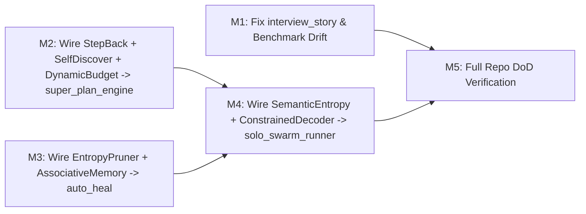

<!--
# SPDX-FileCopyrightText: Copyright (c) 2026 Thế Vị (@TeeVee98). All rights reserved.
# SPDX-License-Identifier: MIT
# Project: Synapse-Hub (https://github.com/TeeVee98/Synapse-Hub)
# Author: Thế Vị (@TeeVee98) | MIT License
-->

# Spec-Driven Super-Plan: Wire Dormant Cognitive Layers & Fix Full-Repo Regression Suite

> **Reference Protocol:** [AGENTS.md §5](AGENTS.md), [.agent/skills/super-plan/SKILL.md](.agent/skills/super-plan/SKILL.md)
> **Super-Plan Routing (`tools/design/super_plan_engine.py`):** `tier = DEEP_SUPER_PLAN` | `risk_score = 0.615` | `fan_in = 39` | `cross_boundary = True` | `state_mutation = False` | `history_drift = 0.1`
> **Ambiguity Gate Status:** Resolved (User approved wiring dormant `tools/reasoning/` layers into runtime orchestrators + fixing `CONTEXT_TOKEN_BENCHMARK.md` drift and `interview_story.py` Fuzzing frontier for 100% green repo suite).
> **Changelog:** `v1.0.0 (2026-11-24)` — Initial Stage 1–5 grounded plan connecting 7 dormant cognitive modules and closing 2 full-repo test failures.

---

## 0. Orthogonal Architectural Tournament (Trade-off Matrix)

| Axis | Branch A: Minimalist Adapter Wiring *(Selected)* | Branch B: New Cognitive Daemon Bus | Branch C: Full Pipeline Rewrite |
| :--- | :--- | :--- | :--- |
| **Strategy** | Wire `StepBackEngine`, `SelfDiscoverEngine`, `DynamicBudgetEngine`, `EntropyPruner`, `AssociativeMemory`, `SemanticEntropyEngine`, and `ConstrainedDecoder` directly into `super_plan_engine.py`, `auto_heal.py`, and `solo_runner.py`, plus fix `interview_story.py` & `CONTEXT_TOKEN_BENCHMARK.md`. | Introduce a new central `CognitivePipelineManager` service class and EventBus routing every tool call through middleware. | Rewrite `super_plan_engine.py`, `auto_heal.py`, and `solo_runner.py` around async multi-turn agent loops. |
| **Files Modified** | 9 files across 5 bounded milestones (`<= 2` files/milestone) | 18+ files + new runtime state files | 25+ files + breaking API changes |
| **Regression Risk** | Very Low (additive return keys, graceful fallbacks, stdlib-only) | Medium (new cross-cutting middleware coupling) | High (breaks existing CLI & unit contracts) |

> **Ruling:** Selected **Branch A (Minimalist Adapter Wiring)** — closes the "0 runtime callers" gap for all 7 practical reasoning layers with zero new dependencies and strict backward compatibility.

---

## 1. Affected Files & Blast Radius

### Target Files & Structural Anchors

| Action | Target File & AST Structural Anchor | Blast Radius / Scope & Responsibility |
| :--- | :--- | :--- |
| `[MODIFY]` | `tools/contrib/interview_story.py::PocockGriller.generate_frontier_questions` (L121-L193) | Include `"Fuzzing"` in the `grill_me=True` payload boundary frontier question title (`"Pocock Fuzzing & Malformed Payload Frontier..."`) while keeping `is_multi_select=False` and ASCII-only English compliance. |
| `[MODIFY]` | `benchmarks/CONTEXT_TOKEN_BENCHMARK.md` | Regenerate via `python3 tools/context/benchmark_swarm_context.py --save-report` so `test_benchmark_report_drift_sentinel` passes byte-for-byte with live repo token counts. |
| `[MODIFY]` | `tools/design/super_plan_engine.py::scaffold_super_plan` (L385-L654) | Wire `StepBackEngine.run()`, `SelfDiscoverEngine.run()`, and `DynamicBudgetEngine.resolve_budget()` via a compact `synthesize_cognitive_planning_brief()` helper embedded into `scaffold_super_plan()` without breaking `plan_schema_sentinel` or `plan_mutator`. |
| `[MODIFY]` | `tests/test_super_plan_and_harvester.py` | Add Positive, Negative/Boundary tests verifying cognitive brief synthesis (`StepBack` principles, `SelfDiscover` primitives, `DynamicBudget` token/thinking allocation) in `scaffold_super_plan()`. |
| `[MODIFY]` | `tools/heal/auto_heal.py::diagnose_and_plan_heal` (L79-L222) & `record_heal_lesson` (L224-L235) | Compress oversized `err_sig` (`> 400` chars) via `EntropyPruner.compress()` (`pruned_error_signature`), query `AssociativeMemory` in `diagnose_and_plan_heal()` (`associative_matches`), and record `page_context -> error_signature -> successful_fix` edges in `record_heal_lesson()`. |
| `[MODIFY]` | `tests/test_p0_p1_audit_fixes.py` | Add Positive & Boundary tests verifying `EntropyPruner` signature pruning and `AssociativeMemory` association lookup/recording in `auto_heal.py` without breaking existing plans or leaking SQLite handles. |
| `[MODIFY]` | `tools/orchestration/solo_runner.py::run_debate` (L925-L985) & `execute_external_oracle` (L580-L656) | Wire `SemanticEntropyEngine().evaluate_hypotheses()` into `run_debate()` (`semantic_entropy`, `uncertainty_status`) and `ConstrainedDecoder().project_json()` into `execute_external_oracle()` as deterministic JSON-repair fallback when `json.loads()` fails on wrapped oracle output. |
| `[MODIFY]` | `tests/test_solo_runner.py` | Add Positive, Negative/Boundary tests verifying `semantic_entropy` metrics in `run_debate()` and `ConstrainedDecoder` JSON repair in `execute_external_oracle()` for fenced/malformed JSON output. |
| `[MODIFY]` | `tests/test_ecosystem_integrations.py` | Read-verify `test_interview_story_grill_me_mode` passes cleanly alongside `tests/test_interview_story.py` (no relaxation of assertions). |

### Blast Radius & Downstream Dependencies
- **Direct Callers:** `tools/core/cli.py`, `tools/core/verify_all.py`, `tools/heal/ci_healing_hook.py`, `tools/design/plan_harvester.py`.
- **Downstream Tests:** `tests/test_super_plan_and_harvester.py`, `tests/test_p0_p1_audit_fixes.py`, `tests/test_solo_runner.py`, `tests/test_ecosystem_integrations.py`, `tests/test_interview_story.py`, `tests/test_benchmark_context.py`, plus full `verify_all.py --mode hub --parallel`.
- **Regression Risk:** Low — all new return fields (`pruned_error_signature`, `associative_matches`, `semantic_entropy`, `uncertainty_status`) are additive and wrapped with clean exception/boundary guards.

---

## 2. Data Flow & Interface Signatures



### Typed Interface Manifests (Anti-Full-Code)

```python
from dataclasses import dataclass, field
from typing import Any, Dict, List, Optional

@dataclass(frozen=True)
class CognitivePlanBriefDTO:
    governing_principles: List[str]
    selected_primitives: List[str]
    thinking_budget: int
    max_tokens: int
    task_category: str

@dataclass(frozen=True)
class AutoHealCognitiveContextDTO:
    pruned_error_signature: str
    pruned_chars_saved: int
    associative_matches: List[Dict[str, Any]] = field(default_factory=list)

@dataclass(frozen=True)
class DebateEpistemicSummaryDTO:
    semantic_entropy: float
    uncertainty_status: str
    oracle_json_repaired: bool = False
```

### Key Function Signatures
- `tools/contrib/interview_story.py::PocockGriller.generate_frontier_questions(self, story_text: str, grill_me: bool = False) -> List[Dict[str, Any]]`
- `tools/design/super_plan_engine.py::synthesize_cognitive_planning_brief(task: str, tier: PlanningTier) -> Dict[str, Any]`
- `tools/design/super_plan_engine.py::scaffold_super_plan(task: str, target_files: Optional[List[str]] = None, tournament: bool = False, tier: Optional[PlanningTier] = None) -> str`
- `tools/heal/auto_heal.py::diagnose_and_plan_heal(target_dir=HUB_ROOT, junit_xml_path=None, failure_info=None, live_url=None, aom_snapshot=None) -> Dict[str, Any]`
- `tools/orchestration/solo_runner.py::run_debate(proposal: str, context: Optional[str] = None, rounds: int = 3, judge_mode: str = "strict", repo_root: Optional[str] = None, oracle_cmd: Optional[str] = None) -> Dict[str, Any]`
- `tools/orchestration/solo_runner.py::execute_external_oracle(oracle_cmd: str, target_file: str = "", prompt_or_spec: str = "", timeout: float = 120.0, cwd: Optional[str] = None, event_stream_path: Optional[str] = None) -> Dict[str, Any]`

---

## 3. Atomic Milestones (Execution DAG)

### Milestone 1: Fix `interview_story.py` Fuzzing Frontier & `CONTEXT_TOKEN_BENCHMARK.md` Drift `[PARALLEL_OK]`
- **Node ID:** `M1`
- **depends_on:** `[]`
- **Compute Tier:** `[Model: Flash | Thinking: Medium | Temp: 0.1]`
- **Files Modified (Max 2):** `tools/contrib/interview_story.py`, `benchmarks/CONTEXT_TOKEN_BENCHMARK.md`
- **Write Set:** `['tools/contrib/interview_story.py', 'benchmarks/CONTEXT_TOKEN_BENCHMARK.md']`
- **Typed Interface Manifest:**
  - **consumes:** `[]`
  - **produces:** `[{'contract': 'FullRepoRegressionBlockersFixed'}]`
- **Task:** Update `interview_story.py::PocockGriller.generate_frontier_questions` (`grill_me=True`) so the payload boundary frontier question includes `"Fuzzing"` (`"Pocock Fuzzing & Malformed Payload Frontier..."`) while keeping ASCII-only English and `is_multi_select=False`. Regenerate `benchmarks/CONTEXT_TOKEN_BENCHMARK.md` via `python3 tools/context/benchmark_swarm_context.py --save-report`.
- **Circuit Breaker:** Max Fix Attempts: 2 | Scope Guard: Modify only `interview_story.py` and `CONTEXT_TOKEN_BENCHMARK.md` (and `reports/context_benchmark.json`).
- **Rollback Hook:** `git checkout -- tools/contrib/interview_story.py benchmarks/CONTEXT_TOKEN_BENCHMARK.md`

### Milestone 2: Wire Cognitive Planning Stack (`StepBackEngine`, `SelfDiscoverEngine`, `DynamicBudgetEngine`) `[PARALLEL_OK]`
- **Node ID:** `M2`
- **depends_on:** `[]`
- **Compute Tier:** `[Model: Pro | Thinking: High | Temp: 0.1]`
- **Files Modified (Max 2):** `tools/design/super_plan_engine.py`, `tests/test_super_plan_and_harvester.py`
- **Write Set:** `['tools/design/super_plan_engine.py', 'tests/test_super_plan_and_harvester.py']`
- **Typed Interface Manifest:**
  - **consumes:** `[]`
  - **produces:** `[{'contract': 'CognitivePlanBriefDTO'}]`
- **Task:** Implement `synthesize_cognitive_planning_brief(task, tier)` in `super_plan_engine.py` calling `StepBackEngine().run(task)`, `SelfDiscoverEngine().run(task)`, and `DynamicBudgetEngine.resolve_budget(fsm_stage=...)`, and include the compact cognitive summary in `scaffold_super_plan()` without breaking `validate_plan_content()` or `run_plan_mutation_audit()`. Add `/solo-swarm` unit tests in `tests/test_super_plan_and_harvester.py`.
- **Circuit Breaker:** Max Fix Attempts: 2 | Scope Guard: Keep `plan_schema_sentinel` 100% compliant; fallback gracefully on empty/unusual task text.
- **Rollback Hook:** `git checkout -- tools/design/super_plan_engine.py tests/test_super_plan_and_harvester.py`

### Milestone 3: Wire `EntropyPruner` & `AssociativeMemory` into `auto_heal.py` `[PARALLEL_OK]`
- **Node ID:** `M3`
- **depends_on:** `[]`
- **Compute Tier:** `[Model: Pro | Thinking: High | Temp: 0.1]`
- **Files Modified (Max 2):** `tools/heal/auto_heal.py`, `tests/test_p0_p1_audit_fixes.py`
- **Write Set:** `['tools/heal/auto_heal.py', 'tests/test_p0_p1_audit_fixes.py']`
- **Typed Interface Manifest:**
  - **consumes:** `[]`
  - **produces:** `[{'contract': 'AutoHealCognitiveContextDTO'}]`
- **Task:** In `auto_heal.py::diagnose_and_plan_heal()`, prune long `err_sig` (`> 400` chars) using `EntropyPruner.compress()` (`pruned_error_signature`), and query `AssociativeMemory` (closed via context manager, DB at `<target_dir>/.synapse/associative_memory.db` with `:memory:` fallback) for prior failure/fix edges (`associative_matches`). In `record_heal_lesson()`, record `page_context -> error_signature -> successful_fix` edges. Add `/solo-swarm` tests in `tests/test_p0_p1_audit_fixes.py`.
- **Circuit Breaker:** Max Fix Attempts: 2 | Scope Guard: Preserve `NO_FAILURE_DETECTED`, `cache_match`, `macro_repair`, and all existing `auto_heal` test contracts.
- **Rollback Hook:** `git checkout -- tools/heal/auto_heal.py tests/test_p0_p1_audit_fixes.py`

### Milestone 4: Wire `SemanticEntropyEngine` & `ConstrainedDecoder` into `solo_runner.py`
- **Node ID:** `M4`
- **depends_on:** `[M2, M3]`
- **Compute Tier:** `[Model: Pro | Thinking: High | Temp: 0.1]`
- **Files Modified (Max 2):** `tools/orchestration/solo_runner.py`, `tests/test_solo_runner.py`
- **Write Set:** `['tools/orchestration/solo_runner.py', 'tests/test_solo_runner.py']`
- **Typed Interface Manifest:**
  - **consumes:** `[{'contract': 'CognitivePlanBriefDTO'}, {'contract': 'AutoHealCognitiveContextDTO'}]`
  - **produces:** `[{'contract': 'DebateEpistemicSummaryDTO'}]`
- **Task:** In `solo_runner.py::run_debate()`, pass round prover/verifier claims to `SemanticEntropyEngine().evaluate_hypotheses()` and return `semantic_entropy` and `uncertainty_status` in the debate output dict. In `execute_external_oracle()`, when `json.loads(output)` fails on wrapped/malformed oracle JSON, fall back to `ConstrainedDecoder().project_json(output)` (`oracle_json_repaired: bool`) cleanly without crashing on plain-text oracle output. Add `/solo-swarm` tests in `tests/test_solo_runner.py`.
- **Circuit Breaker:** Max Fix Attempts: 2 | Scope Guard: Keep `solo_runner.py` CLI flags and `run_debate()` / `execute_external_oracle()` backward-compatible; run after M2/M3 so in-place mutation never collides with M2/M3 `--mutation`.
- **Rollback Hook:** `git checkout -- tools/orchestration/solo_runner.py tests/test_solo_runner.py`

### Milestone 5: Final Benchmark Sync & Full-Repo 100% Verification
- **Node ID:** `M5`
- **depends_on:** `[M1, M2, M3, M4]`
- **Compute Tier:** `[Model: Flash | Thinking: Medium | Temp: 0.1]`
- **Files Modified (Max 1):** `benchmarks/CONTEXT_TOKEN_BENCHMARK.md`
- **Write Set:** `['benchmarks/CONTEXT_TOKEN_BENCHMARK.md']`
- **Typed Interface Manifest:**
  - **consumes:** `[{'contract': 'FullRepoRegressionBlockersFixed'}, {'contract': 'DebateEpistemicSummaryDTO'}]`
  - **produces:** `[{'contract': 'FullHubDoDGreen'}]`
- **Task:** Re-run `python3 tools/context/benchmark_swarm_context.py --save-report` if any `tools/` edit shifted empirical benchmark counts, remove temporary milestone receipts, and execute `python3 tools/core/verify_all.py --mode hub --parallel` confirming **0 failed** across all 2,330+ tests and **11/11 Gates PASS**.
- **Circuit Breaker:** Max Fix Attempts: 2 | Scope Guard: Zero relaxed assertions.
- **Rollback Hook:** `git checkout -- benchmarks/CONTEXT_TOKEN_BENCHMARK.md`

---

## 4. Verification Matrix ("Define the Exam in the Plan")

| ID | Scenario Type | Target & Input | Expected Deterministic Outcome | Verification Command |
| :--- | :--- | :--- | :--- | :--- |
| **TC-01** | **Positive (M1 Interview)** | `PocockGriller().generate_frontier_questions("Story", grill_me=True)` | Includes `"Concurrency"` and `"Fuzzing"` questions; ASCII-only English | `python3 -m pytest tests/test_interview_story.py tests/test_ecosystem_integrations.py -v` |
| **TC-02** | **Positive (M1 Benchmark)** | `benchmark_swarm_context.py --save-report` then drift sentinel test | `test_benchmark_report_drift_sentinel` passes byte-for-byte | `python3 -m pytest tests/test_benchmark_context.py -v` |
| **TC-03** | **Positive (M2 Planning)** | `scaffold_super_plan("Fix race condition in checkout", ["tools/design/super_plan_engine.py"])` | Contains `Step-Back` governing principles, `Self-Discover` primitives, and `DynamicBudget` allocation; passes `validate_plan_content()` | `python3 -m pytest tests/test_super_plan_and_harvester.py -v` |
| **TC-04** | **Boundary (M3 Auto-Heal)** | `diagnose_and_plan_heal` with `> 500`-char `err_sig` after `record_heal_lesson()` | Populates `pruned_error_signature` (`len <= len(err_sig)`) and `associative_matches`; closes SQLite cleanly; empty payload still returns `NO_FAILURE_DETECTED` | `python3 -m pytest tests/test_p0_p1_audit_fixes.py tests/test_tools_coverage_boost.py -v` |
| **TC-05** | **Negative (M4 Debate & Oracle)** | `run_debate(...)` and `execute_external_oracle` returning `<thought>...</thought> ```json {'ok': True,} ``` ` | `run_debate` returns float `semantic_entropy` & `uncertainty_status`; `execute_external_oracle` repairs single-quoted/trailing-comma JSON via `ConstrainedDecoder`; plain-text oracle output yields `parsed=None` without crash | `python3 -m pytest tests/test_solo_runner.py -v` |
| **TC-06** | **Full Repo DoD (M5)** | Full Hub parallel verification across all 11 Gates and all test suites | **11/11 Quality Gates PASS**, **0 failed** across full pytest suite, **0** Rule 16 violations | `python3 tools/core/verify_all.py --mode hub --parallel && python3 tools/lint/invariant_checker.py --rule 16 --json` |

---

## 5. Tri-Vulnerability Self-Critique & Mitigations

1. **Concurrency / Race Condition:**
   - `M1`, `M2`, and `M3` have strictly disjoint write sets (`[PARALLEL_OK]`). `M4` depends on `[M2, M3]` so `solo_runner.py` is never mutated in-place by M4 while M2/M3 execute `solo_runner.py --mutation`.
   - `AssociativeMemory` opens a SQLite connection per instance; `auto_heal.py` always opens and closes it via `with AssociativeMemory(...) as mem:` so pytest workers (`-n auto`) never leak file descriptors or lock `.db` files.
2. **Resource Extremes & Boundary Handling:**
   - `EntropyPruner.compress()` only triggers in `auto_heal.py` when `len(err_sig) > 400`, preventing unnecessary work on short errors while bounding megabyte stack traces.
   - `ConstrainedDecoder().project_json()` is wrapped in `try/except ValueError` inside `execute_external_oracle()` so plain-text (non-JSON) oracle stdout still yields `parsed = None` cleanly.
3. **Backward Compatibility & Blast Radius Protection:**
   - All new fields in `scaffold_super_plan()`, `diagnose_and_plan_heal()`, `run_debate()`, and `execute_external_oracle()` are strictly additive; existing callers and schemas remain 100% compatible.

---

## 6. Rollback & State-Migration Matrix

| Phase | Trigger Scenario | Mitigation / Dual-mode | Rollback Command |
| :--- | :--- | :--- | :--- |
| M1 | Interview or benchmark regression | Revert targeted files only | `git checkout -- tools/contrib/interview_story.py benchmarks/CONTEXT_TOKEN_BENCHMARK.md` |
| M2 | Plan schema or mutator regression | Revert planning engine + test | `git checkout -- tools/design/super_plan_engine.py tests/test_super_plan_and_harvester.py` |
| M3 | Auto-heal contract break or DB lock | Revert healer + test | `git checkout -- tools/heal/auto_heal.py tests/test_p0_p1_audit_fixes.py` |
| M4 | Debate or oracle parsing regression | Revert runner + test | `git checkout -- tools/orchestration/solo_runner.py tests/test_solo_runner.py` |

---

## 7. Recommended Execution Model & Thinking Level

- **Primary Executor Model & Thinking Level:** **Gemini 4 Hydrogen (High)**
- **Milestone Escalation Overrides:**
  - **M4 (`tools/orchestration/solo_runner.py`, `tests/test_solo_runner.py`):** Escalate to **Gemini 4 Neon (High)** — `solo_runner.py` is 3,187 LOC (`FanIn=39` across orchestrator & tests); integrating `SemanticEntropyEngine` and `ConstrainedDecoder` cleanly with >= 80% mutation kill rate warrants Neon High precision.
  - **M1, M2, M3, M5:** Execute on **Gemini 4 Hydrogen (High)** — M1–M3 run cleanly in parallel (`[PARALLEL_OK]`) with disjoint write sets, followed by M4 and M5.
- **Rationale:** `RiskScore=0.615` (`DEEP_SUPER_PLAN`, `FanIn=39`) justifies parallel Hydrogen High on M1–M3 and Neon High strictly on the high-fan-in orchestrator (`M4`) before final full-repo DoD (`M5`).

### Clean Context Handoff Prompt
```text
Read implementation_plan.md and execute Milestones M1 through M5 via /solo-swarm (Red -> Green -> Mutation >= 80% -> Purple Audit), starting with M1, M2, and M3 in parallel (Gemini 4 Hydrogen High), then M4 (Gemini 4 Neon High) and M5, and verify 100% repo green with `python3 tools/core/verify_all.py --mode hub --parallel`.
```
