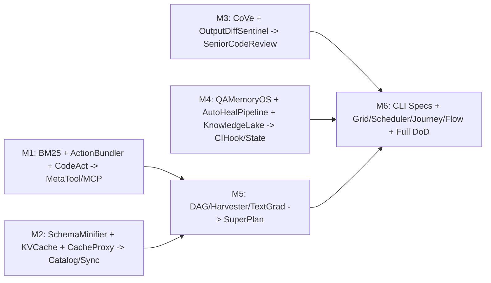

<!--
# SPDX-FileCopyrightText: Copyright (c) 2026 Thế Vị (@TeeVee98). All rights reserved.
# SPDX-License-Identifier: MIT
# Project: Synapse-Hub (https://github.com/TeeVee98/Synapse-Hub)
# Author: Thế Vị (@TeeVee98) | MIT License
-->

# Spec-Driven Super-Plan (Phase 2): Wire Remaining Standalone AI, Search, Memory, and Runtime Modules

> **Reference Protocol:** [AGENTS.md §5](AGENTS.md), [.agent/skills/super-plan/SKILL.md](.agent/skills/super-plan/SKILL.md)
> **Super-Plan Routing (`tools/design/super_plan_engine.py`):** `tier = DEEP_SUPER_PLAN` | `risk_score = 0.749` | `fan_in = 72` | `cross_boundary = False` | `state_mutation = True` | `history_drift = 0.996`
> **Scope:** Connects the remaining high-value standalone modules across `tools/ai/`, `tools/core/`, `tools/runtime/`, `tools/lint/`, `tools/orchestration/`, and `tools/design/` (`BM25Index`, `ActionBundler`, `CodeActEngine`, `SchemaMinifier`, `kv_cache_sentinel`, `ContextCachingProxy`, `ChainOfVerificationEngine`, `OutputDiffSentinel`, `QAMemoryOS`, `auto_heal_pipeline`, `FederatedKnowledgeLake`, `SelfHealingDAGExecutor`, `plan_harvester`, `TextGradOptimizer`, plus CLI/catalog dispatch for `SynapseGrid`, `QATaskScheduler`, `JourneyHarvester`, `StateGraph`, and `testcase_transpiler`) into Synapse-Hub's live runtime flows.
> **Explicit Exclusion:** Inference-server research simulation modules (`ast_symbol_minifier.py`, `counterfactual_distiller.py`, `symbolic_micro_dsl.py`, `suffix_speculative_decoder.py`, `logprob_branching_engine.py`, `telegraphic_enforcer.py`) and intentional standalone endpoints (`serve_dashboard.py`, `a2a_qa_server.py`, `telegram_bot.py`, `onboarding_wizard.py`, `checklist_query.py`, `testrail_exporter.py`, `xray_exporter.py`, `ci_summary_generator.py`, `spec_reconciler.py`) remain untouched.
> **Changelog:**
> - `v1.0.0 (2026-11-24)` — Initial Phase-2 Deep Super-Plan exported for fresh-session execution.
> - `v1.1.0 (2026-11-24)` — Added `ContextCachingProxy`, `FederatedKnowledgeLake`, and Milestone 6 (`cli_specs.json` / `cli.py` / `MetaToolEngine` catalog exposure for `SynapseGrid`, `QATaskScheduler`, `JourneyHarvester`, `StateGraph`, and `testcase_transpiler`) so zero functional tools remain orphaned.

---

## 0. Orthogonal Architectural Tournament (Trade-off Matrix)

| Axis | Branch A: Direct Adapter Wiring *(Selected)* | Branch B: Unified Plugin Broker | Branch C: Rewrite Standalone Modules |
| :--- | :--- | :--- | :--- |
| **Strategy** | Wire existing classes (`BM25Index`, `ActionBundler`, `CodeActEngine`, `SchemaMinifier`, `ChainOfVerificationEngine`, `OutputDiffSentinel`, `QAMemoryOS`, `SelfHealingDAGExecutor`, `plan_harvester`, `TextGradOptimizer`) directly into their natural Hub entrypoints (`MetaToolEngine`, `generate_tool_catalog.py`, `senior_code_review.py`, `ci_healing_hook.py`, `project_state.py`, `super_plan_engine.py`). | Introduce a new dynamic service locator & lifecycle registry for all 15+ standalone tools. | Merge standalone files into monoliths and delete original modules. |
| **Files Modified** | 14 files across 5 bounded milestones (`<= 3` files/milestone) | 22+ files + new registry abstraction | 30+ files + breaking imports across existing tests |
| **Regression Risk** | Low (additive methods/flags, existing defaults preserved, `<= 350` token MCP schema preserved) | Medium (indirection complicates debugging & static linters) | High (breaks 12+ existing test suites and `tools_schema.json`) |

> **Ruling:** Selected **Branch A (Direct Adapter Wiring)** — integrates every practical unwired subsystem while keeping 100% backward compatibility and disjoint parallel milestones.

---

## 1. Affected Files & Blast Radius

### Target Files & Structural Anchors

| Action | Target File & AST Structural Anchor | Blast Radius / Scope & Responsibility |
| :--- | :--- | :--- |
| `[MODIFY]` | `tools/runtime/meta_tool_engine.py::MetaToolEngine` (L44-L200) | Upgrade `search_tools()` with hybrid `BM25Index` ranking (`tools/core/bm25_retriever.py`), add `execute_batch()` via `ActionBundler`, and add `filter_in_memory()` / `execute_codeact()` via `CodeActEngine`. |
| `[MODIFY]` | `tools/mcp/synapse_meta_mcp.py::SynapseMetaMCPServer` (L44-L188) | Support optional `actions` batching or `filter_expr` execution through `execute_tool` while keeping `TOOLS` schema footprint `< 350` tokens (`len(json.dumps(TOOLS))/3.8 < 350`). |
| `[MODIFY]` | `tests/test_token_reduction_engine.py` | Add Positive, Negative, and Boundary tests for BM25 ranking in `search_tools`, `ActionBundler` batching, and `CodeActEngine` filtering in `MetaToolEngine` / `SynapseMetaMCPServer`. |
| `[MODIFY]` | `tools/report/generate_tool_catalog.py::main` (L722-L759) | Automatically invoke `SchemaMinifier.minify_schema_file()` after catalog generation when `tools/tools_schema.json` exists so `tools/tools_schema.min.json` never goes stale. |
| `[MODIFY]` | `tools/core/sync_agent_rules.py::sync_project_state` (L552-L588) | Wire `kv_cache_sentinel.load_telemetry_config()` + `evaluate_cache_hit_rate()` telemetry baseline checks and `ContextCachingProxy.assemble_prompt_payload()` helper compatibility into `sync_agent_rules.py`. |
| `[MODIFY]` | `tests/test_sync_agent_rules.py` | Verify `sync_project_state()` records/validates KV cache threshold metadata cleanly and test `SchemaMinifier` auto-refresh helper in `generate_tool_catalog.py`. |
| `[MODIFY]` | `tools/orchestration/senior_code_review.py::run_review` (L363-L401) | Wire `OutputDiffSentinel.audit_git_diff()` into `run_review()` (surfacing diff bloat metrics) and add optional `verify_report: bool = False` using `ChainOfVerificationEngine().verify(output_md)` on exported markdown reviews. |
| `[MODIFY]` | `tests/test_senior_code_review.py` | Add Positive & Negative/Boundary tests verifying `OutputDiffSentinel` diff-waste reporting and `ChainOfVerificationEngine` report verification without breaking existing diff findings. |
| `[MODIFY]` | `tools/heal/ci_healing_hook.py::CIHealingHook.evaluate_and_heal` (L38-L102) | After applying a valid locator replacement, record the instinct via `auto_heal_pipeline.heal_and_record_instinct()`, log recall/archival entry in `QAMemoryOS`, and publish healed pattern to `FederatedKnowledgeLake` (all SQLite handles closed cleanly). |
| `[MODIFY]` | `tools/core/project_state.py::update_state` | Add optional `QAMemoryOS` core-block/recall mirror (`sync_memory_os=True`) with strict secret scrubbing and immediate SQLite `close()` on exit. |
| `[MODIFY]` | `tests/test_auto_heal_pipeline.py` | Add Positive, Negative/Boundary tests verifying `CIHealingHook` -> `auto_heal_pipeline` + `QAMemoryOS` + `FederatedKnowledgeLake` persistence and `project_state.py` core-block sync. |
| `[MODIFY]` | `tools/design/super_plan_engine.py::main` (L656-L830) | Add `calibrate_and_refine_plan()` invoking `SelfHealingDAGExecutor` (`parse_plan_to_dag`), `plan_harvester.harvest_plan(..., dry_run=True)`, and `TextGradOptimizer` textual loss evaluation on plan drafts. |
| `[MODIFY]` | `tools/core/cli_specs.json` & `tools/core/cli.py` | Register clean CLI dispatch entries (`cove`, `memory-os`, `harvest-plan`, `dag-heal`, `knowledge-lake`, `cache-proxy`, `harvest-journey`, `grid`, `schedule`, `flow`) alongside existing `scaffold-tc` (`testcase_transpiler`) without breaking CLI smoke tests. |
| `[MODIFY]` | `tests/test_super_plan_and_harvester.py` & `tests/test_cli_smoke.py` | Add integration tests for `dag_self_healer` + `plan_harvester` + `TextGradOptimizer` wiring and verify all new CLI subcommand registrations pass smoke checks. |

### Blast Radius & Downstream Dependencies
- **Direct Callers:** `tools/core/verify_all.py`, `tools/core/gates/gate_11_token_reduction.py`, `tools/core/cli.py`, `tests/test_cli_smoke.py`.
- **Downstream Tests:** `tests/test_token_reduction_engine.py`, `tests/test_gate_11_all_15_tiers.py`, `tests/test_sync_agent_rules.py`, `tests/test_senior_code_review.py`, `tests/test_auto_heal_pipeline.py`, `tests/test_super_plan_and_harvester.py`, `tests/test_cli_smoke.py`.
- **Regression Risk:** Low — all new parameters default to safe backward-compatible behavior (`verify_report=False`, `sync_memory_os=True` with non-fatal fallback if DB dir is read-only).

---

## 2. Data Flow & Interface Signatures



### Typed Interface Manifests (Anti-Full-Code)

```python
from dataclasses import dataclass, field
from typing import Any, Dict, List, Optional

@dataclass(frozen=True)
class MetaRuntimeBatchResultDTO:
    status: str
    results: List[Dict[str, Any]] = field(default_factory=list)
    tokens_saved_est: int = 0
    search_engine: str = "bm25_hybrid"

@dataclass(frozen=True)
class ReviewVerificationResultDTO:
    review_exit_code: int
    diff_bloat_warnings: int
    cove_confidence_pct: Optional[float] = None

@dataclass(frozen=True)
class HealingMemorySyncDTO:
    applied: bool
    instinct_status: str
    memory_os_event_id: Optional[str] = None
```

### Key Function Signatures
- `tools/runtime/meta_tool_engine.py::MetaToolEngine.search_tools(self, query: str, domain: Optional[str] = None, compact_format: str = "json") -> Any`
- `tools/runtime/meta_tool_engine.py::MetaToolEngine.execute_batch(self, actions: List[Dict[str, Any]], mask_observations: bool = True) -> Dict[str, Any]`
- `tools/runtime/meta_tool_engine.py::MetaToolEngine.filter_output_in_memory(self, records: List[Dict[str, Any]], predicate_expr: str) -> Dict[str, Any]`
- `tools/orchestration/senior_code_review.py::run_review(repo_dir: str, target: str = "uncommitted", as_json: bool = False, output_md: Optional[str] = None, verify_report: bool = False) -> int`
- `tools/heal/ci_healing_hook.py::CIHealingHook.evaluate_and_heal(cls, file_path: str, failed_locator: str, healed_locator: str, test_id: str = "TC_HEAL_001", confidence: float = 0.95, project_dir: Optional[str] = None, vault_db_path: Optional[str] = None) -> Dict[str, Any]`
- `tools/design/super_plan_engine.py::calibrate_and_refine_plan(plan_path: str, repo_root: Optional[str] = None) -> Dict[str, Any]`

---

## 3. Atomic Milestones (Execution DAG)

### Milestone 1: Wire `BM25Index`, `ActionBundler` & `CodeActEngine` into `MetaToolEngine` / `SynapseMetaMCPServer` `[PARALLEL_OK]`
- **Node ID:** `M1`
- **depends_on:** `[]`
- **Compute Tier:** `[Model: Pro | Thinking: High | Temp: 0.1]`
- **Files Modified (Max 3):** `tools/runtime/meta_tool_engine.py`, `tools/mcp/synapse_meta_mcp.py`, `tests/test_token_reduction_engine.py`
- **Write Set:** `['tools/runtime/meta_tool_engine.py', 'tools/mcp/synapse_meta_mcp.py', 'tests/test_token_reduction_engine.py']`
- **Typed Interface Manifest:**
  - **consumes:** `[]`
  - **produces:** `[{'contract': 'MetaRuntimeBatchResultDTO'}]`
- **Task:** Build a lazy `BM25Index` over tools + skills inside `MetaToolEngine` to rank semantic/multi-word queries cleanly alongside exact keyword boosts; add `MetaToolEngine.execute_batch()` delegating to `ActionBundler.execute_batch()` and `MetaToolEngine.filter_output_in_memory()` delegating to `CodeActEngine.filter_in_memory()`. Expose optional batch/filter parameters via `SynapseMetaMCPServer` while preserving `TOOLS` schema `< 350` tokens (`Gate 11` invariant). Execute `/solo-swarm` (`Red -> Green -> Mutation >= 80% -> Purple`).
- **Circuit Breaker:** Max Fix Attempts: 2 | Scope Guard: Keep `Gate 11` `< 350`-token MCP schema assertion passing and `compact_format="json"` default intact.
- **Rollback Hook:** `git checkout -- tools/runtime/meta_tool_engine.py tools/mcp/synapse_meta_mcp.py tests/test_token_reduction_engine.py`

### Milestone 2: Wire `SchemaMinifier`, `KVCacheSentinel` & `ContextCachingProxy` into Catalog & Rule Sync `[PARALLEL_OK]`
- **Node ID:** `M2`
- **depends_on:** `[]`
- **Compute Tier:** `[Model: Flash | Thinking: Medium | Temp: 0.1]`
- **Files Modified (Max 3):** `tools/report/generate_tool_catalog.py`, `tools/core/sync_agent_rules.py`, `tests/test_sync_agent_rules.py`
- **Write Set:** `['tools/report/generate_tool_catalog.py', 'tools/core/sync_agent_rules.py', 'tests/test_sync_agent_rules.py']`
- **Typed Interface Manifest:**
  - **consumes:** `[]`
  - **produces:** `[{'contract': 'CatalogAndKVCacheSynced'}]`
- **Task:** Add `sync_minified_schema()` in `generate_tool_catalog.py` calling `SchemaMinifier.minify_schema_file()` when `tools/tools_schema.json` is present during catalog regeneration. In `sync_agent_rules.py::sync_project_state()`, call `kv_cache_sentinel.load_telemetry_config()` + `evaluate_cache_hit_rate()` baseline check and expose `assemble_cached_rule_payload()` via `ContextCachingProxy.assemble_prompt_payload()`. Execute `/solo-swarm` (`Red -> Green -> Mutation >= 80% -> Purple`).
- **Circuit Breaker:** Max Fix Attempts: 2 | Scope Guard: Do not introduce Hub path leaks into `templates/ai_bridges/*`; preserve `sync_all(check_only=True) == 0`.
- **Rollback Hook:** `git checkout -- tools/report/generate_tool_catalog.py tools/core/sync_agent_rules.py tests/test_sync_agent_rules.py`

### Milestone 3: Wire `ChainOfVerificationEngine` & `OutputDiffSentinel` into `senior_code_review.py` `[PARALLEL_OK]`
- **Node ID:** `M3`
- **depends_on:** `[]`
- **Compute Tier:** `[Model: Pro | Thinking: High | Temp: 0.1]`
- **Files Modified (Max 2):** `tools/orchestration/senior_code_review.py`, `tests/test_senior_code_review.py`
- **Write Set:** `['tools/orchestration/senior_code_review.py', 'tests/test_senior_code_review.py']`
- **Typed Interface Manifest:**
  - **consumes:** `[]`
  - **produces:** `[{'contract': 'ReviewVerificationResultDTO'}]`
- **Task:** Call `OutputDiffSentinel.audit_git_diff()` inside `senior_code_review.py::run_review()` to surface diff-waste metrics cleanly without breaking JSON stdout purity (`--json`), and add optional `verify_report: bool = False` (plus `--verify-cove` CLI flag) invoking `ChainOfVerificationEngine().verify(output_md)` when an exported markdown review is generated. Execute `/solo-swarm` (`Red -> Green -> Mutation >= 80% -> Purple`).
- **Circuit Breaker:** Max Fix Attempts: 2 | Scope Guard: Keep `--json` stdout strictly parseable by `json.loads` and preserve existing `Must fix` exit-code semantics.
- **Rollback Hook:** `git checkout -- tools/orchestration/senior_code_review.py tests/test_senior_code_review.py`

### Milestone 4: Wire `QAMemoryOS`, `auto_heal_pipeline` & `FederatedKnowledgeLake` into `ci_healing_hook.py` & `project_state.py` `[PARALLEL_OK]`
- **Node ID:** `M4`
- **depends_on:** `[]`
- **Compute Tier:** `[Model: Pro | Thinking: High | Temp: 0.1]`
- **Files Modified (Max 3):** `tools/heal/ci_healing_hook.py`, `tools/core/project_state.py`, `tests/test_auto_heal_pipeline.py`
- **Write Set:** `['tools/heal/ci_healing_hook.py', 'tools/core/project_state.py', 'tests/test_auto_heal_pipeline.py']`
- **Typed Interface Manifest:**
  - **consumes:** `[]`
  - **produces:** `[{'contract': 'HealingMemorySyncDTO'}]`
- **Task:** Update `CIHealingHook.evaluate_and_heal()` so successful locator patches invoke `auto_heal_pipeline.heal_and_record_instinct()` (using configurable `vault_db_path`), record Tier-2 recall + Tier-3 archival entries in `QAMemoryOS`, and publish healed patterns into `FederatedKnowledgeLake` (with configurable DB path and explicit `close()`). Add optional `QAMemoryOS` core-block sync inside `project_state.py::update_state()` with non-fatal fallback if DB path is read-only. Execute `/solo-swarm` (`Red -> Green -> Mutation >= 80% -> Purple`).
- **Circuit Breaker:** Max Fix Attempts: 2 | Scope Guard: Keep `export_stateless_working_block` `< 950` chars (`Gate 11` Tier 4 check) and zero unclosed SQLite connections.
- **Rollback Hook:** `git checkout -- tools/heal/ci_healing_hook.py tools/core/project_state.py tests/test_auto_heal_pipeline.py`

### Milestone 5: Wire `SelfHealingDAGExecutor`, `plan_harvester` & `TextGradOptimizer` into `super_plan_engine.py`
- **Node ID:** `M5`
- **depends_on:** `[M1, M2]`
- **Compute Tier:** `[Model: Pro | Thinking: High | Temp: 0.1]`
- **Files Modified (Max 2):** `tools/design/super_plan_engine.py`, `tests/test_super_plan_and_harvester.py`
- **Write Set:** `['tools/design/super_plan_engine.py', 'tests/test_super_plan_and_harvester.py']`
- **Typed Interface Manifest:**
  - **consumes:** `[{'contract': 'MetaRuntimeBatchResultDTO'}, {'contract': 'CatalogAndKVCacheSynced'}]`
  - **produces:** `[{'contract': 'PlanCalibrationSummaryDTO'}]`
- **Task:** Add `calibrate_and_refine_plan(plan_path, repo_root)` in `super_plan_engine.py` combining `parse_plan_to_dag()` (`dag_self_healer.py`), `harvest_plan(..., dry_run=True)` (`plan_harvester.py`), and `TextGradOptimizer().evaluate_loss()` (`textgrad_optimizer.py`) for post-plan quality calibration. Execute `/solo-swarm` (`Red -> Green -> Mutation >= 80% -> Purple`).
- **Circuit Breaker:** Max Fix Attempts: 2 | Scope Guard: Keep `validate_plan_content()` and `run_plan_mutation_audit()` 100% compatible.
- **Rollback Hook:** `git checkout -- tools/design/super_plan_engine.py tests/test_super_plan_and_harvester.py`

### Milestone 6: Register Remaining Infrastructure Tools in `cli_specs.json` / `cli.py` & Run Full DoD
- **Node ID:** `M6`
- **depends_on:** `[M3, M4, M5]`
- **Compute Tier:** `[Model: Pro | Thinking: High | Temp: 0.1]`
- **Files Modified (Max 3):** `tools/core/cli_specs.json`, `tools/core/cli.py`, `tests/test_cli_smoke.py`
- **Write Set:** `['tools/core/cli_specs.json', 'tools/core/cli.py', 'tests/test_cli_smoke.py']`
- **Typed Interface Manifest:**
  - **consumes:** `[{'contract': 'ReviewVerificationResultDTO'}, {'contract': 'HealingMemorySyncDTO'}, {'contract': 'PlanCalibrationSummaryDTO'}]`
  - **produces:** `[{'contract': 'Phase2WiringDoDGreen'}]`
- **Task:** Register clean CLI dispatch entries in `tools/core/cli_specs.json` and `tools/core/cli.py` for `cove` (`cove_verifier`), `memory-os` (`qa_memory_os`), `harvest-plan` (`plan_harvester`), `dag-heal` (`dag_self_healer`), `knowledge-lake` (`federated_knowledge_lake`), `cache-proxy` (`cache_proxy`), `harvest-journey` (`journey_harvester`), `grid` (`synapse_grid`), `schedule` (`qa_task_scheduler`), and `flow` (`synapse_flow`) alongside existing `scaffold-tc` (`testcase_transpiler`) without launching background loops on import/help. Add smoke assertions in `tests/test_cli_smoke.py` via `/solo-swarm`, then run `python3 tools/core/verify_all.py --mode hub --parallel` and `python3 tools/lint/invariant_checker.py --rule 16 --json`.
- **Circuit Breaker:** Max Fix Attempts: 2 | Scope Guard: Keep `tests/test_cli_smoke.py` and `tests/test_gate_11_all_15_tiers.py` 100% green; zero daemon side effects on `--help`.
- **Rollback Hook:** `git checkout -- tools/core/cli_specs.json tools/core/cli.py tests/test_cli_smoke.py`

---

## 4. Verification Matrix ("Define the Exam in the Plan")

| ID | Scenario Type | Target & Input | Expected Deterministic Outcome | Verification Command |
| :--- | :--- | :--- | :--- | :--- |
| **TC-01** | **Positive (M1 Meta/BM25)** | `MetaToolEngine().search_tools("flaky quarantine")` + `execute_batch(...)` + `filter_output_in_memory(...)` | BM25 ranks relevant tools/skills first; batch returns structured results; `SynapseMetaMCPServer.TOOLS` stays `< 350` tokens | `python3 -m pytest tests/test_token_reduction_engine.py tests/test_gate_11_all_15_tiers.py -v` |
| **TC-02** | **Positive (M2 Catalog/Cache)** | `sync_minified_schema()` and `sync_agent_rules.sync_all(check_only=True)` | `tools_schema.min.json` stays valid & smaller than `tools_schema.json`; `sync_all(check_only=True) == 0`; `kv_cache_min_pct` synced | `python3 -m pytest tests/test_sync_agent_rules.py tests/test_tool_catalog.py -v` |
| **TC-03** | **Positive/Boundary (M3 CoVe)** | `senior_code_review.run_review(..., output_md=tmp_md, verify_report=True)` and `--json` | `--json` prints valid single JSON object; `verify_report=True` runs `ChainOfVerificationEngine` and reports confidence without crash | `python3 -m pytest tests/test_senior_code_review.py -v` |
| **TC-04** | **Boundary (M4 MemoryOS)** | `CIHealingHook.evaluate_and_heal(..., vault_db_path=tmp_db)` on existing & missing file | Existing file updates locator, records instinct & `QAMemoryOS` entry; missing file returns `applied=False` without crash; `export_stateless_working_block` `< 950` chars | `python3 -m pytest tests/test_auto_heal_pipeline.py tests/test_gate_11_all_15_tiers.py -v` |
| **TC-05** | **Positive (M5 Plan Calibration)** | `calibrate_and_refine_plan("implementation_plan_phase2_wiring.md")` | Returns DAG nodes, dry-run calibration metrics, and TextGrad score without modifying plan | `python3 -m pytest tests/test_super_plan_and_harvester.py -v` |
| **TC-06** | **CLI & Full DoD (M6)** | `cli.py` dispatch for `cove`, `memory-os`, `harvest-plan`, `dag-heal`, `knowledge-lake`, `cache-proxy`, `harvest-journey`, `grid`, `schedule`, `flow`, `scaffold-tc` + full parallel verification | All CLI smoke checks pass (`0` background loops on help), 11/11 Quality Gates PASS, 0 pytest failures, 0 Rule 16 violations | `python3 -m pytest tests/test_cli_smoke.py -v && python3 tools/core/verify_all.py --mode hub --parallel && python3 tools/lint/invariant_checker.py --rule 16 --json` |

---

## 5. Tri-Vulnerability Self-Critique & Mitigations

1. **Concurrency / Race Condition:**
   - `M1`, `M2`, `M3`, and `M4` have strictly disjoint write sets (`[PARALLEL_OK]`). `M5` serializes downstream so `cli.py`, `super_plan_engine.py`, and full `verify_all.py` run only after all adapters are landed.
   - `QAMemoryOS` and `QAInstinctVault` connections in `ci_healing_hook.py` and `project_state.py` must be explicitly closed (`try/finally: mem._conn.close()`) to prevent SQLite lock contention under `pytest -n auto`.
2. **Resource Extremes & Boundary Handling:**
   - `MetaToolEngine` lazy-builds `BM25Index` once per instance and caps `CodeActEngine.filter_in_memory()` to deterministic AST-safe expressions.
   - `SynapseMetaMCPServer.TOOLS` token footprint is checked against `< 350` tokens (`Gate 11`) so adding batch/filter support never bloats MCP schemas.
3. **Backward Compatibility & Blast Radius Protection:**
   - All new arguments (`verify_report=False`, `vault_db_path=None`, `sync_memory_os=True`) default safely and preserve existing signatures, CLI smoke tests, and JSON stdout schemas.

---

## 6. Rollback & State-Migration Matrix

| Phase | Trigger Scenario | Mitigation / Dual-mode | Rollback Command |
| :--- | :--- | :--- | :--- |
| M1 | MCP schema > 350 tokens or BM25 regression | Revert runtime & MCP files | `git checkout -- tools/runtime/meta_tool_engine.py tools/mcp/synapse_meta_mcp.py tests/test_token_reduction_engine.py` |
| M2 | Bridge drift or catalog error | Revert catalog & rule sync | `git checkout -- tools/report/generate_tool_catalog.py tools/core/sync_agent_rules.py tests/test_sync_agent_rules.py` |
| M3 | Review JSON stdout polluted | Revert review engine & test | `git checkout -- tools/orchestration/senior_code_review.py tests/test_senior_code_review.py` |
| M4 | SQLite lock or working block > 950 chars | Revert CI hook & state sync | `git checkout -- tools/heal/ci_healing_hook.py tools/core/project_state.py tests/test_auto_heal_pipeline.py` |
| M5 | Plan calibration regression | Revert planner & test | `git checkout -- tools/design/super_plan_engine.py tests/test_super_plan_and_harvester.py` |
| M6 | CLI smoke or DoD failure | Revert CLI specs, CLI & smoke tests | `git checkout -- tools/core/cli_specs.json tools/core/cli.py tests/test_cli_smoke.py` |

---

## 7. Recommended Execution Model & Thinking Level

- **Primary Executor Model & Thinking Level:** **Gemini 4 Hydrogen (High)**
- **Milestone Escalation Overrides:**
  - **M1 (`MetaToolEngine`, `SynapseMetaMCPServer`), M4 (`CIHealingHook`, `project_state`), M5 (`super_plan_engine`), and M6 (`cli_specs.json`, `cli`):** Escalate to **Gemini 4 Neon (High)** — `RiskScore=0.749` (`FanIn=72`, `state_mutation=True`); SQLite lifecycle hygiene, `< 350`-token MCP schema constraints, and central CLI dispatch require Neon High precision.
  - **M2 and M3:** Execute on **Gemini 4 Hydrogen (High)** — well-bounded adapters with clear existing test harnesses (`M1–M4` execute in parallel with isolated `--receipt-path` files).
- **Rationale:** Tier 2 Deep Super-Plan (`RiskScore=0.749`) warrants **Neon (High)** on stateful/high-fan-in runtime & CLI nodes (`M1`, `M4`, `M5`, `M6`) and **Hydrogen (High)** on `M2` and `M3` for optimal speed and cost balance.

### Clean Context Handoff Prompt
```text
Read implementation_plan_phase2_wiring.md and execute Milestones M1 through M6 via /solo-swarm (Red -> Green -> Mutation >= 80% -> Purple Audit), running M1 (Gemini 4 Neon High), M2 (Gemini 4 Hydrogen High), M3 (Gemini 4 Hydrogen High), and M4 (Gemini 4 Neon High) in parallel with isolated --receipt-path flags, followed by M5 and M6 (Gemini 4 Neon High), and verify 100% repo green with `python3 tools/core/verify_all.py --mode hub --parallel`.
```
